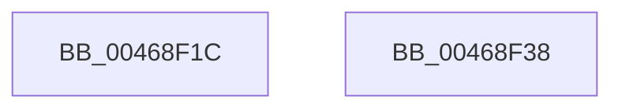

# MiQuerySystemBase

- RVA: `0x00468F1C`–`0x00468F39` (길이 `29` bytes)
- VA: `0x0000000140468F1C`
- 실행 섹션: `.text`
- PDB 이름 있음: `예`; PDB Function 태그: `아니요`
- unwind 정보 RVA: `0x000DB714`
- 디코드: `9`개 명령, `29/29` bytes 표시
- 미해석 바이트: `0` (있으면 어셈블리에 `.byte`로 보존)

> 이 문서는 커널 이미지의 기계어와 PDB 기호를 분석해 생성했습니다. 4번과 5번은 함수 원형과 자료형을 바이너리 사용 방식에서 추정한 C 해석이며 원본 소스 복구 결과는 아닙니다.

## 1. Dependencies

- 직접 호출 지점: **0**; 고유 호출 대상: **0**
- 직접 호출자로 확인된 함수: **2**
- RIP 상대 이미지 참조: **1**

### Outgoing calls
- 직접 디코드된 call 명령이 없습니다.

### Direct callers
- [MiInitializeSystemCache](../../page/7F/MiInitializeSystemCache_function_007FE1F0.md) at `0x007FE274`
- [MmMarkHiberPhase](../../pagelk/B7/MmMarkHiberPhase_function_00B74578.md) at `0x00B74607`

### Static image references
- `0x00468F1F` → RVA `0x00E38BA8` (`.data`; read)

## 2. Other-region calls and transfers

- 다른 실행 섹션으로 향하는 call: **0**
- 별도 외부 분기/꼬리 이동을 확인하지 못했습니다.

## 3. Assembly (complete function range)

```asm
00468F1C  48 63 C9                        movsxd rcx, ecx
00468F1F  48 8D 05 82 FC 9C 00            lea rax, [rip + 0x9cfc82]
00468F26  48 C1 E1 04                     shl rcx, 4
00468F2A  48 03 C8                        add rcx, rax
00468F2D  48 8B 01                        mov rax, qword ptr [rcx]
00468F30  48 8B 49 08                     mov rcx, qword ptr [rcx + 8]
00468F34  48 89 0A                        mov qword ptr [rdx], rcx
00468F37  C3                              ret
00468F38  CC                              int3
```

## 4. C-style interpretation (structured pseudocode)

```c
__int64 __fastcall MiQuerySystemBase(int a1, __int64 a2)
{
    a1 = ((int)(a1)) << (4);
    a1 = (a1) + (v_rip + 10288258);
    *(unsigned __int64 *)(a2) = *(unsigned __int64 *)(a1 + 8);
    return *(unsigned __int64 *)(a1);
}
```

## 5. (Beta) C Style

```c
int64_t MiQuerySystemBase(int32_t Arg1, void *Arg2)
{
    uint8_t *arg2 = (uint8_t *)Arg2;

    Arg1 = ((int32_t)(Arg1)) << (4);
    Arg1 = (Arg1) + (v_rip + 10288258);
    *(uint64_t *)(arg2) = *(uint64_t *)(Arg1 + 0x8);
    return *(uint64_t *)(Arg1);
}
```

### 관측된 메모리 오프셋

구조체 형식이 확인되지 않은 접근은 인자 기준의 오프셋으로만 기록했습니다.

| 기준 인자 | 오프셋 표현 | 폭 (bit) | 접근 |
|---|---:|---:|---|
| `Arg2` | `+ 0x0` | `64` | `W` |

## 6. Execution-region graph

[열기: 2D/3D 그래프와 함수 탐색 컨트롤 패널](../../../control-panel.html?section=text&rva=0x00468F1C&view=graph)

- 2D 그래프는 위에서 아래로 흐르고, 3D 그래프는 빈 공간을 드래그해 회전합니다. Shift+드래그는 이동, 휠은 확대·축소, 함수 노드 선택은 대상 보고서 이동입니다.

### Static fallback


