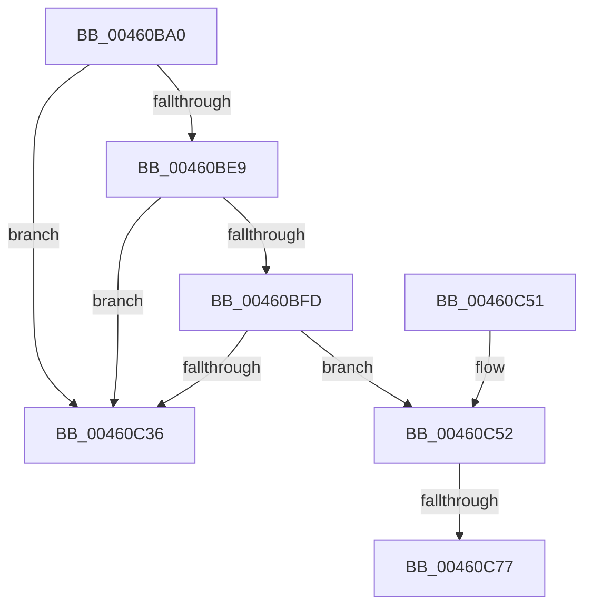

# MiRevokeExecutePte

- RVA: `0x00460BA0`–`0x00460CA5` (길이 `261` bytes)
- VA: `0x0000000140460BA0`
- 실행 섹션: `.text`
- PDB 이름 있음: `예`; PDB Function 태그: `예`
- unwind 정보 RVA: `0x00091B5C`
- 디코드: `63`개 명령, `261/261` bytes 표시
- 미해석 바이트: `0` (있으면 어셈블리에 `.byte`로 보존)

> 이 문서는 커널 이미지의 기계어와 PDB 기호를 분석해 생성했습니다. 4번과 5번은 함수 원형과 자료형을 바이너리 사용 방식에서 추정한 C 해석이며 원본 소스 복구 결과는 아닙니다.

## 1. Dependencies

- 직접 호출 지점: **5**; 고유 호출 대상: **5**
- 직접 호출자로 확인된 함수: **0**
- RIP 상대 이미지 참조: **0**

### Outgoing calls
- `0x00460BF0` → [MI_READ_PTE_LOCK_FREE](../28/MI_READ_PTE_LOCK_FREE_function_002828A0.md) (function, `0x002828A0`)
- `0x00460C29` → [MiGetPfnProtection](../32/MiGetPfnProtection_function_0032A650.md) (function, `0x0032A650`)
- `0x00460C62` → [MiWriteValidPteNewProtection](../28/MiWriteValidPteNewProtection_function_00281810.md) (function, `0x00281810`)
- `0x00460C77` → [MiGetProcessorFlushList](../24/MiGetProcessorFlushList_function_00242C90.md) (function, `0x00242C90`)
- `0x00460C94` → [MiInitializeTbFlushList](../29/MiInitializeTbFlushList_function_00294F00.md) (function, `0x00294F00`)

### Direct callers
- 이 함수 시작 RVA로 연결되는 직접 call은 확인되지 않았습니다. 간접 호출은 완전히 역산할 수 없습니다.

### Static image references
- 디코드된 RIP-relative 메모리 참조가 없습니다.

## 2. Other-region calls and transfers

- 다른 실행 섹션으로 향하는 call: **0**
- call이 아닌 외부 분기/꼬리 이동: **2**
  - `0x00460C71` → [sub_006F25AE](../6F/Unknown_function_006F25AE.md) (`tail-transfer`)
  - `0x00460CA0` → [sub_006F25AE](../6F/Unknown_function_006F25AE.md) (`tail-transfer`)

## 3. Assembly (complete function range)

```asm
00460BA0  48 89 5C 24 08                  mov qword ptr [rsp + 8], rbx
00460BA5  48 89 6C 24 10                  mov qword ptr [rsp + 0x10], rbp
00460BAA  48 89 74 24 18                  mov qword ptr [rsp + 0x18], rsi
00460BAF  57                              push rdi
00460BB0  41 56                           push r14
00460BB2  41 57                           push r15
00460BB4  48 83 EC 30                     sub rsp, 0x30
00460BB8  48 8B F2                        mov rsi, rdx
00460BBB  4C 8B F2                        mov r14, rdx
00460BBE  48 C1 E6 19                     shl rsi, 0x19
00460BC2  48 8B E9                        mov rbp, rcx
00460BC5  48 B8 00 00 00 00 80 F6 FF FF   movabs rax, 0xfffff68000000000
00460BCF  48 C1 E0 19                     shl rax, 0x19
00460BD3  48 2B F0                        sub rsi, rax
00460BD6  48 B8 FF FF FE FF FF 7F 00 00   movabs rax, 0x7ffffffeffff
00460BE0  48 C1 FE 10                     sar rsi, 0x10
00460BE4  48 3B F0                        cmp rsi, rax
00460BE7  77 4D                           ja 0x140460c36
00460BE9  4C 8B 79 20                     mov r15, qword ptr [rcx + 0x20]
00460BED  48 8B CA                        mov rcx, rdx
00460BF0  E8 AB 1C E2 FF                  call 0x1402828a0
00460BF5  48 8B D8                        mov rbx, rax
00460BF8  48 85 C0                        test rax, rax
00460BFB  78 39                           js 0x140460c36
00460BFD  48 C1 E8 0C                     shr rax, 0xc
00460C01  48 B9 FF FF FF FF FF 00 00 00   movabs rcx, 0xffffffffff
00460C0B  48 23 C1                        and rax, rcx
00460C0E  48 8D 3C 40                     lea rdi, [rax + rax*2]
00460C12  48 C1 E7 04                     shl rdi, 4
00460C16  48 B8 00 00 00 00 00 DE FF FF   movabs rax, 0xffffde0000000000
00460C20  48 03 F8                        add rdi, rax
00460C23  48 8B D6                        mov rdx, rsi
00460C26  4C 8B C7                        mov r8, rdi
00460C29  E8 22 9A EC FF                  call 0x14032a650
00460C2E  48 8B 4F 28                     mov rcx, qword ptr [rdi + 0x28]
00460C32  A8 02                           test al, 2
00460C34  74 1C                           je 0x140460c52
00460C36  48 8B 5C 24 50                  mov rbx, qword ptr [rsp + 0x50]
00460C3B  33 C0                           xor eax, eax
00460C3D  48 8B 6C 24 58                  mov rbp, qword ptr [rsp + 0x58]
00460C42  48 8B 74 24 60                  mov rsi, qword ptr [rsp + 0x60]
00460C47  48 83 C4 30                     add rsp, 0x30
00460C4B  41 5F                           pop r15
00460C4D  41 5E                           pop r14
00460C4F  5F                              pop rdi
00460C50  C3                              ret
00460C51  CC                              int3
00460C52  48 BA 00 00 00 00 00 00 00 80   movabs rdx, 0x8000000000000000
00460C5C  49 8B CE                        mov rcx, r14
00460C5F  48 0B D3                        or rdx, rbx
00460C62  E8 A9 0B E2 FF                  call 0x140281810
00460C67  48 8B 8D B8 00 00 00            mov rcx, qword ptr [rbp + 0xb8]
00460C6E  48 85 C9                        test rcx, rcx
00460C71  0F 85 37 19 29 00               jne 0x1406f25ae
00460C77  E8 14 20 DE FF                  call 0x140242c90
00460C7C  48 8B C8                        mov rcx, rax
00460C7F  C7 44 24 20 20 00 00 00         mov dword ptr [rsp + 0x20], 0x20
00460C87  41 B9 08 00 00 00               mov r9d, 8
00460C8D  49 8B D7                        mov rdx, r15
00460C90  44 8B 40 0C                     mov r8d, dword ptr [rax + 0xc]
00460C94  E8 67 42 E3 FF                  call 0x140294f00
00460C99  48 89 8D B8 00 00 00            mov qword ptr [rbp + 0xb8], rcx
00460CA0  E9 09 19 29 00                  jmp 0x1406f25ae
```

## 4. C-style interpretation (structured pseudocode)

```c
__int64 __fastcall MiRevokeExecutePte(__int64 a1, __int64 a2)
{
    __int64 result;
    __int64 v_rdi;
    __int64 v_rsi;
    __int64 v_rsp;
    unsigned __int64 v_stack_p10;
    unsigned __int64 v_stack_p18;
    unsigned int v_stack_p20;
    unsigned __int64 v_stack_p8;

    v_stack_p8 = v_rbx;
    v_stack_p10 = v_rbp;
    v_stack_p18 = v_rsi;
    v_rsp = (v_rsp) - (48);
    v_rsi = (a2) << (25);
    result = (result) << (25);
    v_rsi = (v_rsi) - (result);
    v_rsi = (v_rsi) >> (16);
    if (v_rsi > result) goto loc_00460C36;
    result = MI_READ_PTE_LOCK_FREE(a2, a2, a3, a4);
    if (sign_flag) goto loc_00460C36;
    result = (result) >> (12);
    result = (result) & (a2);
    v_rdi = (result + result * 2) << (4);
    v_rdi = (v_rdi) + (result);
    result = MiGetPfnProtection(a2, v_rsi, v_rdi, a4);
    if ((((unsigned __int8)(result)) & (2)) == 0) goto loc_00460C52;
loc_00460C36:
    result = 0;
    v_rsp = (v_rsp) + (48);
    return result;
loc_00460C52:
    a2 = (v_rsi) | (v_stack_p8);
    result = MiWriteValidPteNewProtection(a2, a2, v_rdi, a4);
    result = MiGetProcessorFlushList(*(unsigned __int64 *)(v_stack_p10 + 184), a2, v_rdi, a4);
    v_stack_p20 = 32;
    result = MiInitializeTbFlushList(result, *(unsigned __int64 *)(a1 + 32), (unsigned int)(*(unsigned int *)(result + 12)), 8);
    *(unsigned __int64 *)(v_stack_p10 + 184) = result;
}
```

## 5. (Beta) C Style

```c
int64_t MiRevokeExecutePte(void *Arg1, int64_t Arg2)
{
    uint8_t *arg1 = (uint8_t *)Arg1;

    int64_t result;
    int64_t local_rdi;
    int64_t local_rsi;
    int64_t local_rsp;
    uint64_t v_stack_p10;
    uint64_t v_stack_p18;
    uint32_t v_stack_p20;
    uint64_t v_stack_p8;

    v_stack_p8 = local_rbx;
    v_stack_p10 = local_rbp;
    v_stack_p18 = local_rsi;
    local_rsp = (local_rsp) - (48);
    local_rsi = (Arg2) << (25);
    result = (result) << (25);
    local_rsi = (local_rsi) - (result);
    local_rsi = (local_rsi) >> (16);
    if (local_rsi > result) goto loc_00460C36;
    result = MI_READ_PTE_LOCK_FREE(Arg2, Arg2, a3, a4);
    if (sign_flag) goto loc_00460C36;
    result = (result) >> (12);
    result = (result) & (Arg2);
    local_rdi = (result + result * 2) << (4);
    local_rdi = (local_rdi) + (result);
    result = MiGetPfnProtection(Arg2, local_rsi, local_rdi, a4);
    if ((((uint8_t)(result)) & (2)) == 0) goto loc_00460C52;
loc_00460C36:
    result = 0;
    local_rsp = (local_rsp) + (48);
    return result;
loc_00460C52:
    Arg2 = (local_rsi) | (v_stack_p8);
    result = MiWriteValidPteNewProtection(Arg2, Arg2, local_rdi, a4);
    result = MiGetProcessorFlushList(*(uint64_t *)(v_stack_p10 + 0xB8), Arg2, local_rdi, a4);
    v_stack_p20 = 32;
    result = MiInitializeTbFlushList(result, *(uint64_t *)(arg1 + 0x20), (uint32_t)(*(uint32_t *)(result + 0xC)), 8);
    *(uint64_t *)(v_stack_p10 + 0xB8) = result;
}
```

### 관측된 메모리 오프셋

구조체 형식이 확인되지 않은 접근은 인자 기준의 오프셋으로만 기록했습니다.

| 기준 인자 | 오프셋 표현 | 폭 (bit) | 접근 |
|---|---:|---:|---|
| `Arg1` | `+ 0x20` | `64` | `R` |
| `Arg1` | `+ 0xB8` | `64` | `R` |
| `Arg1` | `+ 0xB8` | `64` | `W` |

## 6. Execution-region graph

[열기: 2D/3D 그래프와 함수 탐색 컨트롤 패널](../../../control-panel.html?section=text&rva=0x00460BA0&view=graph)

- 2D 그래프는 위에서 아래로 흐르고, 3D 그래프는 빈 공간을 드래그해 회전합니다. Shift+드래그는 이동, 휠은 확대·축소, 함수 노드 선택은 대상 보고서 이동입니다.

### Static fallback


