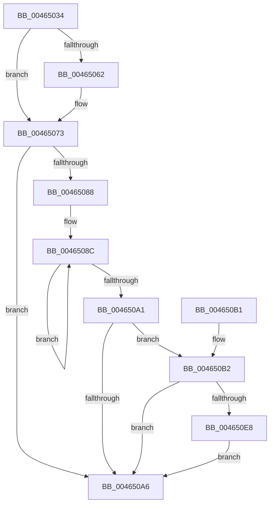

# MiSaveUnusedSegmentCalibration

- RVA: `0x00465034`–`0x004650F1` (길이 `189` bytes)
- VA: `0x0000000140465034`
- 실행 섹션: `.text`
- PDB 이름 있음: `예`; PDB Function 태그: `아니요`
- unwind 정보 RVA: `0x000AA9EC`
- 디코드: `54`개 명령, `189/189` bytes 표시
- 미해석 바이트: `0` (있으면 어셈블리에 `.byte`로 보존)

> 이 문서는 커널 이미지의 기계어와 PDB 기호를 분석해 생성했습니다. 4번과 5번은 함수 원형과 자료형을 바이너리 사용 방식에서 추정한 C 해석이며 원본 소스 복구 결과는 아닙니다.

## 1. Dependencies

- 직접 호출 지점: **1**; 고유 호출 대상: **1**
- 직접 호출자로 확인된 함수: **1**
- RIP 상대 이미지 참조: **2**

### Outgoing calls
- `0x0046504F` → [KeQueryPerformanceCounter](../37/KeQueryPerformanceCounter_function_0037E7E0.md) (function, `0x0037E7E0`)

### Direct callers
- [MiIssueSegmentDereferenceWork](MiIssueSegmentDereferenceWork_function_00464AB0.md) at `0x00464D15`

### Static image references
- `0x004650B7` → RVA `0x00E2CD20` (`.data`; read/write)
- `0x004650C2` → RVA `0x00E2CD28` (`.data`; read)

## 2. Other-region calls and transfers

- 다른 실행 섹션으로 향하는 call: **0**
- 별도 외부 분기/꼬리 이동을 확인하지 못했습니다.

## 3. Assembly (complete function range)

```asm
00465034  48 89 5C 24 10                  mov qword ptr [rsp + 0x10], rbx
00465039  57                              push rdi
0046503A  48 83 EC 20                     sub rsp, 0x20
0046503E  48 83 64 24 30 00               and qword ptr [rsp + 0x30], 0
00465044  48 8B D9                        mov rbx, rcx
00465047  48 8D 4C 24 30                  lea rcx, [rsp + 0x30]
0046504C  48 8B FA                        mov rdi, rdx
0046504F  E8 8C 97 F1 FF                  call 0x14037e7e0
00465054  48 81 7C 24 30 80 96 98 00      cmp qword ptr [rsp + 0x30], 0x989680
0046505D  4C 8B C0                        mov r8, rax
00465060  74 11                           je 0x140465073
00465062  49 69 C0 80 96 98 00            imul rax, r8, 0x989680
00465069  48 99                           cqo
0046506B  48 F7 7C 24 30                  idiv qword ptr [rsp + 0x30]
00465070  4C 8B C0                        mov r8, rax
00465073  8B 0B                           mov ecx, dword ptr [rbx]
00465075  4C 3B C7                        cmp r8, rdi
00465078  4C 0F 42 C7                     cmovb r8, rdi
0046507C  45 33 C9                        xor r9d, r9d
0046507F  45 33 D2                        xor r10d, r10d
00465082  33 D2                           xor edx, edx
00465084  85 C9                           test ecx, ecx
00465086  74 1E                           je 0x1404650a6
00465088  48 8D 43 70                     lea rax, [rbx + 0x70]
0046508C  48 03 50 F8                     add rdx, qword ptr [rax - 8]
00465090  4C 03 10                        add r10, qword ptr [rax]
00465093  44 03 48 E4                     add r9d, dword ptr [rax - 0x1c]
00465097  48 8D 40 60                     lea rax, [rax + 0x60]
0046509B  48 83 E9 01                     sub rcx, 1
0046509F  75 EB                           jne 0x14046508c
004650A1  48 85 D2                        test rdx, rdx
004650A4  75 0C                           jne 0x1404650b2
004650A6  48 8B 5C 24 38                  mov rbx, qword ptr [rsp + 0x38]
004650AB  48 83 C4 20                     add rsp, 0x20
004650AF  5F                              pop rdi
004650B0  C3                              ret
004650B1  CC                              int3
004650B2  B9 01 00 00 00                  mov ecx, 1
004650B7  F0 0F C1 0D 61 7C 9C 00         lock xadd dword ptr [rip + 0x9c7c61], ecx
004650BF  83 E1 3F                        and ecx, 0x3f
004650C2  48 8D 05 5F 7C 9C 00            lea rax, [rip + 0x9c7c5f]
004650C9  48 C1 E1 05                     shl rcx, 5
004650CD  4C 2B C7                        sub r8, rdi
004650D0  48 03 C8                        add rcx, rax
004650D3  4C 89 01                        mov qword ptr [rcx], r8
004650D6  48 89 51 08                     mov qword ptr [rcx + 8], rdx
004650DA  4C 89 51 10                     mov qword ptr [rcx + 0x10], r10
004650DE  8B 03                           mov eax, dword ptr [rbx]
004650E0  89 41 18                        mov dword ptr [rcx + 0x18], eax
004650E3  45 85 C9                        test r9d, r9d
004650E6  74 BE                           je 0x1404650a6
004650E8  0F BA E8 1F                     bts eax, 0x1f
004650EC  89 41 18                        mov dword ptr [rcx + 0x18], eax
004650EF  EB B5                           jmp 0x1404650a6
```

## 4. C-style interpretation (structured pseudocode)

```c
__int64 __fastcall MiSaveUnusedSegmentCalibration(__int64 a1, __int64 a2, __int64 a3, int a4)
{
    __int64 result;
    __int64 v_r10;
    __int64 v_rsp;
    unsigned __int64 v_stack_p10;
    unsigned __int64 v_stack_p8;

    v_stack_p10 = v_rbx;
    v_rsp = (v_rsp) - (32);
    result = KeQueryPerformanceCounter(v_stack_p8, a2, a3, a4);
    if (v_stack_p8 != 0x989680ULL) {
        result = (result) * (result);
        a3 = result;
    }
    if (a3 < a2) { a3 = a2; }
    a4 = 0;
    v_r10 = 0;
    a2 = 0;
    if ((unsigned int)((unsigned int)(*(unsigned int *)(a1))) == 0) goto loc_004650A6;
loc_0046508C:
    a2 = (a2) + (*(unsigned __int64 *)(a1 + 112 - 8));
    v_r10 = (v_r10) + (*(unsigned __int64 *)(a1 + 112));
    a4 = (unsigned int)((a4) + (*(unsigned int *)(a1 + 112 - 28)));
    a1 = ((unsigned int)(*(unsigned int *)(a1))) - (1);
    if (condition_is_not_equal) goto loc_0046508C;
    if (a2 != 0) goto loc_004650B2;
loc_004650A6:
    v_rsp = (v_rsp) + (32);
    return a1 + 112 + 96;
loc_004650B2:
    a1 = (unsigned int)((1) & (63));
    a1 = (a1) << (5);
    a3 = (a3) - (a2);
    a1 = (a1) + (v_rip + 10255455);
    *(unsigned __int64 *)(a1) = a3;
    *(unsigned __int64 *)(a1 + 8) = a2;
    *(unsigned __int64 *)(a1 + 16) = v_r10;
    *(unsigned int *)(a1 + 24) = (unsigned int)((unsigned int)(*(unsigned int *)(v_stack_p10)));
    if (a4 == 0) goto loc_004650A6;
    *(unsigned int *)(a1 + 24) = (unsigned int)((unsigned int)(*(unsigned int *)(v_stack_p10)));
    goto loc_004650A6;
}
```

## 5. (Beta) C Style

```c
int64_t MiSaveUnusedSegmentCalibration(void *Arg1, int64_t Arg2, int64_t Arg3, int32_t Arg4)
{
    uint8_t *arg1 = (uint8_t *)Arg1;

    int64_t result;
    int64_t local_r10;
    int64_t local_rsp;
    uint64_t v_stack_p10;
    uint64_t v_stack_p8;

    v_stack_p10 = local_rbx;
    local_rsp = (local_rsp) - (32);
    result = KeQueryPerformanceCounter(v_stack_p8, Arg2, Arg3, Arg4);
    if (v_stack_p8 != 0x989680ULL) {
        result = (result) * (result);
        Arg3 = result;
    }
    if (Arg3 < Arg2) { Arg3 = Arg2; }
    Arg4 = 0;
    local_r10 = 0;
    Arg2 = 0;
    if ((uint32_t)((uint32_t)(*(uint32_t *)(arg1))) == 0) goto loc_004650A6;
loc_0046508C:
    Arg2 = (Arg2) + (*(uint64_t *)(arg1 + 0x70 - 0x8));
    local_r10 = (local_r10) + (*(uint64_t *)(arg1 + 0x70));
    Arg4 = (uint32_t)((Arg4) + (*(uint32_t *)(arg1 + 0x70 - 0x1C)));
    Arg1 = ((uint32_t)(*(uint32_t *)(arg1))) - (1);
    if (condition_is_not_equal) goto loc_0046508C;
    if (Arg2 != 0) goto loc_004650B2;
loc_004650A6:
    local_rsp = (local_rsp) + (32);
    return Arg1 + 112 + 96;
loc_004650B2:
    Arg1 = (uint32_t)((1) & (63));
    Arg1 = (Arg1) << (5);
    Arg3 = (Arg3) - (Arg2);
    Arg1 = (Arg1) + (v_rip + 10255455);
    *(uint64_t *)(arg1) = Arg3;
    *(uint64_t *)(arg1 + 0x8) = Arg2;
    *(uint64_t *)(arg1 + 0x10) = local_r10;
    *(uint32_t *)(arg1 + 0x18) = (uint32_t)((uint32_t)(*(uint32_t *)(v_stack_p10)));
    if (Arg4 == 0) goto loc_004650A6;
    *(uint32_t *)(arg1 + 0x18) = (uint32_t)((uint32_t)(*(uint32_t *)(v_stack_p10)));
    goto loc_004650A6;
}
```

### 관측된 메모리 오프셋

구조체 형식이 확인되지 않은 접근은 인자 기준의 오프셋으로만 기록했습니다.

| 기준 인자 | 오프셋 표현 | 폭 (bit) | 접근 |
|---|---:|---:|---|
| `Arg1` | `- 0x1C` | `32` | `R` |
| `Arg1` | `- 0x8` | `64` | `R` |
| `Arg1` | `+ 0x0` | `32` | `R` |
| `Arg1` | `+ 0x0` | `64` | `R` |
| `Arg1` | `+ 0x60` | `64` | `R` |
| `Arg1` | `+ 0x70` | `64` | `R` |

## 6. Execution-region graph

[열기: 2D/3D 그래프와 함수 탐색 컨트롤 패널](../../../control-panel.html?section=text&rva=0x00465034&view=graph)

- 2D 그래프는 위에서 아래로 흐르고, 3D 그래프는 빈 공간을 드래그해 회전합니다. Shift+드래그는 이동, 휠은 확대·축소, 함수 노드 선택은 대상 보고서 이동입니다.

### Static fallback


