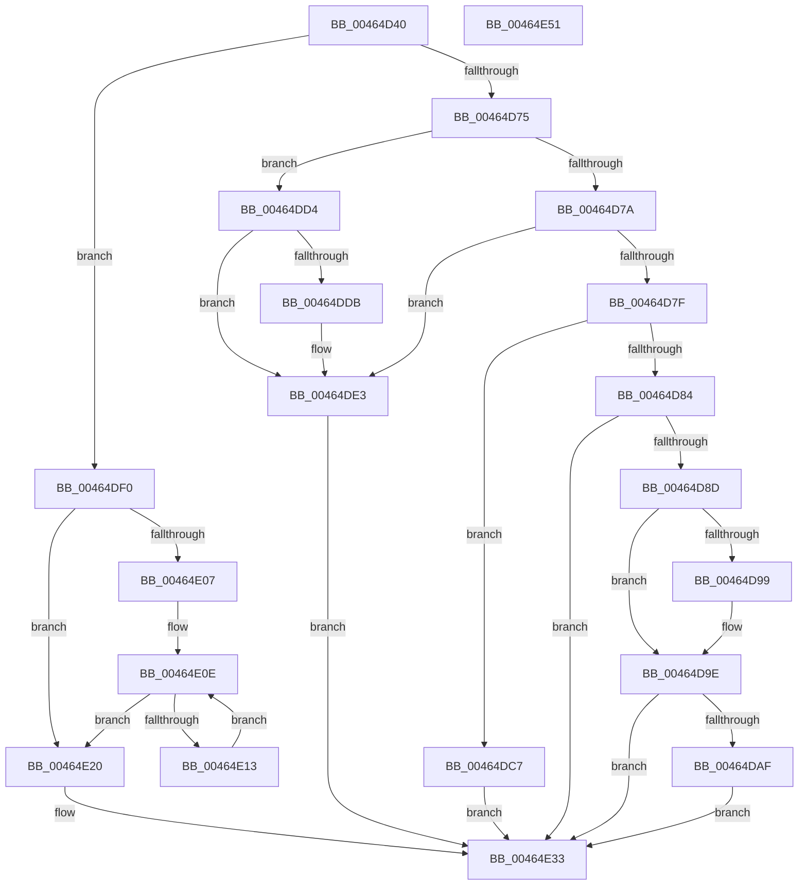

# MiSegmentDereferenceWorker

- RVA: `0x00464D40`–`0x00464E52` (길이 `274` bytes)
- VA: `0x0000000140464D40`
- 실행 섹션: `.text`
- PDB 이름 있음: `예`; PDB Function 태그: `아니요`
- unwind 정보 RVA: `0x00060BC4`
- 디코드: `77`개 명령, `274/274` bytes 표시
- 미해석 바이트: `0` (있으면 어셈블리에 `.byte`로 보존)

> 이 문서는 커널 이미지의 기계어와 PDB 기호를 분석해 생성했습니다. 4번과 5번은 함수 원형과 자료형을 바이너리 사용 방식에서 추정한 C 해석이며 원본 소스 복구 결과는 아닙니다.

## 1. Dependencies

- 직접 호출 지점: **14**; 고유 호출 대상: **11**
- 직접 호출자로 확인된 함수: **1**
- RIP 상대 이미지 참조: **1**

### Outgoing calls
- `0x00464D59` → [MiDeleteEmptySubsections](../4E/MiDeleteEmptySubsections_function_004ED818.md) (function, `0x004ED818`)
- `0x00464D61` → [MiFreeClonePool](../49/MiFreeClonePool_function_00492EE0.md) (function, `0x00492EE0`)
- `0x00464D69` → [MiDeleteControlAreaList](../48/MiDeleteControlAreaList_function_0048AE78.md) (function, `0x0048AE78`)
- `0x00464D99` → [MiDistributeSystemCacheVaReductions](../67/MiDistributeSystemCacheVaReductions_function_00677E94.md) (function, `0x00677E94`)
- `0x00464DA1` → [MiComputeProportionalSystemCacheVaReduction](../4E/MiComputeProportionalSystemCacheVaReduction_function_004EDAC8.md) (function, `0x004EDAC8`)
- `0x00464DC0` → [CcUnmapInactiveViews](../4B/CcUnmapInactiveViews_function_004BA2DC.md) (function, `0x004BA2DC`)
- `0x00464DCD` → [MiProcessDeleteOnClose](../67/MiProcessDeleteOnClose_function_006783D8.md) (function, `0x006783D8`)
- `0x00464DDE` → [MiHandlePageFileSizeChanges](../48/MiHandlePageFileSizeChanges_function_004811D0.md) (function, `0x004811D0`)
- `0x00464DE9` → [MiRemoveUnusedSegments](../4E/MiRemoveUnusedSegments_function_004ED99C.md) (function, `0x004ED99C`)
- `0x00464DF6` → [MiDeleteCachedEntries](../67/MiDeleteCachedEntries_function_00677A28.md) (function, `0x00677A28`)
- `0x00464E19` → [MiDeleteCachedEntries](../67/MiDeleteCachedEntries_function_00677A28.md) (function, `0x00677A28`)
- `0x00464E26` → [MiProcessDeleteOnClose](../67/MiProcessDeleteOnClose_function_006783D8.md) (function, `0x006783D8`)
- `0x00464E2E` → [MiDeleteControlAreaList](../48/MiDeleteControlAreaList_function_0048AE78.md) (function, `0x0048AE78`)
- `0x00464E3C` → [KeSetEvent](../33/KeSetEvent_function_0033F310.md) (function, `0x0033F310`)

### Direct callers
- [MiIssueSegmentDereferenceWork](MiIssueSegmentDereferenceWork_function_00464AB0.md) at `0x00464C64`

### Static image references
- `0x00464D8D` → RVA `0x00E38D00` (`.data`; read)

## 2. Other-region calls and transfers

- 다른 실행 섹션으로 향하는 call: **0**
- 별도 외부 분기/꼬리 이동을 확인하지 못했습니다.

## 3. Assembly (complete function range)

```asm
00464D40  48 89 5C 24 08                  mov qword ptr [rsp + 8], rbx
00464D45  48 89 74 24 10                  mov qword ptr [rsp + 0x10], rsi
00464D4A  57                              push rdi
00464D4B  48 83 EC 20                     sub rsp, 0x20
00464D4F  48 8B 59 40                     mov rbx, qword ptr [rcx + 0x40]
00464D53  48 8B F9                        mov rdi, rcx
00464D56  48 8B CB                        mov rcx, rbx
00464D59  E8 BA 8A 08 00                  call 0x1404ed818
00464D5E  48 8B CB                        mov rcx, rbx
00464D61  E8 7A E1 02 00                  call 0x140492ee0
00464D66  48 8B CB                        mov rcx, rbx
00464D69  E8 0A 61 02 00                  call 0x14048ae78
00464D6E  8B 57 38                        mov edx, dword ptr [rdi + 0x38]
00464D71  85 D2                           test edx, edx
00464D73  74 7B                           je 0x140464df0
00464D75  83 EA 02                        sub edx, 2
00464D78  74 5A                           je 0x140464dd4
00464D7A  83 EA 01                        sub edx, 1
00464D7D  74 64                           je 0x140464de3
00464D7F  83 EA 01                        sub edx, 1
00464D82  74 43                           je 0x140464dc7
00464D84  83 FA 03                        cmp edx, 3
00464D87  0F 85 A6 00 00 00               jne 0x140464e33
00464D8D  48 8D 05 6C 3F 9D 00            lea rax, [rip + 0x9d3f6c]
00464D94  48 3B D8                        cmp rbx, rax
00464D97  75 05                           jne 0x140464d9e
00464D99  E8 F6 30 21 00                  call 0x140677e94
00464D9E  48 8B CB                        mov rcx, rbx
00464DA1  E8 22 8D 08 00                  call 0x1404edac8
00464DA6  48 85 C0                        test rax, rax
00464DA9  0F 84 84 00 00 00               je 0x140464e33
00464DAF  48 8B 8B B8 00 00 00            mov rcx, qword ptr [rbx + 0xb8]
00464DB6  45 33 C9                        xor r9d, r9d
00464DB9  48 8B D0                        mov rdx, rax
00464DBC  45 8D 41 01                     lea r8d, [r9 + 1]
00464DC0  E8 17 55 05 00                  call 0x1404ba2dc
00464DC5  EB 6C                           jmp 0x140464e33
00464DC7  48 8B D7                        mov rdx, rdi
00464DCA  48 8B CB                        mov rcx, rbx
00464DCD  E8 06 36 21 00                  call 0x1406783d8
00464DD2  EB 5F                           jmp 0x140464e33
00464DD4  48 83 7F 10 01                  cmp qword ptr [rdi + 0x10], 1
00464DD9  75 08                           jne 0x140464de3
00464DDB  48 8B CB                        mov rcx, rbx
00464DDE  E8 ED C3 01 00                  call 0x1404811d0
00464DE3  48 8B D7                        mov rdx, rdi
00464DE6  48 8B CB                        mov rcx, rbx
00464DE9  E8 AE 8B 08 00                  call 0x1404ed99c
00464DEE  EB 43                           jmp 0x140464e33
00464DF0  48 8B D7                        mov rdx, rdi
00464DF3  48 8B CB                        mov rcx, rbx
00464DF6  E8 2D 2C 21 00                  call 0x140677a28
00464DFB  48 8D 05 FE 3E 9D 00            lea rax, [rip + 0x9d3efe]
00464E02  48 3B D8                        cmp rbx, rax
00464E05  74 19                           je 0x140464e20
00464E07  48 8D B3 40 08 00 00            lea rsi, [rbx + 0x840]
00464E0E  48 39 36                        cmp qword ptr [rsi], rsi
00464E11  74 0D                           je 0x140464e20
00464E13  48 8B D7                        mov rdx, rdi
00464E16  48 8B CB                        mov rcx, rbx
00464E19  E8 0A 2C 21 00                  call 0x140677a28
00464E1E  EB EE                           jmp 0x140464e0e
00464E20  48 8B D7                        mov rdx, rdi
00464E23  48 8B CB                        mov rcx, rbx
00464E26  E8 AD 35 21 00                  call 0x1406783d8
00464E2B  48 8B CB                        mov rcx, rbx
00464E2E  E8 45 60 02 00                  call 0x14048ae78
00464E33  48 8D 4F 20                     lea rcx, [rdi + 0x20]
00464E37  45 33 C0                        xor r8d, r8d
00464E3A  33 D2                           xor edx, edx
00464E3C  E8 CF A4 ED FF                  call 0x14033f310
00464E41  48 8B 5C 24 30                  mov rbx, qword ptr [rsp + 0x30]
00464E46  48 8B 74 24 38                  mov rsi, qword ptr [rsp + 0x38]
00464E4B  48 83 C4 20                     add rsp, 0x20
00464E4F  5F                              pop rdi
00464E50  C3                              ret
00464E51  CC                              int3
```

## 4. C-style interpretation (structured pseudocode)

```c
__int64 __fastcall MiSegmentDereferenceWorker(__int64 a1, __int64 a2, __int64 a3, int a4)
{
    __int64 result;
    __int64 v_rsp;
    unsigned __int64 v_stack_p10;
    unsigned __int64 v_stack_p8;

    v_stack_p8 = v_rbx;
    v_stack_p10 = v_rsi;
    v_rsp = (v_rsp) - (32);
    result = MiDeleteEmptySubsections(*(unsigned __int64 *)(a1 + 64), a2, a3, a4);
    result = MiFreeClonePool(*(unsigned __int64 *)(a1 + 64), a2, a3, a4);
    result = MiDeleteControlAreaList(*(unsigned __int64 *)(a1 + 64), a2, a3, a4);
    if ((unsigned int)((unsigned int)(*(unsigned int *)(a1 + 56))) == 0) goto loc_00464DF0;
    a2 = (unsigned int)(((unsigned int)(*(unsigned int *)(a1 + 56))) - (2));
    if (condition_is_equal) goto loc_00464DD4;
    a2 = (unsigned int)((a2) - (1));
    if (condition_is_equal) goto loc_00464DE3;
    a2 = (unsigned int)((a2) - (1));
    if (condition_is_equal) goto loc_00464DC7;
    if (((unsigned int)(a2)) != 3) goto loc_00464E33;
    result = v_rip + 10305388;
    if ((*(unsigned __int64 *)(a1 + 64)) == (v_rip + 10305388)) {
        result = MiDistributeSystemCacheVaReductions(*(unsigned __int64 *)(a1 + 64), a2, a3, a4);
    }
    result = MiComputeProportionalSystemCacheVaReduction(*(unsigned __int64 *)(a1 + 64), a2, a3, a4);
    if (result == 0) goto loc_00464E33;
    a4 = 0;
    result = CcUnmapInactiveViews(*(unsigned __int64 *)(*(unsigned __int64 *)(a1 + 64) + 184), result, a4 + 1, a4);
    goto loc_00464E33;
loc_00464DC7:
    result = MiProcessDeleteOnClose(*(unsigned __int64 *)(a1 + 64), a1, a4 + 1, a4);
    goto loc_00464E33;
loc_00464DD4:
    if ((*(unsigned __int64 *)(a1 + 16)) == 1) {
        a1 = *(unsigned __int64 *)(a1 + 64);
        result = MiHandlePageFileSizeChanges(a1, a1, a4 + 1, a4);
    }
    result = MiRemoveUnusedSegments(*(unsigned __int64 *)(a1 + 64), a1, a4 + 1, a4);
    goto loc_00464E33;
loc_00464DF0:
    result = MiDeleteCachedEntries(*(unsigned __int64 *)(a1 + 64), a1, a4 + 1, a4);
    if ((*(unsigned __int64 *)(a1 + 64)) == (v_rip + 10305278)) goto loc_00464E20;
loc_00464E0E:
    if ((*(unsigned __int64 *)(*(unsigned __int64 *)(a1 + 64) + 2112)) == (*(unsigned __int64 *)(a1 + 64) + 2112)) goto loc_00464E20;
    result = MiDeleteCachedEntries(*(unsigned __int64 *)(a1 + 64), a1, a4 + 1, a4);
    goto loc_00464E0E;
loc_00464E20:
    result = MiProcessDeleteOnClose(*(unsigned __int64 *)(a1 + 64), a1, a4 + 1, a4);
    result = MiDeleteControlAreaList(*(unsigned __int64 *)(a1 + 64), a1, a4 + 1, a4);
loc_00464E33:
    a3 = 0;
    a2 = 0;
    result = KeSetEvent(a1 + 32, a2, a3, a4);
    v_rsp = (v_rsp) + (32);
    return result;
}
```

## 5. (Beta) C Style

```c
int64_t MiSegmentDereferenceWorker(void *Arg1, int64_t Arg2, int64_t Arg3, int32_t Arg4)
{
    uint8_t *arg1 = (uint8_t *)Arg1;

    int64_t result;
    int64_t local_rsp;
    uint64_t v_stack_p10;
    uint64_t v_stack_p8;

    v_stack_p8 = local_rbx;
    v_stack_p10 = local_rsi;
    local_rsp = (local_rsp) - (32);
    result = MiDeleteEmptySubsections(*(uint64_t *)(arg1 + 0x40), Arg2, Arg3, Arg4);
    result = MiFreeClonePool(*(uint64_t *)(arg1 + 0x40), Arg2, Arg3, Arg4);
    result = MiDeleteControlAreaList(*(uint64_t *)(arg1 + 0x40), Arg2, Arg3, Arg4);
    if ((uint32_t)((uint32_t)(*(uint32_t *)(arg1 + 0x38))) == 0) goto loc_00464DF0;
    Arg2 = (uint32_t)(((uint32_t)(*(uint32_t *)(arg1 + 0x38))) - (2));
    if (condition_is_equal) goto loc_00464DD4;
    Arg2 = (uint32_t)((Arg2) - (1));
    if (condition_is_equal) goto loc_00464DE3;
    Arg2 = (uint32_t)((Arg2) - (1));
    if (condition_is_equal) goto loc_00464DC7;
    if (((uint32_t)(Arg2)) != 3) goto loc_00464E33;
    result = v_rip + 10305388;
    if ((*(uint64_t *)(arg1 + 0x40)) == (v_rip + 10305388)) {
        result = MiDistributeSystemCacheVaReductions(*(uint64_t *)(arg1 + 0x40), Arg2, Arg3, Arg4);
    }
    result = MiComputeProportionalSystemCacheVaReduction(*(uint64_t *)(arg1 + 0x40), Arg2, Arg3, Arg4);
    if (result == 0) goto loc_00464E33;
    Arg4 = 0;
    result = CcUnmapInactiveViews(*(uint64_t *)(*(uint64_t *)(arg1 + 0x40) + 0xB8), result, Arg4 + 1, Arg4);
    goto loc_00464E33;
loc_00464DC7:
    result = MiProcessDeleteOnClose(*(uint64_t *)(arg1 + 0x40), Arg1, Arg4 + 1, Arg4);
    goto loc_00464E33;
loc_00464DD4:
    if ((*(uint64_t *)(arg1 + 0x10)) == 1) {
        Arg1 = *(uint64_t *)(arg1 + 0x40);
        result = MiHandlePageFileSizeChanges(Arg1, Arg1, Arg4 + 1, Arg4);
    }
    result = MiRemoveUnusedSegments(*(uint64_t *)(arg1 + 0x40), Arg1, Arg4 + 1, Arg4);
    goto loc_00464E33;
loc_00464DF0:
    result = MiDeleteCachedEntries(*(uint64_t *)(arg1 + 0x40), Arg1, Arg4 + 1, Arg4);
    if ((*(uint64_t *)(arg1 + 0x40)) == (v_rip + 10305278)) goto loc_00464E20;
loc_00464E0E:
    if ((*(uint64_t *)(*(uint64_t *)(arg1 + 0x40) + 0x840)) == (*(uint64_t *)(arg1 + 0x40) + 2112)) goto loc_00464E20;
    result = MiDeleteCachedEntries(*(uint64_t *)(arg1 + 0x40), Arg1, Arg4 + 1, Arg4);
    goto loc_00464E0E;
loc_00464E20:
    result = MiProcessDeleteOnClose(*(uint64_t *)(arg1 + 0x40), Arg1, Arg4 + 1, Arg4);
    result = MiDeleteControlAreaList(*(uint64_t *)(arg1 + 0x40), Arg1, Arg4 + 1, Arg4);
loc_00464E33:
    Arg3 = 0;
    Arg2 = 0;
    result = KeSetEvent(Arg1 + 32, Arg2, Arg3, Arg4);
    local_rsp = (local_rsp) + (32);
    return result;
}
```

### 관측된 메모리 오프셋

구조체 형식이 확인되지 않은 접근은 인자 기준의 오프셋으로만 기록했습니다.

| 기준 인자 | 오프셋 표현 | 폭 (bit) | 접근 |
|---|---:|---:|---|
| `Arg1` | `+ 0x10` | `64` | `R` |
| `Arg1` | `+ 0x20` | `64` | `R` |
| `Arg1` | `+ 0x38` | `32` | `R` |
| `Arg1` | `+ 0x40` | `64` | `R` |

## 6. Execution-region graph

[열기: 2D/3D 그래프와 함수 탐색 컨트롤 패널](../../../control-panel.html?section=text&rva=0x00464D40&view=graph)

- 2D 그래프는 위에서 아래로 흐르고, 3D 그래프는 빈 공간을 드래그해 회전합니다. Shift+드래그는 이동, 휠은 확대·축소, 함수 노드 선택은 대상 보고서 이동입니다.

### Static fallback


