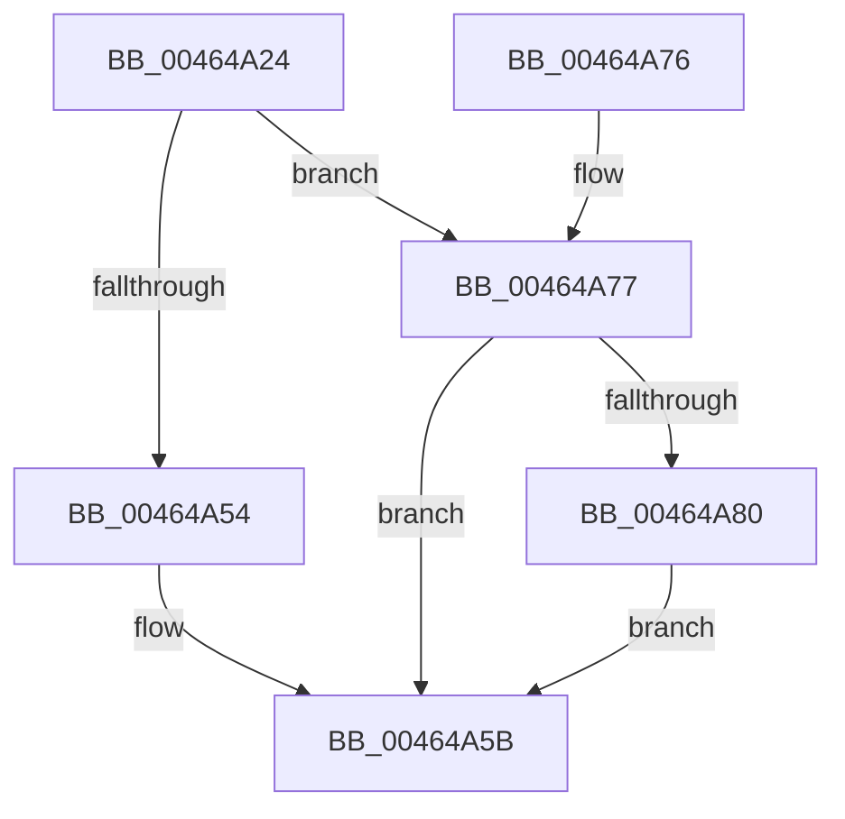

# MiSetDeleteOnCloseTimer

- RVA: `0x00464A24`–`0x00464AA8` (길이 `132` bytes)
- VA: `0x0000000140464A24`
- 실행 섹션: `.text`
- PDB 이름 있음: `예`; PDB Function 태그: `아니요`
- unwind 정보 RVA: `0x000AA970`
- 디코드: `32`개 명령, `132/132` bytes 표시
- 미해석 바이트: `0` (있으면 어셈블리에 `.byte`로 보존)

> 이 문서는 커널 이미지의 기계어와 PDB 기호를 분석해 생성했습니다. 4번과 5번은 함수 원형과 자료형을 바이너리 사용 방식에서 추정한 C 해석이며 원본 소스 복구 결과는 아닙니다.

## 1. Dependencies

- 직접 호출 지점: **3**; 고유 호출 대상: **3**
- 직접 호출자로 확인된 함수: **1**
- RIP 상대 이미지 참조: **1**

### Outgoing calls
- `0x00464A40` → [ExAcquireSpinLockExclusive](../24/ExAcquireSpinLockExclusive_function_00248690.md) (function, `0x00248690`)
- `0x00464A61` → [MiReleaseSpinLockExclusive](../24/MiReleaseSpinLockExclusive_function_002482C0.md) (function, `0x002482C0`)
- `0x00464AA1` → [KiSetTimerEx](../23/KiSetTimerEx_function_00232CB0.md) (function, `0x00232CB0`)

### Direct callers
- [MiDereferenceSegmentThread](MiDereferenceSegmentThread_function_00464890.md) at `0x004649B1`

### Static image references
- `0x00464A97` → RVA `0x000134D0` (`.rdata`; read)

## 2. Other-region calls and transfers

- 다른 실행 섹션으로 향하는 call: **0**
- 별도 외부 분기/꼬리 이동을 확인하지 못했습니다.

## 3. Assembly (complete function range)

```asm
00464A24  48 89 5C 24 08                  mov qword ptr [rsp + 8], rbx
00464A29  48 89 74 24 10                  mov qword ptr [rsp + 0x10], rsi
00464A2E  57                              push rdi
00464A2F  48 83 EC 30                     sub rsp, 0x30
00464A33  48 8D B9 C0 06 00 00            lea rdi, [rcx + 0x6c0]
00464A3A  48 8B D9                        mov rbx, rcx
00464A3D  48 8B CF                        mov rcx, rdi
00464A40  E8 4B 3C DE FF                  call 0x140248690
00464A45  48 8D 93 C8 07 00 00            lea rdx, [rbx + 0x7c8]
00464A4C  40 8A F0                        mov sil, al
00464A4F  48 39 12                        cmp qword ptr [rdx], rdx
00464A52  75 23                           jne 0x140464a77
00464A54  C6 83 28 08 00 00 00            mov byte ptr [rbx + 0x828], 0
00464A5B  40 8A D6                        mov dl, sil
00464A5E  48 8B CF                        mov rcx, rdi
00464A61  E8 5A 38 DE FF                  call 0x1402482c0
00464A66  48 8B 5C 24 40                  mov rbx, qword ptr [rsp + 0x40]
00464A6B  48 8B 74 24 48                  mov rsi, qword ptr [rsp + 0x48]
00464A70  48 83 C4 30                     add rsp, 0x30
00464A74  5F                              pop rdi
00464A75  C3                              ret
00464A76  CC                              int3
00464A77  80 BB 28 08 00 00 00            cmp byte ptr [rbx + 0x828], 0
00464A7E  75 DB                           jne 0x140464a5b
00464A80  48 83 64 24 20 00               and qword ptr [rsp + 0x20], 0
00464A86  48 8D 8B E8 07 00 00            lea rcx, [rbx + 0x7e8]
00464A8D  C6 83 28 08 00 00 01            mov byte ptr [rbx + 0x828], 1
00464A94  45 33 C9                        xor r9d, r9d
00464A97  48 8B 15 32 EA BA FF            mov rdx, qword ptr [rip - 0x4515ce]
00464A9E  45 33 C0                        xor r8d, r8d
00464AA1  E8 0A E2 DC FF                  call 0x140232cb0
00464AA6  EB B3                           jmp 0x140464a5b
```

## 4. C-style interpretation (structured pseudocode)

```c
__int64 __fastcall MiSetDeleteOnCloseTimer(__int64 a1, __int64 a2, int a3, int a4)
{
    __int64 result;
    __int64 v_rsp;
    unsigned __int64 v_stack_p10;
    unsigned __int64 v_stack_p20;
    unsigned __int64 v_stack_p8;

    v_stack_p8 = v_rbx;
    v_stack_p10 = v_rsi;
    v_rsp = (v_rsp) - (48);
    result = ExAcquireSpinLockExclusive(a1 + 1728, a2, a3, a4);
    if ((*(unsigned __int64 *)(a1 + 1992)) != (a1 + 1992)) goto loc_00464A77;
    *(unsigned __int8 *)(a1 + 2088) = 0;
loc_00464A5B:
    result = MiReleaseSpinLockExclusive(a1 + 1728, (unsigned __int8)((unsigned __int8)(result)), a3, a4);
    v_rsp = (v_rsp) + (48);
    return result;
loc_00464A77:
    if ((*(unsigned __int8 *)(v_stack_p8 + 2088)) != 0) goto loc_00464A5B;
    *(unsigned __int8 *)(v_stack_p8 + 2088) = 1;
    a4 = 0;
    a3 = 0;
    result = KiSetTimerEx(v_stack_p8 + 2024, *(unsigned __int64 *)(v_rip - 4527566), a3, a4);
    goto loc_00464A5B;
}
```

## 5. (Beta) C Style

```c
int64_t MiSetDeleteOnCloseTimer(void *Arg1, int64_t Arg2, int32_t Arg3, int32_t Arg4)
{
    uint8_t *arg1 = (uint8_t *)Arg1;

    int64_t result;
    int64_t local_rsp;
    uint64_t v_stack_p10;
    uint64_t v_stack_p20;
    uint64_t v_stack_p8;

    v_stack_p8 = local_rbx;
    v_stack_p10 = local_rsi;
    local_rsp = (local_rsp) - (48);
    result = ExAcquireSpinLockExclusive(Arg1 + 1728, Arg2, Arg3, Arg4);
    if ((*(uint64_t *)(arg1 + 0x7C8)) != (Arg1 + 1992)) goto loc_00464A77;
    *(uint8_t *)(arg1 + 0x828) = 0;
loc_00464A5B:
    result = MiReleaseSpinLockExclusive(Arg1 + 1728, (uint8_t)((uint8_t)(result)), Arg3, Arg4);
    local_rsp = (local_rsp) + (48);
    return result;
loc_00464A77:
    if ((*(uint8_t *)(v_stack_p8 + 0x828)) != 0) goto loc_00464A5B;
    *(uint8_t *)(v_stack_p8 + 0x828) = 1;
    Arg4 = 0;
    Arg3 = 0;
    result = KiSetTimerEx(v_stack_p8 + 2024, *(uint64_t *)(v_rip - 0x4515CE), Arg3, Arg4);
    goto loc_00464A5B;
}
```

### 관측된 메모리 오프셋

구조체 형식이 확인되지 않은 접근은 인자 기준의 오프셋으로만 기록했습니다.

| 기준 인자 | 오프셋 표현 | 폭 (bit) | 접근 |
|---|---:|---:|---|
| `Arg1` | `+ 0x0` | `64` | `R` |
| `Arg1` | `+ 0x6C0` | `64` | `R` |
| `Arg1` | `+ 0x7C8` | `64` | `R` |
| `Arg1` | `+ 0x7E8` | `64` | `R` |
| `Arg1` | `+ 0x828` | `8` | `R` |
| `Arg1` | `+ 0x828` | `8` | `W` |

## 6. Execution-region graph

[열기: 2D/3D 그래프와 함수 탐색 컨트롤 패널](../../../control-panel.html?section=text&rva=0x00464A24&view=graph)

- 2D 그래프는 위에서 아래로 흐르고, 3D 그래프는 빈 공간을 드래그해 회전합니다. Shift+드래그는 이동, 휠은 확대·축소, 함수 노드 선택은 대상 보고서 이동입니다.

### Static fallback


