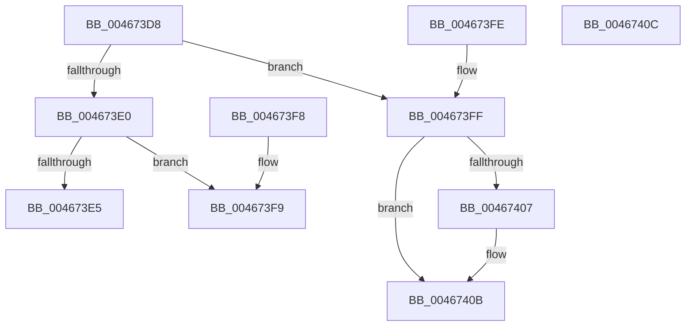

# MiSetFaultPacketDirectives

- RVA: `0x004673D8`–`0x0046740D` (길이 `53` bytes)
- VA: `0x00000001404673D8`
- 실행 섹션: `.text`
- PDB 이름 있음: `예`; PDB Function 태그: `아니요`
- unwind 정보 RVA: `0x000DB714`
- 디코드: `16`개 명령, `53/53` bytes 표시
- 미해석 바이트: `0` (있으면 어셈블리에 `.byte`로 보존)

> 이 문서는 커널 이미지의 기계어와 PDB 기호를 분석해 생성했습니다. 4번과 5번은 함수 원형과 자료형을 바이너리 사용 방식에서 추정한 C 해석이며 원본 소스 복구 결과는 아닙니다.

## 1. Dependencies

- 직접 호출 지점: **0**; 고유 호출 대상: **0**
- 직접 호출자로 확인된 함수: **3**
- RIP 상대 이미지 참조: **0**

### Outgoing calls
- 직접 디코드된 call 명령이 없습니다.

### Direct callers
- [MiValidFault](../32/MiValidFault_function_003280B4.md) at `0x00328522`
- [MiCompleteProtoPteFault](../34/MiCompleteProtoPteFault_function_00345710.md) at `0x00346444`
- [MiValidVirtualizationFault](MiValidVirtualizationFault_function_00466EC0.md) at `0x00466FEA`

### Static image references
- 디코드된 RIP-relative 메모리 참조가 없습니다.

## 2. Other-region calls and transfers

- 다른 실행 섹션으로 향하는 call: **0**
- 별도 외부 분기/꼬리 이동을 확인하지 못했습니다.

## 3. Assembly (complete function range)

```asm
004673D8  81 FA 17 00 00 C0               cmp edx, 0xc0000017
004673DE  75 1F                           jne 0x1404673ff
004673E0  4D 85 C0                        test r8, r8
004673E3  74 14                           je 0x1404673f9
004673E5  4C 89 81 80 00 00 00            mov qword ptr [rcx + 0x80], r8
004673EC  48 C7 81 90 00 00 00 01 00 00 00  mov qword ptr [rcx + 0x90], 1
004673F7  C3                              ret
004673F8  CC                              int3
004673F9  83 49 50 01                     or dword ptr [rcx + 0x50], 1
004673FD  C3                              ret
004673FE  CC                              int3
004673FF  81 FA 34 04 00 C0               cmp edx, 0xc0000434
00467405  75 04                           jne 0x14046740b
00467407  83 49 50 02                     or dword ptr [rcx + 0x50], 2
0046740B  C3                              ret
0046740C  CC                              int3
```

## 4. C-style interpretation (structured pseudocode)

```c
void __fastcall MiSetFaultPacketDirectives(__int64 a1, int a2, __int64 a3)
{
    if (a2 != 0xC0000017ULL) goto loc_004673FF;
    if (a3 == 0) goto loc_004673F9;
    *(unsigned __int64 *)(a1 + 128) = a3;
    *(unsigned __int64 *)(a1 + 144) = 1;
    return;
loc_004673F9:
    return;
loc_004673FF:
    if (a2 == 0xC0000434ULL) {
    }
    return;
}
```

## 5. (Beta) C Style

```c
void MiSetFaultPacketDirectives(void *Arg1, int32_t Arg2, int64_t Arg3)
{
    uint8_t *arg1 = (uint8_t *)Arg1;

    if (Arg2 != 0xC0000017ULL) goto loc_004673FF;
    if (Arg3 == 0) goto loc_004673F9;
    *(uint64_t *)(arg1 + 0x80) = Arg3;
    *(uint64_t *)(arg1 + 0x90) = 1;
    return;
loc_004673F9:
    return;
loc_004673FF:
    if (Arg2 == 0xC0000434ULL) {
    }
    return;
}
```

### 관측된 메모리 오프셋

구조체 형식이 확인되지 않은 접근은 인자 기준의 오프셋으로만 기록했습니다.

| 기준 인자 | 오프셋 표현 | 폭 (bit) | 접근 |
|---|---:|---:|---|
| `Arg1` | `+ 0x50` | `32` | `R/W` |
| `Arg1` | `+ 0x80` | `64` | `W` |
| `Arg1` | `+ 0x90` | `64` | `W` |

## 6. Execution-region graph

[열기: 2D/3D 그래프와 함수 탐색 컨트롤 패널](../../../control-panel.html?section=text&rva=0x004673D8&view=graph)

- 2D 그래프는 위에서 아래로 흐르고, 3D 그래프는 빈 공간을 드래그해 회전합니다. Shift+드래그는 이동, 휠은 확대·축소, 함수 노드 선택은 대상 보고서 이동입니다.

### Static fallback


