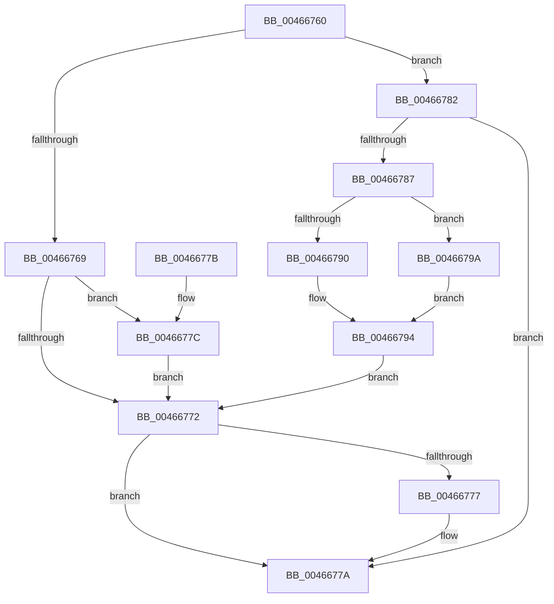

# MiSetHintSlabEntry

- RVA: `0x00466760`–`0x004667A0` (길이 `64` bytes)
- VA: `0x0000000140466760`
- 실행 섹션: `.text`
- PDB 이름 있음: `예`; PDB Function 태그: `아니요`
- unwind 정보 RVA: `0x000DB714`
- 디코드: `22`개 명령, `64/64` bytes 표시
- 미해석 바이트: `0` (있으면 어셈블리에 `.byte`로 보존)

> 이 문서는 커널 이미지의 기계어와 PDB 기호를 분석해 생성했습니다. 4번과 5번은 함수 원형과 자료형을 바이너리 사용 방식에서 추정한 C 해석이며 원본 소스 복구 결과는 아닙니다.

## 1. Dependencies

- 직접 호출 지점: **0**; 고유 호출 대상: **0**
- 직접 호출자로 확인된 함수: **1**
- RIP 상대 이미지 참조: **0**

### Outgoing calls
- 직접 디코드된 call 명령이 없습니다.

### Direct callers
- [MiGetPageFromSlabAllocatorByIdentity](../4D/MiGetPageFromSlabAllocatorByIdentity_function_004D50A0.md) at `0x004D5170`

### Static image references
- 디코드된 RIP-relative 메모리 참조가 없습니다.

## 2. Other-region calls and transfers

- 다른 실행 섹션으로 향하는 call: **0**
- 별도 외부 분기/꼬리 이동을 확인하지 못했습니다.

## 3. Assembly (complete function range)

```asm
00466760  83 B9 80 00 00 00 08            cmp dword ptr [rcx + 0x80], 8
00466767  74 19                           je 0x140466782
00466769  48 8D 41 20                     lea rax, [rcx + 0x20]
0046676D  45 85 C0                        test r8d, r8d
00466770  74 0A                           je 0x14046677c
00466772  48 85 C0                        test rax, rax
00466775  74 03                           je 0x14046677a
00466777  4C 89 08                        mov qword ptr [rax], r9
0046677A  C3                              ret
0046677B  CC                              int3
0046677C  48 8D 41 28                     lea rax, [rcx + 0x28]
00466780  EB F0                           jmp 0x140466772
00466782  80 FA FF                        cmp dl, 0xff
00466785  74 F3                           je 0x14046677a
00466787  44 0F B6 D2                     movzx r10d, dl
0046678B  45 85 C0                        test r8d, r8d
0046678E  74 0A                           je 0x14046679a
00466790  48 8B 41 20                     mov rax, qword ptr [rcx + 0x20]
00466794  4A 8D 04 D0                     lea rax, [rax + r10*8]
00466798  EB D8                           jmp 0x140466772
0046679A  48 8B 41 28                     mov rax, qword ptr [rcx + 0x28]
0046679E  EB F4                           jmp 0x140466794
```

## 4. C-style interpretation (structured pseudocode)

```c
__int64 __fastcall MiSetHintSlabEntry(__int64 a1, unsigned __int8 a2, int a3, __int64 a4)
{
    if ((*(unsigned int *)(a1 + 128)) == 8) goto loc_00466782;
    if (a3 == 0) goto loc_0046677C;
loc_00466772:
    if (a1 + 32 != 0) {
        *(unsigned __int64 *)(a1 + 32) = a4;
    }
    return a1 + 32;
loc_0046677C:
    goto loc_00466772;
loc_00466782:
    if (a2 == 255) goto loc_0046677A;
    if (a3 == 0) goto loc_0046679A;
loc_00466794:
    goto loc_00466772;
loc_0046679A:
    goto loc_00466794;
}
```

## 5. (Beta) C Style

```c
void *MiSetHintSlabEntry(void *Arg1, uint8_t Arg2, int32_t Arg3, int64_t Arg4)
{
    uint8_t *arg1 = (uint8_t *)Arg1;

    if ((*(uint32_t *)(arg1 + 0x80)) == 8) goto loc_00466782;
    if (Arg3 == 0) goto loc_0046677C;
loc_00466772:
    if (Arg1 + 32 != 0) {
        *(uint64_t *)(arg1 + 0x20) = Arg4;
    }
    return Arg1 + 32;
loc_0046677C:
    goto loc_00466772;
loc_00466782:
    if (Arg2 == 255) goto loc_0046677A;
    if (Arg3 == 0) goto loc_0046679A;
loc_00466794:
    goto loc_00466772;
loc_0046679A:
    goto loc_00466794;
}
```

### 관측된 메모리 오프셋

구조체 형식이 확인되지 않은 접근은 인자 기준의 오프셋으로만 기록했습니다.

| 기준 인자 | 오프셋 표현 | 폭 (bit) | 접근 |
|---|---:|---:|---|
| `Arg1` | `+ 0x20` | `64` | `R` |
| `Arg1` | `+ 0x28` | `64` | `R` |
| `Arg1` | `+ 0x80` | `32` | `R` |

## 6. Execution-region graph

[열기: 2D/3D 그래프와 함수 탐색 컨트롤 패널](../../../control-panel.html?section=text&rva=0x00466760&view=graph)

- 2D 그래프는 위에서 아래로 흐르고, 3D 그래프는 빈 공간을 드래그해 회전합니다. Shift+드래그는 이동, 휠은 확대·축소, 함수 노드 선택은 대상 보고서 이동입니다.

### Static fallback


