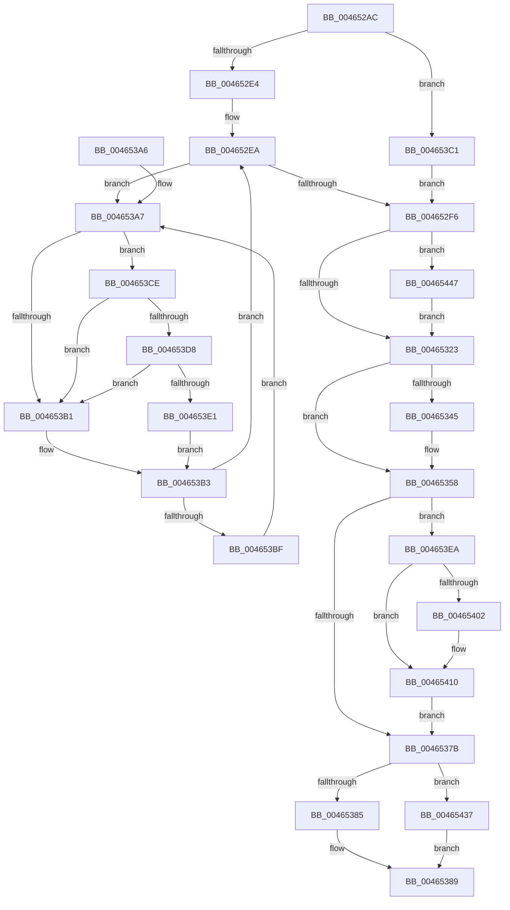

# MiSetPfnOwnedAndActive

- RVA: `0x004652AC`–`0x0046545D` (길이 `433` bytes)
- VA: `0x00000001404652AC`
- 실행 섹션: `.text`
- PDB 이름 있음: `예`; PDB Function 태그: `아니요`
- unwind 정보 RVA: `0x000AAA30`
- 디코드: `114`개 명령, `433/433` bytes 표시
- 미해석 바이트: `0` (있으면 어셈블리에 `.byte`로 보존)

> 이 문서는 커널 이미지의 기계어와 PDB 기호를 분석해 생성했습니다. 4번과 5번은 함수 원형과 자료형을 바이너리 사용 방식에서 추정한 C 해석이며 원본 소스 복구 결과는 아닙니다.

## 1. Dependencies

- 직접 호출 지점: **7**; 고유 호출 대상: **7**
- 직접 호출자로 확인된 함수: **3**
- RIP 상대 이미지 참조: **2**

### Outgoing calls
- `0x004653C1` → [MiLockPageInline](../31/MiLockPageInline_function_0031A340.md) (function, `0x0031A340`)
- `0x004653D8` → [KiCheckVpBackingLongSpinWaitHypercall](../30/KiCheckVpBackingLongSpinWaitHypercall_function_0030F490.md) (function, `0x0030F490`)
- `0x004653E3` → [HvlNotifyLongSpinWait](../30/HvlNotifyLongSpinWait_function_0030F460.md) (function, `0x0030F460`)
- `0x004653F7` → [MiSetPfnContainingFrame](../36/MiSetPfnContainingFrame_function_00363FC0.md) (function, `0x00363FC0`)
- `0x00465407` → [MiMakeDemandZeroPte](../33/MiMakeDemandZeroPte_function_00337A00.md) (function, `0x00337A00`)
- `0x0046543D` → [MiUnlockPage](../31/MiUnlockPage_function_0031A3E0.md) (function, `0x0031A3E0`)
- `0x00465453` → [MiChangePageAttribute](../33/MiChangePageAttribute_function_00332ECC.md) (function, `0x00332ECC`)

### Direct callers
- [MiFindContiguousPagesEx](../28/MiFindContiguousPagesEx_function_0028BDE0.md) at `0x0028C893`
- [MiInitializeFoundLargeNodePage](../4F/MiInitializeFoundLargeNodePage_function_004F97E8.md) at `0x004F986F`
- [MiRemoveMdlPages](../../page/7F/MiRemoveMdlPages_function_007FC568.md) at `0x007FC677`

### Static image references
- `0x004653A9` → RVA `0x00FC52AC` (`ALMOSTRO`; reference)
- `0x004653CE` → RVA `0x00FC6AB8` (`ALMOSTRO`; read)

## 2. Other-region calls and transfers

- 다른 실행 섹션으로 향하는 call: **0**
- 별도 외부 분기/꼬리 이동을 확인하지 못했습니다.

## 3. Assembly (complete function range)

```asm
004652AC  48 89 5C 24 08                  mov qword ptr [rsp + 8], rbx
004652B1  48 89 6C 24 10                  mov qword ptr [rsp + 0x10], rbp
004652B6  48 89 74 24 18                  mov qword ptr [rsp + 0x18], rsi
004652BB  57                              push rdi
004652BC  41 54                           push r12
004652BE  41 55                           push r13
004652C0  41 56                           push r14
004652C2  41 57                           push r15
004652C4  48 83 EC 20                     sub rsp, 0x20
004652C8  45 33 ED                        xor r13d, r13d
004652CB  48 8D 79 18                     lea rdi, [rcx + 0x18]
004652CF  45 8B F9                        mov r15d, r9d
004652D2  4D 8B E0                        mov r12, r8
004652D5  44 8B F2                        mov r14d, edx
004652D8  48 8B D9                        mov rbx, rcx
004652DB  F6 C2 04                        test dl, 4
004652DE  0F 84 DD 00 00 00               je 0x1404653c1
004652E4  40 B5 11                        mov bpl, 0x11
004652E7  41 8B F5                        mov esi, r13d
004652EA  F0 48 0F BA 2F 3F               lock bts qword ptr [rdi], 0x3f
004652F0  0F 82 B1 00 00 00               jb 0x1404653a7
004652F6  48 8B 4B 28                     mov rcx, qword ptr [rbx + 0x28]
004652FA  48 BE FF FF FF FF FF FF FF 7F   movabs rsi, 0x7fffffffffffffff
00465304  48 23 CE                        and rcx, rsi
00465307  48 89 4B 28                     mov qword ptr [rbx + 0x28], rcx
0046530B  4C 89 2B                        mov qword ptr [rbx], r13
0046530E  8B 43 20                        mov eax, dword ptr [rbx + 0x20]
00465311  C1 E8 10                        shr eax, 0x10
00465314  0F B6 C8                        movzx ecx, al
00465317  C1 E9 06                        shr ecx, 6
0046531A  41 3B CF                        cmp ecx, r15d
0046531D  0F 85 24 01 00 00               jne 0x140465447
00465323  48 8B 07                        mov rax, qword ptr [rdi]
00465326  48 B9 01 00 00 00 00 00 00 C0   movabs rcx, 0xc000000000000001
00465330  48 23 C1                        and rax, rcx
00465333  0F B7 4C 24 70                  movzx ecx, word ptr [rsp + 0x70]
00465338  48 83 C8 01                     or rax, 1
0046533C  48 89 43 18                     mov qword ptr [rbx + 0x18], rax
00465340  66 85 C9                        test cx, cx
00465343  74 13                           je 0x140465358
00465345  8B 43 20                        mov eax, dword ptr [rbx + 0x20]
00465348  89 44 24 70                     mov dword ptr [rsp + 0x70], eax
0046534C  66 89 4C 24 70                  mov word ptr [rsp + 0x70], cx
00465351  8B 44 24 70                     mov eax, dword ptr [rsp + 0x70]
00465355  89 43 20                        mov dword ptr [rbx + 0x20], eax
00465358  4C 89 63 08                     mov qword ptr [rbx + 8], r12
0046535C  8B 43 20                        mov eax, dword ptr [rbx + 0x20]
0046535F  89 44 24 70                     mov dword ptr [rsp + 0x70], eax
00465363  C1 E8 10                        shr eax, 0x10
00465366  24 FE                           and al, 0xfe
00465368  0C 06                           or al, 6
0046536A  88 44 24 72                     mov byte ptr [rsp + 0x72], al
0046536E  8B 44 24 70                     mov eax, dword ptr [rsp + 0x70]
00465372  89 43 20                        mov dword ptr [rbx + 0x20], eax
00465375  41 F6 C6 03                     test r14b, 3
00465379  75 6F                           jne 0x1404653ea
0046537B  40 80 FD 11                     cmp bpl, 0x11
0046537F  0F 85 B2 00 00 00               jne 0x140465437
00465385  F0 48 21 37                     lock and qword ptr [rdi], rsi
00465389  48 8B 5C 24 50                  mov rbx, qword ptr [rsp + 0x50]
0046538E  48 8B 6C 24 58                  mov rbp, qword ptr [rsp + 0x58]
00465393  48 8B 74 24 60                  mov rsi, qword ptr [rsp + 0x60]
00465398  48 83 C4 20                     add rsp, 0x20
0046539C  41 5F                           pop r15
0046539E  41 5E                           pop r14
004653A0  41 5D                           pop r13
004653A2  41 5C                           pop r12
004653A4  5F                              pop rdi
004653A5  C3                              ret
004653A6  CC                              int3
004653A7  FF C6                           inc esi
004653A9  85 35 FD FE B5 00               test dword ptr [rip + 0xb5fefd], esi
004653AF  74 1D                           je 0x1404653ce
004653B1  F3 90                           pause
004653B3  48 8B 07                        mov rax, qword ptr [rdi]
004653B6  48 85 C0                        test rax, rax
004653B9  0F 89 2B FF FF FF               jns 0x1404652ea
004653BF  EB E6                           jmp 0x1404653a7
004653C1  E8 7A 4F EB FF                  call 0x14031a340
004653C6  40 8A E8                        mov bpl, al
004653C9  E9 28 FF FF FF                  jmp 0x1404652f6
004653CE  8B 05 E4 16 B6 00               mov eax, dword ptr [rip + 0xb616e4]
004653D4  A8 40                           test al, 0x40
004653D6  74 D9                           je 0x1404653b1
004653D8  E8 B3 A0 EA FF                  call 0x14030f490
004653DD  84 C0                           test al, al
004653DF  74 D0                           je 0x1404653b1
004653E1  8B CE                           mov ecx, esi
004653E3  E8 78 A0 EA FF                  call 0x14030f460
004653E8  EB C9                           jmp 0x1404653b3
004653EA  48 BA FE FF FF FF 3F 00 00 00   movabs rdx, 0x3ffffffffe
004653F4  48 8B CB                        mov rcx, rbx
004653F7  E8 C4 EB EF FF                  call 0x140363fc0
004653FC  41 F6 C6 08                     test r14b, 8
00465400  75 0E                           jne 0x140465410
00465402  B9 04 00 00 00                  mov ecx, 4
00465407  E8 F4 25 ED FF                  call 0x140337a00
0046540C  48 89 43 10                     mov qword ptr [rbx + 0x10], rax
00465410  48 B8 00 00 00 00 80 F6 FF FF   movabs rax, 0xfffff68000000000
0046541A  48 89 43 08                     mov qword ptr [rbx + 8], rax
0046541E  48 B9 00 00 00 00 00 00 00 40   movabs rcx, 0x4000000000000000
00465428  48 8B 07                        mov rax, qword ptr [rdi]
0046542B  48 0B C1                        or rax, rcx
0046542E  48 89 43 18                     mov qword ptr [rbx + 0x18], rax
00465432  E9 44 FF FF FF                  jmp 0x14046537b
00465437  40 8A D5                        mov dl, bpl
0046543A  48 8B CB                        mov rcx, rbx
0046543D  E8 9E 4F EB FF                  call 0x14031a3e0
00465442  E9 42 FF FF FF                  jmp 0x140465389
00465447  41 B8 01 00 00 00               mov r8d, 1
0046544D  41 8B D7                        mov edx, r15d
00465450  48 8B CB                        mov rcx, rbx
00465453  E8 74 DA EC FF                  call 0x140332ecc
00465458  E9 C6 FE FF FF                  jmp 0x140465323
```

## 4. C-style interpretation (structured pseudocode)

```c
__int64 __fastcall MiSetPfnOwnedAndActive(__int64 a1, int a2, __int64 a3, int a4, unsigned __int16 a5)
{
    __int64 result;
    __int64 v_r13;
    __int64 v_rsi;
    __int64 v_rsp;
    unsigned __int64 v_stack_p10;
    unsigned __int64 v_stack_p18;
    unsigned int v_stack_p28;
    unsigned __int8 v_stack_p2A;
    unsigned __int64 v_stack_p8;

    v_stack_p8 = v_rbx;
    v_stack_p10 = v_rbp;
    v_stack_p18 = v_rsi;
    v_rsp = (v_rsp) - (32);
    v_r13 = 0;
    if ((((unsigned __int8)(a2)) & (4)) == 0) goto loc_004653C1;
loc_004652EA:
    if (condition_is_below) goto loc_004653A7;
loc_004652F6:
    a1 = (*(unsigned __int64 *)(a1 + 40)) & (0);
    *(unsigned __int64 *)(a1 + 40) = a1;
    *(unsigned __int64 *)(a1) = 0;
    result = (unsigned int)(((unsigned int)(*(unsigned int *)(a1 + 32))) >> (16));
    a1 = (unsigned int)(((unsigned __int8)(result)) >> (6));
    if (((unsigned int)(a1)) != ((unsigned int)((unsigned int)(a4)))) goto loc_00465447;
loc_00465323:
    result = (*(unsigned __int64 *)(a1 + 24)) & (a1);
    result = (result) | (1);
    *(unsigned __int64 *)(a1 + 24) = result;
    if (a5 != 0) {
        result = *(unsigned int *)(a1 + 32);
        v_stack_p28 = (unsigned int)(result);
        v_stack_p28 = a5;
        result = a5;
        *(unsigned int *)(a1 + 32) = (unsigned int)(result);
    }
    *(unsigned __int64 *)(a1 + 8) = a3;
    v_stack_p28 = (unsigned int)((unsigned int)(*(unsigned int *)(a1 + 32)));
    result = (unsigned int)(((unsigned int)(*(unsigned int *)(a1 + 32))) >> (16));
    result = (unsigned __int8)((result) & (254));
    result = (unsigned __int8)((result) | (6));
    v_stack_p2A = (unsigned __int8)(result);
    *(unsigned int *)(a1 + 32) = (unsigned int)((unsigned int)(a5));
    if ((((unsigned __int8)((unsigned int)(a2))) & (3)) != 0) goto loc_004653EA;
loc_0046537B:
    if (17 != 17) goto loc_00465437;
loc_00465389:
    v_rsp = (v_rsp) + (32);
    return (unsigned int)(a5);
loc_004653A7:
    v_rsi = (unsigned int)((v_stack_p18) + 1);
    if (((*(unsigned int *)(v_rip + 11927293)) & ((unsigned int)(v_rsi))) == 0) goto loc_004653CE;
loc_004653B1:
loc_004653B3:
    if (!sign_flag) goto loc_004652EA;
    goto loc_004653A7;
loc_004653C1:
    result = MiLockPageInline(a5, a2, a3, a4);
    goto loc_004652F6;
loc_004653CE:
    if ((((unsigned __int8)((unsigned int)(*(unsigned int *)(v_rip + 11933412)))) & (64)) == 0) goto loc_004653B1;
    result = KiCheckVpBackingLongSpinWaitHypercall(a5, a2, a3, a4);
    if ((unsigned __int8)(result) == 0) goto loc_004653B1;
    result = HvlNotifyLongSpinWait((unsigned int)((unsigned int)(v_rsi)), a2, a3, a4);
    goto loc_004653B3;
loc_004653EA:
    result = MiSetPfnContainingFrame(v_stack_p8, a2, a3, a4);
    if ((((unsigned __int8)((unsigned int)(a2))) & (8)) == 0) {
        a1 = 4;
        result = MiMakeDemandZeroPte(a1, a2, a3, a4);
        *(unsigned __int64 *)(v_stack_p8 + 16) = result;
    }
    *(unsigned __int64 *)(v_stack_p8 + 8) = result;
    result = (*(unsigned __int64 *)(a1 + 24)) | (a1);
    *(unsigned __int64 *)(v_stack_p8 + 24) = result;
    goto loc_0046537B;
loc_00465437:
    result = MiUnlockPage(v_stack_p8, (unsigned __int8)((unsigned __int8)(result)), a3, a4);
    goto loc_00465389;
loc_00465447:
    result = MiChangePageAttribute(v_stack_p8, (unsigned int)((unsigned int)((unsigned int)(a4))), 1, a4);
    goto loc_00465323;
}
```

## 5. (Beta) C Style

```c
int64_t MiSetPfnOwnedAndActive(void *Arg1, int32_t Arg2, int64_t Arg3, int32_t Arg4, uint16_t Arg5)
{
    uint8_t *arg1 = (uint8_t *)Arg1;

    int64_t result;
    int64_t local_r13;
    int64_t local_rsi;
    int64_t local_rsp;
    uint64_t v_stack_p10;
    uint64_t v_stack_p18;
    uint32_t v_stack_p28;
    uint8_t v_stack_p2A;
    uint64_t v_stack_p8;

    v_stack_p8 = local_rbx;
    v_stack_p10 = local_rbp;
    v_stack_p18 = local_rsi;
    local_rsp = (local_rsp) - (32);
    local_r13 = 0;
    if ((((uint8_t)(Arg2)) & (4)) == 0) goto loc_004653C1;
loc_004652EA:
    if (condition_is_below) goto loc_004653A7;
loc_004652F6:
    Arg1 = (*(uint64_t *)(arg1 + 0x28)) & (0);
    *(void **)(arg1 + 0x28) = Arg1;
    *(uint64_t *)(arg1) = 0;
    result = (uint32_t)(((uint32_t)(*(uint32_t *)(arg1 + 0x20))) >> (16));
    Arg1 = (uint32_t)(((uint8_t)(result)) >> (6));
    if (((uint32_t)(Arg1)) != ((uint32_t)((uint32_t)(Arg4)))) goto loc_00465447;
loc_00465323:
    result = (*(uint64_t *)(arg1 + 0x18)) & (Arg1);
    result = (result) | (1);
    *(uint64_t *)(arg1 + 0x18) = result;
    if (Arg5 != 0) {
        result = *(uint32_t *)(arg1 + 0x20);
        v_stack_p28 = (uint32_t)(result);
        v_stack_p28 = Arg5;
        result = Arg5;
        *(uint32_t *)(arg1 + 0x20) = (uint32_t)(result);
    }
    *(uint64_t *)(arg1 + 0x8) = Arg3;
    v_stack_p28 = (uint32_t)((uint32_t)(*(uint32_t *)(arg1 + 0x20)));
    result = (uint32_t)(((uint32_t)(*(uint32_t *)(arg1 + 0x20))) >> (16));
    result = (uint8_t)((result) & (254));
    result = (uint8_t)((result) | (6));
    v_stack_p2A = (uint8_t)(result);
    *(uint32_t *)(arg1 + 0x20) = (uint32_t)((uint32_t)(Arg5));
    if ((((uint8_t)((uint32_t)(Arg2))) & (3)) != 0) goto loc_004653EA;
loc_0046537B:
    if (17 != 17) goto loc_00465437;
loc_00465389:
    local_rsp = (local_rsp) + (32);
    return (uint32_t)(Arg5);
loc_004653A7:
    local_rsi = (uint32_t)((v_stack_p18) + 1);
    if (((*(uint32_t *)(v_rip + 0xB5FEFD)) & ((uint32_t)(local_rsi))) == 0) goto loc_004653CE;
loc_004653B1:
loc_004653B3:
    if (!sign_flag) goto loc_004652EA;
    goto loc_004653A7;
loc_004653C1:
    result = MiLockPageInline(Arg5, Arg2, Arg3, Arg4);
    goto loc_004652F6;
loc_004653CE:
    if ((((uint8_t)((uint32_t)(*(uint32_t *)(v_rip + 0xB616E4)))) & (64)) == 0) goto loc_004653B1;
    result = KiCheckVpBackingLongSpinWaitHypercall(Arg5, Arg2, Arg3, Arg4);
    if ((uint8_t)(result) == 0) goto loc_004653B1;
    result = HvlNotifyLongSpinWait((uint32_t)((uint32_t)(local_rsi)), Arg2, Arg3, Arg4);
    goto loc_004653B3;
loc_004653EA:
    result = MiSetPfnContainingFrame(v_stack_p8, Arg2, Arg3, Arg4);
    if ((((uint8_t)((uint32_t)(Arg2))) & (8)) == 0) {
        Arg1 = 4;
        result = MiMakeDemandZeroPte(Arg1, Arg2, Arg3, Arg4);
        *(uint64_t *)(v_stack_p8 + 0x10) = result;
    }
    *(uint64_t *)(v_stack_p8 + 0x8) = result;
    result = (*(uint64_t *)(arg1 + 0x18)) | (Arg1);
    *(uint64_t *)(v_stack_p8 + 0x18) = result;
    goto loc_0046537B;
loc_00465437:
    result = MiUnlockPage(v_stack_p8, (uint8_t)((uint8_t)(result)), Arg3, Arg4);
    goto loc_00465389;
loc_00465447:
    result = MiChangePageAttribute(v_stack_p8, (uint32_t)((uint32_t)((uint32_t)(Arg4))), 1, Arg4);
    goto loc_00465323;
}
```

### 관측된 메모리 오프셋

구조체 형식이 확인되지 않은 접근은 인자 기준의 오프셋으로만 기록했습니다.

| 기준 인자 | 오프셋 표현 | 폭 (bit) | 접근 |
|---|---:|---:|---|
| `Arg1` | `+ 0x0` | `64` | `R` |
| `Arg1` | `+ 0x0` | `64` | `R/W` |
| `Arg1` | `+ 0x0` | `64` | `W` |
| `Arg1` | `+ 0x8` | `64` | `W` |
| `Arg1` | `+ 0x10` | `64` | `W` |
| `Arg1` | `+ 0x18` | `64` | `R` |
| `Arg1` | `+ 0x18` | `64` | `W` |
| `Arg1` | `+ 0x20` | `32` | `R` |
| `Arg1` | `+ 0x20` | `32` | `W` |
| `Arg1` | `+ 0x28` | `64` | `R` |
| `Arg1` | `+ 0x28` | `64` | `W` |

## 6. Execution-region graph

[열기: 2D/3D 그래프와 함수 탐색 컨트롤 패널](../../../control-panel.html?section=text&rva=0x004652AC&view=graph)

- 2D 그래프는 위에서 아래로 흐르고, 3D 그래프는 빈 공간을 드래그해 회전합니다. Shift+드래그는 이동, 휠은 확대·축소, 함수 노드 선택은 대상 보고서 이동입니다.

### Static fallback


