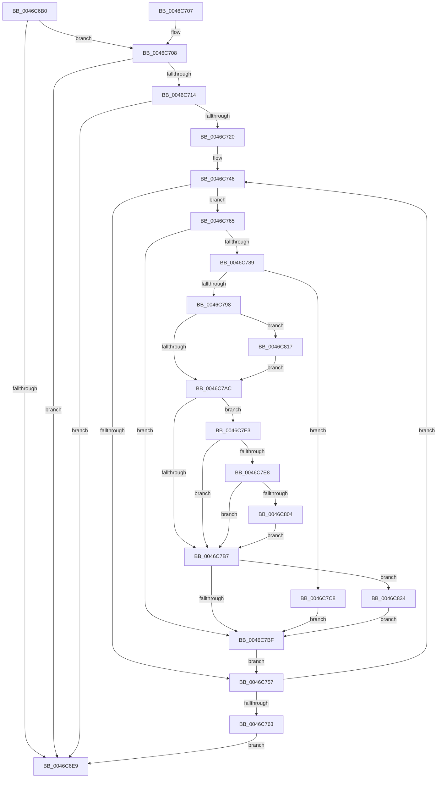

# MiShadowTopLevelPxes

- RVA: `0x0046C6B0`–`0x0046C844` (길이 `404` bytes)
- VA: `0x000000014046C6B0`
- 실행 섹션: `.text`
- PDB 이름 있음: `예`; PDB Function 태그: `아니요`
- unwind 정보 RVA: `0x000AB850`
- 디코드: `104`개 명령, `404/404` bytes 표시
- 미해석 바이트: `0` (있으면 어셈블리에 `.byte`로 보존)

> 이 문서는 커널 이미지의 기계어와 PDB 기호를 분석해 생성했습니다. 4번과 5번은 함수 원형과 자료형을 바이너리 사용 방식에서 추정한 C 해석이며 원본 소스 복구 결과는 아닙니다.

## 1. Dependencies

- 직접 호출 지점: **8**; 고유 호출 대상: **6**
- 직접 호출자로 확인된 함수: **2**
- RIP 상대 이미지 참조: **3**

### Outgoing calls
- `0x0046C770` → [MI_READ_PTE_LOCK_FREE](../28/MI_READ_PTE_LOCK_FREE_function_002828A0.md) (function, `0x002828A0`)
- `0x0046C77F` → [MI_READ_PTE_LOCK_FREE](../28/MI_READ_PTE_LOCK_FREE_function_002828A0.md) (function, `0x002828A0`)
- `0x0046C78C` → [MI_READ_PTE_LOCK_FREE](../28/MI_READ_PTE_LOCK_FREE_function_002828A0.md) (function, `0x002828A0`)
- `0x0046C7A3` → [MiPteInShadowRange](../23/MiPteInShadowRange_function_0023FB00.md) (function, `0x0023FB00`)
- `0x0046C7DC` → [MiTransformValidPteInPlace](../37/MiTransformValidPteInPlace_function_003765E0.md) (function, `0x003765E0`)
- `0x0046C810` → [MiCheckLinearProtectedPteAccessedBit](../29/MiCheckLinearProtectedPteAccessedBit_function_00292D80.md) (function, `0x00292D80`)
- `0x0046C81F` → [MiSanitizeShadowPxe](../29/MiSanitizeShadowPxe_function_00294B68.md) (function, `0x00294B68`)
- `0x0046C83A` → [MiWritePteShadow](../29/MiWritePteShadow_function_00294EAC.md) (function, `0x00294EAC`)

### Direct callers
- [MiCopyTopLevelMappings](MiCopyTopLevelMappings_function_0046C54C.md) at `0x0046C5C3`
- [MiReplicatePteChangeToProcess](../69/MiReplicatePteChangeToProcess_function_00693D24.md) at `0x00693E04`

### Static image references
- `0x0046C6DC` → RVA `0x00FC6A88` (`ALMOSTRO`; read)
- `0x0046C714` → RVA `0x00FC6AB0` (`ALMOSTRO`; read)
- `0x0046C72C` → RVA `0x00E2F18C` (`.data`; read)

## 2. Other-region calls and transfers

- 다른 실행 섹션으로 향하는 call: **0**
- 별도 외부 분기/꼬리 이동을 확인하지 못했습니다.

## 3. Assembly (complete function range)

```asm
0046C6B0  48 89 5C 24 08                  mov qword ptr [rsp + 8], rbx
0046C6B5  48 89 6C 24 10                  mov qword ptr [rsp + 0x10], rbp
0046C6BA  48 89 74 24 18                  mov qword ptr [rsp + 0x18], rsi
0046C6BF  57                              push rdi
0046C6C0  41 54                           push r12
0046C6C2  41 55                           push r13
0046C6C4  41 56                           push r14
0046C6C6  41 57                           push r15
0046C6C8  48 83 EC 40                     sub rsp, 0x40
0046C6CC  33 C0                           xor eax, eax
0046C6CE  45 8B F0                        mov r14d, r8d
0046C6D1  89 44 24 34                     mov dword ptr [rsp + 0x34], eax
0046C6D5  48 8B EA                        mov rbp, rdx
0046C6D8  21 44 24 34                     and dword ptr [rsp + 0x34], eax
0046C6DC  48 F7 05 A1 A3 B5 00 00 00 60 00  test qword ptr [rip + 0xb5a3a1], 0x600000
0046C6E7  75 1F                           jne 0x14046c708
0046C6E9  4C 8D 5C 24 40                  lea r11, [rsp + 0x40]
0046C6EE  49 8B 5B 30                     mov rbx, qword ptr [r11 + 0x30]
0046C6F2  49 8B 6B 38                     mov rbp, qword ptr [r11 + 0x38]
0046C6F6  49 8B 73 40                     mov rsi, qword ptr [r11 + 0x40]
0046C6FA  49 8B E3                        mov rsp, r11
0046C6FD  41 5F                           pop r15
0046C6FF  41 5E                           pop r14
0046C701  41 5D                           pop r13
0046C703  41 5C                           pop r12
0046C705  5F                              pop rdi
0046C706  C3                              ret
0046C707  CC                              int3
0046C708  4C 8B A1 08 05 00 00            mov r12, qword ptr [rcx + 0x508]
0046C70F  4D 85 E4                        test r12, r12
0046C712  74 D5                           je 0x14046c6e9
0046C714  48 8B 05 95 A3 B5 00            mov rax, qword ptr [rip + 0xb5a395]
0046C71B  48 85 C0                        test rax, rax
0046C71E  74 C9                           je 0x14046c6e9
0046C720  4C 8B A8 08 05 00 00            mov r13, qword ptr [rax + 0x508]
0046C727  8B F2                           mov esi, edx
0046C729  C1 EE 03                        shr esi, 3
0046C72C  48 8D 15 59 2A 9C 00            lea rdx, [rip + 0x9c2a59]
0046C733  81 E6 FF 01 00 00               and esi, 0x1ff
0046C739  C7 44 24 30 00 01 00 00         mov dword ptr [rsp + 0x30], 0x100
0046C741  48 89 54 24 38                  mov qword ptr [rsp + 0x38], rdx
0046C746  8D 8E 00 FF FF FF               lea ecx, [rsi - 0x100]
0046C74C  48 0F A3 0A                     bt qword ptr [rdx], rcx
0046C750  0F 92 C0                        setb al
0046C753  84 C0                           test al, al
0046C755  75 0E                           jne 0x14046c765
0046C757  48 83 C5 08                     add rbp, 8
0046C75B  FF C6                           inc esi
0046C75D  41 83 C6 FF                     add r14d, -1
0046C761  75 E3                           jne 0x14046c746
0046C763  EB 84                           jmp 0x14046c6e9
0046C765  48 8D 0C F5 00 00 00 00         lea rcx, [rsi*8]
0046C76D  49 03 CD                        add rcx, r13
0046C770  E8 2B 61 E1 FF                  call 0x1402828a0
0046C775  49 8D 3C F4                     lea rdi, [r12 + rsi*8]
0046C779  48 8B D8                        mov rbx, rax
0046C77C  48 8B CF                        mov rcx, rdi
0046C77F  E8 1C 61 E1 FF                  call 0x1402828a0
0046C784  48 3B D8                        cmp rbx, rax
0046C787  74 36                           je 0x14046c7bf
0046C789  48 8B CF                        mov rcx, rdi
0046C78C  E8 0F 61 E1 FF                  call 0x1402828a0
0046C791  48 8B CF                        mov rcx, rdi
0046C794  A8 01                           test al, 1
0046C796  75 30                           jne 0x14046c7c8
0046C798  48 89 9C 24 88 00 00 00         mov qword ptr [rsp + 0x88], rbx
0046C7A0  45 33 FF                        xor r15d, r15d
0046C7A3  E8 58 33 DD FF                  call 0x14023fb00
0046C7A8  85 C0                           test eax, eax
0046C7AA  75 6B                           jne 0x14046c817
0046C7AC  48 0F BA 25 D3 A2 B5 00 24      bt qword ptr [rip + 0xb5a2d3], 0x24
0046C7B5  72 2C                           jb 0x14046c7e3
0046C7B7  48 89 1F                        mov qword ptr [rdi], rbx
0046C7BA  45 85 FF                        test r15d, r15d
0046C7BD  75 75                           jne 0x14046c834
0046C7BF  48 8D 15 C6 29 9C 00            lea rdx, [rip + 0x9c29c6]
0046C7C6  EB 8F                           jmp 0x14046c757
0046C7C8  41 B9 60 00 00 00               mov r9d, 0x60
0046C7CE  C7 44 24 20 03 00 00 00         mov dword ptr [rsp + 0x20], 3
0046C7D6  4C 8B C3                        mov r8, rbx
0046C7D9  48 8B D5                        mov rdx, rbp
0046C7DC  E8 FF 9D F0 FF                  call 0x1403765e0
0046C7E1  EB DC                           jmp 0x14046c7bf
0046C7E3  F6 C3 20                        test bl, 0x20
0046C7E6  75 CF                           jne 0x14046c7b7
0046C7E8  48 BA 00 00 00 00 80 F6 FF FF   movabs rdx, 0xfffff68000000000
0046C7F2  48 B8 00 00 00 00 40 00 00 00   movabs rax, 0x4000000000
0046C7FC  48 03 D0                        add rdx, rax
0046C7FF  48 3B FA                        cmp rdi, rdx
0046C802  72 B3                           jb 0x14046c7b7
0046C804  41 B8 80 00 00 00               mov r8d, 0x80
0046C80A  48 8B D3                        mov rdx, rbx
0046C80D  48 8B CF                        mov rcx, rdi
0046C810  E8 6B 65 E2 FF                  call 0x140292d80
0046C815  EB A0                           jmp 0x14046c7b7
0046C817  48 8D 94 24 88 00 00 00         lea rdx, [rsp + 0x88]
0046C81F  E8 44 83 E2 FF                  call 0x140294b68
0046C824  48 8B 9C 24 88 00 00 00         mov rbx, qword ptr [rsp + 0x88]
0046C82C  44 8B F8                        mov r15d, eax
0046C82F  E9 78 FF FF FF                  jmp 0x14046c7ac
0046C834  48 8B D3                        mov rdx, rbx
0046C837  48 8B CF                        mov rcx, rdi
0046C83A  E8 6D 86 E2 FF                  call 0x140294eac
0046C83F  E9 7B FF FF FF                  jmp 0x14046c7bf
```

## 4. C-style interpretation (structured pseudocode)

```c
__int64 __fastcall MiShadowTopLevelPxes(__int64 a1, __int64 a2, int a3)
{
    __int64 result;
    __int64 v_r14;
    __int64 v_r15;
    __int64 v_rbp;
    __int64 v_rsi;
    __int64 v_rsp;
    unsigned int v_stack_m10;
    unsigned int v_stack_m20;
    unsigned __int64 v_stack_m28;
    unsigned int v_stack_m34;
    unsigned __int64 v_stack_m8;
    unsigned __int64 v_stack_p10;
    unsigned __int64 v_stack_p18;
    unsigned __int64 v_stack_p48;
    unsigned __int64 v_stack_p8;

    v_stack_p8 = v_rbx;
    v_stack_p10 = v_rbp;
    v_stack_p18 = v_rsi;
    v_rsp = (v_rsp) - (64);
    result = 0;
    v_stack_m34 = 0;
    if (((*(unsigned __int64 *)(v_rip + 11903905)) & (0x600000ULL)) != 0) goto loc_0046C708;
loc_0046C6E9:
    return result;
loc_0046C708:
    if (*(unsigned __int64 *)(a1 + 1288) == 0) goto loc_0046C6E9;
    if (*(unsigned __int64 *)(v_rip + 11903893) == 0) goto loc_0046C6E9;
    v_rsi = (unsigned int)(((unsigned int)((unsigned int)(a2))) >> (3));
    v_rsi = (unsigned int)((v_rsi) & (511));
    v_stack_m10 = 256;
    v_stack_m8 = v_rip + 10234457;
loc_0046C746:
    result = (condition_is_below) ? 1 : 0;
    if ((unsigned __int8)(result) != 0) goto loc_0046C765;
loc_0046C757:
    v_rbp = (*(unsigned __int64 *)(v_stack_m28 + 56)) + (8);
    v_rsi = (unsigned int)((v_rsi) + 1);
    v_r14 = (unsigned int)(((unsigned int)(a3)) + (-1));
    if (condition_is_not_equal) goto loc_0046C746;
    goto loc_0046C6E9;
loc_0046C765:
    a1 = (v_rsi * 8) + (*(unsigned __int64 *)(*(unsigned __int64 *)(v_rip + 11903893) + 1288));
    result = MI_READ_PTE_LOCK_FREE(a1, v_rip + 10234457, a3, a4);
    result = MI_READ_PTE_LOCK_FREE(*(unsigned __int64 *)(a1 + 1288) + v_rsi * 8, v_rip + 10234457, a3, a4);
    if (result == result) goto loc_0046C7BF;
    result = MI_READ_PTE_LOCK_FREE(*(unsigned __int64 *)(a1 + 1288) + v_rsi * 8, v_rip + 10234457, a3, a4);
    if ((((unsigned __int8)(result)) & (1)) != 0) goto loc_0046C7C8;
    v_stack_p48 = result;
    v_r15 = 0;
    result = MiPteInShadowRange(*(unsigned __int64 *)(a1 + 1288) + v_rsi * 8, v_rip + 10234457, a3, a4);
    if ((unsigned int)(result) != 0) goto loc_0046C817;
loc_0046C7AC:
    if (condition_is_below) goto loc_0046C7E3;
loc_0046C7B7:
    *(unsigned __int64 *)(*(unsigned __int64 *)(a1 + 1288) + v_rsi * 8) = result;
    if (0 != 0) goto loc_0046C834;
loc_0046C7BF:
    goto loc_0046C757;
loc_0046C7C8:
    v_stack_m20 = 3;
    result = MiTransformValidPteInPlace(*(unsigned __int64 *)(a1 + 1288) + v_rsi * 8, v_rbp, result, 96);
    goto loc_0046C7BF;
loc_0046C7E3:
    if ((((unsigned __int8)(result)) & (32)) != 0) goto loc_0046C7B7;
    a2 = (v_rbp) + (result);
    if ((*(unsigned __int64 *)(a1 + 1288) + v_rsi * 8) < a2) goto loc_0046C7B7;
    result = MiCheckLinearProtectedPteAccessedBit(*(unsigned __int64 *)(a1 + 1288) + v_rsi * 8, result, 128, 96);
    goto loc_0046C7B7;
loc_0046C817:
    result = MiSanitizeShadowPxe(*(unsigned __int64 *)(a1 + 1288) + v_rsi * 8, v_stack_p48, 128, 96);
    goto loc_0046C7AC;
loc_0046C834:
    result = MiWritePteShadow(*(unsigned __int64 *)(a1 + 1288) + v_rsi * 8, v_stack_p48, 128, 96);
    goto loc_0046C7BF;
}
```

## 5. (Beta) C Style

```c
int64_t MiShadowTopLevelPxes(void *Arg1, int64_t Arg2, int32_t Arg3)
{
    uint8_t *arg1 = (uint8_t *)Arg1;

    int64_t result;
    int64_t local_r14;
    int64_t local_r15;
    int64_t local_rbp;
    int64_t local_rsi;
    int64_t local_rsp;
    uint32_t v_stack_m10;
    uint32_t v_stack_m20;
    uint64_t v_stack_m28;
    uint32_t v_stack_m34;
    uint64_t v_stack_m8;
    uint64_t v_stack_p10;
    uint64_t v_stack_p18;
    uint64_t v_stack_p48;
    uint64_t v_stack_p8;

    v_stack_p8 = local_rbx;
    v_stack_p10 = local_rbp;
    v_stack_p18 = local_rsi;
    local_rsp = (local_rsp) - (64);
    result = 0;
    v_stack_m34 = 0;
    if (((*(uint64_t *)(v_rip + 0xB5A3A1)) & (0x600000ULL)) != 0) goto loc_0046C708;
loc_0046C6E9:
    return result;
loc_0046C708:
    if (*(uint64_t *)(arg1 + 0x508) == 0) goto loc_0046C6E9;
    if (*(uint64_t *)(v_rip + 0xB5A395) == 0) goto loc_0046C6E9;
    local_rsi = (uint32_t)(((uint32_t)((uint32_t)(Arg2))) >> (3));
    local_rsi = (uint32_t)((local_rsi) & (511));
    v_stack_m10 = 256;
    v_stack_m8 = v_rip + 10234457;
loc_0046C746:
    result = (condition_is_below) ? 1 : 0;
    if ((uint8_t)(result) != 0) goto loc_0046C765;
loc_0046C757:
    local_rbp = (*(uint64_t *)(v_stack_m28 + 0x38)) + (8);
    local_rsi = (uint32_t)((local_rsi) + 1);
    local_r14 = (uint32_t)(((uint32_t)(Arg3)) + (-1));
    if (condition_is_not_equal) goto loc_0046C746;
    goto loc_0046C6E9;
loc_0046C765:
    Arg1 = (local_rsi * 8) + (*(uint64_t *)(*(uint64_t *)(v_rip + 0xB5A395) + 0x508));
    result = MI_READ_PTE_LOCK_FREE(Arg1, v_rip + 10234457, Arg3, a4);
    result = MI_READ_PTE_LOCK_FREE(*(uint64_t *)(arg1 + 0x508) + local_rsi * 8, v_rip + 10234457, Arg3, a4);
    if (result == result) goto loc_0046C7BF;
    result = MI_READ_PTE_LOCK_FREE(*(uint64_t *)(arg1 + 0x508) + local_rsi * 8, v_rip + 10234457, Arg3, a4);
    if ((((uint8_t)(result)) & (1)) != 0) goto loc_0046C7C8;
    v_stack_p48 = result;
    local_r15 = 0;
    result = MiPteInShadowRange(*(uint64_t *)(arg1 + 0x508) + local_rsi * 8, v_rip + 10234457, Arg3, a4);
    if ((uint32_t)(result) != 0) goto loc_0046C817;
loc_0046C7AC:
    if (condition_is_below) goto loc_0046C7E3;
loc_0046C7B7:
    *(uint64_t *)(*(uint64_t *)(arg1 + 0x508) + local_rsi * 8) = result;
    if (0 != 0) goto loc_0046C834;
loc_0046C7BF:
    goto loc_0046C757;
loc_0046C7C8:
    v_stack_m20 = 3;
    result = MiTransformValidPteInPlace(*(uint64_t *)(arg1 + 0x508) + local_rsi * 8, local_rbp, result, 96);
    goto loc_0046C7BF;
loc_0046C7E3:
    if ((((uint8_t)(result)) & (32)) != 0) goto loc_0046C7B7;
    Arg2 = (local_rbp) + (result);
    if ((*(uint64_t *)(arg1 + 0x508) + local_rsi * 8) < Arg2) goto loc_0046C7B7;
    result = MiCheckLinearProtectedPteAccessedBit(*(uint64_t *)(arg1 + 0x508) + local_rsi * 8, result, 128, 96);
    goto loc_0046C7B7;
loc_0046C817:
    result = MiSanitizeShadowPxe(*(uint64_t *)(arg1 + 0x508) + local_rsi * 8, v_stack_p48, 128, 96);
    goto loc_0046C7AC;
loc_0046C834:
    result = MiWritePteShadow(*(uint64_t *)(arg1 + 0x508) + local_rsi * 8, v_stack_p48, 128, 96);
    goto loc_0046C7BF;
}
```

### 관측된 메모리 오프셋

구조체 형식이 확인되지 않은 접근은 인자 기준의 오프셋으로만 기록했습니다.

| 기준 인자 | 오프셋 표현 | 폭 (bit) | 접근 |
|---|---:|---:|---|
| `Arg1` | `+ 0x508` | `64` | `R` |

## 6. Execution-region graph

[열기: 2D/3D 그래프와 함수 탐색 컨트롤 패널](../../../control-panel.html?section=text&rva=0x0046C6B0&view=graph)

- 2D 그래프는 위에서 아래로 흐르고, 3D 그래프는 빈 공간을 드래그해 회전합니다. Shift+드래그는 이동, 휠은 확대·축소, 함수 노드 선택은 대상 보고서 이동입니다.

### Static fallback


