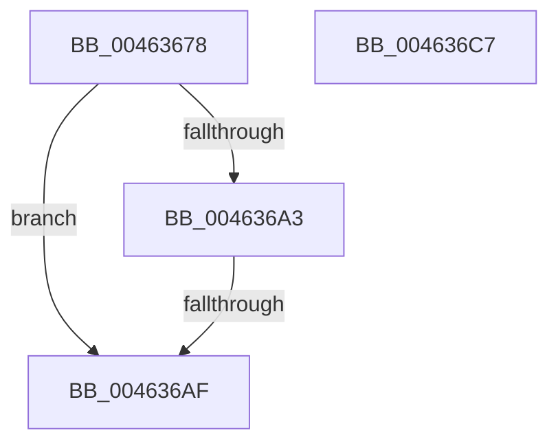

# MiStoreLogNotCandidate

- RVA: `0x00463678`–`0x004636C8` (길이 `80` bytes)
- VA: `0x0000000140463678`
- 실행 섹션: `.text`
- PDB 이름 있음: `예`; PDB Function 태그: `예`
- unwind 정보 RVA: `0x000AA6F8`
- 디코드: `17`개 명령, `80/80` bytes 표시
- 미해석 바이트: `0` (있으면 어셈블리에 `.byte`로 보존)

> 이 문서는 커널 이미지의 기계어와 PDB 기호를 분석해 생성했습니다. 4번과 5번은 함수 원형과 자료형을 바이너리 사용 방식에서 추정한 C 해석이며 원본 소스 복구 결과는 아닙니다.

## 1. Dependencies

- 직접 호출 지점: **1**; 고유 호출 대상: **1**
- 직접 호출자로 확인된 함수: **1**
- RIP 상대 이미지 참조: **2**

### Outgoing calls
- `0x004636BA` → [_security_check_cookie](../6A/_security_check_cookie_function_006AC640.md) (function, `0x006AC640`)

### Direct callers
- [MiStoreWriteModifiedPages](../2B/MiStoreWriteModifiedPages_function_002B46C4.md) at `0x002B4BC0`

### Static image references
- `0x0046367F` → RVA `0x00E0A740` (`.data`; read)
- `0x00463691` → RVA `0x00E37618` (`.data`; read)

## 2. Other-region calls and transfers

- 다른 실행 섹션으로 향하는 call: **0**
- call이 아닌 외부 분기/꼬리 이동: **1**
  - `0x004636A9` → [sub_006F2B30](../6F/Unknown_function_006F2B30.md) (`tail-transfer`)

## 3. Assembly (complete function range)

```asm
00463678  48 81 EC A8 00 00 00            sub rsp, 0xa8
0046367F  48 8B 05 BA 70 9A 00            mov rax, qword ptr [rip + 0x9a70ba]
00463686  48 33 C4                        xor rax, rsp
00463689  48 89 84 24 90 00 00 00         mov qword ptr [rsp + 0x90], rax
00463691  4C 8B 05 80 3F 9D 00            mov r8, qword ptr [rip + 0x9d3f80]
00463698  44 8B D2                        mov r10d, edx
0046369B  44 8B C9                        mov r9d, ecx
0046369E  4D 85 C0                        test r8, r8
004636A1  74 0C                           je 0x1404636af
004636A3  81 F9 A7 01 00 C0               cmp ecx, 0xc00001a7
004636A9  0F 85 81 F4 28 00               jne 0x1406f2b30
004636AF  48 8B 8C 24 90 00 00 00         mov rcx, qword ptr [rsp + 0x90]
004636B7  48 33 CC                        xor rcx, rsp
004636BA  E8 81 8F 24 00                  call 0x1406ac640
004636BF  48 81 C4 A8 00 00 00            add rsp, 0xa8
004636C6  C3                              ret
004636C7  CC                              int3
```

## 4. C-style interpretation (structured pseudocode)

```c
__int64 __fastcall MiStoreLogNotCandidate(int a1, int a2)
{
    __int64 result;
    __int64 v_rsp;
    unsigned __int64 v_stack_m18;

    v_rsp = (v_rsp) - (168);
    result = (*(unsigned __int64 *)(v_rip + 10121402)) ^ (v_rsp);
    v_stack_m18 = result;
    if (*(unsigned __int64 *)(v_rip + 10305408) == 0) goto loc_004636AF;
loc_004636AF:
    a1 = (v_stack_m18) ^ (v_rsp);
    result = _security_check_cookie(a1, a2, *(unsigned __int64 *)(v_rip + 10305408), (unsigned int)(a1));
    v_rsp = (v_rsp) + (168);
    return result;
}
```

## 5. (Beta) C Style

```c
int64_t MiStoreLogNotCandidate(int32_t Arg1, int32_t Arg2)
{
    int64_t result;
    int64_t local_rsp;
    uint64_t v_stack_m18;

    local_rsp = (local_rsp) - (168);
    result = (*(uint64_t *)(v_rip + 0x9A70BA)) ^ (local_rsp);
    v_stack_m18 = result;
    if (*(uint64_t *)(v_rip + 0x9D3F80) == 0) goto loc_004636AF;
loc_004636AF:
    Arg1 = (v_stack_m18) ^ (local_rsp);
    result = _security_check_cookie(Arg1, Arg2, *(uint64_t *)(v_rip + 0x9D3F80), (uint32_t)(Arg1));
    local_rsp = (local_rsp) + (168);
    return result;
}
```

## 6. Execution-region graph

[열기: 2D/3D 그래프와 함수 탐색 컨트롤 패널](../../../control-panel.html?section=text&rva=0x00463678&view=graph)

- 2D 그래프는 위에서 아래로 흐르고, 3D 그래프는 빈 공간을 드래그해 회전합니다. Shift+드래그는 이동, 휠은 확대·축소, 함수 노드 선택은 대상 보고서 이동입니다.

### Static fallback


