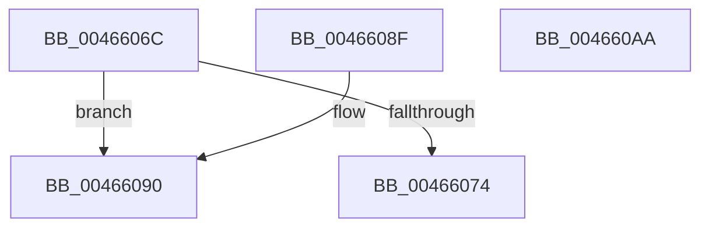

# MiUpdateReserveClusterInfo

- RVA: `0x0046606C`–`0x004660AB` (길이 `63` bytes)
- VA: `0x000000014046606C`
- 실행 섹션: `.text`
- PDB 이름 있음: `예`; PDB Function 태그: `아니요`
- unwind 정보 RVA: `0x000DB714`
- 디코드: `18`개 명령, `63/63` bytes 표시
- 미해석 바이트: `0` (있으면 어셈블리에 `.byte`로 보존)

> 이 문서는 커널 이미지의 기계어와 PDB 기호를 분석해 생성했습니다. 4번과 5번은 함수 원형과 자료형을 바이너리 사용 방식에서 추정한 C 해석이며 원본 소스 복구 결과는 아닙니다.

## 1. Dependencies

- 직접 호출 지점: **0**; 고유 호출 대상: **0**
- 직접 호출자로 확인된 함수: **3**
- RIP 상대 이미지 참조: **0**

### Outgoing calls
- 직접 디코드된 call 명령이 없습니다.

### Direct callers
- [MiAdjustModifiedPageLoad](../2D/MiAdjustModifiedPageLoad_function_002DC07C.md) at `0x002DC239`
- [MiFinishPageFileExtension](../4D/MiFinishPageFileExtension_function_004D5EB4.md) at `0x004D5F5D`
- [MiInsertPageFileInList](../../page/7F/MiInsertPageFileInList_function_007FFF80.md) at `0x00800407`

### Static image references
- 디코드된 RIP-relative 메모리 참조가 없습니다.

## 2. Other-region calls and transfers

- 다른 실행 섹션으로 향하는 call: **0**
- 별도 외부 분기/꼬리 이동을 확인하지 못했습니다.

## 3. Assembly (complete function range)

```asm
0046606C  4C 8B C9                        mov r9, rcx
0046606F  48 85 D2                        test rdx, rdx
00466072  75 1C                           jne 0x140466090
00466074  8B 81 98 03 00 00               mov eax, dword ptr [rcx + 0x398]
0046607A  25 00 FE FF FF                  and eax, 0xfffffe00
0046607F  0F BA E8 09                     bts eax, 9
00466083  05 00 04 00 00                  add eax, 0x400
00466088  87 81 98 03 00 00               xchg dword ptr [rcx + 0x398], eax
0046608E  C3                              ret
0046608F  CC                              int3
00466090  8B 02                           mov eax, dword ptr [rdx]
00466092  8B C8                           mov ecx, eax
00466094  41 33 C8                        xor ecx, r8d
00466097  81 E1 00 FC FF FF               and ecx, 0xfffffc00
0046609D  41 33 C8                        xor ecx, r8d
004660A0  F0 41 0F B1 89 98 03 00 00      lock cmpxchg dword ptr [r9 + 0x398], ecx
004660A9  C3                              ret
004660AA  CC                              int3
```

## 4. C-style interpretation (structured pseudocode)

```c
__int64 __fastcall MiUpdateReserveClusterInfo(__int64 a1, __int64 a2, int a3)
{
    __int64 result;

    if (a2 != 0) goto loc_00466090;
    result = (unsigned int)(((unsigned int)(*(unsigned int *)(a1 + 920))) & (0xFFFFFE00ULL));
    result = (unsigned int)((result) + (0x400ULL));
    return result;
loc_00466090:
    a1 = (unsigned int)(((unsigned int)((unsigned int)((unsigned int)(*(unsigned int *)(a2))))) ^ (a3));
    a1 = (unsigned int)((a1) & (0xFFFFFC00ULL));
    a1 = (unsigned int)((a1) ^ (a3));
    return (unsigned int)(*(unsigned int *)(a2));
}
```

## 5. (Beta) C Style

```c
int64_t MiUpdateReserveClusterInfo(void *Arg1, int64_t Arg2, int32_t Arg3)
{
    uint8_t *arg1 = (uint8_t *)Arg1;

    int64_t result;

    if (Arg2 != 0) goto loc_00466090;
    result = (uint32_t)(((uint32_t)(*(uint32_t *)(arg1 + 0x398))) & (0xFFFFFE00ULL));
    result = (uint32_t)((result) + (0x400ULL));
    return result;
loc_00466090:
    Arg1 = (uint32_t)(((uint32_t)((uint32_t)((uint32_t)(*(uint32_t *)(Arg2))))) ^ (Arg3));
    Arg1 = (uint32_t)((Arg1) & (0xFFFFFC00ULL));
    Arg1 = (uint32_t)((Arg1) ^ (Arg3));
    return (uint32_t)(*(uint32_t *)(Arg2));
}
```

### 관측된 메모리 오프셋

구조체 형식이 확인되지 않은 접근은 인자 기준의 오프셋으로만 기록했습니다.

| 기준 인자 | 오프셋 표현 | 폭 (bit) | 접근 |
|---|---:|---:|---|
| `Arg1` | `+ 0x398` | `32` | `R` |
| `Arg1` | `+ 0x398` | `32` | `R/W` |

## 6. Execution-region graph

[열기: 2D/3D 그래프와 함수 탐색 컨트롤 패널](../../../control-panel.html?section=text&rva=0x0046606C&view=graph)

- 2D 그래프는 위에서 아래로 흐르고, 3D 그래프는 빈 공간을 드래그해 회전합니다. Shift+드래그는 이동, 휠은 확대·축소, 함수 노드 선택은 대상 보고서 이동입니다.

### Static fallback


