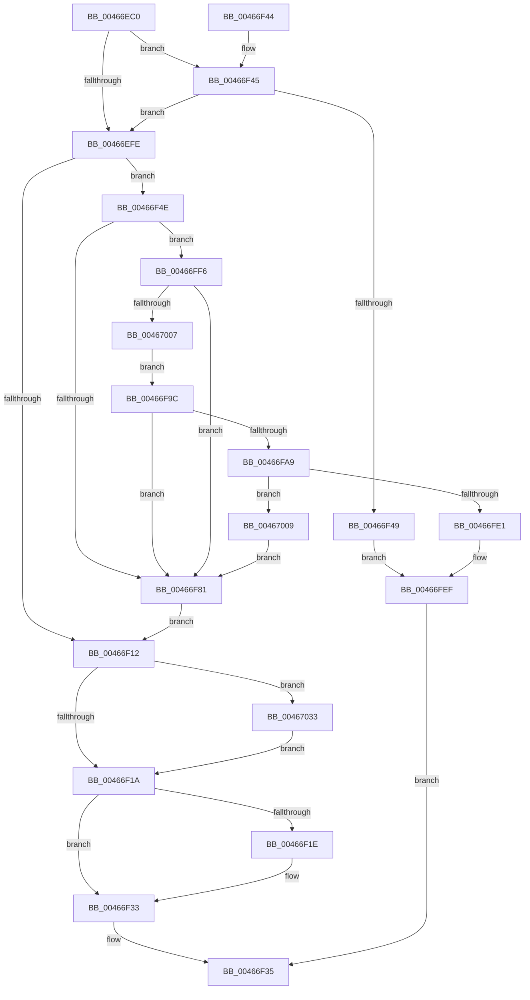

# MiValidVirtualizationFault

- RVA: `0x00466EC0`–`0x00467055` (길이 `405` bytes)
- VA: `0x0000000140466EC0`
- 실행 섹션: `.text`
- PDB 이름 있음: `예`; PDB Function 태그: `아니요`
- unwind 정보 RVA: `0x000AAEF0`
- 디코드: `117`개 명령, `405/405` bytes 표시
- 미해석 바이트: `0` (있으면 어셈블리에 `.byte`로 보존)

> 이 문서는 커널 이미지의 기계어와 PDB 기호를 분석해 생성했습니다. 4번과 5번은 함수 원형과 자료형을 바이너리 사용 방식에서 추정한 C 해석이며 원본 소스 복구 결과는 아닙니다.

## 1. Dependencies

- 직접 호출 지점: **9**; 고유 호출 대상: **7**
- 직접 호출자로 확인된 함수: **2**
- RIP 상대 이미지 참조: **0**

### Outgoing calls
- `0x00466EE1` → [MiGetVirtualFaultPageInfo](MiGetVirtualFaultPageInfo_function_0046705C.md) (function, `0x0046705C`)
- `0x00466EEC` → [MI_READ_PTE_LOCK_FREE](../28/MI_READ_PTE_LOCK_FREE_function_002828A0.md) (function, `0x002828A0`)
- `0x00466F2E` → [MiFillVirtualFaultInfo](MiFillVirtualFaultInfo_function_00467090.md) (function, `0x00467090`)
- `0x00466F8C` → [MiCompleteSecureProcessFault](MiCompleteSecureProcessFault_function_0046710C.md) (function, `0x0046710C`)
- `0x00466FD8` → [MiCopyOnWrite](../36/MiCopyOnWrite_function_00362A0C.md) (function, `0x00362A0C`)
- `0x00466FEA` → [MiSetFaultPacketDirectives](MiSetFaultPacketDirectives_function_004673D8.md) (function, `0x004673D8`)
- `0x0046700C` → [MI_READ_PTE_LOCK_FREE](../28/MI_READ_PTE_LOCK_FREE_function_002828A0.md) (function, `0x002828A0`)
- `0x00467043` → [MiPerformSafePdeWrite](../49/MiPerformSafePdeWrite_function_00494300.md) (function, `0x00494300`)
- `0x0046704B` → [MI_READ_PTE_LOCK_FREE](../28/MI_READ_PTE_LOCK_FREE_function_002828A0.md) (function, `0x002828A0`)

### Direct callers
- [MiValidFault](../32/MiValidFault_function_003280B4.md) at `0x00328398`
- [MiLargePageFault](../3F/MiLargePageFault_function_003F01C4.md) at `0x003F03FD`

### Static image references
- 디코드된 RIP-relative 메모리 참조가 없습니다.

## 2. Other-region calls and transfers

- 다른 실행 섹션으로 향하는 call: **0**
- 별도 외부 분기/꼬리 이동을 확인하지 못했습니다.

## 3. Assembly (complete function range)

```asm
00466EC0  40 55                           push rbp
00466EC2  53                              push rbx
00466EC3  56                              push rsi
00466EC4  57                              push rdi
00466EC5  41 54                           push r12
00466EC7  41 56                           push r14
00466EC9  41 57                           push r15
00466ECB  48 8B EC                        mov rbp, rsp
00466ECE  48 83 EC 30                     sub rsp, 0x30
00466ED2  4C 8B F2                        mov r14, rdx
00466ED5  48 8B F1                        mov rsi, rcx
00466ED8  48 8B 11                        mov rdx, qword ptr [rcx]
00466EDB  49 8B F8                        mov rdi, r8
00466EDE  49 8B CE                        mov rcx, r14
00466EE1  E8 76 01 00 00                  call 0x14046705c
00466EE6  48 8B CF                        mov rcx, rdi
00466EE9  4C 8B F8                        mov r15, rax
00466EEC  E8 AF B9 E1 FF                  call 0x1402828a0
00466EF1  41 8B 4E 38                     mov ecx, dword ptr [r14 + 0x38]
00466EF5  48 89 45 48                     mov qword ptr [rbp + 0x48], rax
00466EF9  F6 C1 01                        test cl, 1
00466EFC  75 47                           jne 0x140466f45
00466EFE  BB 01 00 00 00                  mov ebx, 1
00466F03  49 BC FF FF FF FF FF 00 00 00   movabs r12, 0xffffffffff
00466F0D  F6 C1 20                        test cl, 0x20
00466F10  75 3C                           jne 0x140466f4e
00466F12  A8 20                           test al, 0x20
00466F14  0F 84 19 01 00 00               je 0x140467033
00466F1A  85 DB                           test ebx, ebx
00466F1C  74 15                           je 0x140466f33
00466F1E  48 8B D0                        mov rdx, rax
00466F21  4C 8B C0                        mov r8, rax
00466F24  48 C1 EA 0C                     shr rdx, 0xc
00466F28  49 8B CF                        mov rcx, r15
00466F2B  49 23 D4                        and rdx, r12
00466F2E  E8 5D 01 00 00                  call 0x140467090
00466F33  8B C3                           mov eax, ebx
00466F35  48 83 C4 30                     add rsp, 0x30
00466F39  41 5F                           pop r15
00466F3B  41 5E                           pop r14
00466F3D  41 5C                           pop r12
00466F3F  5F                              pop rdi
00466F40  5E                              pop rsi
00466F41  5B                              pop rbx
00466F42  5D                              pop rbp
00466F43  C3                              ret
00466F44  CC                              int3
00466F45  A8 42                           test al, 0x42
00466F47  75 B5                           jne 0x140466efe
00466F49  E9 A1 00 00 00                  jmp 0x140466fef
00466F4E  48 83 65 58 00                  and qword ptr [rbp + 0x58], 0
00466F53  48 C1 E8 0C                     shr rax, 0xc
00466F57  49 23 C4                        and rax, r12
00466F5A  48 BB 00 00 00 00 00 DE FF FF   movabs rbx, 0xffffde0000000000
00466F64  48 8D 0C 40                     lea rcx, [rax + rax*2]
00466F68  48 C1 E1 04                     shl rcx, 4
00466F6C  48 8B C3                        mov rax, rbx
00466F6F  48 03 C1                        add rax, rcx
00466F72  48 89 45 40                     mov qword ptr [rbp + 0x40], rax
00466F76  48 8B 40 28                     mov rax, qword ptr [rax + 0x28]
00466F7A  48 0F BA E0 28                  bt rax, 0x28
00466F7F  73 75                           jae 0x140466ff6
00466F81  4D 8B C6                        mov r8, r14
00466F84  48 8D 55 48                     lea rdx, [rbp + 0x48]
00466F88  48 8D 4D 40                     lea rcx, [rbp + 0x40]
00466F8C  E8 7B 01 00 00                  call 0x14046710c
00466F91  8B D8                           mov ebx, eax
00466F93  48 8B 45 48                     mov rax, qword ptr [rbp + 0x48]
00466F97  E9 76 FF FF FF                  jmp 0x140466f12
00466F9C  48 8B 45 40                     mov rax, qword ptr [rbp + 0x40]
00466FA0  48 8B 40 08                     mov rax, qword ptr [rax + 8]
00466FA4  48 85 C0                        test rax, rax
00466FA7  74 D8                           je 0x140466f81
00466FA9  48 B8 00 00 00 00 80 F6 FF FF   movabs rax, 0xfffff68000000000
00466FB3  48 C1 E0 19                     shl rax, 0x19
00466FB7  48 8B CF                        mov rcx, rdi
00466FBA  48 C1 E1 19                     shl rcx, 0x19
00466FBE  45 33 C9                        xor r9d, r9d
00466FC1  48 2B C8                        sub rcx, rax
00466FC4  49 83 C8 FF                     or r8, 0xffffffffffffffff
00466FC8  48 8D 45 58                     lea rax, [rbp + 0x58]
00466FCC  48 C1 F9 10                     sar rcx, 0x10
00466FD0  48 8B D7                        mov rdx, rdi
00466FD3  48 89 44 24 20                  mov qword ptr [rsp + 0x20], rax
00466FD8  E8 2F BA EF FF                  call 0x140362a0c
00466FDD  85 C0                           test eax, eax
00466FDF  79 28                           jns 0x140467009
00466FE1  4C 8B 45 58                     mov r8, qword ptr [rbp + 0x58]
00466FE5  8B D0                           mov edx, eax
00466FE7  48 8B CE                        mov rcx, rsi
00466FEA  E8 E9 03 00 00                  call 0x1404673d8
00466FEF  33 C0                           xor eax, eax
00466FF1  E9 3F FF FF FF                  jmp 0x140466f35
00466FF6  48 8B 45 40                     mov rax, qword ptr [rbp + 0x40]
00466FFA  48 8B 40 08                     mov rax, qword ptr [rax + 8]
00466FFE  48 85 C0                        test rax, rax
00467001  0F 88 7A FF FF FF               js 0x140466f81
00467007  EB 93                           jmp 0x140466f9c
00467009  48 8B CF                        mov rcx, rdi
0046700C  E8 8F B8 E1 FF                  call 0x1402828a0
00467011  48 89 45 48                     mov qword ptr [rbp + 0x48], rax
00467015  48 C1 E8 0C                     shr rax, 0xc
00467019  49 23 C4                        and rax, r12
0046701C  48 8D 0C 40                     lea rcx, [rax + rax*2]
00467020  48 C1 E1 04                     shl rcx, 4
00467024  48 8B C3                        mov rax, rbx
00467027  48 03 C8                        add rcx, rax
0046702A  48 89 4D 40                     mov qword ptr [rbp + 0x40], rcx
0046702E  E9 4E FF FF FF                  jmp 0x140466f81
00467033  48 8B 4E 38                     mov rcx, qword ptr [rsi + 0x38]
00467037  41 B9 01 00 00 00               mov r9d, 1
0046703D  4C 8B C0                        mov r8, rax
00467040  48 8B D7                        mov rdx, rdi
00467043  E8 B8 D2 02 00                  call 0x140494300
00467048  48 8B CF                        mov rcx, rdi
0046704B  E8 50 B8 E1 FF                  call 0x1402828a0
00467050  E9 C5 FE FF FF                  jmp 0x140466f1a
```

## 4. C-style interpretation (structured pseudocode)

```c
__int64 __fastcall MiValidVirtualizationFault(__int64 a1, __int64 a2, __int64 a3, int a4)
{
    __int64 result;
    __int64 v_rsp;
    unsigned __int64 v_stack_p10;
    unsigned __int64 v_stack_p20;
    unsigned __int64 v_stack_p8;

    v_rsp = (v_rsp) - (48);
    result = MiGetVirtualFaultPageInfo(a2, *(unsigned __int64 *)(a1), a3, a4);
    result = MI_READ_PTE_LOCK_FREE(a3, *(unsigned __int64 *)(a1), a3, a4);
    v_stack_p10 = result;
    if ((((unsigned __int8)((unsigned int)(*(unsigned int *)(a2 + 56)))) & (1)) != 0) goto loc_00466F45;
loc_00466EFE:
    if ((((unsigned __int8)((unsigned int)(*(unsigned int *)(a2 + 56)))) & (32)) != 0) goto loc_00466F4E;
loc_00466F12:
    if ((((unsigned __int8)(result)) & (32)) == 0) goto loc_00467033;
loc_00466F1A:
    if (1 != 0) {
        a2 = result;
        a3 = result;
        a2 = (a2) >> (12);
        a1 = result;
        a2 = (a2) & (v_r12);
        result = MiFillVirtualFaultInfo(a1, a2, a3, a4);
    }
loc_00466F35:
    v_rsp = (v_rsp) + (48);
    return 1;
loc_00466F45:
    if (((1) & (66)) != 0) goto loc_00466EFE;
    goto loc_00466FEF;
loc_00466F4E:
    result = (1) >> (12);
    result = (result) & (v_r12);
    a1 = (result + result * 2) << (4);
    result = (1) + (a1);
    v_stack_p8 = result;
    if (condition_is_above_or_equal) goto loc_00466FF6;
loc_00466F81:
    result = MiCompleteSecureProcessFault(v_stack_p8, v_stack_p10, a2, a4);
    goto loc_00466F12;
loc_00466F9C:
    if (*(unsigned __int64 *)(v_stack_p8 + 8) == 0) goto loc_00466F81;
    result = (*(unsigned __int64 *)(v_stack_p8 + 8)) << (25);
    a1 = (a3) << (25);
    a4 = 0;
    a1 = (a1) - (result);
    a3 = (a2) | (-1);
    a1 = (a1) >> (16);
    v_stack_p20 = v_stack_p20;
    result = MiCopyOnWrite(a1, a3, a3, a4);
    if (!sign_flag) goto loc_00467009;
    result = MiSetFaultPacketDirectives(a1, (unsigned int)((unsigned int)(result)), v_stack_p20, a4);
loc_00466FEF:
    result = 0;
    goto loc_00466F35;
loc_00466FF6:
    if (sign_flag) goto loc_00466F81;
    goto loc_00466F9C;
loc_00467009:
    result = MI_READ_PTE_LOCK_FREE(a3, (unsigned int)((unsigned int)(result)), v_stack_p20, a4);
    v_stack_p10 = result;
    result = (result) >> (12);
    result = (result) & (v_r12);
    a1 = (result + result * 2) << (4);
    a1 = (a1) + ((unsigned int)((unsigned int)(result)));
    v_stack_p8 = a1;
    goto loc_00466F81;
loc_00467033:
    result = MiPerformSafePdeWrite(*(unsigned __int64 *)(a1 + 56), a3, (unsigned int)((unsigned int)(result)), 1);
    result = MI_READ_PTE_LOCK_FREE(a3, a3, (unsigned int)((unsigned int)(result)), 1);
    goto loc_00466F1A;
}
```

## 5. (Beta) C Style

```c
int64_t MiValidVirtualizationFault(void *Arg1, void *Arg2, int64_t Arg3, int32_t Arg4)
{
    uint8_t *arg1 = (uint8_t *)Arg1;
    uint8_t *arg2 = (uint8_t *)Arg2;

    int64_t result;
    int64_t local_rsp;
    uint64_t v_stack_p10;
    uint64_t v_stack_p20;
    uint64_t v_stack_p8;

    local_rsp = (local_rsp) - (48);
    result = MiGetVirtualFaultPageInfo(Arg2, *(uint64_t *)(arg1), Arg3, Arg4);
    result = MI_READ_PTE_LOCK_FREE(Arg3, *(uint64_t *)(arg1), Arg3, Arg4);
    v_stack_p10 = result;
    if ((((uint8_t)((uint32_t)(*(uint32_t *)(arg2 + 0x38)))) & (1)) != 0) goto loc_00466F45;
loc_00466EFE:
    if ((((uint8_t)((uint32_t)(*(uint32_t *)(arg2 + 0x38)))) & (32)) != 0) goto loc_00466F4E;
loc_00466F12:
    if ((((uint8_t)(result)) & (32)) == 0) goto loc_00467033;
loc_00466F1A:
    if (1 != 0) {
        Arg2 = result;
        Arg3 = result;
        Arg2 = (Arg2) >> (12);
        Arg1 = result;
        Arg2 = (Arg2) & (local_r12);
        result = MiFillVirtualFaultInfo(Arg1, Arg2, Arg3, Arg4);
    }
loc_00466F35:
    local_rsp = (local_rsp) + (48);
    return 1;
loc_00466F45:
    if (((1) & (66)) != 0) goto loc_00466EFE;
    goto loc_00466FEF;
loc_00466F4E:
    result = (1) >> (12);
    result = (result) & (local_r12);
    Arg1 = (result + result * 2) << (4);
    result = (1) + (Arg1);
    v_stack_p8 = result;
    if (condition_is_above_or_equal) goto loc_00466FF6;
loc_00466F81:
    result = MiCompleteSecureProcessFault(v_stack_p8, v_stack_p10, Arg2, Arg4);
    goto loc_00466F12;
loc_00466F9C:
    if (*(uint64_t *)(v_stack_p8 + 0x8) == 0) goto loc_00466F81;
    result = (*(uint64_t *)(v_stack_p8 + 0x8)) << (25);
    Arg1 = (Arg3) << (25);
    Arg4 = 0;
    Arg1 = (Arg1) - (result);
    Arg3 = (Arg2) | (-1);
    Arg1 = (Arg1) >> (16);
    v_stack_p20 = v_stack_p20;
    result = MiCopyOnWrite(Arg1, Arg3, Arg3, Arg4);
    if (!sign_flag) goto loc_00467009;
    result = MiSetFaultPacketDirectives(Arg1, (uint32_t)((uint32_t)(result)), v_stack_p20, Arg4);
loc_00466FEF:
    result = 0;
    goto loc_00466F35;
loc_00466FF6:
    if (sign_flag) goto loc_00466F81;
    goto loc_00466F9C;
loc_00467009:
    result = MI_READ_PTE_LOCK_FREE(Arg3, (uint32_t)((uint32_t)(result)), v_stack_p20, Arg4);
    v_stack_p10 = result;
    result = (result) >> (12);
    result = (result) & (local_r12);
    Arg1 = (result + result * 2) << (4);
    Arg1 = (Arg1) + ((uint32_t)((uint32_t)(result)));
    v_stack_p8 = Arg1;
    goto loc_00466F81;
loc_00467033:
    result = MiPerformSafePdeWrite(*(uint64_t *)(arg1 + 0x38), Arg3, (uint32_t)((uint32_t)(result)), 1);
    result = MI_READ_PTE_LOCK_FREE(Arg3, Arg3, (uint32_t)((uint32_t)(result)), 1);
    goto loc_00466F1A;
}
```

### 관측된 메모리 오프셋

구조체 형식이 확인되지 않은 접근은 인자 기준의 오프셋으로만 기록했습니다.

| 기준 인자 | 오프셋 표현 | 폭 (bit) | 접근 |
|---|---:|---:|---|
| `Arg1` | `+ 0x0` | `64` | `R` |
| `Arg1` | `+ 0x38` | `64` | `R` |
| `Arg2` | `+ 0x38` | `32` | `R` |

## 6. Execution-region graph

[열기: 2D/3D 그래프와 함수 탐색 컨트롤 패널](../../../control-panel.html?section=text&rva=0x00466EC0&view=graph)

- 2D 그래프는 위에서 아래로 흐르고, 3D 그래프는 빈 공간을 드래그해 회전합니다. Shift+드래그는 이동, 휠은 확대·축소, 함수 노드 선택은 대상 보고서 이동입니다.

### Static fallback


