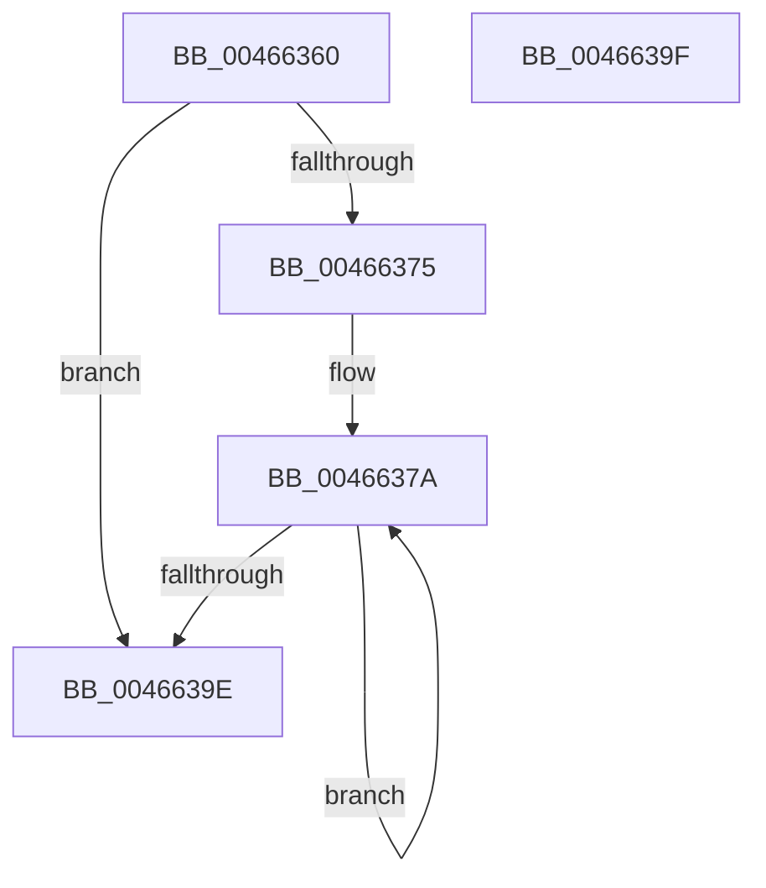

# MiWalkGetResumptionPxe

- RVA: `0x00466360`–`0x004663A0` (길이 `64` bytes)
- VA: `0x0000000140466360`
- 실행 섹션: `.text`
- PDB 이름 있음: `예`; PDB Function 태그: `아니요`
- unwind 정보 RVA: `0x000DB714`
- 디코드: `17`개 명령, `64/64` bytes 표시
- 미해석 바이트: `0` (있으면 어셈블리에 `.byte`로 보존)

> 이 문서는 커널 이미지의 기계어와 PDB 기호를 분석해 생성했습니다. 4번과 5번은 함수 원형과 자료형을 바이너리 사용 방식에서 추정한 C 해석이며 원본 소스 복구 결과는 아닙니다.

## 1. Dependencies

- 직접 호출 지점: **0**; 고유 호출 대상: **0**
- 직접 호출자로 확인된 함수: **1**
- RIP 상대 이미지 참조: **0**

### Outgoing calls
- 직접 디코드된 call 명령이 없습니다.

### Direct callers
- [MiWalkPageTablesRecursively](../27/MiWalkPageTablesRecursively_function_002796C0.md) at `0x00279D98`
- [MiWalkPageTablesRecursively](../27/MiWalkPageTablesRecursively_function_002796C0.md) at `0x0027A1D6`

### Static image references
- 디코드된 RIP-relative 메모리 참조가 없습니다.

## 2. Other-region calls and transfers

- 다른 실행 섹션으로 향하는 call: **0**
- 별도 외부 분기/꼬리 이동을 확인하지 못했습니다.

## 3. Assembly (complete function range)

```asm
00466360  44 8B 41 04                     mov r8d, dword ptr [rcx + 4]
00466364  48 8B 41 48                     mov rax, qword ptr [rcx + 0x48]
00466368  41 C1 E8 02                     shr r8d, 2
0046636C  41 83 E0 07                     and r8d, 7
00466370  41 3B D0                        cmp edx, r8d
00466373  74 29                           je 0x14046639e
00466375  41 2B D0                        sub edx, r8d
00466378  8B CA                           mov ecx, edx
0046637A  48 C1 E8 09                     shr rax, 9
0046637E  48 BA F8 FF FF FF 7F 00 00 00   movabs rdx, 0x7ffffffff8
00466388  48 23 C2                        and rax, rdx
0046638B  48 BA 00 00 00 00 80 F6 FF FF   movabs rdx, 0xfffff68000000000
00466395  48 03 C2                        add rax, rdx
00466398  48 83 E9 01                     sub rcx, 1
0046639C  75 DC                           jne 0x14046637a
0046639E  C3                              ret
0046639F  CC                              int3
```

## 4. C-style interpretation (structured pseudocode)

```c
__int64 __fastcall MiWalkGetResumptionPxe(__int64 a1, int a2)
{
    __int64 result;

    a3 = (unsigned int)(((unsigned int)(*(unsigned int *)(a1 + 4))) >> (2));
    a3 = (unsigned int)((a3) & (7));
    if (a2 == ((unsigned int)(a3))) goto loc_0046639E;
    a2 = (unsigned int)((a2) - ((unsigned int)(a3)));
loc_0046637A:
    result = (*(unsigned __int64 *)(a1 + 72)) >> (9);
    result = (result) & (a2);
    result = (result) + (a2);
    a1 = ((unsigned int)(a2)) - (1);
    if (condition_is_not_equal) goto loc_0046637A;
loc_0046639E:
    return result;
}
```

## 5. (Beta) C Style

```c
int64_t MiWalkGetResumptionPxe(void *Arg1, int32_t Arg2)
{
    uint8_t *arg1 = (uint8_t *)Arg1;

    int64_t result;

    a3 = (uint32_t)(((uint32_t)(*(uint32_t *)(arg1 + 0x4))) >> (2));
    a3 = (uint32_t)((a3) & (7));
    if (Arg2 == ((uint32_t)(a3))) goto loc_0046639E;
    Arg2 = (uint32_t)((Arg2) - ((uint32_t)(a3)));
loc_0046637A:
    result = (*(uint64_t *)(arg1 + 0x48)) >> (9);
    result = (result) & (Arg2);
    result = (result) + (Arg2);
    Arg1 = ((uint32_t)(Arg2)) - (1);
    if (condition_is_not_equal) goto loc_0046637A;
loc_0046639E:
    return result;
}
```

### 관측된 메모리 오프셋

구조체 형식이 확인되지 않은 접근은 인자 기준의 오프셋으로만 기록했습니다.

| 기준 인자 | 오프셋 표현 | 폭 (bit) | 접근 |
|---|---:|---:|---|
| `Arg1` | `+ 0x4` | `32` | `R` |
| `Arg1` | `+ 0x48` | `64` | `R` |

## 6. Execution-region graph

[열기: 2D/3D 그래프와 함수 탐색 컨트롤 패널](../../../control-panel.html?section=text&rva=0x00466360&view=graph)

- 2D 그래프는 위에서 아래로 흐르고, 3D 그래프는 빈 공간을 드래그해 회전합니다. Shift+드래그는 이동, 휠은 확대·축소, 함수 노드 선택은 대상 보고서 이동입니다.

### Static fallback


