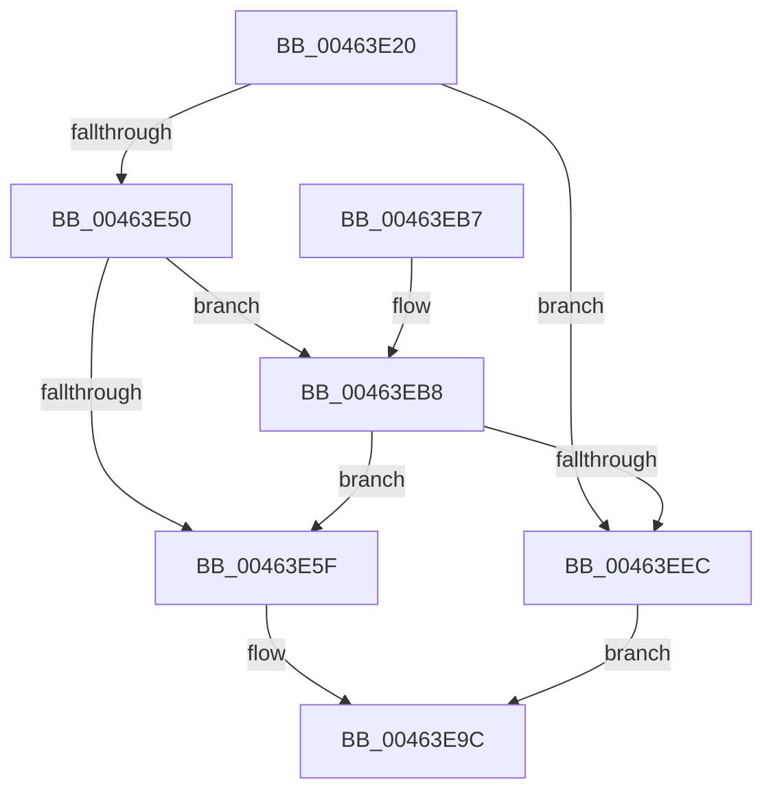

# MmCreateMdl

- RVA: `0x00463E20`–`0x00463EF0` (길이 `208` bytes)
- VA: `0x0000000140463E20`
- 실행 섹션: `.text`
- PDB 이름 있음: `예`; PDB Function 태그: `아니요`
- unwind 정보 RVA: `0x000AA7E8`
- 디코드: `56`개 명령, `208/208` bytes 표시
- 미해석 바이트: `0` (있으면 어셈블리에 `.byte`로 보존)

> 이 문서는 커널 이미지의 기계어와 PDB 기호를 분석해 생성했습니다. 4번과 5번은 함수 원형과 자료형을 바이너리 사용 방식에서 추정한 C 해석이며 원본 소스 복구 결과는 아닙니다.

## 1. Dependencies

- 직접 호출 지점: **1**; 고유 호출 대상: **1**
- 직접 호출자로 확인된 함수: **4**
- RIP 상대 이미지 참조: **0**

### Outgoing calls
- `0x00463EDB` → [MiAllocatePool](../35/MiAllocatePool_function_0035B540.md) (function, `0x0035B540`)

### Direct callers
- [DifMmCreateMdlWrapper](../63/DifMmCreateMdlWrapper_function_00634D30.md) at `0x00634E15`
- [SmKmStoreFileWriteHeader](../../page/7A/SmKmStoreFileWriteHeader_function_007A9DB4.md) at `0x007A9E43`
- [MiPfAllocateMdls](../../page/93/MiPfAllocateMdls_function_0093E45C.md) at `0x0093E6F2`
- [MiLockKernelScpSection](../../init/C6/MiLockKernelScpSection_function_00C666B8.md) at `0x00C666D6`

### Static image references
- 디코드된 RIP-relative 메모리 참조가 없습니다.

## 2. Other-region calls and transfers

- 다른 실행 섹션으로 향하는 call: **0**
- 별도 외부 분기/꼬리 이동을 확인하지 못했습니다.

## 3. Assembly (complete function range)

```asm
00463E20  48 8B C4                        mov rax, rsp
00463E23  48 89 58 08                     mov qword ptr [rax + 8], rbx
00463E27  48 89 68 10                     mov qword ptr [rax + 0x10], rbp
00463E2B  48 89 70 18                     mov qword ptr [rax + 0x18], rsi
00463E2F  48 89 78 20                     mov qword ptr [rax + 0x20], rdi
00463E33  41 56                           push r14
00463E35  48 83 EC 20                     sub rsp, 0x20
00463E39  B8 FF FF FF FF                  mov eax, 0xffffffff
00463E3E  49 8B F0                        mov rsi, r8
00463E41  48 8B DA                        mov rbx, rdx
00463E44  4C 8B C9                        mov r9, rcx
00463E47  4C 3B C0                        cmp r8, rax
00463E4A  0F 87 9C 00 00 00               ja 0x140463eec
00463E50  33 ED                           xor ebp, ebp
00463E52  41 BE FF 0F 00 00               mov r14d, 0xfff
00463E58  8B FB                           mov edi, ebx
00463E5A  48 85 C9                        test rcx, rcx
00463E5D  74 59                           je 0x140463eb8
00463E5F  8B CF                           mov ecx, edi
00463E61  49 89 29                        mov qword ptr [r9], rbp
00463E64  49 23 CE                        and rcx, r14
00463E67  66 41 89 69 0A                  mov word ptr [r9 + 0xa], bp
00463E6C  49 03 CE                        add rcx, r14
00463E6F  41 89 71 28                     mov dword ptr [r9 + 0x28], esi
00463E73  48 03 CE                        add rcx, rsi
00463E76  48 81 E3 00 F0 FF FF            and rbx, 0xfffffffffffff000
00463E7D  48 C1 E9 0C                     shr rcx, 0xc
00463E81  49 8B C1                        mov rax, r9
00463E84  66 83 C1 06                     add cx, 6
00463E88  49 89 59 20                     mov qword ptr [r9 + 0x20], rbx
00463E8C  66 C1 E1 03                     shl cx, 3
00463E90  41 23 FE                        and edi, r14d
00463E93  66 41 89 49 08                  mov word ptr [r9 + 8], cx
00463E98  41 89 79 2C                     mov dword ptr [r9 + 0x2c], edi
00463E9C  48 8B 5C 24 30                  mov rbx, qword ptr [rsp + 0x30]
00463EA1  48 8B 6C 24 38                  mov rbp, qword ptr [rsp + 0x38]
00463EA6  48 8B 74 24 40                  mov rsi, qword ptr [rsp + 0x40]
00463EAB  48 8B 7C 24 48                  mov rdi, qword ptr [rsp + 0x48]
00463EB0  48 83 C4 20                     add rsp, 0x20
00463EB4  41 5E                           pop r14
00463EB6  C3                              ret
00463EB7  CC                              int3
00463EB8  48 8B D7                        mov rdx, rdi
00463EBB  B9 40 00 00 00                  mov ecx, 0x40
00463EC0  49 23 D6                        and rdx, r14
00463EC3  41 B8 4D 6D 64 6C               mov r8d, 0x6c646d4d
00463EC9  49 03 D6                        add rdx, r14
00463ECC  48 03 D6                        add rdx, rsi
00463ECF  48 C1 EA 0C                     shr rdx, 0xc
00463ED3  48 8D 14 D5 30 00 00 00         lea rdx, [rdx*8 + 0x30]
00463EDB  E8 60 76 EF FF                  call 0x14035b540
00463EE0  4C 8B C8                        mov r9, rax
00463EE3  48 85 C0                        test rax, rax
00463EE6  0F 85 73 FF FF FF               jne 0x140463e5f
00463EEC  33 C0                           xor eax, eax
00463EEE  EB AC                           jmp 0x140463e9c
```

## 4. C-style interpretation (structured pseudocode)

```c
__int64 __fastcall MmCreateMdl(__int64 a1, __int64 a2, __int64 a3)
{
    __int64 result;
    __int64 v_rbp;
    __int64 v_rbx;
    __int64 v_rdi;
    __int64 v_rsp;
    unsigned __int64 v_stack_p10;
    unsigned __int64 v_stack_p18;
    unsigned __int64 v_stack_p20;
    unsigned __int64 v_stack_p8;

    *(unsigned __int64 *)(v_rsp + 8) = v_rbx;
    *(unsigned __int64 *)(v_rsp + 16) = v_rbp;
    *(unsigned __int64 *)(v_rsp + 24) = v_rsi;
    *(unsigned __int64 *)(v_rsp + 32) = v_rdi;
    v_rsp = (v_rsp) - (32);
    if (a3 > ((unsigned int)(0xFFFFFFFFULL))) goto loc_00463EEC;
    v_rbp = 0;
    if (a1 == 0) goto loc_00463EB8;
loc_00463E5F:
    *(unsigned __int64 *)(a1) = 0;
    a1 = ((unsigned int)((unsigned int)((unsigned int)((unsigned int)(a2))))) & ((unsigned int)(0xFFFULL));
    *(unsigned __int16 *)(a1 + 10) = 0;
    a1 = (a1) + ((unsigned int)(0xFFFULL));
    *(unsigned int *)(a1 + 40) = (unsigned int)(a3);
    a1 = (a1) + (a3);
    v_rbx = (a2) & (0xFFFFFFFFFFFFF000ULL);
    a1 = (a1) >> (12);
    a1 = (unsigned __int16)((a1) + (6));
    *(unsigned __int64 *)(a1 + 32) = v_rbx;
    a1 = (unsigned __int16)((a1) << (3));
    v_rdi = (unsigned int)(((unsigned int)((unsigned int)(a2))) & ((unsigned int)((unsigned int)(0xFFFULL))));
    *(unsigned __int16 *)(a1 + 8) = (unsigned __int16)(a1);
    *(unsigned int *)(a1 + 44) = (unsigned int)(v_rdi);
loc_00463E9C:
    v_rsp = (v_rsp) + (32);
    return a1;
loc_00463EB8:
    a2 = (v_stack_p20) & ((unsigned int)(0xFFFULL));
    a2 = (a2) + ((unsigned int)(0xFFFULL));
    a2 = (a2) + (v_stack_p18);
    a2 = (a2) >> (12);
    result = MiAllocatePool(64, a2 * 8 + 48, (unsigned int)(0x6C646D4DULL), a1);
    if (result != 0) goto loc_00463E5F;
loc_00463EEC:
    result = 0;
    goto loc_00463E9C;
}
```

## 5. (Beta) C Style

```c
int64_t MmCreateMdl(int64_t Arg1, int64_t Arg2, int64_t Arg3)
{
    int64_t result;
    int64_t local_rbp;
    int64_t local_rbx;
    int64_t local_rdi;
    int64_t local_rsp;
    uint64_t v_stack_p10;
    uint64_t v_stack_p18;
    uint64_t v_stack_p20;
    uint64_t v_stack_p8;

    *(uint64_t *)(local_rsp + 0x8) = local_rbx;
    *(uint64_t *)(local_rsp + 0x10) = local_rbp;
    *(uint64_t *)(local_rsp + 0x18) = local_rsi;
    *(uint64_t *)(local_rsp + 0x20) = local_rdi;
    local_rsp = (local_rsp) - (32);
    if (Arg3 > ((uint32_t)(0xFFFFFFFFULL))) goto loc_00463EEC;
    local_rbp = 0;
    if (Arg1 == 0) goto loc_00463EB8;
loc_00463E5F:
    *(uint64_t *)(Arg1) = 0;
    Arg1 = ((uint32_t)((uint32_t)((uint32_t)((uint32_t)(Arg2))))) & ((uint32_t)(0xFFFULL));
    *(uint16_t *)(Arg1 + 0xA) = 0;
    Arg1 = (Arg1) + ((uint32_t)(0xFFFULL));
    *(uint32_t *)(Arg1 + 0x28) = (uint32_t)(Arg3);
    Arg1 = (Arg1) + (Arg3);
    local_rbx = (Arg2) & (0xFFFFFFFFFFFFF000ULL);
    Arg1 = (Arg1) >> (12);
    Arg1 = (uint16_t)((Arg1) + (6));
    *(uint64_t *)(Arg1 + 0x20) = local_rbx;
    Arg1 = (uint16_t)((Arg1) << (3));
    local_rdi = (uint32_t)(((uint32_t)((uint32_t)(Arg2))) & ((uint32_t)((uint32_t)(0xFFFULL))));
    *(uint16_t *)(Arg1 + 0x8) = (uint16_t)(Arg1);
    *(uint32_t *)(Arg1 + 0x2C) = (uint32_t)(local_rdi);
loc_00463E9C:
    local_rsp = (local_rsp) + (32);
    return Arg1;
loc_00463EB8:
    Arg2 = (v_stack_p20) & ((uint32_t)(0xFFFULL));
    Arg2 = (Arg2) + ((uint32_t)(0xFFFULL));
    Arg2 = (Arg2) + (v_stack_p18);
    Arg2 = (Arg2) >> (12);
    result = MiAllocatePool(64, Arg2 * 8 + 48, (uint32_t)(0x6C646D4DULL), Arg1);
    if (result != 0) goto loc_00463E5F;
loc_00463EEC:
    result = 0;
    goto loc_00463E9C;
}
```

## 6. Execution-region graph

[열기: 2D/3D 그래프와 함수 탐색 컨트롤 패널](../../../control-panel.html?section=text&rva=0x00463E20&view=graph)

- 2D 그래프는 위에서 아래로 흐르고, 3D 그래프는 빈 공간을 드래그해 회전합니다. Shift+드래그는 이동, 휠은 확대·축소, 함수 노드 선택은 대상 보고서 이동입니다.

### Static fallback


