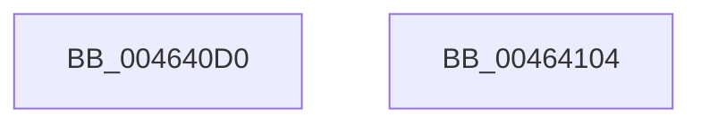

# MmGetNumberOfFreeSystemPtes

- RVA: `0x004640D0`–`0x00464105` (길이 `53` bytes)
- VA: `0x00000001404640D0`
- 실행 섹션: `.text`
- PDB 이름 있음: `예`; PDB Function 태그: `아니요`
- unwind 정보 RVA: `0x0005CF00`
- 디코드: `13`개 명령, `53/53` bytes 표시
- 미해석 바이트: `0` (있으면 어셈블리에 `.byte`로 보존)

> 이 문서는 커널 이미지의 기계어와 PDB 기호를 분석해 생성했습니다. 4번과 5번은 함수 원형과 자료형을 바이너리 사용 방식에서 추정한 C 해석이며 원본 소스 복구 결과는 아닙니다.

## 1. Dependencies

- 직접 호출 지점: **1**; 고유 호출 대상: **1**
- 직접 호출자로 확인된 함수: **2**
- RIP 상대 이미지 참조: **4**

### Outgoing calls
- `0x004640F6` → [MiGetNumberOfCachedPtes](MiGetNumberOfCachedPtes_function_00464288.md) (function, `0x00464288`)

### Direct callers
- [MiIssueNoPtesBugcheck](../4F/MiIssueNoPtesBugcheck_function_004F6B9C.md) at `0x004F6BC0`
- [MiIssueNoPtesBugcheck](../4F/MiIssueNoPtesBugcheck_function_004F6B9C.md) at `0x004F6BE1`
- [ExpQuerySystemPerformanceInformation](../../page/9D/ExpQuerySystemPerformanceInformation_function_009D648C.md) at `0x009D6768`

### Static image references
- `0x004640D6` → RVA `0x00E2EF70` (`.data`; read)
- `0x004640DD` → RVA `0x00E37668` (`.data`; read)
- `0x004640E4` → RVA `0x00E38A48` (`.data`; read)
- `0x004640EF` → RVA `0x00E376C0` (`.data`; read)

## 2. Other-region calls and transfers

- 다른 실행 섹션으로 향하는 call: **0**
- 별도 외부 분기/꼬리 이동을 확인하지 못했습니다.

## 3. Assembly (complete function range)

```asm
004640D0  40 53                           push rbx
004640D2  48 83 EC 20                     sub rsp, 0x20
004640D6  48 8B 1D 93 AE 9C 00            mov rbx, qword ptr [rip + 0x9cae93]
004640DD  48 8D 0D 84 35 9D 00            lea rcx, [rip + 0x9d3584]
004640E4  48 2B 1D 5D 49 9D 00            sub rbx, qword ptr [rip + 0x9d495d]
004640EB  48 C1 E3 09                     shl rbx, 9
004640EF  48 03 1D CA 35 9D 00            add rbx, qword ptr [rip + 0x9d35ca]
004640F6  E8 8D 01 00 00                  call 0x140464288
004640FB  48 03 C3                        add rax, rbx
004640FE  48 83 C4 20                     add rsp, 0x20
00464102  5B                              pop rbx
00464103  C3                              ret
00464104  CC                              int3
```

## 4. C-style interpretation (structured pseudocode)

```c
__int64 __fastcall MmGetNumberOfFreeSystemPtes(void)
{
    __int64 result;
    __int64 v_rbx;
    __int64 v_rsp;

    v_rsp = (v_rsp) - (32);
    v_rbx = (*(unsigned __int64 *)(v_rip + 10268307)) - (*(unsigned __int64 *)(v_rip + 10307933));
    v_rbx = (v_rbx) << (9);
    v_rbx = (v_rbx) + (*(unsigned __int64 *)(v_rip + 10302922));
    result = MiGetNumberOfCachedPtes(v_rip + 10302852, a2, a3, a4);
    result = (result) + (v_rbx);
    v_rsp = (v_rsp) + (32);
    return result;
}
```

## 5. (Beta) C Style

```c
void MmGetNumberOfFreeSystemPtes(void)
{
    int64_t result;
    int64_t local_rbx;
    int64_t local_rsp;

    local_rsp = (local_rsp) - (32);
    local_rbx = (*(uint64_t *)(v_rip + 0x9CAE93)) - (*(uint64_t *)(v_rip + 0x9D495D));
    local_rbx = (local_rbx) << (9);
    local_rbx = (local_rbx) + (*(uint64_t *)(v_rip + 0x9D35CA));
    result = MiGetNumberOfCachedPtes(v_rip + 10302852, a2, a3, a4);
    result = (result) + (local_rbx);
    local_rsp = (local_rsp) + (32);
    return result;
}
```

## 6. Execution-region graph

[열기: 2D/3D 그래프와 함수 탐색 컨트롤 패널](../../../control-panel.html?section=text&rva=0x004640D0&view=graph)

- 2D 그래프는 위에서 아래로 흐르고, 3D 그래프는 빈 공간을 드래그해 회전합니다. Shift+드래그는 이동, 휠은 확대·축소, 함수 노드 선택은 대상 보고서 이동입니다.

### Static fallback


