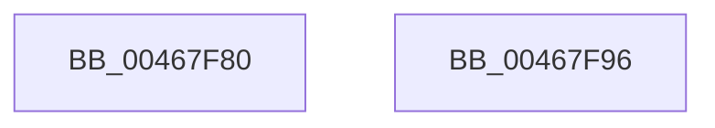

# MmGetNumberOfPhysicalPages

- RVA: `0x00467F80`–`0x00467F97` (길이 `23` bytes)
- VA: `0x0000000140467F80`
- 실행 섹션: `.text`
- PDB 이름 있음: `예`; PDB Function 태그: `아니요`
- unwind 정보 RVA: `0x000DB714`
- 디코드: `6`개 명령, `23/23` bytes 표시
- 미해석 바이트: `0` (있으면 어셈블리에 `.byte`로 보존)

> 이 문서는 커널 이미지의 기계어와 PDB 기호를 분석해 생성했습니다. 4번과 5번은 함수 원형과 자료형을 바이너리 사용 방식에서 추정한 C 해석이며 원본 소스 복구 결과는 아닙니다.

## 1. Dependencies

- 직접 호출 지점: **0**; 고유 호출 대상: **0**
- 직접 호출자로 확인된 함수: **10**
- RIP 상대 이미지 참조: **1**

### Outgoing calls
- 직접 디코드된 call 명령이 없습니다.

### Direct callers
- [PopCalculateHiberFileSize](../../page/75/PopCalculateHiberFileSize_function_0075CC98.md) at `0x0075CCC0`
- [PopEnlargeHiberFile](../../page/75/PopEnlargeHiberFile_function_0075D564.md) at `0x0075D58D`
- [SmpSystemStoreCreate](../../page/7A/SmpSystemStoreCreate_function_007A8024.md) at `0x007A809C`
- [ExpQuerySystemInformation](../../page/A5/ExpQuerySystemInformation_function_00A57858.md) at `0x00A5A996`
- [ExpQuerySystemInformation](../../page/A5/ExpQuerySystemInformation_function_00A57858.md) at `0x00A5ABA1`
- [CmpCanGrowHive](../../page/A6/CmpCanGrowHive_function_00A60C38.md) at `0x00A60C61`
- [CmpCanGrowHive](../../page/A6/CmpCanGrowHive_function_00A60C38.md) at `0x00A60C74`
- [EtwpInitLoggerContext](../../page/A7/EtwpInitLoggerContext_function_00A7154C.md) at `0x00A7167A`
- [EtwpGetSystemMaximumBufferCount](../../page/A7/EtwpGetSystemMaximumBufferCount_function_00A74890.md) at `0x00A748A4`
- [PopRequestWrite](../../pagelk/B6/PopRequestWrite_function_00B6EB14.md) at `0x00B6EFCD`
- [PopWriteHiberPages](../../pagelk/B6/PopWriteHiberPages_function_00B6FF78.md) at `0x00B70038`
- [ViPtInitCircularPoolTrace](../../pagevrfy/B9/ViPtInitCircularPoolTrace_function_00B9C964.md) at `0x00B9C96E`

### Static image references
- `0x00467F80` → RVA `0x00E30088` (`.data`; read)

## 2. Other-region calls and transfers

- 다른 실행 섹션으로 향하는 call: **0**
- 별도 외부 분기/꼬리 이동을 확인하지 못했습니다.

## 3. Assembly (complete function range)

```asm
00467F80  48 8B 05 01 81 9C 00            mov rax, qword ptr [rip + 0x9c8101]
00467F87  0F B7 D1                        movzx edx, cx
00467F8A  48 8B 04 D0                     mov rax, qword ptr [rax + rdx*8]
00467F8E  48 8B 80 50 48 00 00            mov rax, qword ptr [rax + 0x4850]
00467F95  C3                              ret
00467F96  CC                              int3
```

## 4. C-style interpretation (structured pseudocode)

```c
__int64 __fastcall MmGetNumberOfPhysicalPages(unsigned __int16 a1)
{
    return *(unsigned __int64 *)(*(unsigned __int64 *)(*(unsigned __int64 *)(v_rip + 10256641) + a1 * 8) + 18512);
}
```

## 5. (Beta) C Style

```c
int64_t MmGetNumberOfPhysicalPages(uint16_t Arg1)
{
    return *(uint64_t *)(*(uint64_t *)(*(uint64_t *)(v_rip + 0x9C8101) + Arg1 * 8) + 0x4850);
}
```

## 6. Execution-region graph

[열기: 2D/3D 그래프와 함수 탐색 컨트롤 패널](../../../control-panel.html?section=text&rva=0x00467F80&view=graph)

- 2D 그래프는 위에서 아래로 흐르고, 3D 그래프는 빈 공간을 드래그해 회전합니다. Shift+드래그는 이동, 휠은 확대·축소, 함수 노드 선택은 대상 보고서 이동입니다.

### Static fallback


