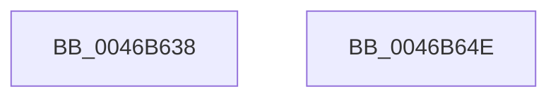

# MmGetTotalCommittedPages

- RVA: `0x0046B638`–`0x0046B64F` (길이 `23` bytes)
- VA: `0x000000014046B638`
- 실행 섹션: `.text`
- PDB 이름 있음: `예`; PDB Function 태그: `아니요`
- unwind 정보 RVA: `0x000DB714`
- 디코드: `6`개 명령, `23/23` bytes 표시
- 미해석 바이트: `0` (있으면 어셈블리에 `.byte`로 보존)

> 이 문서는 커널 이미지의 기계어와 PDB 기호를 분석해 생성했습니다. 4번과 5번은 함수 원형과 자료형을 바이너리 사용 방식에서 추정한 C 해석이며 원본 소스 복구 결과는 아닙니다.

## 1. Dependencies

- 직접 호출 지점: **0**; 고유 호출 대상: **0**
- 직접 호출자로 확인된 함수: **2**
- RIP 상대 이미지 참조: **1**

### Outgoing calls
- 직접 디코드된 call 명령이 없습니다.

### Direct callers
- [ExpQuerySystemPerformanceInformation](../../page/9D/ExpQuerySystemPerformanceInformation_function_009D648C.md) at `0x009D6600`
- [ExpQuerySystemInformation](../../page/A5/ExpQuerySystemInformation_function_00A57858.md) at `0x00A599D2`
- [ExpQuerySystemInformation](../../page/A5/ExpQuerySystemInformation_function_00A57858.md) at `0x00A5A9CC`

### Static image references
- `0x0046B638` → RVA `0x00E30088` (`.data`; read)

## 2. Other-region calls and transfers

- 다른 실행 섹션으로 향하는 call: **0**
- 별도 외부 분기/꼬리 이동을 확인하지 못했습니다.

## 3. Assembly (complete function range)

```asm
0046B638  48 8B 05 49 4A 9C 00            mov rax, qword ptr [rip + 0x9c4a49]
0046B63F  0F B7 D1                        movzx edx, cx
0046B642  48 8B 04 D0                     mov rax, qword ptr [rax + rdx*8]
0046B646  48 8B 80 80 4B 00 00            mov rax, qword ptr [rax + 0x4b80]
0046B64D  C3                              ret
0046B64E  CC                              int3
```

## 4. C-style interpretation (structured pseudocode)

```c
__int64 __fastcall MmGetTotalCommittedPages(unsigned __int16 a1)
{
    return *(unsigned __int64 *)(*(unsigned __int64 *)(*(unsigned __int64 *)(v_rip + 10242633) + a1 * 8) + 19328);
}
```

## 5. (Beta) C Style

```c
int64_t MmGetTotalCommittedPages(uint16_t Arg1)
{
    return *(uint64_t *)(*(uint64_t *)(*(uint64_t *)(v_rip + 0x9C4A49) + Arg1 * 8) + 0x4B80);
}
```

## 6. Execution-region graph

[열기: 2D/3D 그래프와 함수 탐색 컨트롤 패널](../../../control-panel.html?section=text&rva=0x0046B638&view=graph)

- 2D 그래프는 위에서 아래로 흐르고, 3D 그래프는 빈 공간을 드래그해 회전합니다. Shift+드래그는 이동, 휠은 확대·축소, 함수 노드 선택은 대상 보고서 이동입니다.

### Static fallback


