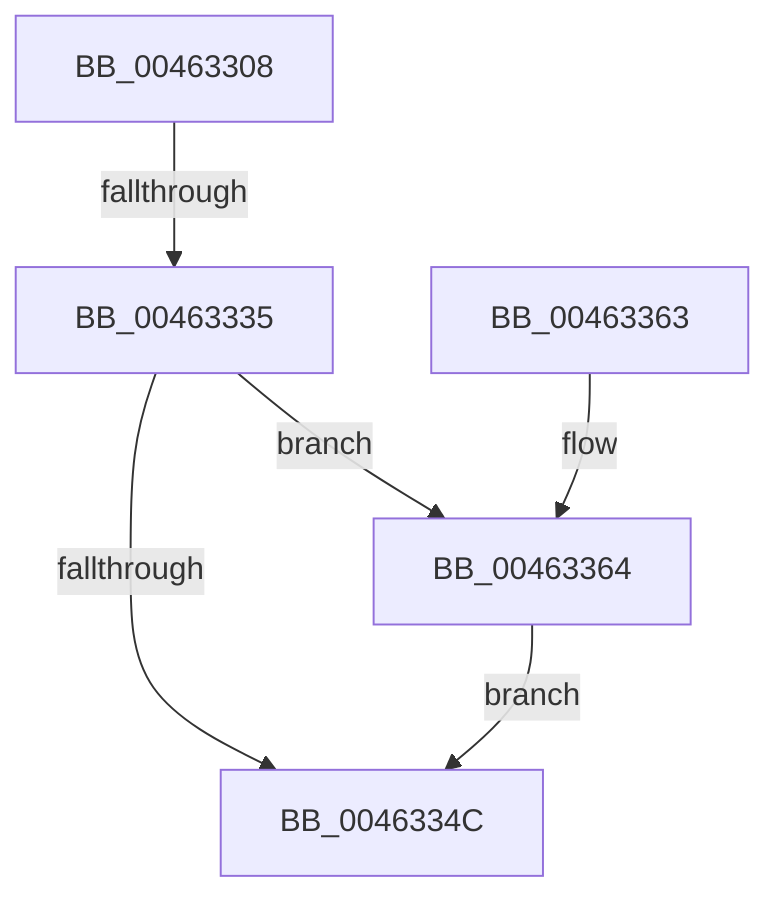

# MmInSwapProcess

- RVA: `0x00463308`–`0x0046336E` (길이 `102` bytes)
- VA: `0x0000000140463308`
- 실행 섹션: `.text`
- PDB 이름 있음: `예`; PDB Function 태그: `예`
- unwind 정보 RVA: `0x000AA65C`
- 디코드: `32`개 명령, `102/102` bytes 표시
- 미해석 바이트: `0` (있으면 어셈블리에 `.byte`로 보존)

> 이 문서는 커널 이미지의 기계어와 PDB 기호를 분석해 생성했습니다. 4번과 5번은 함수 원형과 자료형을 바이너리 사용 방식에서 추정한 C 해석이며 원본 소스 복구 결과는 아닙니다.

## 1. Dependencies

- 직접 호출 지점: **1**; 고유 호출 대상: **1**
- 직접 호출자로 확인된 함수: **1**
- RIP 상대 이미지 참조: **0**

### Outgoing calls
- `0x00463367` → [MiReAcquireOutSwappedProcessCommit](../66/MiReAcquireOutSwappedProcessCommit_function_0066F598.md) (function, `0x0066F598`)

### Direct callers
- [KiInSwapProcesses](KiInSwapProcesses_function_00463218.md) at `0x00463246`

### Static image references
- 디코드된 RIP-relative 메모리 참조가 없습니다.

## 2. Other-region calls and transfers

- 다른 실행 섹션으로 향하는 call: **0**
- call이 아닌 외부 분기/꼬리 이동: **1**
  - `0x0046332F` → [sub_006F28BE](../6F/Unknown_function_006F28BE.md) (`tail-transfer`)

## 3. Assembly (complete function range)

```asm
00463308  48 89 5C 24 10                  mov qword ptr [rsp + 0x10], rbx
0046330D  48 89 6C 24 18                  mov qword ptr [rsp + 0x18], rbp
00463312  56                              push rsi
00463313  57                              push rdi
00463314  41 55                           push r13
00463316  41 56                           push r14
00463318  41 57                           push r15
0046331A  48 83 EC 20                     sub rsp, 0x20
0046331E  8B 81 B8 04 00 00               mov eax, dword ptr [rcx + 0x4b8]
00463324  48 8B D9                        mov rbx, rcx
00463327  8B 81 F4 01 00 00               mov eax, dword ptr [rcx + 0x1f4]
0046332D  84 C0                           test al, al
0046332F  0F 88 89 F5 28 00               js 0x1406f28be
00463335  F0 83 A3 F4 01 00 00 BF         lock and dword ptr [rbx + 0x1f4], 0xffffffbf
0046333D  8B 83 B8 04 00 00               mov eax, dword ptr [rbx + 0x4b8]
00463343  C1 E8 18                        shr eax, 0x18
00463346  24 30                           and al, 0x30
00463348  3C 20                           cmp al, 0x20
0046334A  74 18                           je 0x140463364
0046334C  48 8B 5C 24 58                  mov rbx, qword ptr [rsp + 0x58]
00463351  48 8B 6C 24 60                  mov rbp, qword ptr [rsp + 0x60]
00463356  48 83 C4 20                     add rsp, 0x20
0046335A  41 5F                           pop r15
0046335C  41 5E                           pop r14
0046335E  41 5D                           pop r13
00463360  5F                              pop rdi
00463361  5E                              pop rsi
00463362  C3                              ret
00463363  CC                              int3
00463364  48 8B CB                        mov rcx, rbx
00463367  E8 2C C2 20 00                  call 0x14066f598
0046336C  EB DE                           jmp 0x14046334c
```

## 4. C-style interpretation (structured pseudocode)

```c
__int64 __fastcall MmInSwapProcess(__int64 a1)
{
    __int64 result;
    __int64 v_rsp;
    unsigned __int64 v_stack_p10;
    unsigned __int64 v_stack_p18;

    v_stack_p10 = v_rbx;
    v_stack_p18 = v_rbp;
    v_rsp = (v_rsp) - (32);
    result = (unsigned int)(((unsigned int)(*(unsigned int *)(a1 + 1208))) >> (24));
    result = (unsigned __int8)((result) & (48));
    if (((unsigned __int8)(result)) == 32) goto loc_00463364;
loc_0046334C:
    v_rsp = (v_rsp) + (32);
    return result;
loc_00463364:
    result = MiReAcquireOutSwappedProcessCommit(v_stack_p10, a2, a3, a4);
    goto loc_0046334C;
}
```

## 5. (Beta) C Style

```c
int64_t MmInSwapProcess(void *Arg1)
{
    uint8_t *arg1 = (uint8_t *)Arg1;

    int64_t result;
    int64_t local_rsp;
    uint64_t v_stack_p10;
    uint64_t v_stack_p18;

    v_stack_p10 = local_rbx;
    v_stack_p18 = local_rbp;
    local_rsp = (local_rsp) - (32);
    result = (uint32_t)(((uint32_t)(*(uint32_t *)(arg1 + 0x4B8))) >> (24));
    result = (uint8_t)((result) & (48));
    if (((uint8_t)(result)) == 32) goto loc_00463364;
loc_0046334C:
    local_rsp = (local_rsp) + (32);
    return result;
loc_00463364:
    result = MiReAcquireOutSwappedProcessCommit(v_stack_p10, a2, a3, a4);
    goto loc_0046334C;
}
```

### 관측된 메모리 오프셋

구조체 형식이 확인되지 않은 접근은 인자 기준의 오프셋으로만 기록했습니다.

| 기준 인자 | 오프셋 표현 | 폭 (bit) | 접근 |
|---|---:|---:|---|
| `Arg1` | `+ 0x1F4` | `32` | `R` |
| `Arg1` | `+ 0x1F4` | `32` | `R/W` |
| `Arg1` | `+ 0x4B8` | `32` | `R` |

## 6. Execution-region graph

[열기: 2D/3D 그래프와 함수 탐색 컨트롤 패널](../../../control-panel.html?section=text&rva=0x00463308&view=graph)

- 2D 그래프는 위에서 아래로 흐르고, 3D 그래프는 빈 공간을 드래그해 회전합니다. Shift+드래그는 이동, 휠은 확대·축소, 함수 노드 선택은 대상 보고서 이동입니다.

### Static fallback


