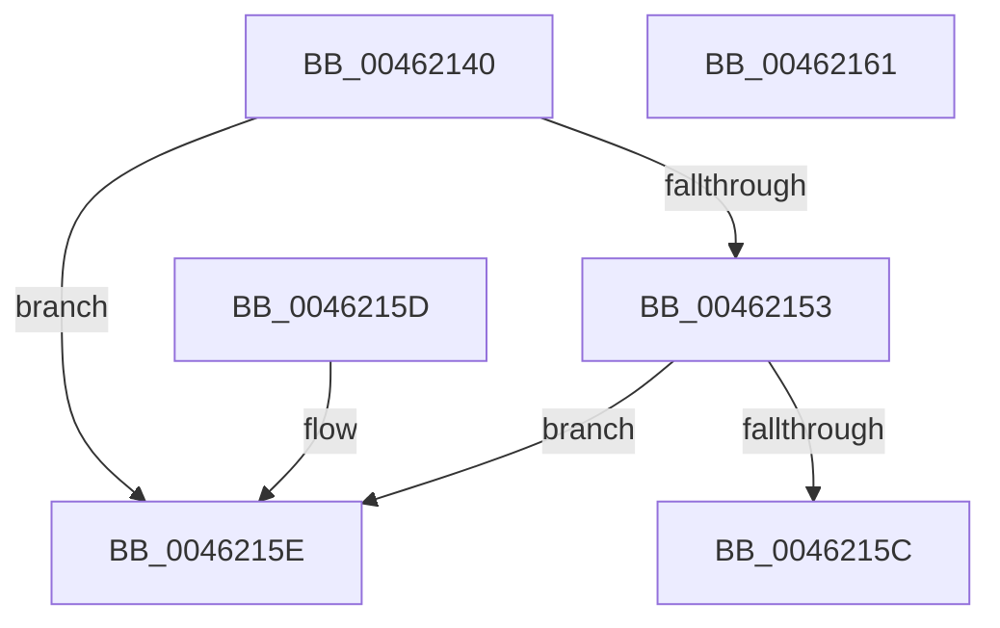

# MmIsRecursiveIoFault

- RVA: `0x00462140`–`0x00462162` (길이 `34` bytes)
- VA: `0x0000000140462140`
- 실행 섹션: `.text`
- PDB 이름 있음: `예`; PDB Function 태그: `아니요`
- unwind 정보 RVA: `0x000DB714`
- 디코드: `11`개 명령, `34/34` bytes 표시
- 미해석 바이트: `0` (있으면 어셈블리에 `.byte`로 보존)

> 이 문서는 커널 이미지의 기계어와 PDB 기호를 분석해 생성했습니다. 4번과 5번은 함수 원형과 자료형을 바이너리 사용 방식에서 추정한 C 해석이며 원본 소스 복구 결과는 아닙니다.

## 1. Dependencies

- 직접 호출 지점: **0**; 고유 호출 대상: **0**
- 직접 호출자로 확인된 함수: **0**
- RIP 상대 이미지 참조: **0**

### Outgoing calls
- 직접 디코드된 call 명령이 없습니다.

### Direct callers
- 이 함수 시작 RVA로 연결되는 직접 call은 확인되지 않았습니다. 간접 호출은 완전히 역산할 수 없습니다.

### Static image references
- 디코드된 RIP-relative 메모리 참조가 없습니다.

## 2. Other-region calls and transfers

- 다른 실행 섹션으로 향하는 call: **0**
- 별도 외부 분기/꼬리 이동을 확인하지 못했습니다.

## 3. Assembly (complete function range)

```asm
00462140  65 48 8B 0C 25 88 01 00 00      mov rcx, qword ptr gs:[0x188]
00462149  33 C0                           xor eax, eax
0046214B  38 81 AD 05 00 00               cmp byte ptr [rcx + 0x5ad], al
00462151  75 0B                           jne 0x14046215e
00462153  80 B9 AC 05 00 00 01            cmp byte ptr [rcx + 0x5ac], 1
0046215A  74 02                           je 0x14046215e
0046215C  C3                              ret
0046215D  CC                              int3
0046215E  B0 01                           mov al, 1
00462160  C3                              ret
00462161  CC                              int3
```

## 4. C-style interpretation (structured pseudocode)

```c
__int64 __fastcall MmIsRecursiveIoFault(void)
{
    __int64 result;

    result = 0;
    if ((*(unsigned __int8 *)(*(unsigned __int64 *)(gs_base + (0 + 392)) + 1453)) != 0) goto loc_0046215E;
    if ((*(unsigned __int8 *)(*(unsigned __int64 *)(gs_base + (0 + 392)) + 1452)) == 1) goto loc_0046215E;
    return result;
loc_0046215E:
    return 1;
}
```

## 5. (Beta) C Style

```c
void MmIsRecursiveIoFault(void)
{
    int64_t result;

    result = 0;
    if ((*(uint8_t *)(*(uint64_t *)(gs_base + (0 + 0x188)) + 0x5AD)) != 0) goto loc_0046215E;
    if ((*(uint8_t *)(*(uint64_t *)(gs_base + (0 + 0x188)) + 0x5AC)) == 1) goto loc_0046215E;
    return result;
loc_0046215E:
    return 1;
}
```

## 6. Execution-region graph

[열기: 2D/3D 그래프와 함수 탐색 컨트롤 패널](../../../control-panel.html?section=text&rva=0x00462140&view=graph)

- 2D 그래프는 위에서 아래로 흐르고, 3D 그래프는 빈 공간을 드래그해 회전합니다. Shift+드래그는 이동, 휠은 확대·축소, 함수 노드 선택은 대상 보고서 이동입니다.

### Static fallback


