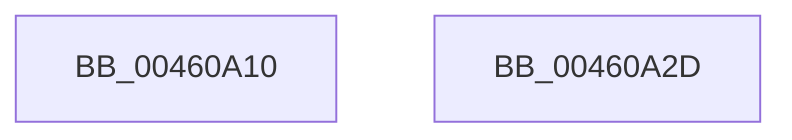

# MmSizeOfMdl

- RVA: `0x00460A10`–`0x00460A2E` (길이 `30` bytes)
- VA: `0x0000000140460A10`
- 실행 섹션: `.text`
- PDB 이름 있음: `예`; PDB Function 태그: `아니요`
- unwind 정보 RVA: `0x000DB714`
- 디코드: `7`개 명령, `30/30` bytes 표시
- 미해석 바이트: `0` (있으면 어셈블리에 `.byte`로 보존)

> 이 문서는 커널 이미지의 기계어와 PDB 기호를 분석해 생성했습니다. 4번과 5번은 함수 원형과 자료형을 바이너리 사용 방식에서 추정한 C 해석이며 원본 소스 복구 결과는 아닙니다.

## 1. Dependencies

- 직접 호출 지점: **0**; 고유 호출 대상: **0**
- 직접 호출자로 확인된 함수: **12**
- RIP 상대 이미지 참조: **0**

### Outgoing calls
- 직접 디코드된 call 명령이 없습니다.

### Direct callers
- [VslObtainHotPatchUndoTable](../../page/71/VslObtainHotPatchUndoTable_function_00718F50.md) at `0x00718FB1`
- [SmProcessStatsRequest](../../page/7A/SmProcessStatsRequest_function_007A6E68.md) at `0x007A6FD3`
- [ExInitializeLeapSecondData](../../page/7C/ExInitializeLeapSecondData_function_007C562C.md) at `0x007C5703`
- [NtStartProfile](../../page/7D/NtStartProfile_function_007D22C0.md) at `0x007D236A`
- [ExLockUserBuffer](../../page/95/ExLockUserBuffer_function_009533B8.md) at `0x009533F5`
- [MiRotateToFrameBuffer](../../page/A3/MiRotateToFrameBuffer_function_00A38214.md) at `0x00A3831B`
- [VslValidateDynamicCodePages](../../page/A5/VslValidateDynamicCodePages_function_00A5687C.md) at `0x00A568F3`
- [VslCreateSecureSection](../../page/A7/VslCreateSecureSection_function_00A722A0.md) at `0x00A7230D`
- [MiReplaceRotateWithDemandZero](../../page/A7/MiReplaceRotateWithDemandZero_function_00A7C010.md) at `0x00A7C0A4`
- [MiReplaceRotateWithDemandZero](../../page/A7/MiReplaceRotateWithDemandZero_function_00A7C010.md) at `0x00A7C0D2`
- [PspCreateSecureThread](../../page/A8/PspCreateSecureThread_function_00A89160.md) at `0x00A891B6`
- [MiLoadDataIntoVsmEnclave](../../page/AC/MiLoadDataIntoVsmEnclave_function_00ACD114.md) at `0x00ACD326`
- [MiQueryMemoryPhysicalContiguity](../../page/AD/MiQueryMemoryPhysicalContiguity_function_00AD5B98.md) at `0x00AD5DCB`

### Static image references
- 디코드된 RIP-relative 메모리 참조가 없습니다.

## 2. Other-region calls and transfers

- 다른 실행 섹션으로 향하는 call: **0**
- 별도 외부 분기/꼬리 이동을 확인하지 못했습니다.

## 3. Assembly (complete function range)

```asm
00460A10  81 E1 FF 0F 00 00               and ecx, 0xfff
00460A16  48 8D 82 FF 0F 00 00            lea rax, [rdx + 0xfff]
00460A1D  48 03 C1                        add rax, rcx
00460A20  48 C1 E8 0C                     shr rax, 0xc
00460A24  48 8D 04 C5 30 00 00 00         lea rax, [rax*8 + 0x30]
00460A2C  C3                              ret
00460A2D  CC                              int3
```

## 4. C-style interpretation (structured pseudocode)

```c
__int64 __fastcall MmSizeOfMdl(int a1, __int64 a2)
{
    __int64 result;

    a1 = (unsigned int)((a1) & (0xFFFULL));
    result = (a2 + 4095) + (a1);
    result = (result) >> (12);
    return result * 8 + 48;
}
```

## 5. (Beta) C Style

```c
int64_t MmSizeOfMdl(int32_t Arg1, void *Arg2)
{
    uint8_t *arg2 = (uint8_t *)Arg2;

    int64_t result;

    Arg1 = (uint32_t)((Arg1) & (0xFFFULL));
    result = (Arg2 + 4095) + (Arg1);
    result = (result) >> (12);
    return result * 8 + 48;
}
```

### 관측된 메모리 오프셋

구조체 형식이 확인되지 않은 접근은 인자 기준의 오프셋으로만 기록했습니다.

| 기준 인자 | 오프셋 표현 | 폭 (bit) | 접근 |
|---|---:|---:|---|
| `Arg2` | `+ 0xFFF` | `64` | `R` |

## 6. Execution-region graph

[열기: 2D/3D 그래프와 함수 탐색 컨트롤 패널](../../../control-panel.html?section=text&rva=0x00460A10&view=graph)

- 2D 그래프는 위에서 아래로 흐르고, 3D 그래프는 빈 공간을 드래그해 회전합니다. Shift+드래그는 이동, 휠은 확대·축소, 함수 노드 선택은 대상 보고서 이동입니다.

### Static fallback


