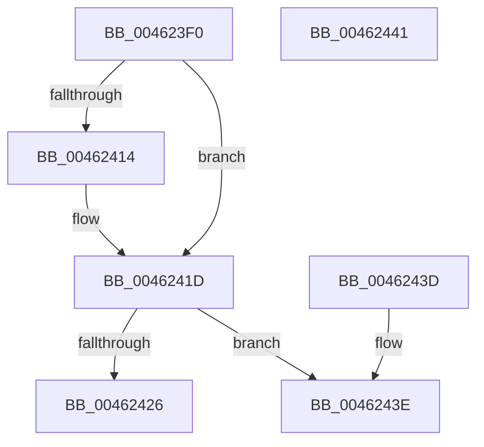

# NtQueryDebugFilterState

- RVA: `0x004623F0`–`0x00462442` (길이 `82` bytes)
- VA: `0x00000001404623F0`
- 실행 섹션: `.text`
- PDB 이름 있음: `예`; PDB Function 태그: `아니요`
- unwind 정보 RVA: `0x000DB714`
- 디코드: `24`개 명령, `82/82` bytes 표시
- 미해석 바이트: `0` (있으면 어셈블리에 `.byte`로 보존)

> 이 문서는 커널 이미지의 기계어와 PDB 기호를 분석해 생성했습니다. 4번과 5번은 함수 원형과 자료형을 바이너리 사용 방식에서 추정한 C 해석이며 원본 소스 복구 결과는 아닙니다.

## 1. Dependencies

- 직접 호출 지점: **0**; 고유 호출 대상: **0**
- 직접 호출자로 확인된 함수: **1**
- RIP 상대 이미지 참조: **2**

### Outgoing calls
- 직접 디코드된 call 명령이 없습니다.

### Direct callers
- [DbgQueryDebugFilterState](../5E/DbgQueryDebugFilterState_function_005E58D0.md) at `0x005E58D4`

### Static image references
- `0x0046241D` → RVA `0x00E0AA50` (`.data`; reference)
- `0x00462426` → RVA `0x0000AC70` (`.rdata`; read)

## 2. Other-region calls and transfers

- 다른 실행 섹션으로 향하는 call: **0**
- 별도 외부 분기/꼬리 이동을 확인하지 못했습니다.

## 3. Assembly (complete function range)

```asm
004623F0  B8 9C 00 00 00                  mov eax, 0x9c
004623F5  41 B8 03 00 00 00               mov r8d, 3
004623FB  3B C8                           cmp ecx, eax
004623FD  44 0F 42 C2                     cmovb r8d, edx
00462401  BA 01 00 00 00                  mov edx, 1
00462406  44 8D 48 C9                     lea r9d, [rax - 0x37]
0046240A  44 0F 42 C9                     cmovb r9d, ecx
0046240E  41 83 F8 1F                     cmp r8d, 0x1f
00462412  77 09                           ja 0x14046241d
00462414  41 8B C8                        mov ecx, r8d
00462417  44 8B C2                        mov r8d, edx
0046241A  41 D3 E0                        shl r8d, cl
0046241D  44 85 05 2C 86 9A 00            test dword ptr [rip + 0x9a862c], r8d
00462424  75 18                           jne 0x14046243e
00462426  48 8D 0D 43 88 BA FF            lea rcx, [rip - 0x4577bd]
0046242D  4A 8B 04 C9                     mov rax, qword ptr [rcx + r9*8]
00462431  44 85 00                        test dword ptr [rax], r8d
00462434  B8 00 00 00 00                  mov eax, 0
00462439  0F 95 C0                        setne al
0046243C  C3                              ret
0046243D  CC                              int3
0046243E  8B C2                           mov eax, edx
00462440  C3                              ret
00462441  CC                              int3
```

## 4. C-style interpretation (structured pseudocode)

```c
__int64 __fastcall NtQueryDebugFilterState(int a1, int a2)
{
    __int64 result;

    a3 = 3;
    if (a1 < 156) { a3 = a2; }
    a4 = 156 - 55;
    if (a1 < 156) { a4 = a1; }
    if (((unsigned int)(a3)) <= 31) {
        a1 = (unsigned int)(a3);
        a3 = 1;
        a3 = (unsigned int)((a3) << ((unsigned __int8)(a1)));
    }
    if (((*(unsigned int *)(v_rip + 10126892)) & ((unsigned int)(a3))) != 0) goto loc_0046243E;
    result = (((*(unsigned int *)(*(unsigned __int64 *)(v_rip - 4552637 + a4 * 8))) & ((unsigned int)(a3))) != 0) ? 1 : 0;
    return result;
loc_0046243E:
    return 1;
}
```

## 5. (Beta) C Style

```c
int64_t NtQueryDebugFilterState(int32_t Arg1, int32_t Arg2)
{
    int64_t result;

    a3 = 3;
    if (Arg1 < 156) { a3 = Arg2; }
    a4 = 156 - 55;
    if (Arg1 < 156) { a4 = Arg1; }
    if (((uint32_t)(a3)) <= 31) {
        Arg1 = (uint32_t)(a3);
        a3 = 1;
        a3 = (uint32_t)((a3) << ((uint8_t)(Arg1)));
    }
    if (((*(uint32_t *)(v_rip + 0x9A862C)) & ((uint32_t)(a3))) != 0) goto loc_0046243E;
    result = (((*(uint32_t *)(*(uint64_t *)(v_rip - 0x4577BD + a4 * 8))) & ((uint32_t)(a3))) != 0) ? 1 : 0;
    return result;
loc_0046243E:
    return 1;
}
```

## 6. Execution-region graph

[열기: 2D/3D 그래프와 함수 탐색 컨트롤 패널](../../../control-panel.html?section=text&rva=0x004623F0&view=graph)

- 2D 그래프는 위에서 아래로 흐르고, 3D 그래프는 빈 공간을 드래그해 회전합니다. Shift+드래그는 이동, 휠은 확대·축소, 함수 노드 선택은 대상 보고서 이동입니다.

### Static fallback


