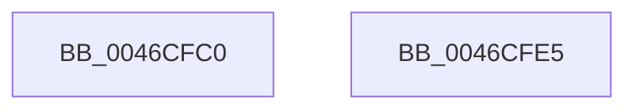

# PfpPartitionCanDoNameLoggingCallback

- RVA: `0x0046CFC0`–`0x0046CFE6` (길이 `38` bytes)
- VA: `0x000000014046CFC0`
- 실행 섹션: `.text`
- PDB 이름 있음: `예`; PDB Function 태그: `아니요`
- unwind 정보 RVA: `0x000DB714`
- 디코드: `12`개 명령, `38/38` bytes 표시
- 미해석 바이트: `0` (있으면 어셈블리에 `.byte`로 보존)

> 이 문서는 커널 이미지의 기계어와 PDB 기호를 분석해 생성했습니다. 4번과 5번은 함수 원형과 자료형을 바이너리 사용 방식에서 추정한 C 해석이며 원본 소스 복구 결과는 아닙니다.

## 1. Dependencies

- 직접 호출 지점: **0**; 고유 호출 대상: **0**
- 직접 호출자로 확인된 함수: **1**
- RIP 상대 이미지 참조: **0**

### Outgoing calls
- 직접 디코드된 call 명령이 없습니다.

### Direct callers
- [sub_003427F1](../34/Unknown_function_003427F1.md) at `0x003427F9`

### Static image references
- 디코드된 RIP-relative 메모리 참조가 없습니다.

## 2. Other-region calls and transfers

- 다른 실행 섹션으로 향하는 call: **0**
- 별도 외부 분기/꼬리 이동을 확인하지 못했습니다.

## 3. Assembly (complete function range)

```asm
0046CFC0  44 8B 89 60 02 00 00            mov r9d, dword ptr [rcx + 0x260]
0046CFC7  44 8B 81 64 02 00 00            mov r8d, dword ptr [rcx + 0x264]
0046CFCE  45 3B C8                        cmp r9d, r8d
0046CFD1  1B C0                           sbb eax, eax
0046CFD3  33 C9                           xor ecx, ecx
0046CFD5  F7 D0                           not eax
0046CFD7  25 89 01 00 C0                  and eax, 0xc0000189
0046CFDC  45 3B C8                        cmp r9d, r8d
0046CFDF  0F 92 C1                        setb cl
0046CFE2  89 0A                           mov dword ptr [rdx], ecx
0046CFE4  C3                              ret
0046CFE5  CC                              int3
```

## 4. C-style interpretation (structured pseudocode)

```c
__int64 __fastcall PfpPartitionCanDoNameLoggingCallback(__int64 a1, __int64 a2)
{
    __int64 result;

    a1 = 0;
    result = (unsigned int)(~(result));
    result = (unsigned int)((result) & (0xC0000189ULL));
    a1 = (((unsigned int)((unsigned int)(*(unsigned int *)(a1 + 608)))) < ((unsigned int)((unsigned int)(*(unsigned int *)(a1 + 612))))) ? 1 : 0;
    *(unsigned int *)(a2) = (unsigned int)(a1);
    return result;
}
```

## 5. (Beta) C Style

```c
int64_t PfpPartitionCanDoNameLoggingCallback(void *Arg1, void *Arg2)
{
    uint8_t *arg1 = (uint8_t *)Arg1;
    uint8_t *arg2 = (uint8_t *)Arg2;

    int64_t result;

    Arg1 = 0;
    result = (uint32_t)(~(result));
    result = (uint32_t)((result) & (0xC0000189ULL));
    Arg1 = (((uint32_t)((uint32_t)(*(uint32_t *)(arg1 + 0x260)))) < ((uint32_t)((uint32_t)(*(uint32_t *)(arg1 + 0x264))))) ? 1 : 0;
    *(uint32_t *)(arg2) = (uint32_t)(Arg1);
    return result;
}
```

### 관측된 메모리 오프셋

구조체 형식이 확인되지 않은 접근은 인자 기준의 오프셋으로만 기록했습니다.

| 기준 인자 | 오프셋 표현 | 폭 (bit) | 접근 |
|---|---:|---:|---|
| `Arg1` | `+ 0x260` | `32` | `R` |
| `Arg1` | `+ 0x264` | `32` | `R` |
| `Arg2` | `+ 0x0` | `32` | `W` |

## 6. Execution-region graph

[열기: 2D/3D 그래프와 함수 탐색 컨트롤 패널](../../../control-panel.html?section=text&rva=0x0046CFC0&view=graph)

- 2D 그래프는 위에서 아래로 흐르고, 3D 그래프는 빈 공간을 드래그해 회전합니다. Shift+드래그는 이동, 휠은 확대·축소, 함수 노드 선택은 대상 보고서 이동입니다.

### Static fallback


