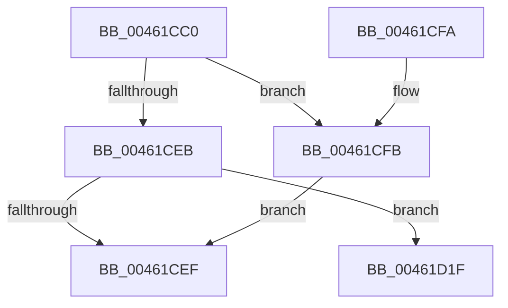

# PoFxCompleteIdleCondition

- RVA: `0x00461CC0`–`0x00461D36` (길이 `118` bytes)
- VA: `0x0000000140461CC0`
- 실행 섹션: `.text`
- PDB 이름 있음: `예`; PDB Function 태그: `아니요`
- unwind 정보 RVA: `0x00069D3C`
- 디코드: `34`개 명령, `118/118` bytes 표시
- 미해석 바이트: `0` (있으면 어셈블리에 `.byte`로 보존)

> 이 문서는 커널 이미지의 기계어와 PDB 기호를 분석해 생성했습니다. 4번과 5번은 함수 원형과 자료형을 바이너리 사용 방식에서 추정한 C 해석이며 원본 소스 복구 결과는 아닙니다.

## 1. Dependencies

- 직접 호출 지점: **3**; 고유 호출 대상: **3**
- 직접 호출자로 확인된 함수: **3**
- RIP 상대 이미지 참조: **0**

### Outgoing calls
- `0x00461D0B` → [PopFxAddLogEntry](../39/PopFxAddLogEntry_function_00390B94.md) (function, `0x00390B94`)
- `0x00461D18` → [PopFxIdleWorkerTail](../43/PopFxIdleWorkerTail_function_0043CDA0.md) (function, `0x0043CDA0`)
- `0x00461D30` → [PopFxBugCheck](../2B/PopFxBugCheck_function_002BFC6C.md) (function, `0x002BFC6C`)

### Direct callers
- [HalpTimerPowerComponentIdleCallback](../54/HalpTimerPowerComponentIdleCallback_function_00549EF0.md) at `0x00549EFF`
- [HalpInterruptPowerComponentIdleCallback](../55/HalpInterruptPowerComponentIdleCallback_function_00558750.md) at `0x0055876F`
- [DifPoFxCompleteIdleConditionWrapper](../63/DifPoFxCompleteIdleConditionWrapper_function_006390F0.md) at `0x006391C7`

### Static image references
- 디코드된 RIP-relative 메모리 참조가 없습니다.

## 2. Other-region calls and transfers

- 다른 실행 섹션으로 향하는 call: **0**
- 별도 외부 분기/꼬리 이동을 확인하지 못했습니다.

## 3. Assembly (complete function range)

```asm
00461CC0  48 89 5C 24 08                  mov qword ptr [rsp + 8], rbx
00461CC5  57                              push rdi
00461CC6  48 83 EC 20                     sub rsp, 0x20
00461CCA  48 8B 81 68 03 00 00            mov rax, qword ptr [rcx + 0x368]
00461CD1  48 8B D9                        mov rbx, rcx
00461CD4  8B FA                           mov edi, edx
00461CD6  4C 8B 04 F8                     mov r8, qword ptr [rax + rdi*8]
00461CDA  83 C8 FF                        or eax, 0xffffffff
00461CDD  F0 41 0F C1 80 88 00 00 00      lock xadd dword ptr [r8 + 0x88], eax
00461CE6  83 E8 01                        sub eax, 1
00461CE9  74 10                           je 0x140461cfb
00461CEB  85 C0                           test eax, eax
00461CED  78 30                           js 0x140461d1f
00461CEF  48 8B 5C 24 30                  mov rbx, qword ptr [rsp + 0x30]
00461CF4  48 83 C4 20                     add rsp, 0x20
00461CF8  5F                              pop rdi
00461CF9  C3                              ret
00461CFA  CC                              int3
00461CFB  48 8B 49 30                     mov rcx, qword ptr [rcx + 0x30]
00461CFF  41 B9 01 00 00 00               mov r9d, 1
00461D05  8B D7                           mov edx, edi
00461D07  45 8D 41 0C                     lea r8d, [r9 + 0xc]
00461D0B  E8 84 EE F2 FF                  call 0x140390b94
00461D10  45 33 C0                        xor r8d, r8d
00461D13  8B D7                           mov edx, edi
00461D15  48 8B CB                        mov rcx, rbx
00461D18  E8 83 B0 FD FF                  call 0x14043cda0
00461D1D  EB D0                           jmp 0x140461cef
00461D1F  41 B9 02 00 00 00               mov r9d, 2
00461D25  4C 8B C7                        mov r8, rdi
00461D28  48 8B D3                        mov rdx, rbx
00461D2B  B9 13 06 00 00                  mov ecx, 0x613
00461D30  E8 37 DF E5 FF                  call 0x1402bfc6c
00461D35  CC                              int3
```

## 4. C-style interpretation (structured pseudocode)

```c
__int64 __fastcall PoFxCompleteIdleCondition(__int64 a1, int a2)
{
    __int64 result;
    __int64 v_rsp;
    unsigned __int64 v_stack_p8;

    v_stack_p8 = v_rbx;
    v_rsp = (v_rsp) - (32);
    result = (unsigned int)((*(unsigned __int64 *)(a1 + 872)) | (0xFFFFFFFFULL));
    result = (unsigned int)((result) - (1));
    if (condition_is_equal) goto loc_00461CFB;
    if (sign_flag) goto loc_00461D1F;
loc_00461CEF:
    v_rsp = (v_rsp) + (32);
    return result;
loc_00461CFB:
    result = PopFxAddLogEntry(*(unsigned __int64 *)(a1 + 48), (unsigned int)((unsigned int)((unsigned int)(a2))), 1 + 12, 1);
    a3 = 0;
    result = PopFxIdleWorkerTail(v_stack_p8, (unsigned int)((unsigned int)((unsigned int)(a2))), a3, 1);
    goto loc_00461CEF;
loc_00461D1F:
    result = PopFxBugCheck((unsigned int)(0x613ULL), v_stack_p8, (unsigned int)(a2), 2);
    return result;
}
```

## 5. (Beta) C Style

```c
int64_t PoFxCompleteIdleCondition(void *Arg1, int32_t Arg2)
{
    uint8_t *arg1 = (uint8_t *)Arg1;

    int64_t result;
    int64_t local_rsp;
    uint64_t v_stack_p8;

    v_stack_p8 = local_rbx;
    local_rsp = (local_rsp) - (32);
    result = (uint32_t)((*(uint64_t *)(arg1 + 0x368)) | (0xFFFFFFFFULL));
    result = (uint32_t)((result) - (1));
    if (condition_is_equal) goto loc_00461CFB;
    if (sign_flag) goto loc_00461D1F;
loc_00461CEF:
    local_rsp = (local_rsp) + (32);
    return result;
loc_00461CFB:
    result = PopFxAddLogEntry(*(uint64_t *)(arg1 + 0x30), (uint32_t)((uint32_t)((uint32_t)(Arg2))), 1 + 12, 1);
    a3 = 0;
    result = PopFxIdleWorkerTail(v_stack_p8, (uint32_t)((uint32_t)((uint32_t)(Arg2))), a3, 1);
    goto loc_00461CEF;
loc_00461D1F:
    result = PopFxBugCheck((uint32_t)(0x613ULL), v_stack_p8, (uint32_t)(Arg2), 2);
    return result;
}
```

### 관측된 메모리 오프셋

구조체 형식이 확인되지 않은 접근은 인자 기준의 오프셋으로만 기록했습니다.

| 기준 인자 | 오프셋 표현 | 폭 (bit) | 접근 |
|---|---:|---:|---|
| `Arg1` | `+ 0x30` | `64` | `R` |
| `Arg1` | `+ 0x368` | `64` | `R` |

## 6. Execution-region graph

[열기: 2D/3D 그래프와 함수 탐색 컨트롤 패널](../../../control-panel.html?section=text&rva=0x00461CC0&view=graph)

- 2D 그래프는 위에서 아래로 흐르고, 3D 그래프는 빈 공간을 드래그해 회전합니다. Shift+드래그는 이동, 휠은 확대·축소, 함수 노드 선택은 대상 보고서 이동입니다.

### Static fallback


