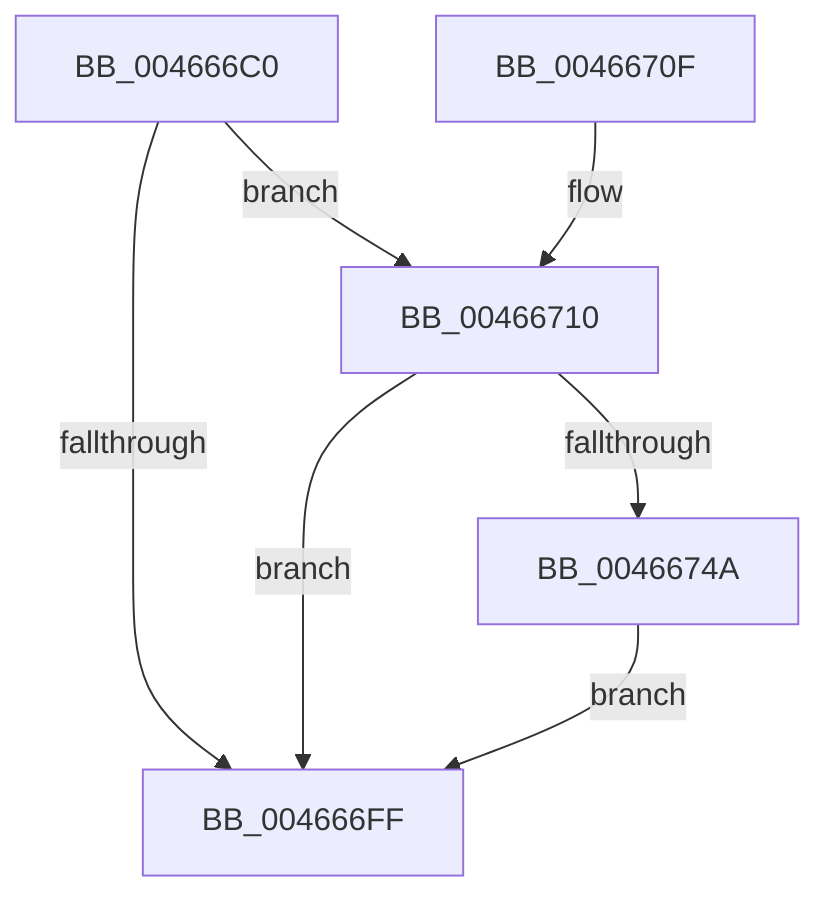

# PoFxCompleteIdleState

- RVA: `0x004666C0`–`0x00466758` (길이 `152` bytes)
- VA: `0x00000001404666C0`
- 실행 섹션: `.text`
- PDB 이름 있음: `예`; PDB Function 태그: `아니요`
- unwind 정보 RVA: `0x000AAD3C`
- 디코드: `41`개 명령, `152/152` bytes 표시
- 미해석 바이트: `0` (있으면 어셈블리에 `.byte`로 보존)

> 이 문서는 커널 이미지의 기계어와 PDB 기호를 분석해 생성했습니다. 4번과 5번은 함수 원형과 자료형을 바이너리 사용 방식에서 추정한 C 해석이며 원본 소스 복구 결과는 아닙니다.

## 1. Dependencies

- 직접 호출 지점: **5**; 고유 호출 대상: **5**
- 직접 호출자로 확인된 함수: **1**
- RIP 상대 이미지 참조: **0**

### Outgoing calls
- `0x004666DF` → [memset](../6C/memset_function_006C6C40.md) (function, `0x006C6C40`)
- `0x00466720` → [PopFxAddLogEntry](../39/PopFxAddLogEntry_function_00390B94.md) (function, `0x00390B94`)
- `0x00466732` → [PopDiagTraceFxComponentIdleState](../2B/PopDiagTraceFxComponentIdleState_function_002BE0C4.md) (function, `0x002BE0C4`)
- `0x00466741` → [PopPluginComponentIdleState](../2B/PopPluginComponentIdleState_function_002BE310.md) (function, `0x002BE310`)
- `0x00466751` → [PopFxProcessWork](../2B/PopFxProcessWork_function_002BD3E0.md) (function, `0x002BD3E0`)

### Direct callers
- [DifPoFxCompleteIdleStateWrapper](../63/DifPoFxCompleteIdleStateWrapper_function_00639260.md) at `0x00639337`

### Static image references
- 디코드된 RIP-relative 메모리 참조가 없습니다.

## 2. Other-region calls and transfers

- 다른 실행 섹션으로 향하는 call: **0**
- 별도 외부 분기/꼬리 이동을 확인하지 못했습니다.

## 3. Assembly (complete function range)

```asm
004666C0  48 89 5C 24 08                  mov qword ptr [rsp + 8], rbx
004666C5  48 89 74 24 10                  mov qword ptr [rsp + 0x10], rsi
004666CA  57                              push rdi
004666CB  48 83 EC 60                     sub rsp, 0x60
004666CF  8B FA                           mov edi, edx
004666D1  48 8B F1                        mov rsi, rcx
004666D4  33 D2                           xor edx, edx
004666D6  48 8D 4C 24 20                  lea rcx, [rsp + 0x20]
004666DB  44 8D 42 40                     lea r8d, [rdx + 0x40]
004666DF  E8 5C 05 26 00                  call 0x1406c6c40
004666E4  48 8B 86 68 03 00 00            mov rax, qword ptr [rsi + 0x368]
004666EB  48 8B 1C F8                     mov rbx, qword ptr [rax + rdi*8]
004666EF  83 C8 FF                        or eax, 0xffffffff
004666F2  F0 0F C1 83 8C 00 00 00         lock xadd dword ptr [rbx + 0x8c], eax
004666FA  83 F8 01                        cmp eax, 1
004666FD  74 11                           je 0x140466710
004666FF  48 8B 5C 24 70                  mov rbx, qword ptr [rsp + 0x70]
00466704  48 8B 74 24 78                  mov rsi, qword ptr [rsp + 0x78]
00466709  48 83 C4 60                     add rsp, 0x60
0046670D  5F                              pop rdi
0046670E  C3                              ret
0046670F  CC                              int3
00466710  48 8B 4E 30                     mov rcx, qword ptr [rsi + 0x30]
00466714  41 B9 01 00 00 00               mov r9d, 1
0046671A  8B D7                           mov edx, edi
0046671C  45 8D 41 0D                     lea r8d, [r9 + 0xd]
00466720  E8 6F A4 F2 FF                  call 0x140390b94
00466725  44 8B 83 98 00 00 00            mov r8d, dword ptr [rbx + 0x98]
0046672C  8B D7                           mov edx, edi
0046672E  48 8B 4E 30                     mov rcx, qword ptr [rsi + 0x30]
00466732  E8 8D 79 E5 FF                  call 0x1402be0c4
00466737  4C 8D 4C 24 20                  lea r9, [rsp + 0x20]
0046673C  8B D7                           mov edx, edi
0046673E  48 8B CE                        mov rcx, rsi
00466741  E8 CA 7B E5 FF                  call 0x1402be310
00466746  84 C0                           test al, al
00466748  74 B5                           je 0x1404666ff
0046674A  48 8D 54 24 20                  lea rdx, [rsp + 0x20]
0046674F  33 C9                           xor ecx, ecx
00466751  E8 8A 6C E5 FF                  call 0x1402bd3e0
00466756  EB A7                           jmp 0x1404666ff
```

## 4. C-style interpretation (structured pseudocode)

```c
__int64 __fastcall PoFxCompleteIdleState(__int64 a1, int a2)
{
    __int64 result;
    __int64 v_rsp;
    unsigned __int64 v_stack_m48;
    unsigned __int64 v_stack_p10;
    unsigned __int64 v_stack_p20;
    unsigned __int64 v_stack_p8;

    v_stack_p8 = v_rbx;
    v_stack_p10 = v_rsi;
    v_rsp = (v_rsp) - (96);
    a2 = 0;
    result = memset(v_stack_m48, a2, a2 + 64, a4);
    result = (unsigned int)((*(unsigned __int64 *)(a1 + 872)) | (0xFFFFFFFFULL));
    if (((unsigned int)(result)) == 1) goto loc_00466710;
loc_004666FF:
    v_rsp = (v_rsp) + (96);
    return result;
loc_00466710:
    result = PopFxAddLogEntry(*(unsigned __int64 *)(v_stack_p10 + 48), (unsigned int)((unsigned int)((unsigned int)(a2))), 1 + 13, 1);
    result = PopDiagTraceFxComponentIdleState(*(unsigned __int64 *)(v_stack_p10 + 48), (unsigned int)((unsigned int)((unsigned int)(a2))), (unsigned int)(*(unsigned int *)(v_stack_p8 + 152)), 1);
    result = PopPluginComponentIdleState(v_stack_p10, (unsigned int)((unsigned int)((unsigned int)(a2))), (unsigned int)(*(unsigned int *)(v_stack_p8 + 152)), v_stack_p20);
    if ((unsigned __int8)(result) == 0) goto loc_004666FF;
    a1 = 0;
    result = PopFxProcessWork(a1, v_stack_p20, (unsigned int)(*(unsigned int *)(v_stack_p8 + 152)), v_stack_p20);
    goto loc_004666FF;
}
```

## 5. (Beta) C Style

```c
int64_t PoFxCompleteIdleState(void *Arg1, int32_t Arg2)
{
    uint8_t *arg1 = (uint8_t *)Arg1;

    int64_t result;
    int64_t local_rsp;
    uint64_t v_stack_m48;
    uint64_t v_stack_p10;
    uint64_t v_stack_p20;
    uint64_t v_stack_p8;

    v_stack_p8 = local_rbx;
    v_stack_p10 = local_rsi;
    local_rsp = (local_rsp) - (96);
    Arg2 = 0;
    result = memset(v_stack_m48, Arg2, Arg2 + 64, a4);
    result = (uint32_t)((*(uint64_t *)(arg1 + 0x368)) | (0xFFFFFFFFULL));
    if (((uint32_t)(result)) == 1) goto loc_00466710;
loc_004666FF:
    local_rsp = (local_rsp) + (96);
    return result;
loc_00466710:
    result = PopFxAddLogEntry(*(uint64_t *)(v_stack_p10 + 0x30), (uint32_t)((uint32_t)((uint32_t)(Arg2))), 1 + 13, 1);
    result = PopDiagTraceFxComponentIdleState(*(uint64_t *)(v_stack_p10 + 0x30), (uint32_t)((uint32_t)((uint32_t)(Arg2))), (uint32_t)(*(uint32_t *)(v_stack_p8 + 0x98)), 1);
    result = PopPluginComponentIdleState(v_stack_p10, (uint32_t)((uint32_t)((uint32_t)(Arg2))), (uint32_t)(*(uint32_t *)(v_stack_p8 + 0x98)), v_stack_p20);
    if ((uint8_t)(result) == 0) goto loc_004666FF;
    Arg1 = 0;
    result = PopFxProcessWork(Arg1, v_stack_p20, (uint32_t)(*(uint32_t *)(v_stack_p8 + 0x98)), v_stack_p20);
    goto loc_004666FF;
}
```

### 관측된 메모리 오프셋

구조체 형식이 확인되지 않은 접근은 인자 기준의 오프셋으로만 기록했습니다.

| 기준 인자 | 오프셋 표현 | 폭 (bit) | 접근 |
|---|---:|---:|---|
| `Arg1` | `+ 0x30` | `64` | `R` |
| `Arg1` | `+ 0x368` | `64` | `R` |

## 6. Execution-region graph

[열기: 2D/3D 그래프와 함수 탐색 컨트롤 패널](../../../control-panel.html?section=text&rva=0x004666C0&view=graph)

- 2D 그래프는 위에서 아래로 흐르고, 3D 그래프는 빈 공간을 드래그해 회전합니다. Shift+드래그는 이동, 휠은 확대·축소, 함수 노드 선택은 대상 보고서 이동입니다.

### Static fallback


