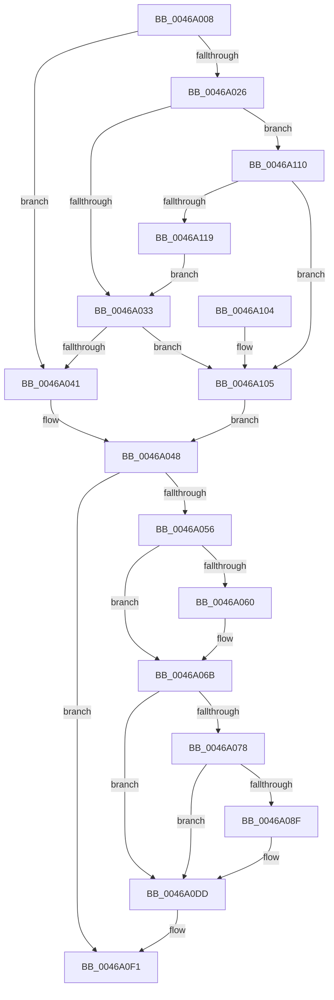

# PoFxSendSystemLatencyUpdate

- RVA: `0x0046A008`–`0x0046A11E` (길이 `278` bytes)
- VA: `0x000000014046A008`
- 실행 섹션: `.text`
- PDB 이름 있음: `예`; PDB Function 태그: `아니요`
- unwind 정보 RVA: `0x000AB240`
- 디코드: `61`개 명령, `278/278` bytes 표시
- 미해석 바이트: `0` (있으면 어셈블리에 `.byte`로 보존)

> 이 문서는 커널 이미지의 기계어와 PDB 기호를 분석해 생성했습니다. 4번과 5번은 함수 원형과 자료형을 바이너리 사용 방식에서 추정한 C 해석이며 원본 소스 복구 결과는 아닙니다.

## 1. Dependencies

- 직접 호출 지점: **6**; 고유 호출 대상: **6**
- 직접 호출자로 확인된 함수: **6**
- RIP 상대 이미지 참조: **11**

### Outgoing calls
- `0x0046A041` → [PopFxGetLatencyLimitWithoutResiliency](PopFxGetLatencyLimitWithoutResiliency_function_0046A124.md) (function, `0x0046A124`)
- `0x0046A086` → [EtwEventEnabled](../39/EtwEventEnabled_function_00392450.md) (function, `0x00392450`)
- `0x0046A0D8` → [EtwWriteEx](../25/EtwWriteEx_function_0025F0D0.md) (function, `0x0025F0D0`)
- `0x0046A0DF` → [PoFxSystemLatencyNotify](PoFxSystemLatencyNotify_function_0046A15C.md) (function, `0x0046A15C`)
- `0x0046A0E6` → [PpmIdleUpdateSystemLatencyLimit](../2D/PpmIdleUpdateSystemLatencyLimit_function_002D9204.md) (function, `0x002D9204`)
- `0x0046A0F9` → [_security_check_cookie](../6A/_security_check_cookie_function_006AC640.md) (function, `0x006AC640`)

### Direct callers
- [PopDeepSleepEvaluateCallback](PopDeepSleepEvaluateCallback_function_00469F10.md) at `0x00469FA9`
- [PoNotifyVSyncChange](PoNotifyVSyncChange_function_00469FD0.md) at `0x00469FEA`
- [PopCheckResiliencyScenarios](../../page/A3/PopCheckResiliencyScenarios_function_00A31718.md) at `0x00A31872`
- [PopWnfFullscreenVideoCallback](../../page/A4/PopWnfFullscreenVideoCallback_function_00A49EB0.md) at `0x00A49F77`
- [PopEnforceResiliencyScenarios](../../page/AC/PopEnforceResiliencyScenarios_function_00AC3D90.md) at `0x00AC3DAD`
- [PoInitSystem](../../init/C7/PoInitSystem_function_00C72358.md) at `0x00C72E68`

### Static image references
- `0x0046A00E` → RVA `0x00E0A740` (`.data`; read)
- `0x0046A01D` → RVA `0x00F0CED4` (`.data`; read)
- `0x0046A026` → RVA `0x00F092F2` (`.data`; read)
- `0x0046A033` → RVA `0x00F092F1` (`.data`; read)
- `0x0046A048` → RVA `0x00E0B3E8` (`.data`; read)
- `0x0046A060` → RVA `0x00E0B3E8` (`.data`; write)
- `0x0046A06B` → RVA `0x00E67858` (`.data`; read)
- `0x0046A078` → RVA `0x00F0B408` (`.data`; read)
- `0x0046A07F` → RVA `0x0001A2D0` (`.rdata`; read)
- `0x0046A105` → RVA `0x00FC545C` (`ALMOSTRO`; read)
- `0x0046A110` → RVA `0x00F0C720` (`.data`; read)

## 2. Other-region calls and transfers

- 다른 실행 섹션으로 향하는 call: **0**
- 별도 외부 분기/꼬리 이동을 확인하지 못했습니다.

## 3. Assembly (complete function range)

```asm
0046A008  40 53                           push rbx
0046A00A  48 83 EC 60                     sub rsp, 0x60
0046A00E  48 8B 05 2B 07 9A 00            mov rax, qword ptr [rip + 0x9a072b]
0046A015  48 33 C4                        xor rax, rsp
0046A018  48 89 44 24 58                  mov qword ptr [rsp + 0x58], rax
0046A01D  80 3D B0 2E AA 00 00            cmp byte ptr [rip + 0xaa2eb0], 0
0046A024  74 1B                           je 0x14046a041
0046A026  80 3D C5 F2 A9 00 00            cmp byte ptr [rip + 0xa9f2c5], 0
0046A02D  0F 84 DD 00 00 00               je 0x14046a110
0046A033  8A 05 B8 F2 A9 00               mov al, byte ptr [rip + 0xa9f2b8]
0046A039  84 C0                           test al, al
0046A03B  0F 85 C4 00 00 00               jne 0x14046a105
0046A041  E8 DE 00 00 00                  call 0x14046a124
0046A046  8B D8                           mov ebx, eax
0046A048  8B 05 9A 13 9A 00               mov eax, dword ptr [rip + 0x9a139a]
0046A04E  3B D8                           cmp ebx, eax
0046A050  0F 84 9B 00 00 00               je 0x14046a0f1
0046A056  8B 05 8C 13 9A 00               mov eax, dword ptr [rip + 0x9a138c]
0046A05C  3B D8                           cmp ebx, eax
0046A05E  76 0B                           jbe 0x14046a06b
0046A060  89 1D 82 13 9A 00               mov dword ptr [rip + 0x9a1382], ebx
0046A066  F0 83 0C 24 00                  lock or dword ptr [rsp], 0
0046A06B  80 3D E6 D7 9F 00 00            cmp byte ptr [rip + 0x9fd7e6], 0
0046A072  89 5C 24 40                     mov dword ptr [rsp + 0x40], ebx
0046A076  74 65                           je 0x14046a0dd
0046A078  48 8B 0D 89 13 AA 00            mov rcx, qword ptr [rip + 0xaa1389]
0046A07F  48 8D 15 4A 02 BB FF            lea rdx, [rip - 0x44fdb6]
0046A086  E8 C5 83 F2 FF                  call 0x140392450
0046A08B  84 C0                           test al, al
0046A08D  74 4E                           je 0x14046a0dd
0046A08F  83 64 24 54 00                  and dword ptr [rsp + 0x54], 0
0046A094  48 8D 44 24 40                  lea rax, [rsp + 0x40]
0046A099  48 8B 0D 68 13 AA 00            mov rcx, qword ptr [rip + 0xaa1368]
0046A0A0  48 8D 15 29 02 BB FF            lea rdx, [rip - 0x44fdd7]
0046A0A7  48 89 44 24 48                  mov qword ptr [rsp + 0x48], rax
0046A0AC  45 33 C9                        xor r9d, r9d
0046A0AF  48 8D 44 24 48                  lea rax, [rsp + 0x48]
0046A0B4  C7 44 24 50 04 00 00 00         mov dword ptr [rsp + 0x50], 4
0046A0BC  48 89 44 24 38                  mov qword ptr [rsp + 0x38], rax
0046A0C1  45 33 C0                        xor r8d, r8d
0046A0C4  C7 44 24 30 01 00 00 00         mov dword ptr [rsp + 0x30], 1
0046A0CC  48 83 64 24 28 00               and qword ptr [rsp + 0x28], 0
0046A0D2  48 83 64 24 20 00               and qword ptr [rsp + 0x20], 0
0046A0D8  E8 F3 4F DF FF                  call 0x14025f0d0
0046A0DD  8B CB                           mov ecx, ebx
0046A0DF  E8 78 00 00 00                  call 0x14046a15c
0046A0E4  8B CB                           mov ecx, ebx
0046A0E6  E8 19 F1 E6 FF                  call 0x1402d9204
0046A0EB  89 1D F7 12 9A 00               mov dword ptr [rip + 0x9a12f7], ebx
0046A0F1  48 8B 4C 24 58                  mov rcx, qword ptr [rsp + 0x58]
0046A0F6  48 33 CC                        xor rcx, rsp
0046A0F9  E8 42 25 24 00                  call 0x1406ac640
0046A0FE  48 83 C4 60                     add rsp, 0x60
0046A102  5B                              pop rbx
0046A103  C3                              ret
0046A104  CC                              int3
0046A105  8B 1D 51 B3 B5 00               mov ebx, dword ptr [rip + 0xb5b351]
0046A10B  E9 38 FF FF FF                  jmp 0x14046a048
0046A110  80 3D 09 26 AA 00 00            cmp byte ptr [rip + 0xaa2609], 0
0046A117  75 EC                           jne 0x14046a105
0046A119  E9 15 FF FF FF                  jmp 0x14046a033
```

## 4. C-style interpretation (structured pseudocode)

```c
__int64 __fastcall PoFxSendSystemLatencyUpdate(__int64 a1, __int64 a2, int a3, int a4)
{
    __int64 result;
    __int64 v_rsp;
    unsigned __int64 v_stack_m10;
    unsigned int v_stack_m14;
    unsigned int v_stack_m18;
    unsigned __int64 v_stack_m20;
    unsigned int v_stack_m28;
    unsigned __int64 v_stack_m30;
    unsigned int v_stack_m38;
    unsigned __int64 v_stack_m40;
    unsigned __int64 v_stack_m48;
    unsigned int v_stack_m68;

    v_rsp = (v_rsp) - (96);
    result = (*(unsigned __int64 *)(v_rip + 10094379)) ^ (v_rsp);
    v_stack_m10 = result;
    if ((*(unsigned __int8 *)(v_rip + 11153072)) == 0) goto loc_0046A041;
    if ((*(unsigned __int8 *)(v_rip + 11137733)) == 0) goto loc_0046A110;
loc_0046A033:
    if ((unsigned __int8)(*(unsigned __int8 *)(v_rip + 11137720)) != 0) goto loc_0046A105;
loc_0046A041:
    result = PopFxGetLatencyLimitWithoutResiliency(a1, a2, a3, a4);
loc_0046A048:
    if (((unsigned int)((unsigned int)((unsigned int)(result)))) == ((unsigned int)((unsigned int)(*(unsigned int *)(v_rip + 10097562))))) goto loc_0046A0F1;
    if (((unsigned int)((unsigned int)((unsigned int)(result)))) >= = ((unsigned int)((unsigned int)(*(unsigned int *)(v_rip + 10097548))))) {
        *(unsigned int *)(v_rip + 10097538) = (unsigned int)((unsigned int)((unsigned int)(result)));
    }
    v_stack_m28 = (unsigned int)((unsigned int)((unsigned int)(result)));
    if ((*(unsigned __int8 *)(v_rip + 10475494)) == 0) goto loc_0046A0DD;
    result = EtwEventEnabled(*(unsigned __int64 *)(v_rip + 11146121), v_rip - 4521398, a3, a4);
    if ((unsigned __int8)(result) != 0) {
        result = v_stack_m28;
        a1 = *(unsigned __int64 *)(v_rip + 11146088);
        a2 = v_rip - 4521431;
        v_stack_m20 = result;
        a4 = 0;
        result = v_stack_m20;
        v_stack_m18 = 4;
        v_stack_m30 = result;
        a3 = 0;
        v_stack_m38 = 1;
        result = EtwWriteEx(a1, a2, a3, a4);
    }
    result = PoFxSystemLatencyNotify((unsigned int)((unsigned int)((unsigned int)((unsigned int)(result)))), a2, a3, a4);
    result = PpmIdleUpdateSystemLatencyLimit((unsigned int)((unsigned int)((unsigned int)((unsigned int)(result)))), a2, a3, a4);
    *(unsigned int *)(v_rip + 10097399) = (unsigned int)((unsigned int)((unsigned int)(result)));
loc_0046A0F1:
    a1 = (v_stack_m10) ^ (v_rsp);
    result = _security_check_cookie(a1, a2, a3, a4);
    v_rsp = (v_rsp) + (96);
    return result;
loc_0046A105:
    goto loc_0046A048;
loc_0046A110:
    if ((*(unsigned __int8 *)(v_rip + 11150857)) != 0) goto loc_0046A105;
    goto loc_0046A033;
}
```

## 5. (Beta) C Style

```c
int64_t PoFxSendSystemLatencyUpdate(int64_t Arg1, int64_t Arg2, int32_t Arg3, int32_t Arg4)
{
    int64_t result;
    int64_t local_rsp;
    uint64_t v_stack_m10;
    uint32_t v_stack_m14;
    uint32_t v_stack_m18;
    uint64_t v_stack_m20;
    uint32_t v_stack_m28;
    uint64_t v_stack_m30;
    uint32_t v_stack_m38;
    uint64_t v_stack_m40;
    uint64_t v_stack_m48;
    uint32_t v_stack_m68;

    local_rsp = (local_rsp) - (96);
    result = (*(uint64_t *)(v_rip + 0x9A072B)) ^ (local_rsp);
    v_stack_m10 = result;
    if ((*(uint8_t *)(v_rip + 0xAA2EB0)) == 0) goto loc_0046A041;
    if ((*(uint8_t *)(v_rip + 0xA9F2C5)) == 0) goto loc_0046A110;
loc_0046A033:
    if ((uint8_t)(*(uint8_t *)(v_rip + 0xA9F2B8)) != 0) goto loc_0046A105;
loc_0046A041:
    result = PopFxGetLatencyLimitWithoutResiliency(Arg1, Arg2, Arg3, Arg4);
loc_0046A048:
    if (((uint32_t)((uint32_t)((uint32_t)(result)))) == ((uint32_t)((uint32_t)(*(uint32_t *)(v_rip + 0x9A139A))))) goto loc_0046A0F1;
    if (((uint32_t)((uint32_t)((uint32_t)(result)))) >= = ((uint32_t)((uint32_t)(*(uint32_t *)(v_rip + 0x9A138C))))) {
        *(uint32_t *)(v_rip + 0x9A1382) = (uint32_t)((uint32_t)((uint32_t)(result)));
    }
    v_stack_m28 = (uint32_t)((uint32_t)((uint32_t)(result)));
    if ((*(uint8_t *)(v_rip + 0x9FD7E6)) == 0) goto loc_0046A0DD;
    result = EtwEventEnabled(*(uint64_t *)(v_rip + 0xAA1389), v_rip - 4521398, Arg3, Arg4);
    if ((uint8_t)(result) != 0) {
        result = v_stack_m28;
        Arg1 = *(uint64_t *)(v_rip + 0xAA1368);
        Arg2 = v_rip - 4521431;
        v_stack_m20 = result;
        Arg4 = 0;
        result = v_stack_m20;
        v_stack_m18 = 4;
        v_stack_m30 = result;
        Arg3 = 0;
        v_stack_m38 = 1;
        result = EtwWriteEx(Arg1, Arg2, Arg3, Arg4);
    }
    result = PoFxSystemLatencyNotify((uint32_t)((uint32_t)((uint32_t)((uint32_t)(result)))), Arg2, Arg3, Arg4);
    result = PpmIdleUpdateSystemLatencyLimit((uint32_t)((uint32_t)((uint32_t)((uint32_t)(result)))), Arg2, Arg3, Arg4);
    *(uint32_t *)(v_rip + 0x9A12F7) = (uint32_t)((uint32_t)((uint32_t)(result)));
loc_0046A0F1:
    Arg1 = (v_stack_m10) ^ (local_rsp);
    result = _security_check_cookie(Arg1, Arg2, Arg3, Arg4);
    local_rsp = (local_rsp) + (96);
    return result;
loc_0046A105:
    goto loc_0046A048;
loc_0046A110:
    if ((*(uint8_t *)(v_rip + 0xAA2609)) != 0) goto loc_0046A105;
    goto loc_0046A033;
}
```

## 6. Execution-region graph

[열기: 2D/3D 그래프와 함수 탐색 컨트롤 패널](../../../control-panel.html?section=text&rva=0x0046A008&view=graph)

- 2D 그래프는 위에서 아래로 흐르고, 3D 그래프는 빈 공간을 드래그해 회전합니다. Shift+드래그는 이동, 휠은 확대·축소, 함수 노드 선택은 대상 보고서 이동입니다.

### Static fallback


