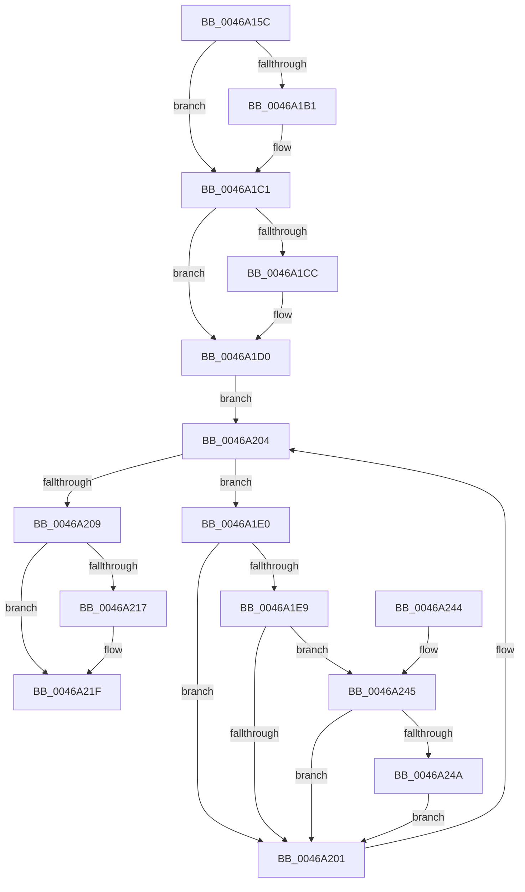

# PoFxSystemLatencyNotify

- RVA: `0x0046A15C`–`0x0046A25C` (길이 `256` bytes)
- VA: `0x000000014046A15C`
- 실행 섹션: `.text`
- PDB 이름 있음: `예`; PDB Function 태그: `아니요`
- unwind 정보 RVA: `0x000AB254`
- 디코드: `76`개 명령, `256/256` bytes 표시
- 미해석 바이트: `0` (있으면 어셈블리에 `.byte`로 보존)

> 이 문서는 커널 이미지의 기계어와 PDB 기호를 분석해 생성했습니다. 4번과 5번은 함수 원형과 자료형을 바이너리 사용 방식에서 추정한 C 해석이며 원본 소스 복구 결과는 아닙니다.

## 1. Dependencies

- 직접 호출 지점: **6**; 고유 호출 대상: **6**
- 직접 호출자로 확인된 함수: **1**
- RIP 상대 이미지 참조: **2**

### Outgoing calls
- `0x0046A198` → [KeAbPreAcquire](../21/KeAbPreAcquire_function_00210230.md) (function, `0x00210230`)
- `0x0046A1BC` → [ExfAcquirePushLockSharedEx](../21/ExfAcquirePushLockSharedEx_function_0021044C.md) (function, `0x0021044C`)
- `0x0046A1F8` → [guard_dispatch_icall](../6B/guard_dispatch_icall_function_006BAAD0.md) (function, `0x006BAAD0`)
- `0x0046A21A` → [ExfReleasePushLockShared](../26/ExfReleasePushLockShared_function_00263440.md) (function, `0x00263440`)
- `0x0046A222` → [KeAbPostRelease](../2E/KeAbPostRelease_function_002E1600.md) (function, `0x002E1600`)
- `0x0046A227` → [KeLeaveCriticalRegion](../25/KeLeaveCriticalRegion_function_0025D8B0.md) (function, `0x0025D8B0`)

### Direct callers
- [PoFxSendSystemLatencyUpdate](PoFxSendSystemLatencyUpdate_function_0046A008.md) at `0x0046A0DF`

### Static image references
- `0x0046A179` → RVA `0x00F0E428` (`.data`; read)
- `0x0046A1D0` → RVA `0x00F0E410` (`.data`; read)

## 2. Other-region calls and transfers

- 다른 실행 섹션으로 향하는 call: **0**
- 별도 외부 분기/꼬리 이동을 확인하지 못했습니다.

## 3. Assembly (complete function range)

```asm
0046A15C  48 89 5C 24 08                  mov qword ptr [rsp + 8], rbx
0046A161  55                              push rbp
0046A162  56                              push rsi
0046A163  57                              push rdi
0046A164  41 54                           push r12
0046A166  41 55                           push r13
0046A168  41 56                           push r14
0046A16A  41 57                           push r15
0046A16C  48 83 EC 20                     sub rsp, 0x20
0046A170  65 48 8B 04 25 88 01 00 00      mov rax, qword ptr gs:[0x188]
0046A179  4C 8D 35 A8 42 AA 00            lea r14, [rip + 0xaa42a8]
0046A180  48 8B F1                        mov rsi, rcx
0046A183  33 ED                           xor ebp, ebp
0046A185  45 33 C0                        xor r8d, r8d
0046A188  33 D2                           xor edx, edx
0046A18A  49 8B CE                        mov rcx, r14
0046A18D  40 8A FD                        mov dil, bpl
0046A190  66 FF 88 E4 01 00 00            dec word ptr [rax + 0x1e4]
0046A197  90                              nop
0046A198  E8 93 60 DA FF                  call 0x140210230
0046A19D  48 8B D8                        mov rbx, rax
0046A1A0  44 8D 6D 11                     lea r13d, [rbp + 0x11]
0046A1A4  33 C0                           xor eax, eax
0046A1A6  F0 4C 0F B1 2D 79 42 AA 00      lock cmpxchg qword ptr [rip + 0xaa4279], r13
0046A1AF  74 10                           je 0x14046a1c1
0046A1B1  4D 8B CE                        mov r9, r14
0046A1B4  4C 8B C3                        mov r8, rbx
0046A1B7  33 D2                           xor edx, edx
0046A1B9  49 8B CE                        mov rcx, r14
0046A1BC  E8 8B 62 DA FF                  call 0x14021044c
0046A1C1  41 BC 01 00 00 00               mov r12d, 1
0046A1C7  48 85 DB                        test rbx, rbx
0046A1CA  74 04                           je 0x14046a1d0
0046A1CC  44 88 63 0A                     mov byte ptr [rbx + 0xa], r12b
0046A1D0  48 8B 1D 39 42 AA 00            mov rbx, qword ptr [rip + 0xaa4239]
0046A1D7  4C 8D 3D 32 42 AA 00            lea r15, [rip + 0xaa4232]
0046A1DE  EB 24                           jmp 0x14046a204
0046A1E0  48 8B 43 60                     mov rax, qword ptr [rbx + 0x60]
0046A1E4  48 85 C0                        test rax, rax
0046A1E7  74 18                           je 0x14046a201
0046A1E9  48 8D 54 24 68                  lea rdx, [rsp + 0x68]
0046A1EE  48 89 74 24 68                  mov qword ptr [rsp + 0x68], rsi
0046A1F3  B9 10 00 00 00                  mov ecx, 0x10
0046A1F8  E8 D3 08 25 00                  call 0x1406baad0
0046A1FD  84 C0                           test al, al
0046A1FF  75 44                           jne 0x14046a245
0046A201  48 8B 1B                        mov rbx, qword ptr [rbx]
0046A204  49 3B DF                        cmp rbx, r15
0046A207  75 D7                           jne 0x14046a1e0
0046A209  49 8B C5                        mov rax, r13
0046A20C  F0 48 0F B1 2D 13 42 AA 00      lock cmpxchg qword ptr [rip + 0xaa4213], rbp
0046A215  74 08                           je 0x14046a21f
0046A217  49 8B CE                        mov rcx, r14
0046A21A  E8 21 92 DF FF                  call 0x140263440
0046A21F  49 8B CE                        mov rcx, r14
0046A222  E8 D9 73 E7 FF                  call 0x1402e1600
0046A227  E8 84 36 DF FF                  call 0x14025d8b0
0046A22C  48 8B 5C 24 60                  mov rbx, qword ptr [rsp + 0x60]
0046A231  40 8A C7                        mov al, dil
0046A234  48 83 C4 20                     add rsp, 0x20
0046A238  41 5F                           pop r15
0046A23A  41 5E                           pop r14
0046A23C  41 5D                           pop r13
0046A23E  41 5C                           pop r12
0046A240  5F                              pop rdi
0046A241  5E                              pop rsi
0046A242  5D                              pop rbp
0046A243  C3                              ret
0046A244  CC                              int3
0046A245  40 84 FF                        test dil, dil
0046A248  75 B7                           jne 0x14046a201
0046A24A  8B 43 18                        mov eax, dword ptr [rbx + 0x18]
0046A24D  48 0F BA E0 1F                  bt rax, 0x1f
0046A252  40 0F B6 FF                     movzx edi, dil
0046A256  41 0F 43 FC                     cmovae edi, r12d
0046A25A  EB A5                           jmp 0x14046a201
```

## 4. C-style interpretation (structured pseudocode)

```c
__int64 __fastcall PoFxSystemLatencyNotify(__int64 a1, int a2, int a3)
{
    __int64 result;
    __int64 v_rbp;
    __int64 v_rdi;
    __int64 v_rsp;
    unsigned __int64 v_stack_p10;
    unsigned __int64 v_stack_p8;

    v_stack_p8 = v_rbx;
    v_rsp = (v_rsp) - (32);
    v_rbp = 0;
    a3 = 0;
    a2 = 0;
    result = KeAbPreAcquire(v_rip + 11158184, a2, a3, a4);
    result = 0;
    if (!(condition_is_equal)) {
        a4 = v_rip + 11158184;
        a3 = 0;
        a2 = 0;
        a1 = v_rip + 11158184;
        result = ExfAcquirePushLockSharedEx(a1, a2, a3, a4);
    }
    if (result != 0) {
        *(unsigned __int8 *)(result + 10) = 1;
    }
    goto loc_0046A204;
loc_0046A1E0:
    if (*(unsigned __int64 *)(*(unsigned __int64 *)(v_rip + 11158073) + 96) == 0) goto loc_0046A201;
    v_stack_p10 = a1;
    result = guard_dispatch_icall(16, v_stack_p10, a3, a4);
    if ((unsigned __int8)(result) != 0) goto loc_0046A245;
loc_0046A201:
loc_0046A204:
    if ((*(unsigned __int64 *)(*(unsigned __int64 *)(v_rip + 11158073))) != (v_rip + 11158066)) goto loc_0046A1E0;
    result = v_rbp + 17;
    if ((*(unsigned __int64 *)(*(unsigned __int64 *)(v_rip + 11158073))) != (v_rip + 11158066)) {
        a1 = v_rip + 11158184;
        result = ExfReleasePushLockShared(a1, v_stack_p10, a3, a4);
    }
    result = KeAbPostRelease(v_rip + 11158184, v_stack_p10, a3, a4);
    result = KeLeaveCriticalRegion(v_rip + 11158184, v_stack_p10, a3, a4);
    v_rsp = (v_rsp) + (32);
    return 0;
loc_0046A245:
    if (0 != 0) goto loc_0046A201;
    v_rdi = 0;
    if (condition_is_above_or_equal) { v_rdi = 1; }
    goto loc_0046A201;
}
```

## 5. (Beta) C Style

```c
int64_t PoFxSystemLatencyNotify(int64_t Arg1, int32_t Arg2, int32_t Arg3)
{
    int64_t result;
    int64_t local_rbp;
    int64_t local_rdi;
    int64_t local_rsp;
    uint64_t v_stack_p10;
    uint64_t v_stack_p8;

    v_stack_p8 = local_rbx;
    local_rsp = (local_rsp) - (32);
    local_rbp = 0;
    Arg3 = 0;
    Arg2 = 0;
    result = KeAbPreAcquire(v_rip + 11158184, Arg2, Arg3, a4);
    result = 0;
    if (!(condition_is_equal)) {
        a4 = v_rip + 11158184;
        Arg3 = 0;
        Arg2 = 0;
        Arg1 = v_rip + 11158184;
        result = ExfAcquirePushLockSharedEx(Arg1, Arg2, Arg3, a4);
    }
    if (result != 0) {
        *(uint8_t *)(result + 0xA) = 1;
    }
    goto loc_0046A204;
loc_0046A1E0:
    if (*(uint64_t *)(*(uint64_t *)(v_rip + 0xAA4239) + 0x60) == 0) goto loc_0046A201;
    v_stack_p10 = Arg1;
    result = guard_dispatch_icall(16, v_stack_p10, Arg3, a4);
    if ((uint8_t)(result) != 0) goto loc_0046A245;
loc_0046A201:
loc_0046A204:
    if ((*(uint64_t *)(*(uint64_t *)(v_rip + 0xAA4239))) != (v_rip + 11158066)) goto loc_0046A1E0;
    result = local_rbp + 17;
    if ((*(uint64_t *)(*(uint64_t *)(v_rip + 0xAA4239))) != (v_rip + 11158066)) {
        Arg1 = v_rip + 11158184;
        result = ExfReleasePushLockShared(Arg1, v_stack_p10, Arg3, a4);
    }
    result = KeAbPostRelease(v_rip + 11158184, v_stack_p10, Arg3, a4);
    result = KeLeaveCriticalRegion(v_rip + 11158184, v_stack_p10, Arg3, a4);
    local_rsp = (local_rsp) + (32);
    return 0;
loc_0046A245:
    if (0 != 0) goto loc_0046A201;
    local_rdi = 0;
    if (condition_is_above_or_equal) { local_rdi = 1; }
    goto loc_0046A201;
}
```

## 6. Execution-region graph

[열기: 2D/3D 그래프와 함수 탐색 컨트롤 패널](../../../control-panel.html?section=text&rva=0x0046A15C&view=graph)

- 2D 그래프는 위에서 아래로 흐르고, 3D 그래프는 빈 공간을 드래그해 회전합니다. Shift+드래그는 이동, 휠은 확대·축소, 함수 노드 선택은 대상 보고서 이동입니다.

### Static fallback


