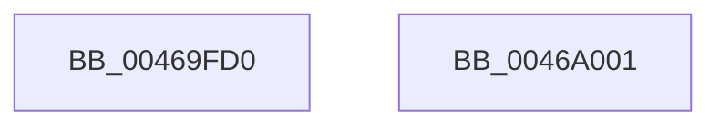

# PoNotifyVSyncChange

- RVA: `0x00469FD0`–`0x0046A002` (길이 `50` bytes)
- VA: `0x0000000140469FD0`
- 실행 섹션: `.text`
- PDB 이름 있음: `예`; PDB Function 태그: `아니요`
- unwind 정보 RVA: `0x0005CF00`
- 디코드: `13`개 명령, `50/50` bytes 표시
- 미해석 바이트: `0` (있으면 어셈블리에 `.byte`로 보존)

> 이 문서는 커널 이미지의 기계어와 PDB 기호를 분석해 생성했습니다. 4번과 5번은 함수 원형과 자료형을 바이너리 사용 방식에서 추정한 C 해석이며 원본 소스 복구 결과는 아닙니다.

## 1. Dependencies

- 직접 호출 지점: **3**; 고유 호출 대상: **3**
- 직접 호출자로 확인된 함수: **0**
- RIP 상대 이미지 참조: **2**

### Outgoing calls
- `0x00469FDF` → [PpmAcquireLock](../2D/PpmAcquireLock_function_002D9AA4.md) (function, `0x002D9AA4`)
- `0x00469FEA` → [PoFxSendSystemLatencyUpdate](PoFxSendSystemLatencyUpdate_function_0046A008.md) (function, `0x0046A008`)
- `0x00469FF6` → [PpmReleaseLock](../2D/PpmReleaseLock_function_002DA428.md) (function, `0x002DA428`)

### Direct callers
- 이 함수 시작 RVA로 연결되는 직접 call은 확인되지 않았습니다. 간접 호출은 완전히 역산할 수 없습니다.

### Static image references
- `0x00469FD8` → RVA `0x00F0E760` (`.data`; read)
- `0x00469FE4` → RVA `0x00E0B3DD` (`.data`; write)

## 2. Other-region calls and transfers

- 다른 실행 섹션으로 향하는 call: **0**
- 별도 외부 분기/꼬리 이동을 확인하지 못했습니다.

## 3. Assembly (complete function range)

```asm
00469FD0  40 53                           push rbx
00469FD2  48 83 EC 20                     sub rsp, 0x20
00469FD6  8A D9                           mov bl, cl
00469FD8  48 8D 0D 81 47 AA 00            lea rcx, [rip + 0xaa4781]
00469FDF  E8 C0 FA E6 FF                  call 0x1402d9aa4
00469FE4  88 1D F3 13 9A 00               mov byte ptr [rip + 0x9a13f3], bl
00469FEA  E8 19 00 00 00                  call 0x14046a008
00469FEF  48 8D 0D 6A 47 AA 00            lea rcx, [rip + 0xaa476a]
00469FF6  E8 2D 04 E7 FF                  call 0x1402da428
00469FFB  48 83 C4 20                     add rsp, 0x20
00469FFF  5B                              pop rbx
0046A000  C3                              ret
0046A001  CC                              int3
```

## 4. C-style interpretation (structured pseudocode)

```c
__int64 __fastcall PoNotifyVSyncChange(unsigned __int8 a1)
{
    __int64 result;
    __int64 v_rsp;

    v_rsp = (v_rsp) - (32);
    result = PpmAcquireLock(v_rip + 11159425, a2, a3, a4);
    *(unsigned __int8 *)(v_rip + 10097651) = a1;
    result = PoFxSendSystemLatencyUpdate(v_rip + 11159425, a2, a3, a4);
    result = PpmReleaseLock(v_rip + 11159402, a2, a3, a4);
    v_rsp = (v_rsp) + (32);
    return result;
}
```

## 5. (Beta) C Style

```c
int64_t PoNotifyVSyncChange(uint8_t Arg1)
{
    int64_t result;
    int64_t local_rsp;

    local_rsp = (local_rsp) - (32);
    result = PpmAcquireLock(v_rip + 11159425, a2, a3, a4);
    *(uint8_t *)(v_rip + 0x9A13F3) = Arg1;
    result = PoFxSendSystemLatencyUpdate(v_rip + 11159425, a2, a3, a4);
    result = PpmReleaseLock(v_rip + 11159402, a2, a3, a4);
    local_rsp = (local_rsp) + (32);
    return result;
}
```

## 6. Execution-region graph

[열기: 2D/3D 그래프와 함수 탐색 컨트롤 패널](../../../control-panel.html?section=text&rva=0x00469FD0&view=graph)

- 2D 그래프는 위에서 아래로 흐르고, 3D 그래프는 빈 공간을 드래그해 회전합니다. Shift+드래그는 이동, 휠은 확대·축소, 함수 노드 선택은 대상 보고서 이동입니다.

### Static fallback


