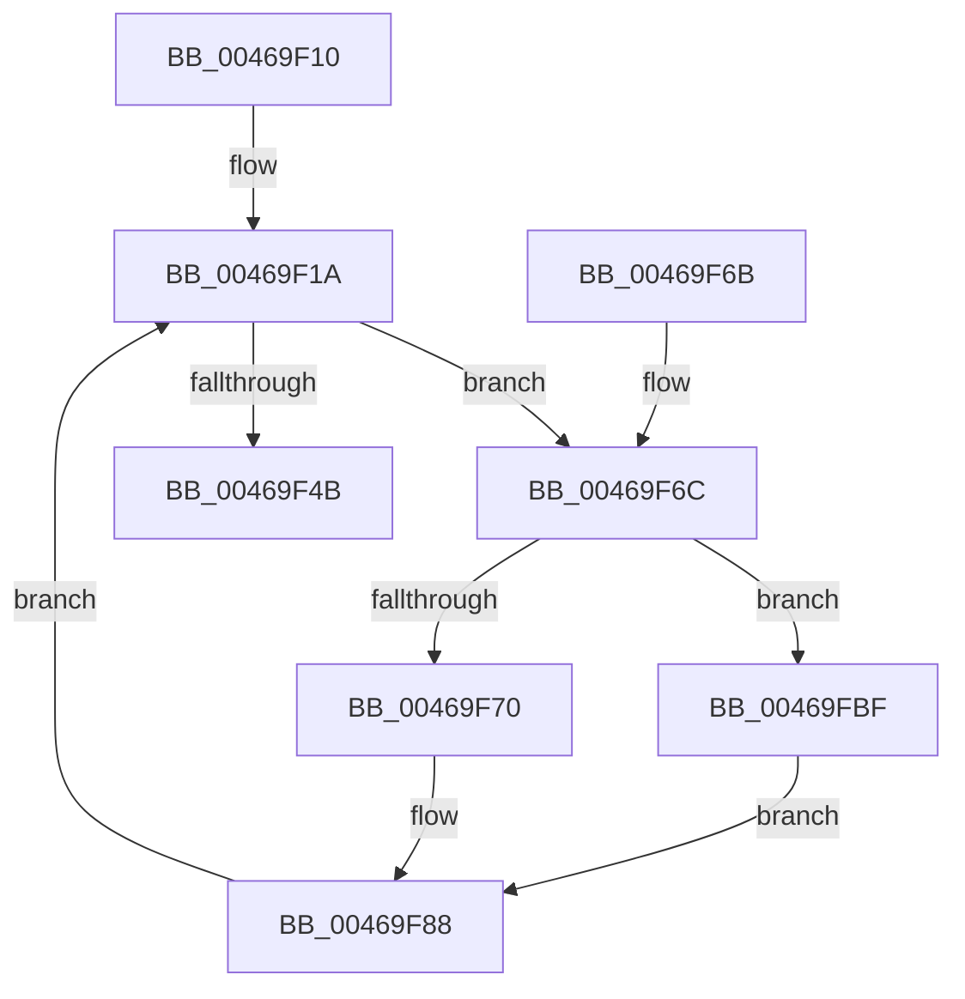

# PopDeepSleepEvaluateCallback

- RVA: `0x00469F10`–`0x00469FCA` (길이 `186` bytes)
- VA: `0x0000000140469F10`
- 실행 섹션: `.text`
- PDB 이름 있음: `예`; PDB Function 태그: `아니요`
- unwind 정보 RVA: `0x0006AF6C`
- 디코드: `45`개 명령, `186/186` bytes 표시
- 미해석 바이트: `0` (있으면 어셈블리에 `.byte`로 보존)

> 이 문서는 커널 이미지의 기계어와 PDB 기호를 분석해 생성했습니다. 4번과 5번은 함수 원형과 자료형을 바이너리 사용 방식에서 추정한 C 해석이며 원본 소스 복구 결과는 아닙니다.

## 1. Dependencies

- 직접 호출 지점: **8**; 고유 호출 대상: **7**
- 직접 호출자로 확인된 함수: **0**
- RIP 상대 이미지 참조: **8**

### Outgoing calls
- `0x00469F21` → [KeAcquireSpinLockRaiseToDpc](../20/KeAcquireSpinLockRaiseToDpc_function_00208470.md) (function, `0x00208470`)
- `0x00469F5B` → [KeReleaseSpinLock](../39/KeReleaseSpinLock_function_00392BA0.md) (function, `0x00392BA0`)
- `0x00469F83` → [PopDiagTraceIdleResiliencyStart](PopDiagTraceIdleResiliencyStart_function_0046A264.md) (function, `0x0046A264`)
- `0x00469F98` → [KeReleaseSpinLock](../39/KeReleaseSpinLock_function_00392BA0.md) (function, `0x00392BA0`)
- `0x00469FA4` → [PpmAcquireLock](../2D/PpmAcquireLock_function_002D9AA4.md) (function, `0x002D9AA4`)
- `0x00469FA9` → [PoFxSendSystemLatencyUpdate](PoFxSendSystemLatencyUpdate_function_0046A008.md) (function, `0x0046A008`)
- `0x00469FB5` → [PpmReleaseLock](../2D/PpmReleaseLock_function_002DA428.md) (function, `0x002DA428`)
- `0x00469FC3` → [PopDiagTraceIdleResiliencyEnd](PopDiagTraceIdleResiliencyEnd_function_0046A324.md) (function, `0x0046A324`)

### Direct callers
- 이 함수 시작 RVA로 연결되는 직접 call은 확인되지 않았습니다. 간접 호출은 완전히 역산할 수 없습니다.

### Static image references
- `0x00469F1A` → RVA `0x00F09328` (`.data`; read)
- `0x00469F26` → RVA `0x00FC6AF0` (`ALMOSTRO`; read)
- `0x00469F31` → RVA `0x00F092F1` (`.data`; read)
- `0x00469F3D` → RVA `0x00F09330` (`.data`; read)
- `0x00469F4D` → RVA `0x00F09320` (`.data`; write)
- `0x00469F75` → RVA `0x00FC6AA0` (`ALMOSTRO`; read)
- `0x00469F8B` → RVA `0x00F092F1` (`.data`; write)
- `0x00469F9D` → RVA `0x00F0E760` (`.data`; read)

## 2. Other-region calls and transfers

- 다른 실행 섹션으로 향하는 call: **0**
- 별도 외부 분기/꼬리 이동을 확인하지 못했습니다.

## 3. Assembly (complete function range)

```asm
00469F10  48 89 5C 24 08                  mov qword ptr [rsp + 8], rbx
00469F15  57                              push rdi
00469F16  48 83 EC 20                     sub rsp, 0x20
00469F1A  48 8D 0D 07 F4 A9 00            lea rcx, [rip + 0xa9f407]
00469F21  E8 4A E5 D9 FF                  call 0x140208470
00469F26  8A 0D C4 CB B5 00               mov cl, byte ptr [rip + 0xb5cbc4]
00469F2C  40 8A F8                        mov dil, al
00469F2F  F6 D9                           neg cl
00469F31  8A 0D BA F3 A9 00               mov cl, byte ptr [rip + 0xa9f3ba]
00469F37  45 1B C9                        sbb r9d, r9d
00469F3A  41 F7 D9                        neg r9d
00469F3D  83 3D EC F3 A9 00 00            cmp dword ptr [rip + 0xa9f3ec], 0
00469F44  0F 94 C3                        sete bl
00469F47  3A CB                           cmp cl, bl
00469F49  75 21                           jne 0x140469f6c
00469F4B  8A D0                           mov dl, al
00469F4D  C6 05 CC F3 A9 00 00            mov byte ptr [rip + 0xa9f3cc], 0
00469F54  48 8D 0D CD F3 A9 00            lea rcx, [rip + 0xa9f3cd]
00469F5B  E8 40 8C F2 FF                  call 0x140392ba0
00469F60  48 8B 5C 24 30                  mov rbx, qword ptr [rsp + 0x30]
00469F65  48 83 C4 20                     add rsp, 0x20
00469F69  5F                              pop rdi
00469F6A  C3                              ret
00469F6B  CC                              int3
00469F6C  84 DB                           test bl, bl
00469F6E  74 4F                           je 0x140469fbf
00469F70  33 D2                           xor edx, edx
00469F72  8D 42 1E                        lea eax, [rdx + 0x1e]
00469F75  F7 35 25 CB B5 00               div dword ptr [rip + 0xb5cb25]
00469F7B  41 8D 51 02                     lea edx, [r9 + 2]
00469F7F  44 8D 40 01                     lea r8d, [rax + 1]
00469F83  E8 DC 02 00 00                  call 0x14046a264
00469F88  40 8A D7                        mov dl, dil
00469F8B  88 1D 60 F3 A9 00               mov byte ptr [rip + 0xa9f360], bl
00469F91  48 8D 0D 90 F3 A9 00            lea rcx, [rip + 0xa9f390]
00469F98  E8 03 8C F2 FF                  call 0x140392ba0
00469F9D  48 8D 0D BC 47 AA 00            lea rcx, [rip + 0xaa47bc]
00469FA4  E8 FB FA E6 FF                  call 0x1402d9aa4
00469FA9  E8 5A 00 00 00                  call 0x14046a008
00469FAE  48 8D 0D AB 47 AA 00            lea rcx, [rip + 0xaa47ab]
00469FB5  E8 6E 04 E7 FF                  call 0x1402da428
00469FBA  E9 5B FF FF FF                  jmp 0x140469f1a
00469FBF  41 8D 51 02                     lea edx, [r9 + 2]
00469FC3  E8 5C 03 00 00                  call 0x14046a324
00469FC8  EB BE                           jmp 0x140469f88
```

## 4. C-style interpretation (structured pseudocode)

```c
__int64 __fastcall PopDeepSleepEvaluateCallback(__int64 a1, __int64 a2, __int64 a3, int a4)
{
    __int64 result;
    __int64 v_rbx;
    __int64 v_rsp;
    unsigned __int64 v_stack_p8;

    v_stack_p8 = v_rbx;
    v_rsp = (v_rsp) - (32);
loc_00469F1A:
    result = KeAcquireSpinLockRaiseToDpc(v_rip + 11138055, a2, a3, a4);
    a1 = (unsigned __int8)(-(*(unsigned __int8 *)(v_rip + 11914180)));
    a4 = (unsigned int)(-(a4));
    v_rbx = ((*(unsigned int *)(v_rip + 11138028)) == 0) ? 1 : 0;
    if (((unsigned __int8)(*(unsigned __int8 *)(v_rip + 11137978))) != ((unsigned __int8)(v_rbx))) goto loc_00469F6C;
    *(unsigned __int8 *)(v_rip + 11137996) = 0;
    result = KeReleaseSpinLock(v_rip + 11137997, (unsigned __int8)(result), a3, a4);
    v_rsp = (v_rsp) + (32);
    return result;
loc_00469F6C:
    if ((unsigned __int8)(v_stack_p8) == 0) goto loc_00469FBF;
    a2 = 0;
    result = PopDiagTraceIdleResiliencyStart(v_rip + 11137997, a4 + 2, a2 + 30 + 1, a4);
loc_00469F88:
    *(unsigned __int8 *)(v_rip + 11137888) = (unsigned __int8)(v_stack_p8);
    result = KeReleaseSpinLock(v_rip + 11137936, (unsigned __int8)((unsigned __int8)(result)), a2 + 30 + 1, a4);
    result = PpmAcquireLock(v_rip + 11159484, (unsigned __int8)((unsigned __int8)(result)), a2 + 30 + 1, a4);
    result = PoFxSendSystemLatencyUpdate(v_rip + 11159484, (unsigned __int8)((unsigned __int8)(result)), a2 + 30 + 1, a4);
    result = PpmReleaseLock(v_rip + 11159467, (unsigned __int8)((unsigned __int8)(result)), a2 + 30 + 1, a4);
    goto loc_00469F1A;
loc_00469FBF:
    result = PopDiagTraceIdleResiliencyEnd(v_rip + 11159467, a4 + 2, a2 + 30 + 1, a4);
    goto loc_00469F88;
}
```

## 5. (Beta) C Style

```c
int64_t PopDeepSleepEvaluateCallback(int64_t Arg1, int64_t Arg2, int64_t Arg3, int32_t Arg4)
{
    int64_t result;
    int64_t local_rbx;
    int64_t local_rsp;
    uint64_t v_stack_p8;

    v_stack_p8 = local_rbx;
    local_rsp = (local_rsp) - (32);
loc_00469F1A:
    result = KeAcquireSpinLockRaiseToDpc(v_rip + 11138055, Arg2, Arg3, Arg4);
    Arg1 = (uint8_t)(-(*(uint8_t *)(v_rip + 0xB5CBC4)));
    Arg4 = (uint32_t)(-(Arg4));
    local_rbx = ((*(uint32_t *)(v_rip + 0xA9F3EC)) == 0) ? 1 : 0;
    if (((uint8_t)(*(uint8_t *)(v_rip + 0xA9F3BA))) != ((uint8_t)(local_rbx))) goto loc_00469F6C;
    *(uint8_t *)(v_rip + 0xA9F3CC) = 0;
    result = KeReleaseSpinLock(v_rip + 11137997, (uint8_t)(result), Arg3, Arg4);
    local_rsp = (local_rsp) + (32);
    return result;
loc_00469F6C:
    if ((uint8_t)(v_stack_p8) == 0) goto loc_00469FBF;
    Arg2 = 0;
    result = PopDiagTraceIdleResiliencyStart(v_rip + 11137997, Arg4 + 2, Arg2 + 30 + 1, Arg4);
loc_00469F88:
    *(uint8_t *)(v_rip + 0xA9F360) = (uint8_t)(v_stack_p8);
    result = KeReleaseSpinLock(v_rip + 11137936, (uint8_t)((uint8_t)(result)), Arg2 + 30 + 1, Arg4);
    result = PpmAcquireLock(v_rip + 11159484, (uint8_t)((uint8_t)(result)), Arg2 + 30 + 1, Arg4);
    result = PoFxSendSystemLatencyUpdate(v_rip + 11159484, (uint8_t)((uint8_t)(result)), Arg2 + 30 + 1, Arg4);
    result = PpmReleaseLock(v_rip + 11159467, (uint8_t)((uint8_t)(result)), Arg2 + 30 + 1, Arg4);
    goto loc_00469F1A;
loc_00469FBF:
    result = PopDiagTraceIdleResiliencyEnd(v_rip + 11159467, Arg4 + 2, Arg2 + 30 + 1, Arg4);
    goto loc_00469F88;
}
```

## 6. Execution-region graph

[열기: 2D/3D 그래프와 함수 탐색 컨트롤 패널](../../../control-panel.html?section=text&rva=0x00469F10&view=graph)

- 2D 그래프는 위에서 아래로 흐르고, 3D 그래프는 빈 공간을 드래그해 회전합니다. Shift+드래그는 이동, 휠은 확대·축소, 함수 노드 선택은 대상 보고서 이동입니다.

### Static fallback


