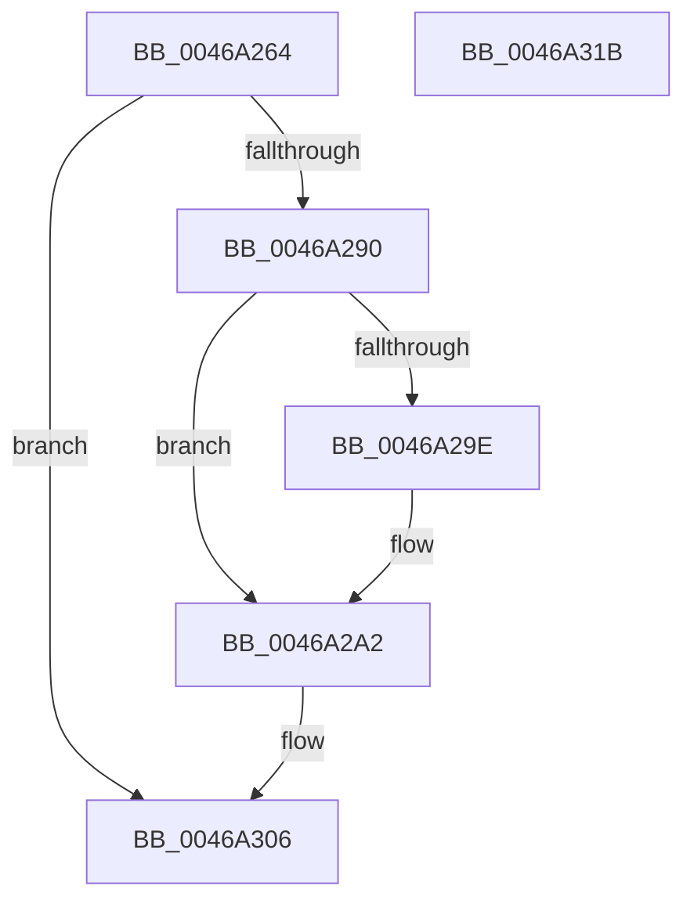

# PopDiagTraceIdleResiliencyStart

- RVA: `0x0046A264`–`0x0046A31C` (길이 `184` bytes)
- VA: `0x000000014046A264`
- 실행 섹션: `.text`
- PDB 이름 있음: `예`; PDB Function 태그: `아니요`
- unwind 정보 RVA: `0x000AB270`
- 디코드: `42`개 명령, `184/184` bytes 표시
- 미해석 바이트: `0` (있으면 어셈블리에 `.byte`로 보존)

> 이 문서는 커널 이미지의 기계어와 PDB 기호를 분석해 생성했습니다. 4번과 5번은 함수 원형과 자료형을 바이너리 사용 방식에서 추정한 C 해석이며 원본 소스 복구 결과는 아닙니다.

## 1. Dependencies

- 직접 호출 지점: **2**; 고유 호출 대상: **2**
- 직접 호출자로 확인된 함수: **1**
- RIP 상대 이미지 참조: **4**

### Outgoing calls
- `0x0046A301` → [EtwWriteEx](../25/EtwWriteEx_function_0025F0D0.md) (function, `0x0025F0D0`)
- `0x0046A30D` → [_security_check_cookie](../6A/_security_check_cookie_function_006AC640.md) (function, `0x006AC640`)

### Direct callers
- [PopDeepSleepEvaluateCallback](PopDeepSleepEvaluateCallback_function_00469F10.md) at `0x00469F83`

### Static image references
- `0x0046A278` → RVA `0x00E0A740` (`.data`; read)
- `0x0046A288` → RVA `0x00E67858` (`.data`; read)
- `0x0046A2A2` → RVA `0x00F0B408` (`.data`; read)
- `0x0046A2F2` → RVA `0x00019ED0` (`.rdata`; read)

## 2. Other-region calls and transfers

- 다른 실행 섹션으로 향하는 call: **0**
- 별도 외부 분기/꼬리 이동을 확인하지 못했습니다.

## 3. Assembly (complete function range)

```asm
0046A264  4C 89 44 24 18                  mov qword ptr [rsp + 0x18], r8
0046A269  89 54 24 10                     mov dword ptr [rsp + 0x10], edx
0046A26D  55                              push rbp
0046A26E  48 8B EC                        mov rbp, rsp
0046A271  48 81 EC 80 00 00 00            sub rsp, 0x80
0046A278  48 8B 05 C1 04 9A 00            mov rax, qword ptr [rip + 0x9a04c1]
0046A27F  48 33 C4                        xor rax, rsp
0046A282  48 89 45 F8                     mov qword ptr [rbp - 8], rax
0046A286  33 D2                           xor edx, edx
0046A288  38 15 CA D5 9F 00               cmp byte ptr [rip + 0x9fd5ca], dl
0046A28E  74 76                           je 0x14046a306
0046A290  B8 FF FF FF FF                  mov eax, 0xffffffff
0046A295  48 89 55 C0                     mov qword ptr [rbp - 0x40], rdx
0046A299  4C 3B C0                        cmp r8, rax
0046A29C  72 04                           jb 0x14046a2a2
0046A29E  48 89 45 20                     mov qword ptr [rbp + 0x20], rax
0046A2A2  48 8B 0D 5F 11 AA 00            mov rcx, qword ptr [rip + 0xaa115f]
0046A2A9  48 8D 45 C0                     lea rax, [rbp - 0x40]
0046A2AD  48 89 45 C8                     mov qword ptr [rbp - 0x38], rax
0046A2B1  45 33 C9                        xor r9d, r9d
0046A2B4  48 8D 45 18                     lea rax, [rbp + 0x18]
0046A2B8  48 C7 45 D0 04 00 00 00         mov qword ptr [rbp - 0x30], 4
0046A2C0  48 89 45 D8                     mov qword ptr [rbp - 0x28], rax
0046A2C4  45 33 C0                        xor r8d, r8d
0046A2C7  48 8D 45 20                     lea rax, [rbp + 0x20]
0046A2CB  48 C7 45 E0 04 00 00 00         mov qword ptr [rbp - 0x20], 4
0046A2D3  48 89 45 E8                     mov qword ptr [rbp - 0x18], rax
0046A2D7  48 8D 45 C8                     lea rax, [rbp - 0x38]
0046A2DB  48 89 44 24 38                  mov qword ptr [rsp + 0x38], rax
0046A2E0  C7 44 24 30 03 00 00 00         mov dword ptr [rsp + 0x30], 3
0046A2E8  48 89 54 24 28                  mov qword ptr [rsp + 0x28], rdx
0046A2ED  48 89 54 24 20                  mov qword ptr [rsp + 0x20], rdx
0046A2F2  48 8D 15 D7 FB BA FF            lea rdx, [rip - 0x450429]
0046A2F9  48 C7 45 F0 04 00 00 00         mov qword ptr [rbp - 0x10], 4
0046A301  E8 CA 4D DF FF                  call 0x14025f0d0
0046A306  48 8B 4D F8                     mov rcx, qword ptr [rbp - 8]
0046A30A  48 33 CC                        xor rcx, rsp
0046A30D  E8 2E 23 24 00                  call 0x1406ac640
0046A312  48 81 C4 80 00 00 00            add rsp, 0x80
0046A319  5D                              pop rbp
0046A31A  C3                              ret
0046A31B  CC                              int3
```

## 4. C-style interpretation (structured pseudocode)

```c
__int64 __fastcall PopDiagTraceIdleResiliencyStart(__int64 a1, int a2, __int64 a3, int a4)
{
    __int64 result;
    __int64 v_rsp;
    unsigned __int64 v_stack_m10;
    unsigned __int64 v_stack_m18;
    unsigned __int64 v_stack_m20;
    unsigned __int64 v_stack_m28;
    unsigned __int64 v_stack_m30;
    unsigned __int64 v_stack_m38;
    unsigned __int64 v_stack_m40;
    unsigned __int64 v_stack_m48;
    unsigned __int64 v_stack_m50;
    unsigned int v_stack_m58;
    unsigned __int64 v_stack_m60;
    unsigned __int64 v_stack_m68;
    unsigned int v_stack_p10;
    unsigned __int64 v_stack_p18;

    v_stack_p18 = a3;
    v_stack_p10 = a2;
    v_rsp = (v_rsp) - (128);
    result = (*(unsigned __int64 *)(v_rip + 10093761)) ^ (v_rsp);
    v_stack_m10 = result;
    a2 = 0;
    if ((*(unsigned __int8 *)(v_rip + 10474954)) == 0) goto loc_0046A306;
    v_stack_m48 = 0;
    if (a3 >= ((unsigned int)(0xFFFFFFFFULL))) {
        v_stack_p18 = (unsigned int)(0xFFFFFFFFULL);
    }
    v_stack_m40 = v_stack_m48;
    a4 = 0;
    v_stack_m38 = 4;
    v_stack_m30 = v_stack_p10;
    a3 = 0;
    v_stack_m28 = 4;
    v_stack_m20 = v_stack_p18;
    v_stack_m50 = v_stack_m40;
    v_stack_m58 = 3;
    v_stack_m60 = 0;
    v_stack_m68 = 0;
    v_stack_m18 = 4;
    result = EtwWriteEx(*(unsigned __int64 *)(v_rip + 11145567), v_rip - 4523049, a3, a4);
loc_0046A306:
    a1 = (v_stack_m10) ^ (v_rsp);
    result = _security_check_cookie(a1, v_rip - 4523049, a3, a4);
    v_rsp = (v_rsp) + (128);
    return result;
}
```

## 5. (Beta) C Style

```c
int64_t PopDiagTraceIdleResiliencyStart(int64_t Arg1, int32_t Arg2, int64_t Arg3, int32_t Arg4)
{
    int64_t result;
    int64_t local_rsp;
    uint64_t v_stack_m10;
    uint64_t v_stack_m18;
    uint64_t v_stack_m20;
    uint64_t v_stack_m28;
    uint64_t v_stack_m30;
    uint64_t v_stack_m38;
    uint64_t v_stack_m40;
    uint64_t v_stack_m48;
    uint64_t v_stack_m50;
    uint32_t v_stack_m58;
    uint64_t v_stack_m60;
    uint64_t v_stack_m68;
    uint32_t v_stack_p10;
    uint64_t v_stack_p18;

    v_stack_p18 = Arg3;
    v_stack_p10 = Arg2;
    local_rsp = (local_rsp) - (128);
    result = (*(uint64_t *)(v_rip + 0x9A04C1)) ^ (local_rsp);
    v_stack_m10 = result;
    Arg2 = 0;
    if ((*(uint8_t *)(v_rip + 0x9FD5CA)) == 0) goto loc_0046A306;
    v_stack_m48 = 0;
    if (Arg3 >= ((uint32_t)(0xFFFFFFFFULL))) {
        v_stack_p18 = (uint32_t)(0xFFFFFFFFULL);
    }
    v_stack_m40 = v_stack_m48;
    Arg4 = 0;
    v_stack_m38 = 4;
    v_stack_m30 = v_stack_p10;
    Arg3 = 0;
    v_stack_m28 = 4;
    v_stack_m20 = v_stack_p18;
    v_stack_m50 = v_stack_m40;
    v_stack_m58 = 3;
    v_stack_m60 = 0;
    v_stack_m68 = 0;
    v_stack_m18 = 4;
    result = EtwWriteEx(*(uint64_t *)(v_rip + 0xAA115F), v_rip - 4523049, Arg3, Arg4);
loc_0046A306:
    Arg1 = (v_stack_m10) ^ (local_rsp);
    result = _security_check_cookie(Arg1, v_rip - 4523049, Arg3, Arg4);
    local_rsp = (local_rsp) + (128);
    return result;
}
```

## 6. Execution-region graph

[열기: 2D/3D 그래프와 함수 탐색 컨트롤 패널](../../../control-panel.html?section=text&rva=0x0046A264&view=graph)

- 2D 그래프는 위에서 아래로 흐르고, 3D 그래프는 빈 공간을 드래그해 회전합니다. Shift+드래그는 이동, 휠은 확대·축소, 함수 노드 선택은 대상 보고서 이동입니다.

### Static fallback


