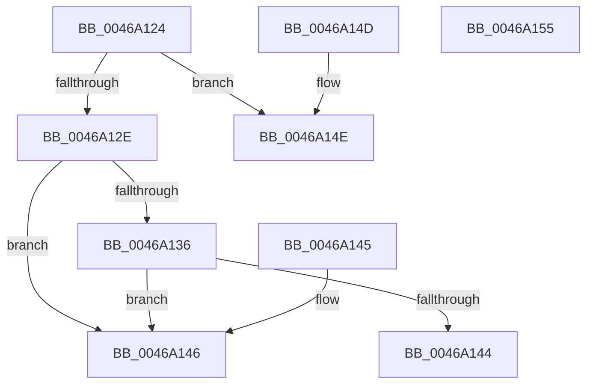

# PopFxGetLatencyLimitWithoutResiliency

- RVA: `0x0046A124`–`0x0046A156` (길이 `50` bytes)
- VA: `0x000000014046A124`
- 실행 섹션: `.text`
- PDB 이름 있음: `예`; PDB Function 태그: `아니요`
- unwind 정보 RVA: `0x000DB714`
- 디코드: `16`개 명령, `50/50` bytes 표시
- 미해석 바이트: `0` (있으면 어셈블리에 `.byte`로 보존)

> 이 문서는 커널 이미지의 기계어와 PDB 기호를 분석해 생성했습니다. 4번과 5번은 함수 원형과 자료형을 바이너리 사용 방식에서 추정한 C 해석이며 원본 소스 복구 결과는 아닙니다.

## 1. Dependencies

- 직접 호출 지점: **0**; 고유 호출 대상: **0**
- 직접 호출자로 확인된 함수: **1**
- RIP 상대 이미지 참조: **6**

### Outgoing calls
- 직접 디코드된 call 명령이 없습니다.

### Direct callers
- [PoFxSendSystemLatencyUpdate](PoFxSendSystemLatencyUpdate_function_0046A008.md) at `0x0046A041`

### Static image references
- `0x0046A126` → RVA `0x00F0CE4E` (`.data`; read)
- `0x0046A12E` → RVA `0x00FC6F90` (`ALMOSTRO`; read)
- `0x0046A136` → RVA `0x00E0B3DD` (`.data`; read)
- `0x0046A13C` → RVA `0x00FC5454` (`ALMOSTRO`; read)
- `0x0046A146` → RVA `0x00FC5450` (`ALMOSTRO`; read)
- `0x0046A14E` → RVA `0x00FC5458` (`ALMOSTRO`; read)

## 2. Other-region calls and transfers

- 다른 실행 섹션으로 향하는 call: **0**
- 별도 외부 분기/꼬리 이동을 확인하지 못했습니다.

## 3. Assembly (complete function range)

```asm
0046A124  33 C0                           xor eax, eax
0046A126  38 05 22 2D AA 00               cmp byte ptr [rip + 0xaa2d22], al
0046A12C  75 20                           jne 0x14046a14e
0046A12E  39 05 5C CE B5 00               cmp dword ptr [rip + 0xb5ce5c], eax
0046A134  75 10                           jne 0x14046a146
0046A136  38 05 A1 12 9A 00               cmp byte ptr [rip + 0x9a12a1], al
0046A13C  8B 05 12 B3 B5 00               mov eax, dword ptr [rip + 0xb5b312]
0046A142  74 02                           je 0x14046a146
0046A144  C3                              ret
0046A145  CC                              int3
0046A146  8B 05 04 B3 B5 00               mov eax, dword ptr [rip + 0xb5b304]
0046A14C  C3                              ret
0046A14D  CC                              int3
0046A14E  8B 05 04 B3 B5 00               mov eax, dword ptr [rip + 0xb5b304]
0046A154  C3                              ret
0046A155  CC                              int3
```

## 4. C-style interpretation (structured pseudocode)

```c
__int64 __fastcall PopFxGetLatencyLimitWithoutResiliency(void)
{
    __int64 result;

    result = 0;
    if ((*(unsigned __int8 *)(v_rip + 11152674)) != 0) goto loc_0046A14E;
    if ((*(unsigned int *)(v_rip + 11914844)) != 0) goto loc_0046A146;
    if ((*(unsigned __int8 *)(v_rip + 10097313)) == 0) goto loc_0046A146;
    return (unsigned int)(*(unsigned int *)(v_rip + 11907858));
loc_0046A146:
    return (unsigned int)(*(unsigned int *)(v_rip + 11907844));
loc_0046A14E:
    return (unsigned int)(*(unsigned int *)(v_rip + 11907844));
}
```

## 5. (Beta) C Style

```c
void PopFxGetLatencyLimitWithoutResiliency(void)
{
    int64_t result;

    result = 0;
    if ((*(uint8_t *)(v_rip + 0xAA2D22)) != 0) goto loc_0046A14E;
    if ((*(uint32_t *)(v_rip + 0xB5CE5C)) != 0) goto loc_0046A146;
    if ((*(uint8_t *)(v_rip + 0x9A12A1)) == 0) goto loc_0046A146;
    return (uint32_t)(*(uint32_t *)(v_rip + 0xB5B312));
loc_0046A146:
    return (uint32_t)(*(uint32_t *)(v_rip + 0xB5B304));
loc_0046A14E:
    return (uint32_t)(*(uint32_t *)(v_rip + 0xB5B304));
}
```

## 6. Execution-region graph

[열기: 2D/3D 그래프와 함수 탐색 컨트롤 패널](../../../control-panel.html?section=text&rva=0x0046A124&view=graph)

- 2D 그래프는 위에서 아래로 흐르고, 3D 그래프는 빈 공간을 드래그해 회전합니다. Shift+드래그는 이동, 휠은 확대·축소, 함수 노드 선택은 대상 보고서 이동입니다.

### Static fallback


