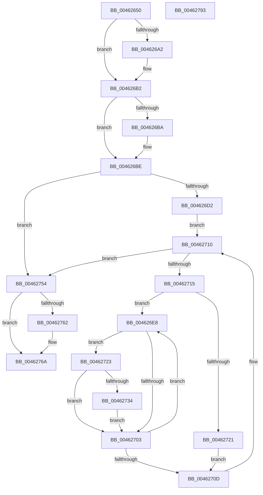

# PopFxResidentTimeoutRoutine

- RVA: `0x00462650`–`0x00462794` (길이 `324` bytes)
- VA: `0x0000000140462650`
- 실행 섹션: `.text`
- PDB 이름 있음: `예`; PDB Function 태그: `아니요`
- unwind 정보 RVA: `0x000AA2A0`
- 디코드: `91`개 명령, `324/324` bytes 표시
- 미해석 바이트: `0` (있으면 어셈블리에 `.byte`로 보존)

> 이 문서는 커널 이미지의 기계어와 PDB 기호를 분석해 생성했습니다. 4번과 5번은 함수 원형과 자료형을 바이너리 사용 방식에서 추정한 C 해석이며 원본 소스 복구 결과는 아닙니다.

## 1. Dependencies

- 직접 호출 지점: **8**; 고유 호출 대상: **8**
- 직접 호출자로 확인된 함수: **0**
- RIP 상대 이미지 참조: **4**

### Outgoing calls
- `0x00462689` → [KeAbPreAcquire](../21/KeAbPreAcquire_function_00210230.md) (function, `0x00210230`)
- `0x004626AD` → [ExfAcquirePushLockSharedEx](../21/ExfAcquirePushLockSharedEx_function_0021044C.md) (function, `0x0021044C`)
- `0x004626D7` → [RtlGetInterruptTimePrecise](../20/RtlGetInterruptTimePrecise_function_0020A4C0.md) (function, `0x0020A4C0`)
- `0x0046274D` → [PopFxIdleComponent](../2C/PopFxIdleComponent_function_002C01D8.md) (function, `0x002C01D8`)
- `0x00462765` → [ExfReleasePushLockShared](../26/ExfReleasePushLockShared_function_00263440.md) (function, `0x00263440`)
- `0x0046276D` → [KeAbPostRelease](../2E/KeAbPostRelease_function_002E1600.md) (function, `0x002E1600`)
- `0x00462772` → [KeLeaveCriticalRegion](../25/KeLeaveCriticalRegion_function_0025D8B0.md) (function, `0x0025D8B0`)
- `0x00462779` → [PopFxArmResidentTimer](../2C/PopFxArmResidentTimer_function_002C0680.md) (function, `0x002C0680`)

### Direct callers
- 이 함수 시작 RVA로 연결되는 직접 call은 확인되지 않았습니다. 간접 호출은 완전히 역산할 수 없습니다.

### Static image references
- `0x0046266D` → RVA `0x00F0E408` (`.data`; read)
- `0x004626BE` → RVA `0x00F0E3F0` (`.data`; read)
- `0x00462723` → RVA `0x00E0B3D4` (`.data`; read)
- `0x00462739` → RVA `0x00F0E430` (`.data`; read/write)

## 2. Other-region calls and transfers

- 다른 실행 섹션으로 향하는 call: **0**
- 별도 외부 분기/꼬리 이동을 확인하지 못했습니다.

## 3. Assembly (complete function range)

```asm
00462650  48 89 5C 24 08                  mov qword ptr [rsp + 8], rbx
00462655  55                              push rbp
00462656  56                              push rsi
00462657  57                              push rdi
00462658  41 54                           push r12
0046265A  41 55                           push r13
0046265C  41 56                           push r14
0046265E  41 57                           push r15
00462660  48 83 EC 20                     sub rsp, 0x20
00462664  65 48 8B 04 25 88 01 00 00      mov rax, qword ptr gs:[0x188]
0046266D  48 8D 2D 94 BD AA 00            lea rbp, [rip + 0xaabd94]
00462674  41 83 CD FF                     or r13d, 0xffffffff
00462678  45 33 C0                        xor r8d, r8d
0046267B  33 D2                           xor edx, edx
0046267D  48 8B CD                        mov rcx, rbp
00462680  66 44 01 A8 E4 01 00 00         add word ptr [rax + 0x1e4], r13w
00462688  90                              nop
00462689  E8 A2 DB DA FF                  call 0x140210230
0046268E  48 8B D8                        mov rbx, rax
00462691  45 8D 65 12                     lea r12d, [r13 + 0x12]
00462695  33 C0                           xor eax, eax
00462697  F0 4C 0F B1 25 68 BD AA 00      lock cmpxchg qword ptr [rip + 0xaabd68], r12
004626A0  74 10                           je 0x1404626b2
004626A2  4C 8B CD                        mov r9, rbp
004626A5  4C 8B C3                        mov r8, rbx
004626A8  33 D2                           xor edx, edx
004626AA  48 8B CD                        mov rcx, rbp
004626AD  E8 9A DD DA FF                  call 0x14021044c
004626B2  45 33 F6                        xor r14d, r14d
004626B5  48 85 DB                        test rbx, rbx
004626B8  74 04                           je 0x1404626be
004626BA  C6 43 0A 01                     mov byte ptr [rbx + 0xa], 1
004626BE  4C 8D 3D 2B BD AA 00            lea r15, [rip + 0xaabd2b]
004626C5  4C 39 3D 24 BD AA 00            cmp qword ptr [rip + 0xaabd24], r15
004626CC  0F 84 82 00 00 00               je 0x140462754
004626D2  48 8D 4C 24 70                  lea rcx, [rsp + 0x70]
004626D7  E8 E4 7D DA FF                  call 0x14020a4c0
004626DC  48 8B 1D 0D BD AA 00            mov rbx, qword ptr [rip + 0xaabd0d]
004626E3  48 8B F0                        mov rsi, rax
004626E6  EB 28                           jmp 0x140462710
004626E8  48 8B 83 68 03 00 00            mov rax, qword ptr [rbx + 0x368]
004626EF  8B CF                           mov ecx, edi
004626F1  48 8B 14 C8                     mov rdx, qword ptr [rax + rcx*8]
004626F5  4C 8B 82 90 00 00 00            mov r8, qword ptr [rdx + 0x90]
004626FC  8B 42 60                        mov eax, dword ptr [rdx + 0x60]
004626FF  85 C0                           test eax, eax
00462701  7F 20                           jg 0x140462723
00462703  FF C7                           inc edi
00462705  3B BB 64 03 00 00               cmp edi, dword ptr [rbx + 0x364]
0046270B  72 DB                           jb 0x1404626e8
0046270D  48 8B 1B                        mov rbx, qword ptr [rbx]
00462710  49 3B DF                        cmp rbx, r15
00462713  74 3F                           je 0x140462754
00462715  41 8B FE                        mov edi, r14d
00462718  44 39 B3 64 03 00 00            cmp dword ptr [rbx + 0x364], r14d
0046271F  77 C7                           ja 0x1404626e8
00462721  EB EA                           jmp 0x14046270d
00462723  8B 05 AB 8C 9A 00               mov eax, dword ptr [rip + 0x9a8cab]
00462729  48 8B CE                        mov rcx, rsi
0046272C  49 2B C8                        sub rcx, r8
0046272F  48 3B C8                        cmp rcx, rax
00462732  72 CF                           jb 0x140462703
00462734  F0 44 01 6A 60                  lock add dword ptr [rdx + 0x60], r13d
00462739  F0 44 01 2D EF BC AA 00         lock add dword ptr [rip + 0xaabcef], r13d
00462741  45 33 C9                        xor r9d, r9d
00462744  8B D7                           mov edx, edi
00462746  48 8B CB                        mov rcx, rbx
00462749  45 8D 41 01                     lea r8d, [r9 + 1]
0046274D  E8 86 DA E5 FF                  call 0x1402c01d8
00462752  EB AF                           jmp 0x140462703
00462754  49 8B C4                        mov rax, r12
00462757  F0 4C 0F B1 35 A8 BC AA 00      lock cmpxchg qword ptr [rip + 0xaabca8], r14
00462760  74 08                           je 0x14046276a
00462762  48 8B CD                        mov rcx, rbp
00462765  E8 D6 0C E0 FF                  call 0x140263440
0046276A  48 8B CD                        mov rcx, rbp
0046276D  E8 8E EE E7 FF                  call 0x1402e1600
00462772  E8 39 B1 DF FF                  call 0x14025d8b0
00462777  B1 01                           mov cl, 1
00462779  E8 02 DF E5 FF                  call 0x1402c0680
0046277E  48 8B 5C 24 60                  mov rbx, qword ptr [rsp + 0x60]
00462783  48 83 C4 20                     add rsp, 0x20
00462787  41 5F                           pop r15
00462789  41 5E                           pop r14
0046278B  41 5D                           pop r13
0046278D  41 5C                           pop r12
0046278F  5F                              pop rdi
00462790  5E                              pop rsi
00462791  5D                              pop rbp
00462792  C3                              ret
00462793  CC                              int3
```

## 4. C-style interpretation (structured pseudocode)

```c
__int64 __fastcall PopFxResidentTimeoutRoutine(__int64 a1, int a2, int a3)
{
    __int64 result;
    __int64 v_r13;
    __int64 v_r14;
    __int64 v_rdi;
    __int64 v_rsp;
    unsigned __int64 v_stack_p18;
    unsigned __int64 v_stack_p8;

    v_stack_p8 = v_rbx;
    v_rsp = (v_rsp) - (32);
    v_r13 = (unsigned int)((v_r13) | (0xFFFFFFFFULL));
    a3 = 0;
    a2 = 0;
    result = KeAbPreAcquire(v_rip + 11189652, a2, a3, a4);
    result = 0;
    if (!(condition_is_equal)) {
        a4 = v_rip + 11189652;
        a3 = 0;
        a2 = 0;
        a1 = v_rip + 11189652;
        result = ExfAcquirePushLockSharedEx(a1, a2, a3, a4);
    }
    v_r14 = 0;
    if (result != 0) {
        *(unsigned __int8 *)(result + 10) = 1;
    }
    if ((*(unsigned __int64 *)(v_rip + 11189540)) == (v_rip + 11189547)) goto loc_00462754;
    result = RtlGetInterruptTimePrecise(v_stack_p18, a2, a3, a4);
    goto loc_00462710;
loc_004626E8:
    if (condition_is_greater) goto loc_00462723;
loc_00462703:
    v_rdi = (unsigned int)((v_rdi) + 1);
    if (((unsigned int)(v_rdi)) < (*(unsigned int *)(*(unsigned __int64 *)(v_rip + 11189517) + 868))) goto loc_004626E8;
loc_0046270D:
loc_00462710:
    if ((*(unsigned __int64 *)(*(unsigned __int64 *)(v_rip + 11189517))) == (v_rip + 11189547)) goto loc_00462754;
    if ((*(unsigned int *)(*(unsigned __int64 *)(*(unsigned __int64 *)(v_rip + 11189517)) + 868)) > 0) goto loc_004626E8;
    goto loc_0046270D;
loc_00462723:
    a1 = (result) - (*(unsigned __int64 *)(*(unsigned __int64 *)(*(unsigned __int64 *)(*(unsigned __int64 *)(v_rip + 11189517) + 872) + (unsigned int)((unsigned int)(v_rdi)) * 8) + 144));
    if (a1 < ((unsigned int)(*(unsigned int *)(v_rip + 10128555)))) goto loc_00462703;
    a4 = 0;
    result = PopFxIdleComponent(*(unsigned __int64 *)(*(unsigned __int64 *)(v_rip + 11189517)), 0, a4 + 1, a4);
    goto loc_00462703;
loc_00462754:
    result = v_r13 + 18;
    if (!(condition_is_equal)) {
        a1 = v_rip + 11189652;
        result = ExfReleasePushLockShared(a1, 0, a4 + 1, a4);
    }
    result = KeAbPostRelease(v_rip + 11189652, 0, a4 + 1, a4);
    result = KeLeaveCriticalRegion(v_rip + 11189652, 0, a4 + 1, a4);
    result = PopFxArmResidentTimer(1, 0, a4 + 1, a4);
    v_rsp = (v_rsp) + (32);
    return result;
}
```

## 5. (Beta) C Style

```c
int64_t PopFxResidentTimeoutRoutine(int64_t Arg1, int32_t Arg2, int32_t Arg3)
{
    int64_t result;
    int64_t local_r13;
    int64_t local_r14;
    int64_t local_rdi;
    int64_t local_rsp;
    uint64_t v_stack_p18;
    uint64_t v_stack_p8;

    v_stack_p8 = local_rbx;
    local_rsp = (local_rsp) - (32);
    local_r13 = (uint32_t)((local_r13) | (0xFFFFFFFFULL));
    Arg3 = 0;
    Arg2 = 0;
    result = KeAbPreAcquire(v_rip + 11189652, Arg2, Arg3, a4);
    result = 0;
    if (!(condition_is_equal)) {
        a4 = v_rip + 11189652;
        Arg3 = 0;
        Arg2 = 0;
        Arg1 = v_rip + 11189652;
        result = ExfAcquirePushLockSharedEx(Arg1, Arg2, Arg3, a4);
    }
    local_r14 = 0;
    if (result != 0) {
        *(uint8_t *)(result + 0xA) = 1;
    }
    if ((*(uint64_t *)(v_rip + 0xAABD24)) == (v_rip + 11189547)) goto loc_00462754;
    result = RtlGetInterruptTimePrecise(v_stack_p18, Arg2, Arg3, a4);
    goto loc_00462710;
loc_004626E8:
    if (condition_is_greater) goto loc_00462723;
loc_00462703:
    local_rdi = (uint32_t)((local_rdi) + 1);
    if (((uint32_t)(local_rdi)) < (*(uint32_t *)(*(uint64_t *)(v_rip + 0xAABD0D) + 0x364))) goto loc_004626E8;
loc_0046270D:
loc_00462710:
    if ((*(uint64_t *)(*(uint64_t *)(v_rip + 0xAABD0D))) == (v_rip + 11189547)) goto loc_00462754;
    if ((*(uint32_t *)(*(uint64_t *)(*(uint64_t *)(v_rip + 0xAABD0D)) + 0x364)) > 0) goto loc_004626E8;
    goto loc_0046270D;
loc_00462723:
    Arg1 = (result) - (*(uint64_t *)(*(uint64_t *)(*(uint64_t *)(*(uint64_t *)(v_rip + 0xAABD0D) + 0x368) + (uint32_t)((uint32_t)(local_rdi)) * 8) + 0x90));
    if (Arg1 < ((uint32_t)(*(uint32_t *)(v_rip + 0x9A8CAB)))) goto loc_00462703;
    a4 = 0;
    result = PopFxIdleComponent(*(uint64_t *)(*(uint64_t *)(v_rip + 0xAABD0D)), 0, a4 + 1, a4);
    goto loc_00462703;
loc_00462754:
    result = local_r13 + 18;
    if (!(condition_is_equal)) {
        Arg1 = v_rip + 11189652;
        result = ExfReleasePushLockShared(Arg1, 0, a4 + 1, a4);
    }
    result = KeAbPostRelease(v_rip + 11189652, 0, a4 + 1, a4);
    result = KeLeaveCriticalRegion(v_rip + 11189652, 0, a4 + 1, a4);
    result = PopFxArmResidentTimer(1, 0, a4 + 1, a4);
    local_rsp = (local_rsp) + (32);
    return result;
}
```

## 6. Execution-region graph

[열기: 2D/3D 그래프와 함수 탐색 컨트롤 패널](../../../control-panel.html?section=text&rva=0x00462650&view=graph)

- 2D 그래프는 위에서 아래로 흐르고, 3D 그래프는 빈 공간을 드래그해 회전합니다. Shift+드래그는 이동, 휠은 확대·축소, 함수 노드 선택은 대상 보고서 이동입니다.

### Static fallback


