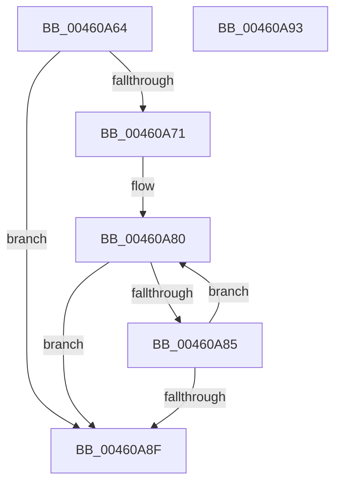

# PopPepComponentGetLatencyIdleState

- RVA: `0x00460A64`–`0x00460A94` (길이 `48` bytes)
- VA: `0x0000000140460A64`
- 실행 섹션: `.text`
- PDB 이름 있음: `예`; PDB Function 태그: `아니요`
- unwind 정보 RVA: `0x000DB714`
- 디코드: `14`개 명령, `48/48` bytes 표시
- 미해석 바이트: `0` (있으면 어셈블리에 `.byte`로 보존)

> 이 문서는 커널 이미지의 기계어와 PDB 기호를 분석해 생성했습니다. 4번과 5번은 함수 원형과 자료형을 바이너리 사용 방식에서 추정한 C 해석이며 원본 소스 복구 결과는 아닙니다.

## 1. Dependencies

- 직접 호출 지점: **0**; 고유 호출 대상: **0**
- 직접 호출자로 확인된 함수: **1**
- RIP 상대 이미지 참조: **0**

### Outgoing calls
- 직접 디코드된 call 명령이 없습니다.

### Direct callers
- [PopPepRegisterDevice](../../page/AA/PopPepRegisterDevice_function_00AAEBD0.md) at `0x00AAEE78`

### Static image references
- 디코드된 RIP-relative 메모리 참조가 없습니다.

## 2. Other-region calls and transfers

- 다른 실행 섹션으로 향하는 call: **0**
- 별도 외부 분기/꼬리 이동을 확인하지 못했습니다.

## 3. Assembly (complete function range)

```asm
00460A64  44 8B 89 BC 00 00 00            mov r9d, dword ptr [rcx + 0xbc]
00460A6B  41 83 E9 01                     sub r9d, 1
00460A6F  74 1E                           je 0x140460a8f
00460A71  48 8B 81 C8 00 00 00            mov rax, qword ptr [rcx + 0xc8]
00460A78  4F 8D 04 49                     lea r8, [r9 + r9*2]
00460A7C  4A 8D 0C C0                     lea rcx, [rax + r8*8]
00460A80  48 39 11                        cmp qword ptr [rcx], rdx
00460A83  76 0A                           jbe 0x140460a8f
00460A85  48 83 E9 18                     sub rcx, 0x18
00460A89  41 83 C1 FF                     add r9d, -1
00460A8D  75 F1                           jne 0x140460a80
00460A8F  41 8B C1                        mov eax, r9d
00460A92  C3                              ret
00460A93  CC                              int3
```

## 4. C-style interpretation (structured pseudocode)

```c
__int64 __fastcall PopPepComponentGetLatencyIdleState(__int64 a1, __int64 a2)
{
    a4 = (unsigned int)(((unsigned int)(*(unsigned int *)(a1 + 188))) - (1));
    if (condition_is_equal) goto loc_00460A8F;
loc_00460A80:
    if ((*(unsigned __int64 *)(*(unsigned __int64 *)(a1 + 200) + a4 + a4 * 2 * 8)) <= a2) goto loc_00460A8F;
    a1 = (*(unsigned __int64 *)(a1 + 200) + a4 + a4 * 2 * 8) - (24);
    a4 = (unsigned int)((a4) + (-1));
    if (condition_is_not_equal) goto loc_00460A80;
loc_00460A8F:
    return (unsigned int)((unsigned int)(a4));
}
```

## 5. (Beta) C Style

```c
int64_t PopPepComponentGetLatencyIdleState(void *Arg1, int64_t Arg2)
{
    uint8_t *arg1 = (uint8_t *)Arg1;

    a4 = (uint32_t)(((uint32_t)(*(uint32_t *)(arg1 + 0xBC))) - (1));
    if (condition_is_equal) goto loc_00460A8F;
loc_00460A80:
    if ((*(uint64_t *)(*(uint64_t *)(arg1 + 0xC8) + a4 + a4 * 2 * 8)) <= Arg2) goto loc_00460A8F;
    Arg1 = (*(uint64_t *)(arg1 + 0xC8) + a4 + a4 * 2 * 8) - (24);
    a4 = (uint32_t)((a4) + (-1));
    if (condition_is_not_equal) goto loc_00460A80;
loc_00460A8F:
    return (uint32_t)((uint32_t)(a4));
}
```

### 관측된 메모리 오프셋

구조체 형식이 확인되지 않은 접근은 인자 기준의 오프셋으로만 기록했습니다.

| 기준 인자 | 오프셋 표현 | 폭 (bit) | 접근 |
|---|---:|---:|---|
| `Arg1` | `+ 0xBC` | `32` | `R` |
| `Arg1` | `+ 0xC8` | `64` | `R` |

## 6. Execution-region graph

[열기: 2D/3D 그래프와 함수 탐색 컨트롤 패널](../../../control-panel.html?section=text&rva=0x00460A64&view=graph)

- 2D 그래프는 위에서 아래로 흐르고, 3D 그래프는 빈 공간을 드래그해 회전합니다. Shift+드래그는 이동, 휠은 확대·축소, 함수 노드 선택은 대상 보고서 이동입니다.

### Static fallback


