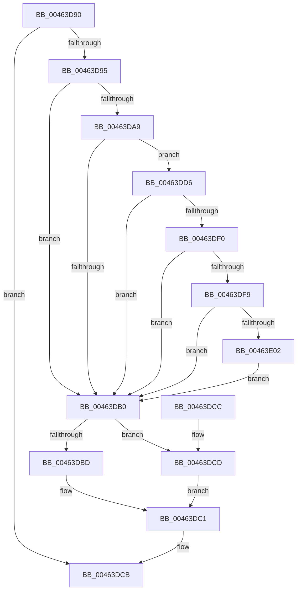

# PopPepTriggerComponentIdleStateChangeActivity

- RVA: `0x00463D90`–`0x00463E11` (길이 `129` bytes)
- VA: `0x0000000140463D90`
- 실행 섹션: `.text`
- PDB 이름 있음: `예`; PDB Function 태그: `아니요`
- unwind 정보 RVA: `0x000AA7D8`
- 디코드: `41`개 명령, `129/129` bytes 표시
- 미해석 바이트: `0` (있으면 어셈블리에 `.byte`로 보존)

> 이 문서는 커널 이미지의 기계어와 PDB 기호를 분석해 생성했습니다. 4번과 5번은 함수 원형과 자료형을 바이너리 사용 방식에서 추정한 C 해석이며 원본 소스 복구 결과는 아닙니다.

## 1. Dependencies

- 직접 호출 지점: **1**; 고유 호출 대상: **1**
- 직접 호출자로 확인된 함수: **2**
- RIP 상대 이미지 참조: **0**

### Outgoing calls
- `0x00463E0A` → [PopPepTriggerActivity](../24/PopPepTriggerActivity_function_0024CDB0.md) (function, `0x0024CDB0`)

### Direct callers
- [PopPepProcessEvent](../24/PopPepProcessEvent_function_0024B930.md) at `0x0024C7C2`
- [PopPepTriggerActivity](../24/PopPepTriggerActivity_function_0024CDB0.md) at `0x0024D088`

### Static image references
- 디코드된 RIP-relative 메모리 참조가 없습니다.

## 2. Other-region calls and transfers

- 다른 실행 섹션으로 향하는 call: **0**
- 별도 외부 분기/꼬리 이동을 확인하지 못했습니다.

## 3. Assembly (complete function range)

```asm
00463D90  48 85 D2                        test rdx, rdx
00463D93  74 36                           je 0x140463dcb
00463D95  48 89 5C 24 08                  mov qword ptr [rsp + 8], rbx
00463D9A  57                              push rdi
00463D9B  48 83 EC 20                     sub rsp, 0x20
00463D9F  41 8B D8                        mov ebx, r8d
00463DA2  48 8B FA                        mov rdi, rdx
00463DA5  85 DB                           test ebx, ebx
00463DA7  79 07                           jns 0x140463db0
00463DA9  8B 42 04                        mov eax, dword ptr [rdx + 4]
00463DAC  A8 02                           test al, 2
00463DAE  74 26                           je 0x140463dd6
00463DB0  83 BF B0 00 00 00 00            cmp dword ptr [rdi + 0xb0], 0
00463DB7  48 8B 47 40                     mov rax, qword ptr [rdi + 0x40]
00463DBB  74 10                           je 0x140463dcd
00463DBD  83 60 04 00                     and dword ptr [rax + 4], 0
00463DC1  48 8B 5C 24 30                  mov rbx, qword ptr [rsp + 0x30]
00463DC6  48 83 C4 20                     add rsp, 0x20
00463DCA  5F                              pop rdi
00463DCB  C3                              ret
00463DCC  CC                              int3
00463DCD  0F BA F3 1F                     btr ebx, 0x1f
00463DD1  89 58 04                        mov dword ptr [rax + 4], ebx
00463DD4  EB EB                           jmp 0x140463dc1
00463DD6  83 C8 02                        or eax, 2
00463DD9  89 42 04                        mov dword ptr [rdx + 4], eax
00463DDC  B8 01 00 00 00                  mov eax, 1
00463DE1  F0 0F C1 81 8C 00 00 00         lock xadd dword ptr [rcx + 0x8c], eax
00463DE9  FF C0                           inc eax
00463DEB  83 F8 01                        cmp eax, 1
00463DEE  75 C0                           jne 0x140463db0
00463DF0  80 B9 88 00 00 00 00            cmp byte ptr [rcx + 0x88], 0
00463DF7  75 B7                           jne 0x140463db0
00463DF9  48 8B 41 48                     mov rax, qword ptr [rcx + 0x48]
00463DFD  83 38 00                        cmp dword ptr [rax], 0
00463E00  75 AE                           jne 0x140463db0
00463E02  45 33 C9                        xor r9d, r9d
00463E05  45 33 C0                        xor r8d, r8d
00463E08  33 D2                           xor edx, edx
00463E0A  E8 A1 8F DE FF                  call 0x14024cdb0
00463E0F  EB 9F                           jmp 0x140463db0
```

## 4. C-style interpretation (structured pseudocode)

```c
__int64 __fastcall PopPepTriggerComponentIdleStateChangeActivity(__int64 a1, __int64 a2, int a3, int a4)
{
    __int64 result;
    __int64 v_rsp;
    unsigned __int64 v_stack_p8;

    if (a2 == 0) goto loc_00463DCB;
    v_stack_p8 = v_rbx;
    v_rsp = (v_rsp) - (32);
    if (!sign_flag) goto loc_00463DB0;
    if ((((unsigned __int8)((unsigned int)(*(unsigned int *)(a2 + 4)))) & (2)) == 0) goto loc_00463DD6;
loc_00463DB0:
    if ((*(unsigned int *)(a2 + 176)) == 0) goto loc_00463DCD;
loc_00463DC1:
    v_rsp = (v_rsp) + (32);
loc_00463DCB:
    return *(unsigned __int64 *)(a2 + 64);
loc_00463DCD:
    *(unsigned int *)(*(unsigned __int64 *)(a2 + 64) + 4) = (unsigned int)(v_stack_p8);
    goto loc_00463DC1;
loc_00463DD6:
    result = (unsigned int)((*(unsigned __int64 *)(a2 + 64)) | (2));
    *(unsigned int *)(a2 + 4) = (unsigned int)(result);
    result = (unsigned int)((1) + 1);
    if (((unsigned int)(result)) != 1) goto loc_00463DB0;
    if ((*(unsigned __int8 *)(a1 + 136)) != 0) goto loc_00463DB0;
    if ((*(unsigned int *)(*(unsigned __int64 *)(a1 + 72))) != 0) goto loc_00463DB0;
    a4 = 0;
    a3 = 0;
    a2 = 0;
    result = PopPepTriggerActivity(a1, a2, a3, a4);
    goto loc_00463DB0;
}
```

## 5. (Beta) C Style

```c
int64_t PopPepTriggerComponentIdleStateChangeActivity(void *Arg1, int64_t Arg2, int32_t Arg3, int32_t Arg4)
{
    uint8_t *arg1 = (uint8_t *)Arg1;

    int64_t result;
    int64_t local_rsp;
    uint64_t v_stack_p8;

    if (Arg2 == 0) goto loc_00463DCB;
    v_stack_p8 = local_rbx;
    local_rsp = (local_rsp) - (32);
    if (!sign_flag) goto loc_00463DB0;
    if ((((uint8_t)((uint32_t)(*(uint32_t *)(Arg2 + 0x4)))) & (2)) == 0) goto loc_00463DD6;
loc_00463DB0:
    if ((*(uint32_t *)(Arg2 + 0xB0)) == 0) goto loc_00463DCD;
loc_00463DC1:
    local_rsp = (local_rsp) + (32);
loc_00463DCB:
    return *(uint64_t *)(Arg2 + 0x40);
loc_00463DCD:
    *(uint32_t *)(*(uint64_t *)(Arg2 + 0x40) + 0x4) = (uint32_t)(v_stack_p8);
    goto loc_00463DC1;
loc_00463DD6:
    result = (uint32_t)((*(uint64_t *)(Arg2 + 0x40)) | (2));
    *(uint32_t *)(Arg2 + 0x4) = (uint32_t)(result);
    result = (uint32_t)((1) + 1);
    if (((uint32_t)(result)) != 1) goto loc_00463DB0;
    if ((*(uint8_t *)(arg1 + 0x88)) != 0) goto loc_00463DB0;
    if ((*(uint32_t *)(*(uint64_t *)(arg1 + 0x48))) != 0) goto loc_00463DB0;
    Arg4 = 0;
    Arg3 = 0;
    Arg2 = 0;
    result = PopPepTriggerActivity(Arg1, Arg2, Arg3, Arg4);
    goto loc_00463DB0;
}
```

### 관측된 메모리 오프셋

구조체 형식이 확인되지 않은 접근은 인자 기준의 오프셋으로만 기록했습니다.

| 기준 인자 | 오프셋 표현 | 폭 (bit) | 접근 |
|---|---:|---:|---|
| `Arg1` | `+ 0x48` | `64` | `R` |
| `Arg1` | `+ 0x88` | `8` | `R` |
| `Arg1` | `+ 0x8C` | `32` | `R/W` |

## 6. Execution-region graph

[열기: 2D/3D 그래프와 함수 탐색 컨트롤 패널](../../../control-panel.html?section=text&rva=0x00463D90&view=graph)

- 2D 그래프는 위에서 아래로 흐르고, 3D 그래프는 빈 공간을 드래그해 회전합니다. Shift+드래그는 이동, 휠은 확대·축소, 함수 노드 선택은 대상 보고서 이동입니다.

### Static fallback


