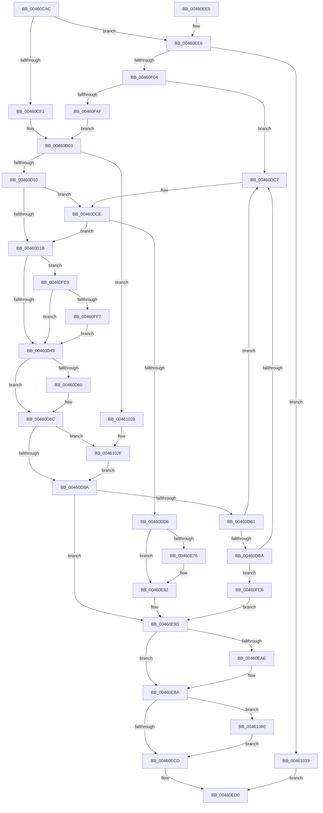

# PopSetWatchdog

- RVA: `0x00460CAC`–`0x00461070` (길이 `964` bytes)
- VA: `0x0000000140460CAC`
- 실행 섹션: `.text`
- PDB 이름 있음: `예`; PDB Function 태그: `아니요`
- unwind 정보 RVA: `0x000A9D70`
- 디코드: `213`개 명령, `964/964` bytes 표시
- 미해석 바이트: `0` (있으면 어셈블리에 `.byte`로 보존)

> 이 문서는 커널 이미지의 기계어와 PDB 기호를 분석해 생성했습니다. 4번과 5번은 함수 원형과 자료형을 바이너리 사용 방식에서 추정한 C 해석이며 원본 소스 복구 결과는 아닙니다.

## 1. Dependencies

- 직접 호출 지점: **21**; 고유 호출 대상: **13**
- 직접 호출자로 확인된 함수: **1**
- RIP 상대 이미지 참조: **6**

### Outgoing calls
- `0x00460CCE` → [RtlGetInterruptTimePrecise](../20/RtlGetInterruptTimePrecise_function_0020A4C0.md) (function, `0x0020A4C0`)
- `0x00460CFB` → [KeAcquireSpinLockRaiseToDpc](../20/KeAcquireSpinLockRaiseToDpc_function_00208470.md) (function, `0x00208470`)
- `0x00460D2A` → [RtlGetInterruptTimePrecise](../20/RtlGetInterruptTimePrecise_function_0020A4C0.md) (function, `0x0020A4C0`)
- `0x00460D57` → [KeCancelTimer](../23/KeCancelTimer_function_002327E0.md) (function, `0x002327E0`)
- `0x00460D67` → [PopUpdateWatchdogNoWorkersEvent](PopUpdateWatchdogNoWorkersEvent_function_00461078.md) (function, `0x00461078`)
- `0x00460D74` → [RtlGetInterruptTimePrecise](../20/RtlGetInterruptTimePrecise_function_0020A4C0.md) (function, `0x0020A4C0`)
- `0x00460D92` → [RtlGetInterruptTimePrecise](../20/RtlGetInterruptTimePrecise_function_0020A4C0.md) (function, `0x0020A4C0`)
- `0x00460DA4` → [memset](../6C/memset_function_006C6C40.md) (function, `0x006C6C40`)
- `0x00460E22` → [RtlGetInterruptTimePrecise](../20/RtlGetInterruptTimePrecise_function_0020A4C0.md) (function, `0x0020A4C0`)
- `0x00460E6D` → [KiSetTimerEx](../23/KiSetTimerEx_function_00232CB0.md) (function, `0x00232CB0`)
- `0x00460E7D` → [PopUpdateWatchdogNoWorkersEvent](PopUpdateWatchdogNoWorkersEvent_function_00461078.md) (function, `0x00461078`)
- `0x00460E91` → [RtlGetInterruptTimePrecise](../20/RtlGetInterruptTimePrecise_function_0020A4C0.md) (function, `0x0020A4C0`)
- `0x00460EA0` → [KxReleaseSpinLock](../20/KxReleaseSpinLock_function_00206670.md) (function, `0x00206670`)
- `0x00460EB5` → [KiLowerIrqlProcessIrqlFlags](../4F/KiLowerIrqlProcessIrqlFlags_function_004F5698.md) (function, `0x004F5698`)
- `0x00460EF3` → [ExAllocatePool2](../../poolcode/B8/ExAllocatePool2_function_00B820F0.md) (function, `0x00B820F0`)
- `0x00460F8F` → [KeAcquireSpinLockRaiseToDpc](../20/KeAcquireSpinLockRaiseToDpc_function_00208470.md) (function, `0x00208470`)
- `0x00460FDC` → [ExFreePoolWithTag](../../poolcode/B8/ExFreePoolWithTag_function_00B82870.md) (function, `0x00B82870`)
- `0x00461035` → [KeReleaseSpinLock](../39/KeReleaseSpinLock_function_00392BA0.md) (function, `0x00392BA0`)
- `0x0046104B` → [KeWaitForSingleObject](../20/KeWaitForSingleObject_function_0020E6B0.md) (function, `0x0020E6B0`)
- `0x00461053` → [KeAcquireSpinLockRaiseToDpc](../20/KeAcquireSpinLockRaiseToDpc_function_00208470.md) (function, `0x00208470`)
- `0x00461066` → [PopCacheDisplayOnPhaseDuration](../4D/PopCacheDisplayOnPhaseDuration_function_004D291C.md) (function, `0x004D291C`)

### Direct callers
- [PopPowerInformationInternal](../../page/A8/PopPowerInformationInternal_function_00A8B7C0.md) at `0x00A8C05C`

### Static image references
- `0x00460CF1` → RVA `0x00F083F8` (`.data`; read)
- `0x00460EA5` → RVA `0x00FC6D20` (`ALMOSTRO`; read)
- `0x00460F34` → RVA `0x005DA160` (`PopWatchdogDpc`; read)
- `0x00460F4D` → RVA `0x005DA200` (`PopWatchdogWorker`; read)
- `0x00460F97` → RVA `0x00F08400` (`.data`; read)
- `0x00460FBA` → RVA `0x00F08400` (`.data`; write)

## 2. Other-region calls and transfers

- 다른 실행 섹션으로 향하는 call: **2**
  - `0x00460EF3` → [ExAllocatePool2](../../poolcode/B8/ExAllocatePool2_function_00B820F0.md) (`.text` → `POOLCODE`)
  - `0x00460FDC` → [ExFreePoolWithTag](../../poolcode/B8/ExFreePoolWithTag_function_00B82870.md) (`.text` → `POOLCODE`)
- 별도 외부 분기/꼬리 이동을 확인하지 못했습니다.

## 3. Assembly (complete function range)

```asm
00460CAC  48 89 5C 24 10                  mov qword ptr [rsp + 0x10], rbx
00460CB1  55                              push rbp
00460CB2  56                              push rsi
00460CB3  57                              push rdi
00460CB4  41 54                           push r12
00460CB6  41 55                           push r13
00460CB8  41 56                           push r14
00460CBA  41 57                           push r15
00460CBC  48 83 EC 30                     sub rsp, 0x30
00460CC0  48 8B F9                        mov rdi, rcx
00460CC3  41 8A D8                        mov bl, r8b
00460CC6  48 8D 4C 24 70                  lea rcx, [rsp + 0x70]
00460CCB  4C 8B FA                        mov r15, rdx
00460CCE  E8 ED 97 DA FF                  call 0x14020a4c0
00460CD3  33 F6                           xor esi, esi
00460CD5  4C 8B E0                        mov r12, rax
00460CD8  40 88 74 24 70                  mov byte ptr [rsp + 0x70], sil
00460CDD  44 8B F6                        mov r14d, esi
00460CE0  44 8B EE                        mov r13d, esi
00460CE3  BD 50 4F 57 44                  mov ebp, 0x44574f50
00460CE8  48 85 FF                        test rdi, rdi
00460CEB  0F 84 F5 01 00 00               je 0x140460ee6
00460CF1  48 8D 35 00 77 AA 00            lea rsi, [rip + 0xaa7700]
00460CF8  48 8B CE                        mov rcx, rsi
00460CFB  E8 70 77 DA FF                  call 0x140208470
00460D00  40 8A E8                        mov bpl, al
00460D03  81 7F 10 50 4F 57 44            cmp dword ptr [rdi + 0x10], 0x44574f50
00460D0A  0F 85 18 03 00 00               jne 0x140461028
00460D10  41 8B 07                        mov eax, dword ptr [r15]
00460D13  85 C0                           test eax, eax
00460D15  0F 85 B3 00 00 00               jne 0x140460dce
00460D1B  48 8D 8C 24 88 00 00 00         lea rcx, [rsp + 0x88]
00460D23  4C 89 A7 48 01 00 00            mov qword ptr [rdi + 0x148], r12
00460D2A  E8 91 97 DA FF                  call 0x14020a4c0
00460D2F  81 BF E0 00 00 00 9C 01 00 00   cmp dword ptr [rdi + 0xe0], 0x19c
00460D39  48 8B C8                        mov rcx, rax
00460D3C  48 89 87 50 01 00 00            mov qword ptr [rdi + 0x150], rax
00460D43  0F 84 A0 02 00 00               je 0x140460fe9
00460D49  45 33 FF                        xor r15d, r15d
00460D4C  48 8D 4F 30                     lea rcx, [rdi + 0x30]
00460D50  44 88 BF D0 00 00 00            mov byte ptr [rdi + 0xd0], r15b
00460D57  E8 84 1A DD FF                  call 0x1402327e0
00460D5C  84 C0                           test al, al
00460D5E  74 0C                           je 0x140460d6c
00460D60  48 8B CF                        mov rcx, rdi
00460D63  44 88 7F 14                     mov byte ptr [rdi + 0x14], r15b
00460D67  E8 0C 03 00 00                  call 0x140461078
00460D6C  48 8D 8C 24 88 00 00 00         lea rcx, [rsp + 0x88]
00460D74  E8 47 97 DA FF                  call 0x14020a4c0
00460D79  48 89 87 58 01 00 00            mov qword ptr [rdi + 0x158], rax
00460D80  44 39 7F 1C                     cmp dword ptr [rdi + 0x1c], r15d
00460D84  0F 84 A5 02 00 00               je 0x14046102f
00460D8A  48 8D 8C 24 88 00 00 00         lea rcx, [rsp + 0x88]
00460D92  E8 29 97 DA FF                  call 0x14020a4c0
00460D97  33 D2                           xor edx, edx
00460D99  48 8D 8F 20 01 00 00            lea rcx, [rdi + 0x120]
00460DA0  44 8D 42 70                     lea r8d, [rdx + 0x70]
00460DA4  E8 97 5E 26 00                  call 0x1406c6c40
00460DA9  84 DB                           test bl, bl
00460DAB  0F 84 EC 00 00 00               je 0x140460e9d
00460DB1  48 8B 0F                        mov rcx, qword ptr [rdi]
00460DB4  48 39 79 08                     cmp qword ptr [rcx + 8], rdi
00460DB8  75 0D                           jne 0x140460dc7
00460DBA  48 8B 47 08                     mov rax, qword ptr [rdi + 8]
00460DBE  48 39 38                        cmp qword ptr [rax], rdi
00460DC1  0F 84 FF 01 00 00               je 0x140460fc6
00460DC7  B9 03 00 00 00                  mov ecx, 3
00460DCC  CD 29                           int 0x29
00460DCE  84 DB                           test bl, bl
00460DD0  0F 85 45 FF FF FF               jne 0x140460d1b
00460DD6  41 0F 10 07                     movups xmm0, xmmword ptr [r15]
00460DDA  48 8D 8C 24 88 00 00 00         lea rcx, [rsp + 0x88]
00460DE2  48 69 D8 10 27 00 00            imul rbx, rax, 0x2710
00460DE9  0F 11 87 D8 00 00 00            movups xmmword ptr [rdi + 0xd8], xmm0
00460DF0  41 0F 10 4F 10                  movups xmm1, xmmword ptr [r15 + 0x10]
00460DF5  0F 11 8F E8 00 00 00            movups xmmword ptr [rdi + 0xe8], xmm1
00460DFC  41 0F 10 47 20                  movups xmm0, xmmword ptr [r15 + 0x20]
00460E01  0F 11 87 F8 00 00 00            movups xmmword ptr [rdi + 0xf8], xmm0
00460E08  41 0F 10 4F 30                  movups xmm1, xmmword ptr [r15 + 0x30]
00460E0D  0F 11 8F 08 01 00 00            movups xmmword ptr [rdi + 0x108], xmm1
00460E14  F2 41 0F 10 47 40               movsd xmm0, qword ptr [r15 + 0x40]
00460E1A  F2 0F 11 87 18 01 00 00         movsd qword ptr [rdi + 0x118], xmm0
00460E22  E8 99 96 DA FF                  call 0x14020a4c0
00460E27  48 89 87 28 01 00 00            mov qword ptr [rdi + 0x128], rax
00460E2E  48 8D 4F 30                     lea rcx, [rdi + 0x30]
00460E32  48 03 C3                        add rax, rbx
00460E35  45 33 C9                        xor r9d, r9d
00460E38  48 89 87 30 01 00 00            mov qword ptr [rdi + 0x130], rax
00460E3F  48 F7 DB                        neg rbx
00460E42  65 48 8B 04 25 88 01 00 00      mov rax, qword ptr gs:[0x188]
00460E4B  45 33 C0                        xor r8d, r8d
00460E4E  48 89 87 20 01 00 00            mov qword ptr [rdi + 0x120], rax
00460E55  48 8B D3                        mov rdx, rbx
00460E58  48 8D 47 70                     lea rax, [rdi + 0x70]
00460E5C  66 C7 87 D0 00 00 00 01 00      mov word ptr [rdi + 0xd0], 1
00460E65  48 89 44 24 20                  mov qword ptr [rsp + 0x20], rax
00460E6A  45 33 FF                        xor r15d, r15d
00460E6D  E8 3E 1E DD FF                  call 0x140232cb0
00460E72  84 C0                           test al, al
00460E74  75 0C                           jne 0x140460e82
00460E76  48 8B CF                        mov rcx, rdi
00460E79  C6 47 14 01                     mov byte ptr [rdi + 0x14], 1
00460E7D  E8 F6 01 00 00                  call 0x140461078
00460E82  48 8D 8C 24 88 00 00 00         lea rcx, [rsp + 0x88]
00460E8A  4C 89 A7 38 01 00 00            mov qword ptr [rdi + 0x138], r12
00460E91  E8 2A 96 DA FF                  call 0x14020a4c0
00460E96  48 89 87 40 01 00 00            mov qword ptr [rdi + 0x140], rax
00460E9D  48 8B CE                        mov rcx, rsi
00460EA0  E8 CB 57 DA FF                  call 0x140206670
00460EA5  44 39 3D 74 5E B6 00            cmp dword ptr [rip + 0xb65e74], r15d
00460EAC  74 0C                           je 0x140460eba
00460EAE  44 0F 20 C1                     mov rcx, cr8
00460EB2  40 8A D5                        mov dl, bpl
00460EB5  E8 DE 47 09 00                  call 0x1404f5698
00460EBA  40 0F B6 C5                     movzx eax, bpl
00460EBE  44 0F 22 C0                     mov cr8, rax
00460EC2  44 38 7C 24 70                  cmp byte ptr [rsp + 0x70], r15b
00460EC7  0F 85 93 01 00 00               jne 0x140461060
00460ECD  48 8B C7                        mov rax, rdi
00460ED0  48 8B 5C 24 78                  mov rbx, qword ptr [rsp + 0x78]
00460ED5  48 83 C4 30                     add rsp, 0x30
00460ED9  41 5F                           pop r15
00460EDB  41 5E                           pop r14
00460EDD  41 5D                           pop r13
00460EDF  41 5C                           pop r12
00460EE1  5F                              pop rdi
00460EE2  5E                              pop rsi
00460EE3  5D                              pop rbp
00460EE4  C3                              ret
00460EE5  CC                              int3
00460EE6  44 8B C5                        mov r8d, ebp
00460EE9  BA 90 01 00 00                  mov edx, 0x190
00460EEE  B9 40 00 00 00                  mov ecx, 0x40
00460EF3  E8 F8 11 72 00                  call 0x140b820f0
00460EF8  48 8B F8                        mov rdi, rax
00460EFB  48 85 C0                        test rax, rax
00460EFE  0F 84 1F 01 00 00               je 0x140461023
00460F04  89 68 10                        mov dword ptr [rax + 0x10], ebp
00460F07  66 89 70 18                     mov word ptr [rax + 0x18], si
00460F0B  C6 40 1A 06                     mov byte ptr [rax + 0x1a], 6
00460F0F  C7 40 1C 01 00 00 00            mov dword ptr [rax + 0x1c], 1
00460F16  48 83 C0 20                     add rax, 0x20
00460F1A  48 89 40 08                     mov qword ptr [rax + 8], rax
00460F1E  48 89 00                        mov qword ptr [rax], rax
00460F21  48 8D 47 38                     lea rax, [rdi + 0x38]
00460F25  48 89 77 30                     mov qword ptr [rdi + 0x30], rsi
00460F29  C6 47 30 08                     mov byte ptr [rdi + 0x30], 8
00460F2D  48 89 40 08                     mov qword ptr [rax + 8], rax
00460F31  48 89 00                        mov qword ptr [rax], rax
00460F34  48 8D 05 25 92 17 00            lea rax, [rip + 0x179225]
00460F3B  48 89 77 48                     mov qword ptr [rdi + 0x48], rsi
00460F3F  89 77 6C                        mov dword ptr [rdi + 0x6c], esi
00460F42  66 89 77 68                     mov word ptr [rdi + 0x68], si
00460F46  48 89 87 88 00 00 00            mov qword ptr [rdi + 0x88], rax
00460F4D  48 8D 05 AC 92 17 00            lea rax, [rip + 0x1792ac]
00460F54  48 89 B7 A8 00 00 00            mov qword ptr [rdi + 0xa8], rsi
00460F5B  48 89 B7 80 00 00 00            mov qword ptr [rdi + 0x80], rsi
00460F62  C7 47 70 13 01 00 00            mov dword ptr [rdi + 0x70], 0x113
00460F69  48 89 BF 90 00 00 00            mov qword ptr [rdi + 0x90], rdi
00460F70  48 89 B7 B0 00 00 00            mov qword ptr [rdi + 0xb0], rsi
00460F77  48 8D 35 7A 74 AA 00            lea rsi, [rip + 0xaa747a]
00460F7E  48 8B CE                        mov rcx, rsi
00460F81  48 89 87 C0 00 00 00            mov qword ptr [rdi + 0xc0], rax
00460F88  48 89 BF C8 00 00 00            mov qword ptr [rdi + 0xc8], rdi
00460F8F  E8 DC 74 DA FF                  call 0x140208470
00460F94  40 8A E8                        mov bpl, al
00460F97  48 8D 0D 62 74 AA 00            lea rcx, [rip + 0xaa7462]
00460F9E  48 8B 05 5B 74 AA 00            mov rax, qword ptr [rip + 0xaa745b]
00460FA5  48 39 48 08                     cmp qword ptr [rax + 8], rcx
00460FA9  0F 85 18 FE FF FF               jne 0x140460dc7
00460FAF  48 89 07                        mov qword ptr [rdi], rax
00460FB2  48 89 4F 08                     mov qword ptr [rdi + 8], rcx
00460FB6  48 89 78 08                     mov qword ptr [rax + 8], rdi
00460FBA  48 89 3D 3F 74 AA 00            mov qword ptr [rip + 0xaa743f], rdi
00460FC1  E9 3D FD FF FF                  jmp 0x140460d03
00460FC6  48 89 08                        mov qword ptr [rax], rcx
00460FC9  BA 50 4F 57 44                  mov edx, 0x44574f50
00460FCE  48 89 41 08                     mov qword ptr [rcx + 8], rax
00460FD2  48 8B CF                        mov rcx, rdi
00460FD5  C7 47 10 4E 4F 4E 4F            mov dword ptr [rdi + 0x10], 0x4f4e4f4e
00460FDC  E8 8F 18 72 00                  call 0x140b82870
00460FE1  49 8B FF                        mov rdi, r15
00460FE4  E9 B4 FE FF FF                  jmp 0x140460e9d
00460FE9  48 83 BF E8 00 00 00 20         cmp qword ptr [rdi + 0xe8], 0x20
00460FF1  0F 86 52 FD FF FF               jbe 0x140460d49
00460FF7  48 2B 8F 28 01 00 00            sub rcx, qword ptr [rdi + 0x128]
00460FFE  48 B8 CD CC CC CC CC CC CC CC   movabs rax, 0xcccccccccccccccd
00461008  44 8B AF E8 00 00 00            mov r13d, dword ptr [rdi + 0xe8]
0046100F  48 F7 E1                        mul rcx
00461012  C6 44 24 70 01                  mov byte ptr [rsp + 0x70], 1
00461017  4C 8B F2                        mov r14, rdx
0046101A  49 C1 EE 03                     shr r14, 3
0046101E  E9 26 FD FF FF                  jmp 0x140460d49
00461023  E9 A8 FE FF FF                  jmp 0x140460ed0
00461028  B9 05 00 00 00                  mov ecx, 5
0046102D  CD 29                           int 0x29
0046102F  40 8A D5                        mov dl, bpl
00461032  48 8B CE                        mov rcx, rsi
00461035  E8 66 1B F3 FF                  call 0x140392ba0
0046103A  48 8D 4F 18                     lea rcx, [rdi + 0x18]
0046103E  4C 89 7C 24 20                  mov qword ptr [rsp + 0x20], r15
00461043  45 33 C9                        xor r9d, r9d
00461046  45 33 C0                        xor r8d, r8d
00461049  33 D2                           xor edx, edx
0046104B  E8 60 D6 DA FF                  call 0x14020e6b0
00461050  48 8B CE                        mov rcx, rsi
00461053  E8 18 74 DA FF                  call 0x140208470
00461058  40 8A E8                        mov bpl, al
0046105B  E9 2A FD FF FF                  jmp 0x140460d8a
00461060  49 8B D6                        mov rdx, r14
00461063  41 8B CD                        mov ecx, r13d
00461066  E8 B1 18 07 00                  call 0x1404d291c
0046106B  E9 5D FE FF FF                  jmp 0x140460ecd
```

## 4. C-style interpretation (structured pseudocode)

```c
__int64 __fastcall PopSetWatchdog(__int64 a1, __int64 a2, unsigned __int8 a3, int a4)
{
    __int64 result;
    __int64 v_r14;
    __int64 v_r15;
    __int64 v_rbx;
    __int64 v_rsi;
    __int64 v_rsp;
    unsigned __int64 v_stack_m48;
    unsigned __int64 v_stack_p10;
    unsigned __int64 v_stack_p20;
    unsigned __int8 v_stack_p70;
    unsigned __int64 v_stack_p8;

    v_stack_p10 = v_rbx;
    v_rsp = (v_rsp) - (48);
    result = RtlGetInterruptTimePrecise(v_stack_p8, a2, a3, a4);
    v_rsi = 0;
    v_stack_p8 = 0;
    if (a1 == 0) goto loc_00460EE6;
    result = KeAcquireSpinLockRaiseToDpc(v_rip + 11171584, a2, a3, a4);
loc_00460D03:
    if ((*(unsigned int *)(a1 + 16)) != 0x44574F50ULL) goto loc_00461028;
    if ((unsigned int)((unsigned int)(*(unsigned int *)(a2))) != 0) goto loc_00460DCE;
loc_00460D1B:
    *(unsigned __int64 *)(a1 + 328) = result;
    result = RtlGetInterruptTimePrecise(v_stack_p20, a2, a3, a4);
    *(unsigned __int64 *)(a1 + 336) = result;
    if ((*(unsigned int *)(a1 + 224)) == 412) goto loc_00460FE9;
loc_00460D49:
    v_r15 = 0;
    *(unsigned __int8 *)(a1 + 208) = 0;
    result = KeCancelTimer(a1 + 48, a2, a3, a4);
    if ((unsigned __int8)(result) != 0) {
        a1 = a1;
        *(unsigned __int8 *)(a1 + 20) = 0;
        result = PopUpdateWatchdogNoWorkersEvent(a1, a2, a3, a4);
    }
    result = RtlGetInterruptTimePrecise(v_stack_p20, a2, a3, a4);
    *(unsigned __int64 *)(a1 + 344) = result;
    if ((*(unsigned int *)(a1 + 28)) == 0) goto loc_0046102F;
loc_00460D8A:
    result = RtlGetInterruptTimePrecise(v_stack_p20, a2, a3, a4);
    a2 = 0;
    result = memset(a1 + 288, a2, a2 + 112, a4);
    if (a3 == 0) goto loc_00460E9D;
    if ((*(unsigned __int64 *)(*(unsigned __int64 *)(a1) + 8)) != a1) goto loc_00460DC7;
    if ((*(unsigned __int64 *)(*(unsigned __int64 *)(a1 + 8))) == a1) goto loc_00460FC6;
loc_00460DC7:
loc_00460DCE:
    if (a3 != 0) goto loc_00460D1B;
    v_rbx = (a3) * (*(unsigned __int64 *)(a1 + 8));
    *(unsigned __int64 *)(a1 + 216) = v_xmm0;
    *(unsigned __int64 *)(a1 + 232) = v_xmm1;
    *(unsigned __int64 *)(a1 + 248) = v_xmm0;
    *(unsigned __int64 *)(a1 + 264) = v_xmm1;
    *(unsigned __int64 *)(a1 + 280) = v_xmm0;
    result = RtlGetInterruptTimePrecise(v_stack_p20, a2, a2 + 112, a4);
    *(unsigned __int64 *)(a1 + 296) = result;
    result = (result) + (v_rbx);
    a4 = 0;
    *(unsigned __int64 *)(a1 + 304) = result;
    v_rbx = -(v_rbx);
    a3 = 0;
    *(unsigned __int64 *)(a1 + 288) = *(unsigned __int64 *)(gs_base + (0 + 392));
    *(unsigned __int16 *)(a1 + 208) = 1;
    v_stack_m48 = a1 + 112;
    v_r15 = 0;
    result = KiSetTimerEx(a1 + 48, v_rbx, a3, a4);
    if ((unsigned __int8)(result) == 0) {
        a1 = a1;
        *(unsigned __int8 *)(a1 + 20) = 1;
        result = PopUpdateWatchdogNoWorkersEvent(a1, v_rbx, a3, a4);
    }
    *(unsigned __int64 *)(a1 + 312) = result;
    result = RtlGetInterruptTimePrecise(v_stack_p20, v_rbx, a3, a4);
    *(unsigned __int64 *)(a1 + 320) = result;
loc_00460E9D:
    result = KxReleaseSpinLock(v_rip + 11171584, v_rbx, a3, a4);
    if ((*(unsigned int *)(v_rip + 11951732)) != 0) {
        a1 = v_cr8;
        a2 = (unsigned __int8)((unsigned __int8)(result));
        result = KiLowerIrqlProcessIrqlFlags(a1, a2, a3, a4);
    }
    if (v_stack_p8 != 0) goto loc_00461060;
loc_00460ECD:
loc_00460ED0:
    v_rsp = (v_rsp) + (48);
    return a1;
loc_00460EE6:
    result = ExAllocatePool2(64, 400, (unsigned int)((unsigned int)((unsigned __int8)(result))), a4);
    if (result == 0) goto loc_00461023;
    *(unsigned int *)(result + 16) = (unsigned int)((unsigned __int8)(result));
    *(unsigned __int16 *)(result + 24) = (unsigned __int16)(v_rip + 11171584);
    *(unsigned __int8 *)(result + 26) = 6;
    *(unsigned int *)(result + 28) = 1;
    result = (result) + (32);
    *(unsigned __int64 *)(result + 8) = result;
    *(unsigned __int64 *)(result) = result;
    *(unsigned __int64 *)(result + 48) = v_rip + 11171584;
    *(unsigned __int8 *)(result + 48) = 8;
    *(unsigned __int64 *)(result + 56 + 8) = result + 56;
    *(unsigned __int64 *)(result + 56) = result + 56;
    *(unsigned __int64 *)(result + 72) = v_rip + 11171584;
    *(unsigned int *)(result + 108) = (unsigned int)(v_rip + 11171584);
    *(unsigned __int16 *)(result + 104) = (unsigned __int16)(v_rip + 11171584);
    *(unsigned __int64 *)(result + 136) = v_rip + 1544741;
    *(unsigned __int64 *)(result + 168) = v_rip + 11171584;
    *(unsigned __int64 *)(result + 128) = v_rip + 11171584;
    *(unsigned int *)(result + 112) = 275;
    *(unsigned __int64 *)(result + 144) = result;
    *(unsigned __int64 *)(result + 176) = v_rip + 11171584;
    *(unsigned __int64 *)(result + 192) = v_rip + 1544876;
    *(unsigned __int64 *)(result + 200) = result;
    result = KeAcquireSpinLockRaiseToDpc(v_rip + 11170938, 400, (unsigned int)((unsigned int)((unsigned __int8)(result))), a4);
    if ((*(unsigned __int64 *)(*(unsigned __int64 *)(v_rip + 11170907) + 8)) != (v_rip + 11170914)) goto loc_00460DC7;
    *(unsigned __int64 *)(result) = *(unsigned __int64 *)(v_rip + 11170907);
    *(unsigned __int64 *)(result + 8) = v_rip + 11170914;
    *(unsigned __int64 *)(*(unsigned __int64 *)(v_rip + 11170907) + 8) = result;
    *(unsigned __int64 *)(v_rip + 11170879) = result;
    goto loc_00460D03;
loc_00460FC6:
    *(unsigned __int64 *)(*(unsigned __int64 *)(v_rip + 11170907)) = v_rip + 11170914;
    *(unsigned __int64 *)(v_rip + 11170914 + 8) = *(unsigned __int64 *)(v_rip + 11170907);
    *(unsigned int *)(result + 16) = 0x4F4E4F4EULL;
    result = ExFreePoolWithTag(result, (unsigned int)(0x44574F50ULL), (unsigned int)((unsigned int)((unsigned __int8)(result))), a4);
    goto loc_00460E9D;
loc_00460FE9:
    if ((*(unsigned __int64 *)(0 + 232)) <= 32) goto loc_00460D49;
    a1 = (result) - (*(unsigned __int64 *)(0 + 296));
    v_stack_p70 = 1;
    v_r14 = ((unsigned int)(0x44574F50ULL)) >> (3);
    goto loc_00460D49;
loc_00461023:
    goto loc_00460ED0;
loc_00461028:
loc_0046102F:
    result = KeReleaseSpinLock(v_rip + 11170938, (unsigned __int8)((unsigned __int8)(result)), (unsigned int)((unsigned int)((unsigned __int8)(result))), a4);
    v_stack_p20 = 0;
    a4 = 0;
    a3 = 0;
    a2 = 0;
    result = KeWaitForSingleObject(0 + 24, a2, a3, a4);
    result = KeAcquireSpinLockRaiseToDpc(v_rip + 11170938, a2, a3, a4);
    goto loc_00460D8A;
loc_00461060:
    result = PopCacheDisplayOnPhaseDuration((unsigned int)((unsigned int)((unsigned int)(*(unsigned int *)(0 + 232)))), v_r14, a3, a4);
    goto loc_00460ECD;
}
```

## 5. (Beta) C Style

```c
int64_t PopSetWatchdog(int64_t Arg1, void *Arg2, uint8_t Arg3, int32_t Arg4)
{
    uint8_t *arg2 = (uint8_t *)Arg2;

    int64_t result;
    int64_t local_r14;
    int64_t local_r15;
    int64_t local_rbx;
    int64_t local_rsi;
    int64_t local_rsp;
    uint64_t v_stack_m48;
    uint64_t v_stack_p10;
    uint64_t v_stack_p20;
    uint8_t v_stack_p70;
    uint64_t v_stack_p8;

    v_stack_p10 = local_rbx;
    local_rsp = (local_rsp) - (48);
    result = RtlGetInterruptTimePrecise(v_stack_p8, Arg2, Arg3, Arg4);
    local_rsi = 0;
    v_stack_p8 = 0;
    if (Arg1 == 0) goto loc_00460EE6;
    result = KeAcquireSpinLockRaiseToDpc(v_rip + 11171584, Arg2, Arg3, Arg4);
loc_00460D03:
    if ((*(uint32_t *)(Arg1 + 0x10)) != 0x44574F50ULL) goto loc_00461028;
    if ((uint32_t)((uint32_t)(*(uint32_t *)(arg2))) != 0) goto loc_00460DCE;
loc_00460D1B:
    *(uint64_t *)(Arg1 + 0x148) = result;
    result = RtlGetInterruptTimePrecise(v_stack_p20, Arg2, Arg3, Arg4);
    *(uint64_t *)(Arg1 + 0x150) = result;
    if ((*(uint32_t *)(Arg1 + 0xE0)) == 412) goto loc_00460FE9;
loc_00460D49:
    local_r15 = 0;
    *(uint8_t *)(Arg1 + 0xD0) = 0;
    result = KeCancelTimer(Arg1 + 48, Arg2, Arg3, Arg4);
    if ((uint8_t)(result) != 0) {
        Arg1 = Arg1;
        *(uint8_t *)(Arg1 + 0x14) = 0;
        result = PopUpdateWatchdogNoWorkersEvent(Arg1, Arg2, Arg3, Arg4);
    }
    result = RtlGetInterruptTimePrecise(v_stack_p20, Arg2, Arg3, Arg4);
    *(uint64_t *)(Arg1 + 0x158) = result;
    if ((*(uint32_t *)(Arg1 + 0x1C)) == 0) goto loc_0046102F;
loc_00460D8A:
    result = RtlGetInterruptTimePrecise(v_stack_p20, Arg2, Arg3, Arg4);
    Arg2 = 0;
    result = memset(Arg1 + 288, Arg2, Arg2 + 112, Arg4);
    if (Arg3 == 0) goto loc_00460E9D;
    if ((*(uint64_t *)(*(uint64_t *)(Arg1) + 0x8)) != Arg1) goto loc_00460DC7;
    if ((*(uint64_t *)(*(uint64_t *)(Arg1 + 0x8))) == Arg1) goto loc_00460FC6;
loc_00460DC7:
loc_00460DCE:
    if (Arg3 != 0) goto loc_00460D1B;
    local_rbx = (Arg3) * (*(uint64_t *)(Arg1 + 0x8));
    *(uint64_t *)(Arg1 + 0xD8) = v_xmm0;
    *(uint64_t *)(Arg1 + 0xE8) = v_xmm1;
    *(uint64_t *)(Arg1 + 0xF8) = v_xmm0;
    *(uint64_t *)(Arg1 + 0x108) = v_xmm1;
    *(uint64_t *)(Arg1 + 0x118) = v_xmm0;
    result = RtlGetInterruptTimePrecise(v_stack_p20, Arg2, Arg2 + 112, Arg4);
    *(uint64_t *)(Arg1 + 0x128) = result;
    result = (result) + (local_rbx);
    Arg4 = 0;
    *(uint64_t *)(Arg1 + 0x130) = result;
    local_rbx = -(local_rbx);
    Arg3 = 0;
    *(uint64_t *)(Arg1 + 0x120) = *(uint64_t *)(gs_base + (0 + 0x188));
    *(uint16_t *)(Arg1 + 0xD0) = 1;
    v_stack_m48 = Arg1 + 112;
    local_r15 = 0;
    result = KiSetTimerEx(Arg1 + 48, local_rbx, Arg3, Arg4);
    if ((uint8_t)(result) == 0) {
        Arg1 = Arg1;
        *(uint8_t *)(Arg1 + 0x14) = 1;
        result = PopUpdateWatchdogNoWorkersEvent(Arg1, local_rbx, Arg3, Arg4);
    }
    *(uint64_t *)(Arg1 + 0x138) = result;
    result = RtlGetInterruptTimePrecise(v_stack_p20, local_rbx, Arg3, Arg4);
    *(uint64_t *)(Arg1 + 0x140) = result;
loc_00460E9D:
    result = KxReleaseSpinLock(v_rip + 11171584, local_rbx, Arg3, Arg4);
    if ((*(uint32_t *)(v_rip + 0xB65E74)) != 0) {
        Arg1 = v_cr8;
        Arg2 = (uint8_t)((uint8_t)(result));
        result = KiLowerIrqlProcessIrqlFlags(Arg1, Arg2, Arg3, Arg4);
    }
    if (v_stack_p8 != 0) goto loc_00461060;
loc_00460ECD:
loc_00460ED0:
    local_rsp = (local_rsp) + (48);
    return Arg1;
loc_00460EE6:
    result = ExAllocatePool2(64, 400, (uint32_t)((uint32_t)((uint8_t)(result))), Arg4);
    if (result == 0) goto loc_00461023;
    *(uint32_t *)(result + 0x10) = (uint32_t)((uint8_t)(result));
    *(uint16_t *)(result + 0x18) = (uint16_t)(v_rip + 11171584);
    *(uint8_t *)(result + 0x1A) = 6;
    *(uint32_t *)(result + 0x1C) = 1;
    result = (result) + (32);
    *(uint64_t *)(result + 0x8) = result;
    *(uint64_t *)(result) = result;
    *(uint64_t *)(result + 0x30) = v_rip + 11171584;
    *(uint8_t *)(result + 0x30) = 8;
    *(uint64_t *)(result + 0x38 + 0x8) = result + 56;
    *(uint64_t *)(result + 0x38) = result + 56;
    *(uint64_t *)(result + 0x48) = v_rip + 11171584;
    *(uint32_t *)(result + 0x6C) = (uint32_t)(v_rip + 11171584);
    *(uint16_t *)(result + 0x68) = (uint16_t)(v_rip + 11171584);
    *(uint64_t *)(result + 0x88) = v_rip + 1544741;
    *(uint64_t *)(result + 0xA8) = v_rip + 11171584;
    *(uint64_t *)(result + 0x80) = v_rip + 11171584;
    *(uint32_t *)(result + 0x70) = 275;
    *(uint64_t *)(result + 0x90) = result;
    *(uint64_t *)(result + 0xB0) = v_rip + 11171584;
    *(uint64_t *)(result + 0xC0) = v_rip + 1544876;
    *(uint64_t *)(result + 0xC8) = result;
    result = KeAcquireSpinLockRaiseToDpc(v_rip + 11170938, 400, (uint32_t)((uint32_t)((uint8_t)(result))), Arg4);
    if ((*(uint64_t *)(*(uint64_t *)(v_rip + 0xAA745B) + 0x8)) != (v_rip + 11170914)) goto loc_00460DC7;
    *(uint64_t *)(result) = *(uint64_t *)(v_rip + 0xAA745B);
    *(uint64_t *)(result + 0x8) = v_rip + 11170914;
    *(uint64_t *)(*(uint64_t *)(v_rip + 0xAA745B) + 0x8) = result;
    *(uint64_t *)(v_rip + 0xAA743F) = result;
    goto loc_00460D03;
loc_00460FC6:
    *(uint64_t *)(*(uint64_t *)(v_rip + 0xAA745B)) = v_rip + 11170914;
    *(uint64_t *)(v_rip + 0xAA7462 + 0x8) = *(uint64_t *)(v_rip + 0xAA745B);
    *(uint32_t *)(result + 0x10) = 0x4F4E4F4EULL;
    result = ExFreePoolWithTag(result, (uint32_t)(0x44574F50ULL), (uint32_t)((uint32_t)((uint8_t)(result))), Arg4);
    goto loc_00460E9D;
loc_00460FE9:
    if ((*(uint64_t *)(0 + 0xE8)) <= 32) goto loc_00460D49;
    Arg1 = (result) - (*(uint64_t *)(0 + 0x128));
    v_stack_p70 = 1;
    local_r14 = ((uint32_t)(0x44574F50ULL)) >> (3);
    goto loc_00460D49;
loc_00461023:
    goto loc_00460ED0;
loc_00461028:
loc_0046102F:
    result = KeReleaseSpinLock(v_rip + 11170938, (uint8_t)((uint8_t)(result)), (uint32_t)((uint32_t)((uint8_t)(result))), Arg4);
    v_stack_p20 = 0;
    Arg4 = 0;
    Arg3 = 0;
    Arg2 = 0;
    result = KeWaitForSingleObject(0 + 24, Arg2, Arg3, Arg4);
    result = KeAcquireSpinLockRaiseToDpc(v_rip + 11170938, Arg2, Arg3, Arg4);
    goto loc_00460D8A;
loc_00461060:
    result = PopCacheDisplayOnPhaseDuration((uint32_t)((uint32_t)((uint32_t)(*(uint32_t *)(0 + 0xE8)))), local_r14, Arg3, Arg4);
    goto loc_00460ECD;
}
```

### 관측된 메모리 오프셋

구조체 형식이 확인되지 않은 접근은 인자 기준의 오프셋으로만 기록했습니다.

| 기준 인자 | 오프셋 표현 | 폭 (bit) | 접근 |
|---|---:|---:|---|
| `Arg2` | `+ 0x0` | `32` | `R` |

## 6. Execution-region graph

[열기: 2D/3D 그래프와 함수 탐색 컨트롤 패널](../../../control-panel.html?section=text&rva=0x00460CAC&view=graph)

- 2D 그래프는 위에서 아래로 흐르고, 3D 그래프는 빈 공간을 드래그해 회전합니다. Shift+드래그는 이동, 휠은 확대·축소, 함수 노드 선택은 대상 보고서 이동입니다.

### Static fallback


