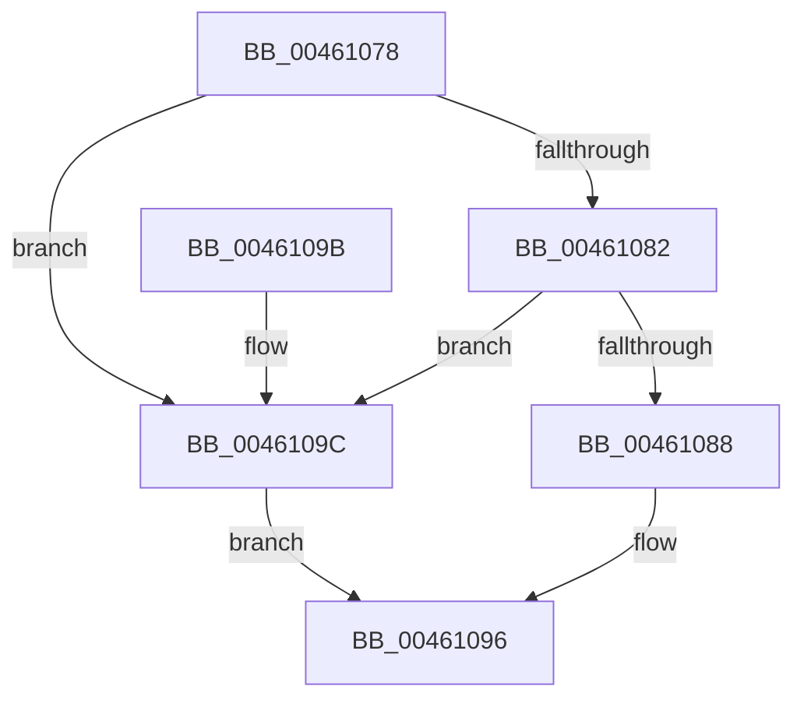

# PopUpdateWatchdogNoWorkersEvent

- RVA: `0x00461078`–`0x004610A7` (길이 `47` bytes)
- VA: `0x0000000140461078`
- 실행 섹션: `.text`
- PDB 이름 있음: `예`; PDB Function 태그: `아니요`
- unwind 정보 RVA: `0x00068784`
- 디코드: `15`개 명령, `47/47` bytes 표시
- 미해석 바이트: `0` (있으면 어셈블리에 `.byte`로 보존)

> 이 문서는 커널 이미지의 기계어와 PDB 기호를 분석해 생성했습니다. 4번과 5번은 함수 원형과 자료형을 바이너리 사용 방식에서 추정한 C 해석이며 원본 소스 복구 결과는 아닙니다.

## 1. Dependencies

- 직접 호출 지점: **2**; 고유 호출 대상: **2**
- 직접 호출자로 확인된 함수: **3**
- RIP 상대 이미지 참조: **0**

### Outgoing calls
- `0x00461091` → [KeSetEvent](../33/KeSetEvent_function_0033F310.md) (function, `0x0033F310`)
- `0x004610A0` → [KeResetEvent](../24/KeResetEvent_function_00248350.md) (function, `0x00248350`)

### Direct callers
- [PopSetWatchdog](PopSetWatchdog_function_00460CAC.md) at `0x00460D67`
- [PopSetWatchdog](PopSetWatchdog_function_00460CAC.md) at `0x00460E7D`
- [PopWatchdogDpc](../5D/PopWatchdogDpc_function_005DA160.md) at `0x005DA1D9`
- [PopWatchdogWorker](../5D/PopWatchdogWorker_function_005DA200.md) at `0x005DA38B`

### Static image references
- 디코드된 RIP-relative 메모리 참조가 없습니다.

## 2. Other-region calls and transfers

- 다른 실행 섹션으로 향하는 call: **0**
- 별도 외부 분기/꼬리 이동을 확인하지 못했습니다.

## 3. Assembly (complete function range)

```asm
00461078  48 83 EC 28                     sub rsp, 0x28
0046107C  80 79 14 00                     cmp byte ptr [rcx + 0x14], 0
00461080  75 1A                           jne 0x14046109c
00461082  80 79 15 00                     cmp byte ptr [rcx + 0x15], 0
00461086  75 14                           jne 0x14046109c
00461088  48 83 C1 18                     add rcx, 0x18
0046108C  45 33 C0                        xor r8d, r8d
0046108F  33 D2                           xor edx, edx
00461091  E8 7A E2 ED FF                  call 0x14033f310
00461096  48 83 C4 28                     add rsp, 0x28
0046109A  C3                              ret
0046109B  CC                              int3
0046109C  48 83 C1 18                     add rcx, 0x18
004610A0  E8 AB 72 DE FF                  call 0x140248350
004610A5  EB EF                           jmp 0x140461096
```

## 4. C-style interpretation (structured pseudocode)

```c
__int64 __fastcall PopUpdateWatchdogNoWorkersEvent(__int64 a1, int a2, int a3)
{
    __int64 result;
    __int64 v_rsp;

    v_rsp = (v_rsp) - (40);
    if ((*(unsigned __int8 *)(a1 + 20)) != 0) goto loc_0046109C;
    if ((*(unsigned __int8 *)(a1 + 21)) != 0) goto loc_0046109C;
    a1 = (a1) + (24);
    a3 = 0;
    a2 = 0;
    result = KeSetEvent(a1, a2, a3, a4);
loc_00461096:
    v_rsp = (v_rsp) + (40);
    return result;
loc_0046109C:
    a1 = (a1) + (24);
    result = KeResetEvent(a1, a2, a3, a4);
    goto loc_00461096;
}
```

## 5. (Beta) C Style

```c
int64_t PopUpdateWatchdogNoWorkersEvent(void *Arg1, int32_t Arg2, int32_t Arg3)
{
    uint8_t *arg1 = (uint8_t *)Arg1;

    int64_t result;
    int64_t local_rsp;

    local_rsp = (local_rsp) - (40);
    if ((*(uint8_t *)(arg1 + 0x14)) != 0) goto loc_0046109C;
    if ((*(uint8_t *)(arg1 + 0x15)) != 0) goto loc_0046109C;
    Arg1 = (Arg1) + (24);
    Arg3 = 0;
    Arg2 = 0;
    result = KeSetEvent(Arg1, Arg2, Arg3, a4);
loc_00461096:
    local_rsp = (local_rsp) + (40);
    return result;
loc_0046109C:
    Arg1 = (Arg1) + (24);
    result = KeResetEvent(Arg1, Arg2, Arg3, a4);
    goto loc_00461096;
}
```

### 관측된 메모리 오프셋

구조체 형식이 확인되지 않은 접근은 인자 기준의 오프셋으로만 기록했습니다.

| 기준 인자 | 오프셋 표현 | 폭 (bit) | 접근 |
|---|---:|---:|---|
| `Arg1` | `+ 0x14` | `8` | `R` |
| `Arg1` | `+ 0x15` | `8` | `R` |

## 6. Execution-region graph

[열기: 2D/3D 그래프와 함수 탐색 컨트롤 패널](../../../control-panel.html?section=text&rva=0x00461078&view=graph)

- 2D 그래프는 위에서 아래로 흐르고, 3D 그래프는 빈 공간을 드래그해 회전합니다. Shift+드래그는 이동, 휠은 확대·축소, 함수 노드 선택은 대상 보고서 이동입니다.

### Static fallback


