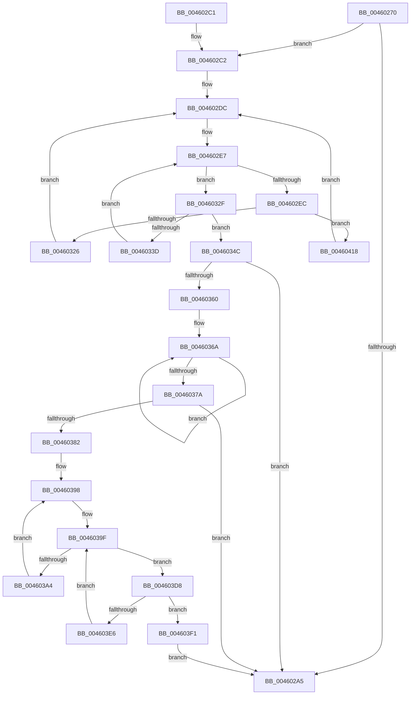

# PpmParkUnblockIdle

- RVA: `0x00460270`–`0x00460428` (길이 `440` bytes)
- VA: `0x0000000140460270`
- 실행 섹션: `.text`
- PDB 이름 있음: `예`; PDB Function 태그: `아니요`
- unwind 정보 RVA: `0x000A9BE0`
- 디코드: `116`개 명령, `440/440` bytes 표시
- 미해석 바이트: `0` (있으면 어셈블리에 `.byte`로 보존)

> 이 문서는 커널 이미지의 기계어와 PDB 기호를 분석해 생성했습니다. 4번과 5번은 함수 원형과 자료형을 바이너리 사용 방식에서 추정한 C 해석이며 원본 소스 복구 결과는 아닙니다.

## 1. Dependencies

- 직접 호출 지점: **5**; 고유 호출 대상: **4**
- 직접 호출자로 확인된 함수: **0**
- RIP 상대 이미지 참조: **6**

### Outgoing calls
- `0x00460314` → [KeGetPrcb](../2D/KeGetPrcb_function_002D85D0.md) (function, `0x002D85D0`)
- `0x004603C4` → [KeGetPrcb](../2D/KeGetPrcb_function_002D85D0.md) (function, `0x002D85D0`)
- `0x004603D1` → [PpmPerfQueueAction](../2D/PpmPerfQueueAction_function_002D91B0.md) (function, `0x002D91B0`)
- `0x0046040B` → [memset](../6C/memset_function_006C6C40.md) (function, `0x006C6C40`)
- `0x0046041E` → [KeRemoveProcessorAffinityEx](../30/KeRemoveProcessorAffinityEx_function_00304E10.md) (function, `0x00304E10`)

### Direct callers
- 이 함수 시작 RVA로 연결되는 직접 call은 확인되지 않았습니다. 간접 호출은 완전히 역산할 수 없습니다.

### Static image references
- `0x0046028E` → RVA `0x00F083D0` (`.data`; read)
- `0x004602C2` → RVA `0x00E0BBA8` (`.data`; read)
- `0x004602C9` → RVA `0x00E0BBA0` (`.data`; read)
- `0x00460306` → RVA `0x00F231B8` (`.data`; read)
- `0x00460382` → RVA `0x00F0B278` (`.data`; write)
- `0x004603F3` → RVA `0x00E0BBA0` (`.data`; write)

## 2. Other-region calls and transfers

- 다른 실행 섹션으로 향하는 call: **0**
- 별도 외부 분기/꼬리 이동을 확인하지 못했습니다.

## 3. Assembly (complete function range)

```asm
00460270  48 89 5C 24 18                  mov qword ptr [rsp + 0x18], rbx
00460275  48 89 74 24 20                  mov qword ptr [rsp + 0x20], rsi
0046027A  55                              push rbp
0046027B  57                              push rdi
0046027C  41 54                           push r12
0046027E  41 56                           push r14
00460280  41 57                           push r15
00460282  48 8B EC                        mov rbp, rsp
00460285  48 83 EC 40                     sub rsp, 0x40
00460289  33 C0                           xor eax, eax
0046028B  45 33 FF                        xor r15d, r15d
0046028E  44 39 3D 3B 81 AA 00            cmp dword ptr [rip + 0xaa813b], r15d
00460295  0F 57 C0                        xorps xmm0, xmm0
00460298  0F 11 45 E0                     movups xmmword ptr [rbp - 0x20], xmm0
0046029C  48 89 45 F0                     mov qword ptr [rbp - 0x10], rax
004602A0  8D 78 01                        lea edi, [rax + 1]
004602A3  75 1D                           jne 0x1404602c2
004602A5  4C 8D 5C 24 40                  lea r11, [rsp + 0x40]
004602AA  40 8A C7                        mov al, dil
004602AD  49 8B 5B 40                     mov rbx, qword ptr [r11 + 0x40]
004602B1  49 8B 73 48                     mov rsi, qword ptr [r11 + 0x48]
004602B5  49 8B E3                        mov rsp, r11
004602B8  41 5F                           pop r15
004602BA  41 5E                           pop r14
004602BC  41 5C                           pop r12
004602BE  5F                              pop rdi
004602BF  5D                              pop rbp
004602C0  C3                              ret
004602C1  CC                              int3
004602C2  48 8B 1D DF B8 9A 00            mov rbx, qword ptr [rip + 0x9ab8df]
004602C9  4C 8D 25 D0 B8 9A 00            lea r12, [rip + 0x9ab8d0]
004602D0  0F B7 75 F0                     movzx esi, word ptr [rbp - 0x10]
004602D4  48 89 5D E8                     mov qword ptr [rbp - 0x18], rbx
004602D8  4C 89 65 E0                     mov qword ptr [rbp - 0x20], r12
004602DC  0F B7 0D BD B8 9A 00            movzx ecx, word ptr [rip + 0x9ab8bd]
004602E3  44 89 7D 30                     mov dword ptr [rbp + 0x30], r15d
004602E7  48 85 DB                        test rbx, rbx
004602EA  74 43                           je 0x14046032f
004602EC  48 0F BC D3                     bsf rdx, rbx
004602F0  0F B7 CE                        movzx ecx, si
004602F3  0F B6 C2                        movzx eax, dl
004602F6  48 0F B3 C3                     btr rbx, rax
004602FA  C1 E1 06                        shl ecx, 6
004602FD  0F B6 C2                        movzx eax, dl
00460300  03 C8                           add ecx, eax
00460302  48 89 5D E8                     mov qword ptr [rbp - 0x18], rbx
00460306  48 8B 05 AB 2E AC 00            mov rax, qword ptr [rip + 0xac2eab]
0046030D  44 8B 34 88                     mov r14d, dword ptr [rax + rcx*4]
00460311  41 8B CE                        mov ecx, r14d
00460314  E8 B7 82 E7 FF                  call 0x1402d85d0
00460319  44 38 B8 89 88 00 00            cmp byte ptr [rax + 0x8889], r15b
00460320  0F 84 F2 00 00 00               je 0x140460418
00460326  44 88 B8 89 88 00 00            mov byte ptr [rax + 0x8889], r15b
0046032D  EB AD                           jmp 0x1404602dc
0046032F  66 03 F7                        add si, di
00460332  0F B7 C6                        movzx eax, si
00460335  66 89 45 F0                     mov word ptr [rbp - 0x10], ax
00460339  3B C1                           cmp eax, ecx
0046033B  73 0F                           jae 0x14046034c
0046033D  49 8B 5C C4 08                  mov rbx, qword ptr [r12 + rax*8 + 8]
00460342  0F B7 75 F0                     movzx esi, word ptr [rbp - 0x10]
00460346  48 89 5D E8                     mov qword ptr [rbp - 0x18], rbx
0046034A  EB 9B                           jmp 0x1404602e7
0046034C  0F B7 05 4D B8 9A 00            movzx eax, word ptr [rip + 0x9ab84d]
00460353  41 8B CF                        mov ecx, r15d
00460356  66 44 3B F8                     cmp r15w, ax
0046035A  0F 83 45 FF FF FF               jae 0x1404602a5
00460360  48 8D 15 41 B8 9A 00            lea rdx, [rip + 0x9ab841]
00460367  44 8B C0                        mov r8d, eax
0046036A  F3 48 0F B8 02                  popcnt rax, qword ptr [rdx]
0046036F  03 C8                           add ecx, eax
00460371  48 8D 52 08                     lea rdx, [rdx + 8]
00460375  4C 2B C7                        sub r8, rdi
00460378  75 F0                           jne 0x14046036a
0046037A  85 C9                           test ecx, ecx
0046037C  0F 84 23 FF FF FF               je 0x1404602a5
00460382  89 0D F0 AE AA 00               mov dword ptr [rip + 0xaaaef0], ecx
00460388  48 8B 35 19 B8 9A 00            mov rsi, qword ptr [rip + 0x9ab819]
0046038F  66 44 89 7D F0                  mov word ptr [rbp - 0x10], r15w
00460394  0F B7 5D F0                     movzx ebx, word ptr [rbp - 0x10]
00460398  0F B7 0D 01 B8 9A 00            movzx ecx, word ptr [rip + 0x9ab801]
0046039F  48 85 F6                        test rsi, rsi
004603A2  74 34                           je 0x1404603d8
004603A4  48 0F BC D6                     bsf rdx, rsi
004603A8  0F B7 CB                        movzx ecx, bx
004603AB  0F B6 C2                        movzx eax, dl
004603AE  48 0F B3 C6                     btr rsi, rax
004603B2  C1 E1 06                        shl ecx, 6
004603B5  0F B6 C2                        movzx eax, dl
004603B8  03 C8                           add ecx, eax
004603BA  48 8B 05 F7 2D AC 00            mov rax, qword ptr [rip + 0xac2df7]
004603C1  8B 0C 88                        mov ecx, dword ptr [rax + rcx*4]
004603C4  E8 07 82 E7 FF                  call 0x1402d85d0
004603C9  BA 06 00 00 00                  mov edx, 6
004603CE  48 8B C8                        mov rcx, rax
004603D1  E8 DA 8D E7 FF                  call 0x1402d91b0
004603D6  EB C0                           jmp 0x140460398
004603D8  66 03 DF                        add bx, di
004603DB  0F B7 C3                        movzx eax, bx
004603DE  66 89 45 F0                     mov word ptr [rbp - 0x10], ax
004603E2  3B C1                           cmp eax, ecx
004603E4  73 0B                           jae 0x1404603f1
004603E6  49 8B 74 C4 08                  mov rsi, qword ptr [r12 + rax*8 + 8]
004603EB  0F B7 5D F0                     movzx ebx, word ptr [rbp - 0x10]
004603EF  EB AE                           jmp 0x14046039f
004603F1  33 D2                           xor edx, edx
004603F3  48 C7 05 A2 B7 9A 00 01 00 20 00  mov qword ptr [rip + 0x9ab7a2], 0x200001
004603FE  41 B8 00 01 00 00               mov r8d, 0x100
00460404  48 8D 0D 9D B7 9A 00            lea rcx, [rip + 0x9ab79d]
0046040B  E8 30 68 26 00                  call 0x1406c6c40
00460410  41 8A FF                        mov dil, r15b
00460413  E9 8D FE FF FF                  jmp 0x1404602a5
00460418  41 8B D6                        mov edx, r14d
0046041B  49 8B CC                        mov rcx, r12
0046041E  E8 ED 49 EA FF                  call 0x140304e10
00460423  E9 B4 FE FF FF                  jmp 0x1404602dc
```

## 4. C-style interpretation (structured pseudocode)

```c
__int64 __fastcall PpmParkUnblockIdle(void)
{
    __int64 result;
    __int64 v_r15;
    __int64 v_rbx;
    __int64 v_rsi;
    __int64 v_rsp;
    unsigned __int64 v_stack_m28;
    unsigned __int64 v_stack_m38;
    unsigned __int64 v_stack_m40;
    unsigned __int64 v_stack_m48;
    unsigned __int64 v_stack_p18;
    unsigned __int64 v_stack_p20;
    unsigned int v_stack_p8;

    v_stack_p18 = v_rbx;
    v_stack_p20 = v_rsi;
    v_rsp = (v_rsp) - (64);
    result = 0;
    v_r15 = 0;
    v_stack_m48 = v_xmm0;
    v_stack_m38 = 0;
    if ((*(unsigned int *)(v_rip + 11174203)) != 0) goto loc_004602C2;
loc_004602A5:
    return (unsigned __int8)(result + 1);
loc_004602C2:
    v_stack_m40 = *(unsigned __int64 *)(v_rip + 10139871);
    v_stack_m48 = v_rip + 10139856;
loc_004602DC:
    v_stack_p8 = 0;
loc_004602E7:
    if (*(unsigned __int64 *)(v_rip + 10139871) == 0) goto loc_0046032F;
    a1 = (unsigned int)(((unsigned __int16)(v_stack_m38)) << (6));
    a1 = (unsigned int)((a1) + ((unsigned int)((unsigned __int8)(a2))));
    v_stack_m40 = *(unsigned __int64 *)(v_rip + 10139871);
    result = KeGetPrcb((unsigned int)((unsigned int)((unsigned int)(*(unsigned int *)(*(unsigned __int64 *)(v_rip + 11284139) + a1 * 4)))), a2, a3, a4);
    if ((*(unsigned __int8 *)(result + 34953)) == 0) goto loc_00460418;
    *(unsigned __int8 *)(result + 34953) = 0;
    goto loc_004602DC;
loc_0046032F:
    v_rsi = (unsigned __int16)((v_stack_m38) + ((unsigned __int16)(result + 1)));
    v_stack_m38 = (unsigned __int16)((unsigned __int16)(v_rsi));
    if (((unsigned int)((unsigned __int16)(v_rsi))) >= ((unsigned int)((unsigned int)((unsigned int)((unsigned int)(*(unsigned int *)(*(unsigned __int64 *)(v_rip + 11284139) + a1 * 4))))))) goto loc_0046034C;
    v_stack_m40 = *(unsigned __int64 *)(v_rip + 10139856 + (unsigned __int16)(v_rsi) * 8 + 8);
    goto loc_004602E7;
loc_0046034C:
    if (0 >= ((unsigned __int16)(*(unsigned __int16 *)(v_rip + 10139725)))) goto loc_004602A5;
loc_0046036A:
    a1 = (unsigned int)((0) + ((unsigned int)(*(unsigned __int16 *)(v_rip + 10139725))));
    a3 = ((unsigned int)((unsigned int)(*(unsigned __int16 *)(v_rip + 10139725)))) - (result + 1);
    if (condition_is_not_equal) goto loc_0046036A;
    if ((unsigned int)(a1) == 0) goto loc_004602A5;
    *(unsigned int *)(v_rip + 11185904) = (unsigned int)(a1);
    v_stack_m38 = 0;
loc_00460398:
loc_0046039F:
    if (*(unsigned __int64 *)(v_rip + 10139673) == 0) goto loc_004603D8;
    a1 = (unsigned int)(((unsigned __int16)(v_stack_m38)) << (6));
    a1 = (unsigned int)((a1) + ((unsigned int)((unsigned __int8)(v_rip + 10139713 + 8))));
    result = KeGetPrcb((unsigned int)(*(unsigned int *)(*(unsigned __int64 *)(v_rip + 11283959) + a1 * 4)), v_rip + 10139713 + 8, a3, a4);
    result = PpmPerfQueueAction(result, 6, a3, a4);
    goto loc_00460398;
loc_004603D8:
    v_rbx = (unsigned __int16)((v_stack_m38) + ((unsigned __int16)(result + 1)));
    v_stack_m38 = (unsigned __int16)((unsigned __int16)(v_rbx));
    if (((unsigned int)((unsigned __int16)(v_rbx))) >= ((unsigned int)(result))) goto loc_004603F1;
    goto loc_0046039F;
loc_004603F1:
    a2 = 0;
    *(unsigned __int64 *)(v_rip + 10139554) = 0x200001ULL;
    result = memset(v_rip + 10139549, a2, 256, a4);
    goto loc_004602A5;
loc_00460418:
    result = KeRemoveProcessorAffinityEx(v_rip + 10139856, (unsigned int)((unsigned int)((unsigned int)(*(unsigned int *)(*(unsigned __int64 *)(v_rip + 11284139) + a1 * 4)))), 256, a4);
    goto loc_004602DC;
}
```

## 5. (Beta) C Style

```c
void PpmParkUnblockIdle(void)
{
    int64_t result;
    int64_t local_r15;
    int64_t local_rbx;
    int64_t local_rsi;
    int64_t local_rsp;
    uint64_t v_stack_m28;
    uint64_t v_stack_m38;
    uint64_t v_stack_m40;
    uint64_t v_stack_m48;
    uint64_t v_stack_p18;
    uint64_t v_stack_p20;
    uint32_t v_stack_p8;

    v_stack_p18 = local_rbx;
    v_stack_p20 = local_rsi;
    local_rsp = (local_rsp) - (64);
    result = 0;
    local_r15 = 0;
    v_stack_m48 = v_xmm0;
    v_stack_m38 = 0;
    if ((*(uint32_t *)(v_rip + 0xAA813B)) != 0) goto loc_004602C2;
loc_004602A5:
    return (uint8_t)(result + 1);
loc_004602C2:
    v_stack_m40 = *(uint64_t *)(v_rip + 0x9AB8DF);
    v_stack_m48 = v_rip + 10139856;
loc_004602DC:
    v_stack_p8 = 0;
loc_004602E7:
    if (*(uint64_t *)(v_rip + 0x9AB8DF) == 0) goto loc_0046032F;
    a1 = (uint32_t)(((uint16_t)(v_stack_m38)) << (6));
    a1 = (uint32_t)((a1) + ((uint32_t)((uint8_t)(a2))));
    v_stack_m40 = *(uint64_t *)(v_rip + 0x9AB8DF);
    result = KeGetPrcb((uint32_t)((uint32_t)((uint32_t)(*(uint32_t *)(*(uint64_t *)(v_rip + 0xAC2EAB) + a1 * 4)))), a2, a3, a4);
    if ((*(uint8_t *)(result + 0x8889)) == 0) goto loc_00460418;
    *(uint8_t *)(result + 0x8889) = 0;
    goto loc_004602DC;
loc_0046032F:
    local_rsi = (uint16_t)((v_stack_m38) + ((uint16_t)(result + 1)));
    v_stack_m38 = (uint16_t)((uint16_t)(local_rsi));
    if (((uint32_t)((uint16_t)(local_rsi))) >= ((uint32_t)((uint32_t)((uint32_t)((uint32_t)(*(uint32_t *)(*(uint64_t *)(v_rip + 0xAC2EAB) + a1 * 4))))))) goto loc_0046034C;
    v_stack_m40 = *(uint64_t *)(v_rip + 0x9AB8D0 + (uint16_t)(local_rsi) * 8 + 0x8);
    goto loc_004602E7;
loc_0046034C:
    if (0 >= ((uint16_t)(*(uint16_t *)(v_rip + 0x9AB84D)))) goto loc_004602A5;
loc_0046036A:
    a1 = (uint32_t)((0) + ((uint32_t)(*(uint16_t *)(v_rip + 0x9AB84D))));
    a3 = ((uint32_t)((uint32_t)(*(uint16_t *)(v_rip + 0x9AB84D)))) - (result + 1);
    if (condition_is_not_equal) goto loc_0046036A;
    if ((uint32_t)(a1) == 0) goto loc_004602A5;
    *(uint32_t *)(v_rip + 0xAAAEF0) = (uint32_t)(a1);
    v_stack_m38 = 0;
loc_00460398:
loc_0046039F:
    if (*(uint64_t *)(v_rip + 0x9AB819) == 0) goto loc_004603D8;
    a1 = (uint32_t)(((uint16_t)(v_stack_m38)) << (6));
    a1 = (uint32_t)((a1) + ((uint32_t)((uint8_t)(v_rip + 10139713 + 8))));
    result = KeGetPrcb((uint32_t)(*(uint32_t *)(*(uint64_t *)(v_rip + 0xAC2DF7) + a1 * 4)), v_rip + 10139713 + 8, a3, a4);
    result = PpmPerfQueueAction(result, 6, a3, a4);
    goto loc_00460398;
loc_004603D8:
    local_rbx = (uint16_t)((v_stack_m38) + ((uint16_t)(result + 1)));
    v_stack_m38 = (uint16_t)((uint16_t)(local_rbx));
    if (((uint32_t)((uint16_t)(local_rbx))) >= ((uint32_t)(result))) goto loc_004603F1;
    goto loc_0046039F;
loc_004603F1:
    a2 = 0;
    *(uint64_t *)(v_rip + 0x9AB7A2) = 0x200001ULL;
    result = memset(v_rip + 10139549, a2, 256, a4);
    goto loc_004602A5;
loc_00460418:
    result = KeRemoveProcessorAffinityEx(v_rip + 10139856, (uint32_t)((uint32_t)((uint32_t)(*(uint32_t *)(*(uint64_t *)(v_rip + 0xAC2EAB) + a1 * 4)))), 256, a4);
    goto loc_004602DC;
}
```

## 6. Execution-region graph

[열기: 2D/3D 그래프와 함수 탐색 컨트롤 패널](../../../control-panel.html?section=text&rva=0x00460270&view=graph)

- 2D 그래프는 위에서 아래로 흐르고, 3D 그래프는 빈 공간을 드래그해 회전합니다. Shift+드래그는 이동, 휠은 확대·축소, 함수 노드 선택은 대상 보고서 이동입니다.

### Static fallback


