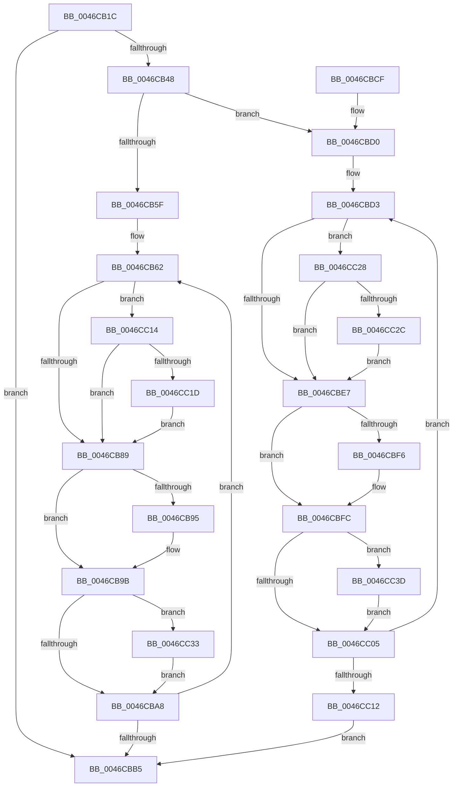

# PpmPerfApplyCapsAndFloors

- RVA: `0x0046CB1C`–`0x0046CC44` (길이 `296` bytes)
- VA: `0x000000014046CB1C`
- 실행 섹션: `.text`
- PDB 이름 있음: `예`; PDB Function 태그: `아니요`
- unwind 정보 RVA: `0x000AB8B0`
- 디코드: `87`개 명령, `296/296` bytes 표시
- 미해석 바이트: `0` (있으면 어셈블리에 `.byte`로 보존)

> 이 문서는 커널 이미지의 기계어와 PDB 기호를 분석해 생성했습니다. 4번과 5번은 함수 원형과 자료형을 바이너리 사용 방식에서 추정한 C 해석이며 원본 소스 복구 결과는 아닙니다.

## 1. Dependencies

- 직접 호출 지점: **0**; 고유 호출 대상: **0**
- 직접 호출자로 확인된 함수: **1**
- RIP 상대 이미지 참조: **0**

### Outgoing calls
- 직접 디코드된 call 명령이 없습니다.

### Direct callers
- [PpmPerfApplyDomainState](../2C/PpmPerfApplyDomainState_function_002CD470.md) at `0x002CD5F7`

### Static image references
- 디코드된 RIP-relative 메모리 참조가 없습니다.

## 2. Other-region calls and transfers

- 다른 실행 섹션으로 향하는 call: **0**
- 별도 외부 분기/꼬리 이동을 확인하지 못했습니다.

## 3. Assembly (complete function range)

```asm
0046CB1C  48 8B C4                        mov rax, rsp
0046CB1F  48 89 58 08                     mov qword ptr [rax + 8], rbx
0046CB23  48 89 70 10                     mov qword ptr [rax + 0x10], rsi
0046CB27  48 89 78 18                     mov qword ptr [rax + 0x18], rdi
0046CB2B  4C 89 70 20                     mov qword ptr [rax + 0x20], r14
0046CB2F  41 57                           push r15
0046CB31  41 8B 81 28 01 00 00            mov eax, dword ptr [r9 + 0x128]
0046CB38  45 33 D2                        xor r10d, r10d
0046CB3B  4D 8B F8                        mov r15, r8
0046CB3E  4C 8B F2                        mov r14, rdx
0046CB41  48 8B F9                        mov rdi, rcx
0046CB44  85 C0                           test eax, eax
0046CB46  74 6D                           je 0x14046cbb5
0046CB48  8B F0                           mov esi, eax
0046CB4A  49 8B 99 38 01 00 00            mov rbx, qword ptr [r9 + 0x138]
0046CB51  45 8B 00                        mov r8d, dword ptr [r8]
0046CB54  8B 12                           mov edx, dword ptr [rdx]
0046CB56  45 38 91 EA 01 00 00            cmp byte ptr [r9 + 0x1ea], r10b
0046CB5D  74 71                           je 0x14046cbd0
0046CB5F  45 8B DA                        mov r11d, r10d
0046CB62  41 8B 44 1B 30                  mov eax, dword ptr [r11 + rbx + 0x30]
0046CB67  41 8B 4C 1B 1C                  mov ecx, dword ptr [r11 + rbx + 0x1c]
0046CB6C  3B C8                           cmp ecx, eax
0046CB6E  0F 43 C8                        cmovae ecx, eax
0046CB71  41 8B 44 1B 18                  mov eax, dword ptr [r11 + rbx + 0x18]
0046CB76  3B C8                           cmp ecx, eax
0046CB78  44 8B C8                        mov r9d, eax
0046CB7B  44 0F 42 C9                     cmovb r9d, ecx
0046CB7F  41 83 F9 64                     cmp r9d, 0x64
0046CB83  0F 82 8B 00 00 00               jb 0x14046cc14
0046CB89  44 3B C8                        cmp r9d, eax
0046CB8C  41 0F 42 C1                     cmovb eax, r9d
0046CB90  44 3B C0                        cmp r8d, eax
0046CB93  76 06                           jbe 0x14046cb9b
0046CB95  41 89 07                        mov dword ptr [r15], eax
0046CB98  44 8B C0                        mov r8d, eax
0046CB9B  41 8B 44 1B 34                  mov eax, dword ptr [r11 + rbx + 0x34]
0046CBA0  3B D0                           cmp edx, eax
0046CBA2  0F 82 8B 00 00 00               jb 0x14046cc33
0046CBA8  49 81 C3 A8 04 00 00            add r11, 0x4a8
0046CBAF  48 83 EE 01                     sub rsi, 1
0046CBB3  75 AD                           jne 0x14046cb62
0046CBB5  48 8B 5C 24 10                  mov rbx, qword ptr [rsp + 0x10]
0046CBBA  41 8A C2                        mov al, r10b
0046CBBD  48 8B 74 24 18                  mov rsi, qword ptr [rsp + 0x18]
0046CBC2  48 8B 7C 24 20                  mov rdi, qword ptr [rsp + 0x20]
0046CBC7  4C 8B 74 24 28                  mov r14, qword ptr [rsp + 0x28]
0046CBCC  41 5F                           pop r15
0046CBCE  C3                              ret
0046CBCF  CC                              int3
0046CBD0  4D 8B CA                        mov r9, r10
0046CBD3  41 8B 4C 19 1C                  mov ecx, dword ptr [r9 + rbx + 0x1c]
0046CBD8  41 8B 44 19 30                  mov eax, dword ptr [r9 + rbx + 0x30]
0046CBDD  3B C8                           cmp ecx, eax
0046CBDF  0F 43 C8                        cmovae ecx, eax
0046CBE2  83 F9 64                        cmp ecx, 0x64
0046CBE5  72 41                           jb 0x14046cc28
0046CBE7  41 8B 44 19 18                  mov eax, dword ptr [r9 + rbx + 0x18]
0046CBEC  3B C8                           cmp ecx, eax
0046CBEE  0F 42 C1                        cmovb eax, ecx
0046CBF1  44 3B C0                        cmp r8d, eax
0046CBF4  76 06                           jbe 0x14046cbfc
0046CBF6  41 89 07                        mov dword ptr [r15], eax
0046CBF9  44 8B C0                        mov r8d, eax
0046CBFC  41 8B 44 19 34                  mov eax, dword ptr [r9 + rbx + 0x34]
0046CC01  3B D0                           cmp edx, eax
0046CC03  72 38                           jb 0x14046cc3d
0046CC05  49 81 C1 A8 04 00 00            add r9, 0x4a8
0046CC0C  48 83 EE 01                     sub rsi, 1
0046CC10  75 C1                           jne 0x14046cbd3
0046CC12  EB A1                           jmp 0x14046cbb5
0046CC14  44 39 0F                        cmp dword ptr [rdi], r9d
0046CC17  0F 86 6C FF FF FF               jbe 0x14046cb89
0046CC1D  41 B2 01                        mov r10b, 1
0046CC20  44 89 0F                        mov dword ptr [rdi], r9d
0046CC23  E9 61 FF FF FF                  jmp 0x14046cb89
0046CC28  39 0F                           cmp dword ptr [rdi], ecx
0046CC2A  76 BB                           jbe 0x14046cbe7
0046CC2C  41 B2 01                        mov r10b, 1
0046CC2F  89 0F                           mov dword ptr [rdi], ecx
0046CC31  EB B4                           jmp 0x14046cbe7
0046CC33  41 89 06                        mov dword ptr [r14], eax
0046CC36  8B D0                           mov edx, eax
0046CC38  E9 6B FF FF FF                  jmp 0x14046cba8
0046CC3D  41 89 06                        mov dword ptr [r14], eax
0046CC40  8B D0                           mov edx, eax
0046CC42  EB C1                           jmp 0x14046cc05
```

## 4. C-style interpretation (structured pseudocode)

```c
__int64 __fastcall PpmPerfApplyCapsAndFloors(__int64 a1, __int64 a2, __int64 a3, __int64 a4)
{
    __int64 result;
    __int64 v_r10;
    __int64 v_r11;
    __int64 v_rsi;
    unsigned __int64 v_stack_p10;
    unsigned __int64 v_stack_p18;
    unsigned __int64 v_stack_p20;
    unsigned __int64 v_stack_p8;

    *(unsigned __int64 *)(v_rsp + 8) = v_rbx;
    *(unsigned __int64 *)(v_rsp + 16) = v_rsi;
    *(unsigned __int64 *)(v_rsp + 24) = v_rdi;
    *(unsigned __int64 *)(v_rsp + 32) = v_r14;
    v_r10 = 0;
    if ((unsigned int)((unsigned int)(*(unsigned int *)(a4 + 296))) == 0) goto loc_0046CBB5;
    if ((*(unsigned __int8 *)(a4 + 490)) == 0) goto loc_0046CBD0;
loc_0046CB62:
    a1 = (unsigned int)(*(unsigned int *)(0 + *(unsigned __int64 *)(a4 + 312) * 1 + 28));
    if (((unsigned int)((unsigned int)(*(unsigned int *)(0 + *(unsigned __int64 *)(a4 + 312) * 1 + 28)))) >= ((unsigned int)((unsigned int)(*(unsigned int *)(0 + *(unsigned __int64 *)(a4 + 312) * 1 + 48))))) { a1 = (unsigned int)((unsigned int)(*(unsigned int *)(0 + *(unsigned __int64 *)(a4 + 312) * 1 + 48))); }
    a4 = (unsigned int)((unsigned int)((unsigned int)(*(unsigned int *)(0 + *(unsigned __int64 *)(a4 + 312) * 1 + 24))));
    if (((unsigned int)(a1)) < ((unsigned int)((unsigned int)(*(unsigned int *)(0 + *(unsigned __int64 *)(a4 + 312) * 1 + 24))))) { a4 = (unsigned int)(a1); }
    if (((unsigned int)(a4)) < 100) goto loc_0046CC14;
loc_0046CB89:
    result = (unsigned int)(*(unsigned int *)(0 + *(unsigned __int64 *)(a4 + 312) * 1 + 24));
    if (((unsigned int)(a4)) < ((unsigned int)((unsigned int)(*(unsigned int *)(0 + *(unsigned __int64 *)(a4 + 312) * 1 + 24))))) { result = (unsigned int)(a4); }
    if (((unsigned int)((unsigned int)(*(unsigned int *)(a3)))) >= = ((unsigned int)(result))) {
        *(unsigned int *)(a3) = (unsigned int)(result);
        a3 = (unsigned int)(result);
    }
    if (((unsigned int)((unsigned int)(*(unsigned int *)(a2)))) < ((unsigned int)((unsigned int)(*(unsigned int *)(0 + *(unsigned __int64 *)(a4 + 312) * 1 + 52))))) goto loc_0046CC33;
loc_0046CBA8:
    v_r11 = (0) + (0x4A8ULL);
    v_rsi = ((unsigned int)((unsigned int)((unsigned int)(*(unsigned int *)(a4 + 296))))) - (1);
    if (condition_is_not_equal) goto loc_0046CB62;
loc_0046CBB5:
    return 0;
loc_0046CBD0:
loc_0046CBD3:
    a1 = (unsigned int)(*(unsigned int *)(0 + v_stack_p8 * 1 + 28));
    if (((unsigned int)((unsigned int)(*(unsigned int *)(0 + v_stack_p8 * 1 + 28)))) >= ((unsigned int)((unsigned int)(*(unsigned int *)(0 + v_stack_p8 * 1 + 48))))) { a1 = (unsigned int)((unsigned int)(*(unsigned int *)(0 + v_stack_p8 * 1 + 48))); }
    if (((unsigned int)(a1)) < 100) goto loc_0046CC28;
loc_0046CBE7:
    result = (unsigned int)(*(unsigned int *)(0 + v_stack_p8 * 1 + 24));
    if (((unsigned int)(a1)) < ((unsigned int)((unsigned int)(*(unsigned int *)(0 + v_stack_p8 * 1 + 24))))) { result = (unsigned int)(a1); }
    if (((unsigned int)(a3)) >= = ((unsigned int)(result))) {
        *(unsigned int *)(a3) = (unsigned int)(result);
        a3 = (unsigned int)(result);
    }
    if (((unsigned int)((unsigned int)(*(unsigned int *)(a2)))) < ((unsigned int)((unsigned int)(*(unsigned int *)(0 + v_stack_p8 * 1 + 52))))) goto loc_0046CC3D;
loc_0046CC05:
    a4 = (0) + (0x4A8ULL);
    v_rsi = (v_stack_p10) - (1);
    if (condition_is_not_equal) goto loc_0046CBD3;
    goto loc_0046CBB5;
loc_0046CC14:
    if ((*(unsigned int *)(v_stack_p18)) <= ((unsigned int)(a4))) goto loc_0046CB89;
    *(unsigned int *)(v_stack_p18) = (unsigned int)(a4);
    goto loc_0046CB89;
loc_0046CC28:
    if ((*(unsigned int *)(v_stack_p18)) <= ((unsigned int)(a1))) goto loc_0046CBE7;
    *(unsigned int *)(v_stack_p18) = (unsigned int)(a1);
    goto loc_0046CBE7;
loc_0046CC33:
    *(unsigned int *)(v_stack_p20) = (unsigned int)((unsigned int)(*(unsigned int *)(0 + v_stack_p8 * 1 + 52)));
    goto loc_0046CBA8;
loc_0046CC3D:
    *(unsigned int *)(v_stack_p20) = (unsigned int)((unsigned int)(*(unsigned int *)(0 + v_stack_p8 * 1 + 52)));
    goto loc_0046CC05;
}
```

## 5. (Beta) C Style

```c
int64_t PpmPerfApplyCapsAndFloors(void *Arg1, void *Arg2, void *Arg3, void *Arg4)
{
    uint8_t *arg1 = (uint8_t *)Arg1;
    uint8_t *arg2 = (uint8_t *)Arg2;
    uint8_t *arg3 = (uint8_t *)Arg3;
    uint8_t *arg4 = (uint8_t *)Arg4;

    int64_t result;
    int64_t local_r10;
    int64_t local_r11;
    int64_t local_rsi;
    uint64_t v_stack_p10;
    uint64_t v_stack_p18;
    uint64_t v_stack_p20;
    uint64_t v_stack_p8;

    *(uint64_t *)(local_rsp + 0x8) = local_rbx;
    *(uint64_t *)(local_rsp + 0x10) = local_rsi;
    *(uint64_t *)(local_rsp + 0x18) = local_rdi;
    *(uint64_t *)(local_rsp + 0x20) = local_r14;
    local_r10 = 0;
    if ((uint32_t)((uint32_t)(*(uint32_t *)(arg4 + 0x128))) == 0) goto loc_0046CBB5;
    if ((*(uint8_t *)(arg4 + 0x1EA)) == 0) goto loc_0046CBD0;
loc_0046CB62:
    Arg1 = (uint32_t)(*(uint32_t *)(0 + *(uint64_t *)(arg4 + 0x138) * 1 + 0x1C));
    if (((uint32_t)((uint32_t)(*(uint32_t *)(0 + *(uint64_t *)(arg4 + 0x138) * 1 + 0x1C)))) >= ((uint32_t)((uint32_t)(*(uint32_t *)(0 + *(uint64_t *)(arg4 + 0x138) * 1 + 0x30))))) { Arg1 = (uint32_t)((uint32_t)(*(uint32_t *)(0 + *(uint64_t *)(arg4 + 0x138) * 1 + 0x30))); }
    Arg4 = (uint32_t)((uint32_t)((uint32_t)(*(uint32_t *)(0 + *(uint64_t *)(arg4 + 0x138) * 1 + 0x18))));
    if (((uint32_t)(Arg1)) < ((uint32_t)((uint32_t)(*(uint32_t *)(0 + *(uint64_t *)(arg4 + 0x138) * 1 + 0x18))))) { Arg4 = (uint32_t)(Arg1); }
    if (((uint32_t)(Arg4)) < 100) goto loc_0046CC14;
loc_0046CB89:
    result = (uint32_t)(*(uint32_t *)(0 + *(uint64_t *)(arg4 + 0x138) * 1 + 0x18));
    if (((uint32_t)(Arg4)) < ((uint32_t)((uint32_t)(*(uint32_t *)(0 + *(uint64_t *)(arg4 + 0x138) * 1 + 0x18))))) { result = (uint32_t)(Arg4); }
    if (((uint32_t)((uint32_t)(*(uint32_t *)(arg3)))) >= = ((uint32_t)(result))) {
        *(uint32_t *)(arg3) = (uint32_t)(result);
        Arg3 = (uint32_t)(result);
    }
    if (((uint32_t)((uint32_t)(*(uint32_t *)(arg2)))) < ((uint32_t)((uint32_t)(*(uint32_t *)(0 + *(uint64_t *)(arg4 + 0x138) * 1 + 0x34))))) goto loc_0046CC33;
loc_0046CBA8:
    local_r11 = (0) + (0x4A8ULL);
    local_rsi = ((uint32_t)((uint32_t)((uint32_t)(*(uint32_t *)(arg4 + 0x128))))) - (1);
    if (condition_is_not_equal) goto loc_0046CB62;
loc_0046CBB5:
    return 0;
loc_0046CBD0:
loc_0046CBD3:
    Arg1 = (uint32_t)(*(uint32_t *)(0 + v_stack_p8 * 1 + 0x1C));
    if (((uint32_t)((uint32_t)(*(uint32_t *)(0 + v_stack_p8 * 1 + 0x1C)))) >= ((uint32_t)((uint32_t)(*(uint32_t *)(0 + v_stack_p8 * 1 + 0x30))))) { Arg1 = (uint32_t)((uint32_t)(*(uint32_t *)(0 + v_stack_p8 * 1 + 0x30))); }
    if (((uint32_t)(Arg1)) < 100) goto loc_0046CC28;
loc_0046CBE7:
    result = (uint32_t)(*(uint32_t *)(0 + v_stack_p8 * 1 + 0x18));
    if (((uint32_t)(Arg1)) < ((uint32_t)((uint32_t)(*(uint32_t *)(0 + v_stack_p8 * 1 + 0x18))))) { result = (uint32_t)(Arg1); }
    if (((uint32_t)(Arg3)) >= = ((uint32_t)(result))) {
        *(uint32_t *)(arg3) = (uint32_t)(result);
        Arg3 = (uint32_t)(result);
    }
    if (((uint32_t)((uint32_t)(*(uint32_t *)(arg2)))) < ((uint32_t)((uint32_t)(*(uint32_t *)(0 + v_stack_p8 * 1 + 0x34))))) goto loc_0046CC3D;
loc_0046CC05:
    Arg4 = (0) + (0x4A8ULL);
    local_rsi = (v_stack_p10) - (1);
    if (condition_is_not_equal) goto loc_0046CBD3;
    goto loc_0046CBB5;
loc_0046CC14:
    if ((*(uint32_t *)(v_stack_p18)) <= ((uint32_t)(Arg4))) goto loc_0046CB89;
    *(uint32_t *)(v_stack_p18) = (uint32_t)(Arg4);
    goto loc_0046CB89;
loc_0046CC28:
    if ((*(uint32_t *)(v_stack_p18)) <= ((uint32_t)(Arg1))) goto loc_0046CBE7;
    *(uint32_t *)(v_stack_p18) = (uint32_t)(Arg1);
    goto loc_0046CBE7;
loc_0046CC33:
    *(uint32_t *)(v_stack_p20) = (uint32_t)((uint32_t)(*(uint32_t *)(0 + v_stack_p8 * 1 + 0x34)));
    goto loc_0046CBA8;
loc_0046CC3D:
    *(uint32_t *)(v_stack_p20) = (uint32_t)((uint32_t)(*(uint32_t *)(0 + v_stack_p8 * 1 + 0x34)));
    goto loc_0046CC05;
}
```

### 관측된 메모리 오프셋

구조체 형식이 확인되지 않은 접근은 인자 기준의 오프셋으로만 기록했습니다.

| 기준 인자 | 오프셋 표현 | 폭 (bit) | 접근 |
|---|---:|---:|---|
| `Arg1` | `+ 0x0` | `32` | `R` |
| `Arg1` | `+ 0x0` | `32` | `W` |
| `Arg2` | `+ 0x0` | `32` | `R` |
| `Arg2` | `+ 0x0` | `32` | `W` |
| `Arg3` | `+ 0x0` | `32` | `R` |
| `Arg3` | `+ 0x0` | `32` | `W` |
| `Arg4` | `+ 0x128` | `32` | `R` |
| `Arg4` | `+ 0x138` | `64` | `R` |
| `Arg4` | `+ 0x1EA` | `8` | `R` |

## 6. Execution-region graph

[열기: 2D/3D 그래프와 함수 탐색 컨트롤 패널](../../../control-panel.html?section=text&rva=0x0046CB1C&view=graph)

- 2D 그래프는 위에서 아래로 흐르고, 3D 그래프는 빈 공간을 드래그해 회전합니다. Shift+드래그는 이동, 휠은 확대·축소, 함수 노드 선택은 대상 보고서 이동입니다.

### Static fallback


