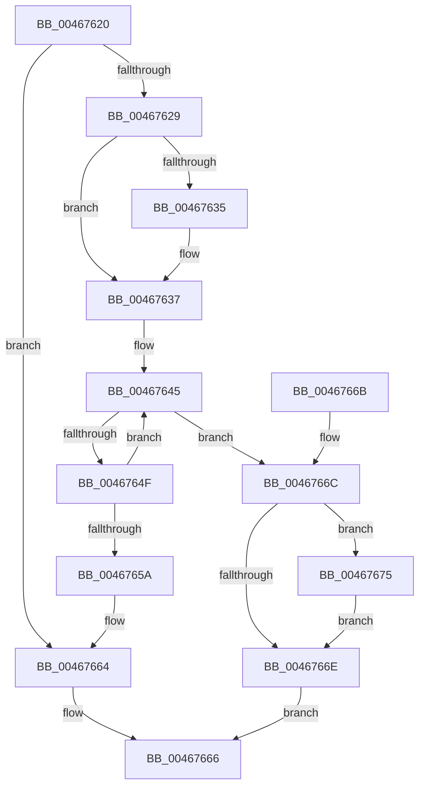

# PsAcquireSiloHardReference

- RVA: `0x00467620`–`0x0046767E` (길이 `94` bytes)
- VA: `0x0000000140467620`
- 실행 섹션: `.text`
- PDB 이름 있음: `예`; PDB Function 태그: `아니요`
- unwind 정보 RVA: `0x0007A1AC`
- 디코드: `25`개 명령, `94/94` bytes 표시
- 미해석 바이트: `0` (있으면 어셈블리에 `.byte`로 보존)

> 이 문서는 커널 이미지의 기계어와 PDB 기호를 분석해 생성했습니다. 4번과 5번은 함수 원형과 자료형을 바이너리 사용 방식에서 추정한 C 해석이며 원본 소스 복구 결과는 아닙니다.

## 1. Dependencies

- 직접 호출 지점: **1**; 고유 호출 대상: **1**
- 직접 호출자로 확인된 함수: **2**
- RIP 상대 이미지 참조: **0**

### Outgoing calls
- `0x0046765F` → [ObfReferenceObjectWithTag](../21/ObfReferenceObjectWithTag_function_00210710.md) (function, `0x00210710`)

### Direct callers
- [IopAllocRealFileObject](../../page/89/IopAllocRealFileObject_function_00899720.md) at `0x00899C40`
- [IopParseDevice](../../page/89/IopParseDevice_function_0089E510.md) at `0x0089F766`

### Static image references
- 디코드된 RIP-relative 메모리 참조가 없습니다.

## 2. Other-region calls and transfers

- 다른 실행 섹션으로 향하는 call: **0**
- 별도 외부 분기/꼬리 이동을 확인하지 못했습니다.

## 3. Assembly (complete function range)

```asm
00467620  48 83 EC 28                     sub rsp, 0x28
00467624  48 85 C9                        test rcx, rcx
00467627  74 3B                           je 0x140467664
00467629  F7 81 10 06 00 00 00 00 00 40   test dword ptr [rcx + 0x610], 0x40000000
00467633  75 02                           jne 0x140467637
00467635  CD 2C                           int 0x2c
00467637  0F 0D 89 D8 06 00 00            prefetchw byte ptr [rcx + 0x6d8]
0046763E  48 8B 81 D8 06 00 00            mov rax, qword ptr [rcx + 0x6d8]
00467645  48 8D 50 01                     lea rdx, [rax + 1]
00467649  48 83 FA 01                     cmp rdx, 1
0046764D  76 1D                           jbe 0x14046766c
0046764F  F0 48 0F B1 91 D8 06 00 00      lock cmpxchg qword ptr [rcx + 0x6d8], rdx
00467658  75 EB                           jne 0x140467645
0046765A  BA 53 69 6C 48                  mov edx, 0x486c6953
0046765F  E8 AC 90 DA FF                  call 0x140210710
00467664  33 C0                           xor eax, eax
00467666  48 83 C4 28                     add rsp, 0x28
0046766A  C3                              ret
0046766B  CC                              int3
0046766C  75 07                           jne 0x140467675
0046766E  B8 0A 01 00 C0                  mov eax, 0xc000010a
00467673  EB F1                           jmp 0x140467666
00467675  B9 0E 00 00 00                  mov ecx, 0xe
0046767A  CD 29                           int 0x29
0046767C  EB F0                           jmp 0x14046766e
```

## 4. C-style interpretation (structured pseudocode)

```c
__int64 __fastcall PsAcquireSiloHardReference(__int64 a1)
{
    __int64 result;
    __int64 v_rsp;

    v_rsp = (v_rsp) - (40);
    if (a1 == 0) goto loc_00467664;
    if (((*(unsigned int *)(a1 + 1552)) & (0x40000000ULL)) == 0) {
    }
loc_00467645:
    if ((*(unsigned __int64 *)(a1 + 1752) + 1) <= 1) goto loc_0046766C;
    if ((*(unsigned __int64 *)(a1 + 1752) + 1) != 1) goto loc_00467645;
    result = ObfReferenceObjectWithTag(a1, (unsigned int)(0x486C6953ULL), a3, a4);
loc_00467664:
    result = 0;
loc_00467666:
    v_rsp = (v_rsp) + (40);
    return result;
loc_0046766C:
    if (condition_is_not_equal) goto loc_00467675;
loc_0046766E:
    goto loc_00467666;
loc_00467675:
    goto loc_0046766E;
}
```

## 5. (Beta) C Style

```c
int64_t PsAcquireSiloHardReference(int64_t Arg1)
{
    int64_t result;
    int64_t local_rsp;

    local_rsp = (local_rsp) - (40);
    if (Arg1 == 0) goto loc_00467664;
    if (((*(uint32_t *)(Arg1 + 0x610)) & (0x40000000ULL)) == 0) {
    }
loc_00467645:
    if ((*(uint64_t *)(Arg1 + 0x6D8) + 1) <= 1) goto loc_0046766C;
    if ((*(uint64_t *)(Arg1 + 0x6D8) + 1) != 1) goto loc_00467645;
    result = ObfReferenceObjectWithTag(Arg1, (uint32_t)(0x486C6953ULL), a3, a4);
loc_00467664:
    result = 0;
loc_00467666:
    local_rsp = (local_rsp) + (40);
    return result;
loc_0046766C:
    if (condition_is_not_equal) goto loc_00467675;
loc_0046766E:
    goto loc_00467666;
loc_00467675:
    goto loc_0046766E;
}
```

## 6. Execution-region graph

[열기: 2D/3D 그래프와 함수 탐색 컨트롤 패널](../../../control-panel.html?section=text&rva=0x00467620&view=graph)

- 2D 그래프는 위에서 아래로 흐르고, 3D 그래프는 빈 공간을 드래그해 회전합니다. Shift+드래그는 이동, 휠은 확대·축소, 함수 노드 선택은 대상 보고서 이동입니다.

### Static fallback


