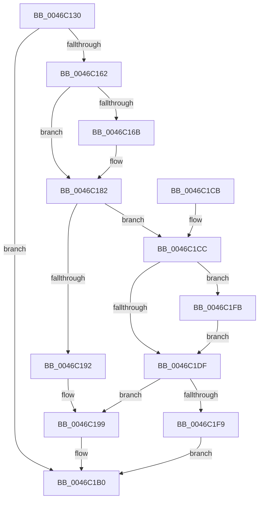

# PsInsertVirtualizedTimer

- RVA: `0x0046C130`–`0x0046C226` (길이 `246` bytes)
- VA: `0x000000014046C130`
- 실행 섹션: `.text`
- PDB 이름 있음: `예`; PDB Function 태그: `아니요`
- unwind 정보 RVA: `0x000AB594`
- 디코드: `63`개 명령, `246/246` bytes 표시
- 미해석 바이트: `0` (있으면 어셈블리에 `.byte`로 보존)

> 이 문서는 커널 이미지의 기계어와 PDB 기호를 분석해 생성했습니다. 4번과 5번은 함수 원형과 자료형을 바이너리 사용 방식에서 추정한 C 해석이며 원본 소스 복구 결과는 아닙니다.

## 1. Dependencies

- 직접 호출 지점: **6**; 고유 호출 대상: **6**
- 직접 호출자로 확인된 함수: **2**
- RIP 상대 이미지 참조: **0**

### Outgoing calls
- `0x0046C172` → [KeAcquireSpinLockRaiseToDpc](../20/KeAcquireSpinLockRaiseToDpc_function_00208470.md) (function, `0x00208470`)
- `0x0046C17D` → [KeAcquireSpinLockAtDpcLevel](../20/KeAcquireSpinLockAtDpcLevel_function_00208430.md) (function, `0x00208430`)
- `0x0046C19C` → [KxReleaseSpinLock](../20/KxReleaseSpinLock_function_00206670.md) (function, `0x00206670`)
- `0x0046C1AB` → [KeReleaseSpinLock](../39/KeReleaseSpinLock_function_00392BA0.md) (function, `0x00392BA0`)
- `0x0046C1E7` → [ObfReferenceObjectWithTag](../21/ObfReferenceObjectWithTag_function_00210710.md) (function, `0x00210710`)
- `0x0046C21F` → [ExpTimerPause](../3D/ExpTimerPause_function_003D38C4.md) (function, `0x003D38C4`)

### Direct callers
- [sub_006D73CA](../6D/Unknown_function_006D73CA.md) at `0x006D74A5`
- [NtCreateTimer](../../page/9F/NtCreateTimer_function_009FF010.md) at `0x009FF1F2`

### Static image references
- 디코드된 RIP-relative 메모리 참조가 없습니다.

## 2. Other-region calls and transfers

- 다른 실행 섹션으로 향하는 call: **0**
- 별도 외부 분기/꼬리 이동을 확인하지 못했습니다.

## 3. Assembly (complete function range)

```asm
0046C130  48 8B C4                        mov rax, rsp
0046C133  48 89 58 08                     mov qword ptr [rax + 8], rbx
0046C137  48 89 68 10                     mov qword ptr [rax + 0x10], rbp
0046C13B  48 89 70 18                     mov qword ptr [rax + 0x18], rsi
0046C13F  48 89 78 20                     mov qword ptr [rax + 0x20], rdi
0046C143  41 56                           push r14
0046C145  48 83 EC 20                     sub rsp, 0x20
0046C149  8B 81 F4 01 00 00               mov eax, dword ptr [rcx + 0x1f4]
0046C14F  45 8A F1                        mov r14b, r9b
0046C152  49 8B F8                        mov rdi, r8
0046C155  48 8B F2                        mov rsi, rdx
0046C158  48 8B D9                        mov rbx, rcx
0046C15B  A9 08 00 00 40                  test eax, 0x40000008
0046C160  75 4E                           jne 0x14046c1b0
0046C162  44 0F 20 C5                     mov rbp, cr8
0046C166  4D 85 C0                        test r8, r8
0046C169  74 17                           je 0x14046c182
0046C16B  48 81 C1 08 07 00 00            add rcx, 0x708
0046C172  E8 F9 C2 D9 FF                  call 0x140208470
0046C177  48 8B CF                        mov rcx, rdi
0046C17A  40 8A E8                        mov bpl, al
0046C17D  E8 AE C2 D9 FF                  call 0x140208430
0046C182  48 8D 8B 10 07 00 00            lea rcx, [rbx + 0x710]
0046C189  48 8B 51 08                     mov rdx, qword ptr [rcx + 8]
0046C18D  48 39 0A                        cmp qword ptr [rdx], rcx
0046C190  74 3A                           je 0x14046c1cc
0046C192  B9 03 00 00 00                  mov ecx, 3
0046C197  CD 29                           int 0x29
0046C199  48 8B CF                        mov rcx, rdi
0046C19C  E8 CF A4 D9 FF                  call 0x140206670
0046C1A1  48 8D 8B 08 07 00 00            lea rcx, [rbx + 0x708]
0046C1A8  40 8A D5                        mov dl, bpl
0046C1AB  E8 F0 69 F2 FF                  call 0x140392ba0
0046C1B0  48 8B 5C 24 30                  mov rbx, qword ptr [rsp + 0x30]
0046C1B5  48 8B 6C 24 38                  mov rbp, qword ptr [rsp + 0x38]
0046C1BA  48 8B 74 24 40                  mov rsi, qword ptr [rsp + 0x40]
0046C1BF  48 8B 7C 24 48                  mov rdi, qword ptr [rsp + 0x48]
0046C1C4  48 83 C4 20                     add rsp, 0x20
0046C1C8  41 5E                           pop r14
0046C1CA  C3                              ret
0046C1CB  CC                              int3
0046C1CC  48 89 0E                        mov qword ptr [rsi], rcx
0046C1CF  48 89 56 08                     mov qword ptr [rsi + 8], rdx
0046C1D3  48 89 32                        mov qword ptr [rdx], rsi
0046C1D6  48 89 71 08                     mov qword ptr [rcx + 8], rsi
0046C1DA  45 84 F6                        test r14b, r14b
0046C1DD  75 1C                           jne 0x14046c1fb
0046C1DF  BA 50 73 56 54                  mov edx, 0x54567350
0046C1E4  48 8B CB                        mov rcx, rbx
0046C1E7  E8 24 45 DA FF                  call 0x140210710
0046C1EC  48 8B 44 24 50                  mov rax, qword ptr [rsp + 0x50]
0046C1F1  48 89 18                        mov qword ptr [rax], rbx
0046C1F4  48 85 FF                        test rdi, rdi
0046C1F7  75 A0                           jne 0x14046c199
0046C1F9  EB B5                           jmp 0x14046c1b0
0046C1FB  49 B8 08 00 00 00 80 F7 FF FF   movabs r8, 0xfffff78000000008
0046C205  48 8D 8E E0 FE FF FF            lea rcx, [rsi - 0x120]
0046C20C  48 BA 14 00 00 00 80 F7 FF FF   movabs rdx, 0xfffff78000000014
0046C216  41 B1 01                        mov r9b, 1
0046C219  4D 8B 00                        mov r8, qword ptr [r8]
0046C21C  48 8B 12                        mov rdx, qword ptr [rdx]
0046C21F  E8 A0 76 F6 FF                  call 0x1403d38c4
0046C224  EB B9                           jmp 0x14046c1df
```

## 4. C-style interpretation (structured pseudocode)

```c
__int64 __fastcall PsInsertVirtualizedTimer(__int64 a1, __int64 a2, __int64 a3, unsigned __int8 a4, __int64 a5)
{
    __int64 result;
    __int64 v_rbp;
    __int64 v_rsp;
    unsigned __int64 v_stack_p10;
    unsigned __int64 v_stack_p18;
    unsigned __int64 v_stack_p20;
    unsigned __int64 v_stack_p8;

    *(unsigned __int64 *)(v_rsp + 8) = v_rbx;
    *(unsigned __int64 *)(v_rsp + 16) = v_rbp;
    *(unsigned __int64 *)(v_rsp + 24) = v_rsi;
    *(unsigned __int64 *)(v_rsp + 32) = v_rdi;
    v_rsp = (v_rsp) - (32);
    if ((((unsigned int)((unsigned int)(*(unsigned int *)(a1 + 500)))) & (0x40000008ULL)) != 0) goto loc_0046C1B0;
    result = (unsigned int)(*(unsigned int *)(a1 + 500));
    v_rbp = v_cr8;
    if (a3 != 0) {
        a1 = (a1) + (0x708ULL);
        result = KeAcquireSpinLockRaiseToDpc(a1, a2, a3, a4);
        a1 = a3;
        v_rbp = (unsigned __int8)(result);
        result = KeAcquireSpinLockAtDpcLevel(a1, a2, a3, a4);
    }
    if ((*(unsigned __int64 *)(*(unsigned __int64 *)(a1 + 1808 + 8))) == (a1 + 1808)) goto loc_0046C1CC;
loc_0046C199:
    result = KxReleaseSpinLock(a3, *(unsigned __int64 *)(a1 + 1808 + 8), a3, a4);
    result = KeReleaseSpinLock(a1 + 1800, (unsigned __int8)(v_rbp), a3, a4);
loc_0046C1B0:
    v_rsp = (v_rsp) + (32);
    return result;
loc_0046C1CC:
    *(unsigned __int64 *)(v_stack_p18) = a1 + 1800;
    *(unsigned __int64 *)(v_stack_p18 + 8) = (unsigned __int8)(v_rbp);
    *(unsigned __int64 *)((unsigned __int8)(v_rbp)) = v_stack_p18;
    *(unsigned __int64 *)(a1 + 1800 + 8) = v_stack_p18;
    if (a4 != 0) goto loc_0046C1FB;
loc_0046C1DF:
    result = ObfReferenceObjectWithTag(v_stack_p8, (unsigned int)(0x54567350ULL), a3, a4);
    *(unsigned __int64 *)(a5) = v_stack_p8;
    if (v_stack_p20 != 0) goto loc_0046C199;
    goto loc_0046C1B0;
loc_0046C1FB:
    result = ExpTimerPause(v_stack_p18 - 288, *(unsigned __int64 *)((unsigned int)(0x54567350ULL)), *(unsigned __int64 *)(a3), 1);
    goto loc_0046C1DF;
}
```

## 5. (Beta) C Style

```c
int64_t PsInsertVirtualizedTimer(void *Arg1, void *Arg2, int64_t Arg3, uint8_t Arg4, void *Arg5)
{
    uint8_t *arg1 = (uint8_t *)Arg1;
    uint8_t *arg2 = (uint8_t *)Arg2;
    uint8_t *arg5 = (uint8_t *)Arg5;

    int64_t result;
    int64_t local_rbp;
    int64_t local_rsp;
    uint64_t v_stack_p10;
    uint64_t v_stack_p18;
    uint64_t v_stack_p20;
    uint64_t v_stack_p8;

    *(uint64_t *)(local_rsp + 0x8) = local_rbx;
    *(uint64_t *)(local_rsp + 0x10) = local_rbp;
    *(uint64_t *)(local_rsp + 0x18) = local_rsi;
    *(uint64_t *)(local_rsp + 0x20) = local_rdi;
    local_rsp = (local_rsp) - (32);
    if ((((uint32_t)((uint32_t)(*(uint32_t *)(arg1 + 0x1F4)))) & (0x40000008ULL)) != 0) goto loc_0046C1B0;
    result = (uint32_t)(*(uint32_t *)(arg1 + 0x1F4));
    local_rbp = v_cr8;
    if (Arg3 != 0) {
        Arg1 = (Arg1) + (0x708ULL);
        result = KeAcquireSpinLockRaiseToDpc(Arg1, Arg2, Arg3, Arg4);
        Arg1 = Arg3;
        local_rbp = (uint8_t)(result);
        result = KeAcquireSpinLockAtDpcLevel(Arg1, Arg2, Arg3, Arg4);
    }
    if ((*(uint64_t *)(*(uint64_t *)(arg1 + 0x710 + 0x8))) == (Arg1 + 1808)) goto loc_0046C1CC;
loc_0046C199:
    result = KxReleaseSpinLock(Arg3, *(uint64_t *)(arg1 + 0x710 + 0x8), Arg3, Arg4);
    result = KeReleaseSpinLock(Arg1 + 1800, (uint8_t)(local_rbp), Arg3, Arg4);
loc_0046C1B0:
    local_rsp = (local_rsp) + (32);
    return result;
loc_0046C1CC:
    *(void **)(v_stack_p18) = Arg1 + 1800;
    *(uint64_t *)(v_stack_p18 + 0x8) = (uint8_t)(local_rbp);
    *(uint64_t *)((uint8_t)(local_rbp)) = v_stack_p18;
    *(uint64_t *)(arg1 + 0x708 + 0x8) = v_stack_p18;
    if (Arg4 != 0) goto loc_0046C1FB;
loc_0046C1DF:
    result = ObfReferenceObjectWithTag(v_stack_p8, (uint32_t)(0x54567350ULL), Arg3, Arg4);
    *(uint64_t *)(arg5) = v_stack_p8;
    if (v_stack_p20 != 0) goto loc_0046C199;
    goto loc_0046C1B0;
loc_0046C1FB:
    result = ExpTimerPause(v_stack_p18 - 288, *(uint64_t *)((uint32_t)(0x54567350ULL)), *(uint64_t *)(Arg3), 1);
    goto loc_0046C1DF;
}
```

### 관측된 메모리 오프셋

구조체 형식이 확인되지 않은 접근은 인자 기준의 오프셋으로만 기록했습니다.

| 기준 인자 | 오프셋 표현 | 폭 (bit) | 접근 |
|---|---:|---:|---|
| `Arg1` | `+ 0x8` | `64` | `R` |
| `Arg1` | `+ 0x8` | `64` | `W` |
| `Arg1` | `+ 0x1F4` | `32` | `R` |
| `Arg1` | `+ 0x708` | `64` | `R` |
| `Arg1` | `+ 0x710` | `64` | `R` |
| `Arg2` | `- 0x120` | `64` | `R` |
| `Arg2` | `+ 0x0` | `64` | `W` |
| `Arg2` | `+ 0x8` | `64` | `W` |
| `Arg5` | `+ 0x0` | `64` | `W` |

## 6. Execution-region graph

[열기: 2D/3D 그래프와 함수 탐색 컨트롤 패널](../../../control-panel.html?section=text&rva=0x0046C130&view=graph)

- 2D 그래프는 위에서 아래로 흐르고, 3D 그래프는 빈 공간을 드래그해 회전합니다. Shift+드래그는 이동, 휠은 확대·축소, 함수 노드 선택은 대상 보고서 이동입니다.

### Static fallback


