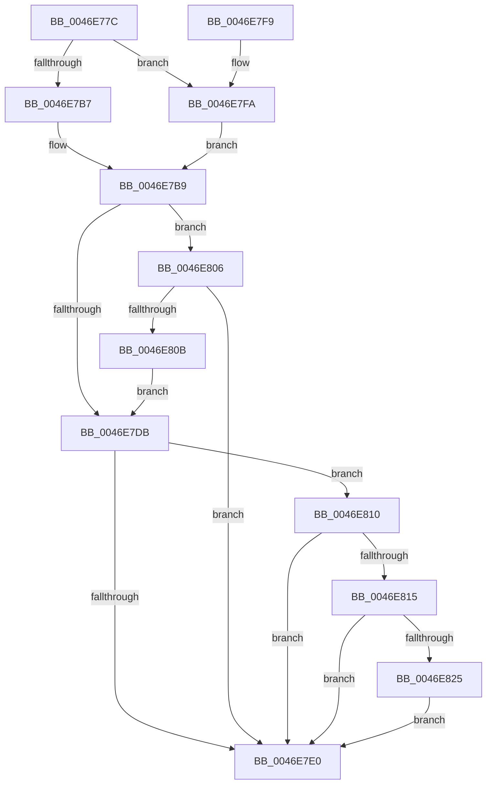

# PsIoRateControlReference

- RVA: `0x0046E77C`–`0x0046E83B` (길이 `191` bytes)
- VA: `0x000000014046E77C`
- 실행 섹션: `.text`
- PDB 이름 있음: `예`; PDB Function 태그: `아니요`
- unwind 정보 RVA: `0x0009A224`
- 디코드: `57`개 명령, `191/191` bytes 표시
- 미해석 바이트: `0` (있으면 어셈블리에 `.byte`로 보존)

> 이 문서는 커널 이미지의 기계어와 PDB 기호를 분석해 생성했습니다. 4번과 5번은 함수 원형과 자료형을 바이너리 사용 방식에서 추정한 C 해석이며 원본 소스 복구 결과는 아닙니다.

## 1. Dependencies

- 직접 호출 지점: **2**; 고유 호출 대상: **2**
- 직접 호출자로 확인된 함수: **1**
- RIP 상대 이미지 참조: **0**

### Outgoing calls
- `0x0046E7AA` → [PspIoRateEntryIoControlReference](PspIoRateEntryIoControlReference_function_0046E844.md) (function, `0x0046E844`)
- `0x0046E81B` → [PspJobIoRateVolumeEntryReference](../5E/PspJobIoRateVolumeEntryReference_function_005E3AA8.md) (function, `0x005E3AA8`)

### Direct callers
- [IoGetIoRateControl](../34/IoGetIoRateControl_function_003493F0.md) at `0x00349482`

### Static image references
- 디코드된 RIP-relative 메모리 참조가 없습니다.

## 2. Other-region calls and transfers

- 다른 실행 섹션으로 향하는 call: **0**
- 별도 외부 분기/꼬리 이동을 확인하지 못했습니다.

## 3. Assembly (complete function range)

```asm
0046E77C  48 89 5C 24 08                  mov qword ptr [rsp + 8], rbx
0046E781  48 89 6C 24 10                  mov qword ptr [rsp + 0x10], rbp
0046E786  48 89 74 24 18                  mov qword ptr [rsp + 0x18], rsi
0046E78B  57                              push rdi
0046E78C  41 56                           push r14
0046E78E  41 57                           push r15
0046E790  48 83 EC 20                     sub rsp, 0x20
0046E794  48 8D B9 60 06 00 00            lea rdi, [rcx + 0x660]
0046E79B  48 8B D9                        mov rbx, rcx
0046E79E  48 8B CF                        mov rcx, rdi
0046E7A1  4D 8B F1                        mov r14, r9
0046E7A4  4D 8B F8                        mov r15, r8
0046E7A7  48 8B EA                        mov rbp, rdx
0046E7AA  E8 95 00 00 00                  call 0x14046e844
0046E7AF  49 89 07                        mov qword ptr [r15], rax
0046E7B2  48 85 C0                        test rax, rax
0046E7B5  75 43                           jne 0x14046e7fa
0046E7B7  33 FF                           xor edi, edi
0046E7B9  48 8B 74 24 60                  mov rsi, qword ptr [rsp + 0x60]
0046E7BE  48 8D 8B A0 06 00 00            lea rcx, [rbx + 0x6a0]
0046E7C5  48 89 3E                        mov qword ptr [rsi], rdi
0046E7C8  49 83 67 08 00                  and qword ptr [r15 + 8], 0
0046E7CD  48 83 66 08 00                  and qword ptr [rsi + 8], 0
0046E7D2  F6 41 08 01                     test byte ptr [rcx + 8], 1
0046E7D6  48 8B 01                        mov rax, qword ptr [rcx]
0046E7D9  75 2B                           jne 0x14046e806
0046E7DB  48 85 C0                        test rax, rax
0046E7DE  75 30                           jne 0x14046e810
0046E7E0  48 8B 5C 24 40                  mov rbx, qword ptr [rsp + 0x40]
0046E7E5  48 8B 6C 24 48                  mov rbp, qword ptr [rsp + 0x48]
0046E7EA  48 8B 74 24 50                  mov rsi, qword ptr [rsp + 0x50]
0046E7EF  48 83 C4 20                     add rsp, 0x20
0046E7F3  41 5F                           pop r15
0046E7F5  41 5E                           pop r14
0046E7F7  5F                              pop rdi
0046E7F8  C3                              ret
0046E7F9  CC                              int3
0046E7FA  48 8B 83 30 06 00 00            mov rax, qword ptr [rbx + 0x630]
0046E801  49 89 06                        mov qword ptr [r14], rax
0046E804  EB B3                           jmp 0x14046e7b9
0046E806  48 85 C0                        test rax, rax
0046E809  74 D5                           je 0x14046e7e0
0046E80B  48 33 C1                        xor rax, rcx
0046E80E  EB CB                           jmp 0x14046e7db
0046E810  48 85 ED                        test rbp, rbp
0046E813  74 CB                           je 0x14046e7e0
0046E815  48 8B D5                        mov rdx, rbp
0046E818  48 8B CB                        mov rcx, rbx
0046E81B  E8 88 52 17 00                  call 0x1405e3aa8
0046E820  48 85 C0                        test rax, rax
0046E823  74 BB                           je 0x14046e7e0
0046E825  48 8B 48 28                     mov rcx, qword ptr [rax + 0x28]
0046E829  49 89 4F 08                     mov qword ptr [r15 + 8], rcx
0046E82D  48 8B 48 30                     mov rcx, qword ptr [rax + 0x30]
0046E831  49 89 4E 08                     mov qword ptr [r14 + 8], rcx
0046E835  48 89 46 08                     mov qword ptr [rsi + 8], rax
0046E839  EB A5                           jmp 0x14046e7e0
```

## 4. C-style interpretation (structured pseudocode)

```c
__int64 __fastcall PsIoRateControlReference(__int64 a1, __int64 a2, __int64 a3, __int64 a4, __int64 a5)
{
    __int64 result;
    __int64 v_rdi;
    __int64 v_rsp;
    unsigned __int64 v_stack_p10;
    unsigned __int64 v_stack_p18;
    unsigned __int64 v_stack_p8;

    v_stack_p8 = v_rbx;
    v_stack_p10 = v_rbp;
    v_stack_p18 = v_rsi;
    v_rsp = (v_rsp) - (32);
    result = PspIoRateEntryIoControlReference(a1 + 1632, a2, a3, a4);
    *(unsigned __int64 *)(a3) = result;
    if (result != 0) goto loc_0046E7FA;
    v_rdi = 0;
loc_0046E7B9:
    *(unsigned __int64 *)(a5) = 0;
    if (((*(unsigned __int8 *)(a1 + 1696 + 8)) & (1)) != 0) goto loc_0046E806;
loc_0046E7DB:
    if (*(unsigned __int64 *)(a1 + 1696) != 0) goto loc_0046E810;
loc_0046E7E0:
    v_rsp = (v_rsp) + (32);
    return *(unsigned __int64 *)(a1 + 1696);
loc_0046E7FA:
    *(unsigned __int64 *)(a4) = *(unsigned __int64 *)(v_stack_p8 + 1584);
    goto loc_0046E7B9;
loc_0046E806:
    if (*(unsigned __int64 *)(v_stack_p8 + 1584) == 0) goto loc_0046E7E0;
    result = (*(unsigned __int64 *)(v_stack_p8 + 1584)) ^ (a1 + 1696);
    goto loc_0046E7DB;
loc_0046E810:
    if (v_stack_p10 == 0) goto loc_0046E7E0;
    result = PspJobIoRateVolumeEntryReference(v_stack_p8, v_stack_p10, a3, a4);
    if (result == 0) goto loc_0046E7E0;
    *(unsigned __int64 *)(a3 + 8) = *(unsigned __int64 *)(result + 40);
    *(unsigned __int64 *)(a4 + 8) = *(unsigned __int64 *)(result + 48);
    *(unsigned __int64 *)(v_stack_p18 + 8) = result;
    goto loc_0046E7E0;
}
```

## 5. (Beta) C Style

```c
int64_t PsIoRateControlReference(void *Arg1, int64_t Arg2, void *Arg3, void *Arg4, void *Arg5)
{
    uint8_t *arg1 = (uint8_t *)Arg1;
    uint8_t *arg3 = (uint8_t *)Arg3;
    uint8_t *arg4 = (uint8_t *)Arg4;
    uint8_t *arg5 = (uint8_t *)Arg5;

    int64_t result;
    int64_t local_rdi;
    int64_t local_rsp;
    uint64_t v_stack_p10;
    uint64_t v_stack_p18;
    uint64_t v_stack_p8;

    v_stack_p8 = local_rbx;
    v_stack_p10 = local_rbp;
    v_stack_p18 = local_rsi;
    local_rsp = (local_rsp) - (32);
    result = PspIoRateEntryIoControlReference(Arg1 + 1632, Arg2, Arg3, Arg4);
    *(uint64_t *)(arg3) = result;
    if (result != 0) goto loc_0046E7FA;
    local_rdi = 0;
loc_0046E7B9:
    *(uint64_t *)(arg5) = 0;
    if (((*(uint8_t *)(arg1 + 0x6A0 + 0x8)) & (1)) != 0) goto loc_0046E806;
loc_0046E7DB:
    if (*(uint64_t *)(arg1 + 0x6A0) != 0) goto loc_0046E810;
loc_0046E7E0:
    local_rsp = (local_rsp) + (32);
    return *(uint64_t *)(arg1 + 0x6A0);
loc_0046E7FA:
    *(uint64_t *)(arg4) = *(uint64_t *)(v_stack_p8 + 0x630);
    goto loc_0046E7B9;
loc_0046E806:
    if (*(uint64_t *)(v_stack_p8 + 0x630) == 0) goto loc_0046E7E0;
    result = (*(uint64_t *)(v_stack_p8 + 0x630)) ^ (Arg1 + 1696);
    goto loc_0046E7DB;
loc_0046E810:
    if (v_stack_p10 == 0) goto loc_0046E7E0;
    result = PspJobIoRateVolumeEntryReference(v_stack_p8, v_stack_p10, Arg3, Arg4);
    if (result == 0) goto loc_0046E7E0;
    *(uint64_t *)(arg3 + 0x8) = *(uint64_t *)(result + 0x28);
    *(uint64_t *)(arg4 + 0x8) = *(uint64_t *)(result + 0x30);
    *(uint64_t *)(v_stack_p18 + 0x8) = result;
    goto loc_0046E7E0;
}
```

### 관측된 메모리 오프셋

구조체 형식이 확인되지 않은 접근은 인자 기준의 오프셋으로만 기록했습니다.

| 기준 인자 | 오프셋 표현 | 폭 (bit) | 접근 |
|---|---:|---:|---|
| `Arg1` | `+ 0x0` | `64` | `R` |
| `Arg1` | `+ 0x8` | `8` | `R` |
| `Arg1` | `+ 0x630` | `64` | `R` |
| `Arg1` | `+ 0x660` | `64` | `R` |
| `Arg1` | `+ 0x6A0` | `64` | `R` |
| `Arg3` | `+ 0x0` | `64` | `W` |
| `Arg3` | `+ 0x8` | `64` | `R/W` |
| `Arg3` | `+ 0x8` | `64` | `W` |
| `Arg4` | `+ 0x0` | `64` | `W` |
| `Arg4` | `+ 0x8` | `64` | `W` |
| `Arg5` | `+ 0x0` | `64` | `W` |
| `Arg5` | `+ 0x8` | `64` | `R/W` |
| `Arg5` | `+ 0x8` | `64` | `W` |

## 6. Execution-region graph

[열기: 2D/3D 그래프와 함수 탐색 컨트롤 패널](../../../control-panel.html?section=text&rva=0x0046E77C&view=graph)

- 2D 그래프는 위에서 아래로 흐르고, 3D 그래프는 빈 공간을 드래그해 회전합니다. Shift+드래그는 이동, 휠은 확대·축소, 함수 노드 선택은 대상 보고서 이동입니다.

### Static fallback


