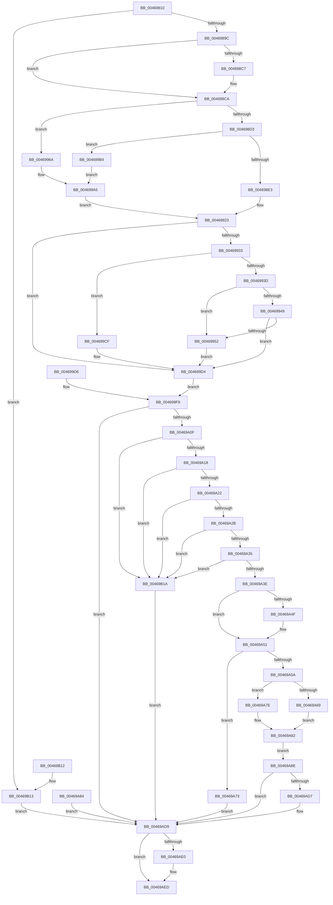

# PsQueryProcessCommandLine

- RVA: `0x00469810`–`0x00469B21` (길이 `785` bytes)
- VA: `0x0000000140469810`
- 실행 섹션: `.text`
- PDB 이름 있음: `예`; PDB Function 태그: `아니요`
- unwind 정보 RVA: `0x000AB19C`
- 디코드: `190`개 명령, `785/785` bytes 표시
- 미해석 바이트: `0` (있으면 어셈블리에 `.byte`로 보존)

> 이 문서는 커널 이미지의 기계어와 PDB 기호를 분석해 생성했습니다. 4번과 5번은 함수 원형과 자료형을 바이너리 사용 방식에서 추정한 C 해석이며 원본 소스 복구 결과는 아닙니다.

## 1. Dependencies

- 직접 호출 지점: **8**; 고유 호출 대상: **8**
- 직접 호출자로 확인된 함수: **3**
- RIP 상대 이미지 참조: **1**

### Outgoing calls
- `0x0046988B` → [ExAcquireRundownProtection](../21/ExAcquireRundownProtection_function_00216620.md) (function, `0x00216620`)
- `0x004698B3` → [KeStackAttachProcess](../21/KeStackAttachProcess_function_00216800.md) (function, `0x00216800`)
- `0x0046997C` → [RtlCopyVolatileMemory](../6B/RtlCopyVolatileMemory_function_006BC9D0.md) (function, `0x006BC9D0`)
- `0x004699CF` → [ExRaiseDatatypeMisalignment](../../page/89/ExRaiseDatatypeMisalignment_function_00899FD0.md) (function, `0x00899FD0`)
- `0x00469A02` → [KiUnstackDetachProcess](../21/KiUnstackDetachProcess_function_00217D30.md) (function, `0x00217D30`)
- `0x00469ACC` → [MmCopyVirtualMemory](../../page/9B/MmCopyVirtualMemory_function_009BBB10.md) (function, `0x009BBB10`)
- `0x00469AE8` → [ExReleaseRundownProtection](../34/ExReleaseRundownProtection_function_00349E80.md) (function, `0x00349E80`)
- `0x00469AFA` → [_security_check_cookie](../6A/_security_check_cookie_function_006AC640.md) (function, `0x006AC640`)

### Direct callers
- [PnpGetProcessCommandLine](../../page/73/PnpGetProcessCommandLine_function_00737FF4.md) at `0x0073801A`
- [PnpGetProcessCommandLine](../../page/73/PnpGetProcessCommandLine_function_00737FF4.md) at `0x0073805A`
- [NtQueryInformationProcess](../../page/9A/NtQueryInformationProcess_function_009AA250.md) at `0x009AC1C3`
- [sub_00B25678](../../page/B2/Unknown_function_00B25678.md) at `0x00B2568D`
- [sub_00B25678](../../page/B2/Unknown_function_00B25678.md) at `0x00B256D5`

### Static image references
- `0x0046982D` → RVA `0x00E0A740` (`.data`; read)

## 2. Other-region calls and transfers

- 다른 실행 섹션으로 향하는 call: **2**
  - `0x004699CF` → [ExRaiseDatatypeMisalignment](../../page/89/ExRaiseDatatypeMisalignment_function_00899FD0.md) (`.text` → `PAGE`)
  - `0x00469ACC` → [MmCopyVirtualMemory](../../page/9B/MmCopyVirtualMemory_function_009BBB10.md) (`.text` → `PAGE`)
- 별도 외부 분기/꼬리 이동을 확인하지 못했습니다.

## 3. Assembly (complete function range)

```asm
00469810  4C 8B DC                        mov r11, rsp
00469813  45 88 4B 20                     mov byte ptr [r11 + 0x20], r9b
00469817  45 89 43 18                     mov dword ptr [r11 + 0x18], r8d
0046981B  53                              push rbx
0046981C  56                              push rsi
0046981D  57                              push rdi
0046981E  41 54                           push r12
00469820  41 55                           push r13
00469822  41 56                           push r14
00469824  41 57                           push r15
00469826  48 81 EC D0 00 00 00            sub rsp, 0xd0
0046982D  48 8B 05 0C 0F 9A 00            mov rax, qword ptr [rip + 0x9a0f0c]
00469834  48 33 C4                        xor rax, rsp
00469837  48 89 84 24 C0 00 00 00         mov qword ptr [rsp + 0xc0], rax
0046983F  4C 8B FA                        mov r15, rdx
00469842  4C 8B E9                        mov r13, rcx
00469845  48 89 4C 24 70                  mov qword ptr [rsp + 0x70], rcx
0046984A  48 89 54 24 78                  mov qword ptr [rsp + 0x78], rdx
0046984F  48 8B 84 24 30 01 00 00         mov rax, qword ptr [rsp + 0x130]
00469857  48 89 44 24 60                  mov qword ptr [rsp + 0x60], rax
0046985C  0F 57 C0                        xorps xmm0, xmm0
0046985F  41 0F 11 43 88                  movups xmmword ptr [r11 - 0x78], xmm0
00469864  41 0F 11 43 98                  movups xmmword ptr [r11 - 0x68], xmm0
00469869  41 0F 11 43 A8                  movups xmmword ptr [r11 - 0x58], xmm0
0046986E  33 FF                           xor edi, edi
00469870  49 89 BB 78 FF FF FF            mov qword ptr [r11 - 0x88], rdi
00469877  48 89 7C 24 58                  mov qword ptr [rsp + 0x58], rdi
0046987C  48 81 C1 E8 01 00 00            add rcx, 0x1e8
00469883  48 89 8C 24 88 00 00 00         mov qword ptr [rsp + 0x88], rcx
0046988B  E8 90 CD DA FF                  call 0x140216620
00469890  88 44 24 40                     mov byte ptr [rsp + 0x40], al
00469894  84 C0                           test al, al
00469896  0F 84 77 02 00 00               je 0x140469b13
0046989C  0F 57 C0                        xorps xmm0, xmm0
0046989F  0F 11 44 24 48                  movups xmmword ptr [rsp + 0x48], xmm0
004698A4  89 7C 24 44                     mov dword ptr [rsp + 0x44], edi
004698A8  48 8D 94 24 90 00 00 00         lea rdx, [rsp + 0x90]
004698B0  49 8B CD                        mov rcx, r13
004698B3  E8 48 CF DA FF                  call 0x140216800
004698B8  90                              nop
004698B9  8B C7                           mov eax, edi
004698BB  49 8B 8D 10 03 00 00            mov rcx, qword ptr [r13 + 0x310]
004698C2  48 85 C9                        test rcx, rcx
004698C5  74 03                           je 0x1404698ca
004698C7  48 8B 01                        mov rax, qword ptr [rcx]
004698CA  48 85 C0                        test rax, rax
004698CD  0F 85 97 00 00 00               jne 0x14046996a
004698D3  49 8B 85 E0 02 00 00            mov rax, qword ptr [r13 + 0x2e0]
004698DA  48 85 C0                        test rax, rax
004698DD  0F 84 D1 00 00 00               je 0x1404699b4
004698E3  48 8B 40 20                     mov rax, qword ptr [rax + 0x20]
004698E7  48 89 44 24 68                  mov qword ptr [rsp + 0x68], rax
004698EC  48 8B C8                        mov rcx, rax
004698EF  48 83 C1 70                     add rcx, 0x70
004698F3  48 BA 00 00 FF FF FF 7F 00 00   movabs rdx, 0x7fffffff0000
004698FD  48 3B CA                        cmp rcx, rdx
00469900  48 0F 43 CA                     cmovae rcx, rdx
00469904  90                              nop
00469905  8B 01                           mov eax, dword ptr [rcx]
00469907  89 44 24 48                     mov dword ptr [rsp + 0x48], eax
0046990B  4C 8B 61 08                     mov r12, qword ptr [rcx + 8]
0046990F  4C 89 64 24 50                  mov qword ptr [rsp + 0x50], r12
00469914  44 0F B7 74 24 4A               movzx r14d, word ptr [rsp + 0x4a]
0046991A  0F B7 5C 24 48                  movzx ebx, word ptr [rsp + 0x48]
0046991F  8B 74 24 44                     mov esi, dword ptr [rsp + 0x44]
00469923  8B 44 24 48                     mov eax, dword ptr [rsp + 0x48]
00469927  C1 F8 10                        sar eax, 0x10
0046992A  66 85 C0                        test ax, ax
0046992D  0F 84 A1 00 00 00               je 0x1404699d4
00469933  41 F6 C4 01                     test r12b, 1
00469937  0F 85 92 00 00 00               jne 0x1404699cf
0046993D  41 0F B7 CE                     movzx ecx, r14w
00469941  49 03 CC                        add rcx, r12
00469944  48 3B CA                        cmp rcx, rdx
00469947  77 09                           ja 0x140469952
00469949  49 3B CC                        cmp rcx, r12
0046994C  0F 83 82 00 00 00               jae 0x1404699d4
00469952  8A 02                           mov al, byte ptr [rdx]
00469954  4C 8B 64 24 50                  mov r12, qword ptr [rsp + 0x50]
00469959  44 0F B7 74 24 4A               movzx r14d, word ptr [rsp + 0x4a]
0046995F  0F B7 5C 24 48                  movzx ebx, word ptr [rsp + 0x48]
00469964  8B 74 24 44                     mov esi, dword ptr [rsp + 0x44]
00469968  EB 6A                           jmp 0x1404699d4
0046996A  8B 50 10                        mov edx, dword ptr [rax + 0x10]
0046996D  48 83 C2 40                     add rdx, 0x40
00469971  41 B8 08 00 00 00               mov r8d, 8
00469977  48 8D 4C 24 58                  lea rcx, [rsp + 0x58]
0046997C  E8 4F 30 25 00                  call 0x1406bc9d0
00469981  48 8B 5C 24 58                  mov rbx, qword ptr [rsp + 0x58]
00469986  66 89 5C 24 48                  mov word ptr [rsp + 0x48], bx
0046998B  44 0F B7 74 24 5A               movzx r14d, word ptr [rsp + 0x5a]
00469991  66 44 89 74 24 4A               mov word ptr [rsp + 0x4a], r14w
00469997  44 8B 64 24 5C                  mov r12d, dword ptr [rsp + 0x5c]
0046999C  4C 89 64 24 50                  mov qword ptr [rsp + 0x50], r12
004699A1  8B 74 24 44                     mov esi, dword ptr [rsp + 0x44]
004699A5  48 BA 00 00 FF FF FF 7F 00 00   movabs rdx, 0x7fffffff0000
004699AF  E9 6F FF FF FF                  jmp 0x140469923
004699B4  BE 25 02 00 C0                  mov esi, 0xc0000225
004699B9  89 74 24 44                     mov dword ptr [rsp + 0x44], esi
004699BD  4C 8B 64 24 50                  mov r12, qword ptr [rsp + 0x50]
004699C2  44 0F B7 74 24 4A               movzx r14d, word ptr [rsp + 0x4a]
004699C8  0F B7 5C 24 48                  movzx ebx, word ptr [rsp + 0x48]
004699CD  EB D6                           jmp 0x1404699a5
004699CF  E8 FC 05 43 00                  call 0x140899fd0
004699D4  EB 22                           jmp 0x1404699f8
004699D6  8B F0                           mov esi, eax
004699D8  89 44 24 44                     mov dword ptr [rsp + 0x44], eax
004699DC  33 FF                           xor edi, edi
004699DE  4C 8B 64 24 50                  mov r12, qword ptr [rsp + 0x50]
004699E3  44 0F B7 74 24 4A               movzx r14d, word ptr [rsp + 0x4a]
004699E9  0F B7 5C 24 48                  movzx ebx, word ptr [rsp + 0x48]
004699EE  4C 8B 6C 24 70                  mov r13, qword ptr [rsp + 0x70]
004699F3  4C 8B 7C 24 78                  mov r15, qword ptr [rsp + 0x78]
004699F8  33 D2                           xor edx, edx
004699FA  48 8D 8C 24 90 00 00 00         lea rcx, [rsp + 0x90]
00469A02  E8 29 E3 DA FF                  call 0x140217d30
00469A07  85 F6                           test esi, esi
00469A09  0F 88 CA 00 00 00               js 0x140469ad9
00469A0F  66 85 DB                        test bx, bx
00469A12  0F 84 02 01 00 00               je 0x140469b1a
00469A18  66 41 3B DE                     cmp bx, r14w
00469A1C  0F 87 F8 00 00 00               ja 0x140469b1a
00469A22  F6 C3 01                        test bl, 1
00469A25  0F 85 EF 00 00 00               jne 0x140469b1a
00469A2B  41 F6 C6 01                     test r14b, 1
00469A2F  0F 85 E5 00 00 00               jne 0x140469b1a
00469A35  4D 85 E4                        test r12, r12
00469A38  0F 84 DC 00 00 00               je 0x140469b1a
00469A3E  41 0F B7 C6                     movzx eax, r14w
00469A42  83 C0 10                        add eax, 0x10
00469A45  48 8B 4C 24 60                  mov rcx, qword ptr [rsp + 0x60]
00469A4A  48 85 C9                        test rcx, rcx
00469A4D  74 02                           je 0x140469a51
00469A4F  89 01                           mov dword ptr [rcx], eax
00469A51  39 84 24 20 01 00 00            cmp dword ptr [rsp + 0x120], eax
00469A58  72 19                           jb 0x140469a73
00469A5A  66 41 89 1F                     mov word ptr [r15], bx
00469A5E  66 45 89 77 02                  mov word ptr [r15 + 2], r14w
00469A63  66 45 85 F6                     test r14w, r14w
00469A67  74 15                           je 0x140469a7e
00469A69  49 8D 47 10                     lea rax, [r15 + 0x10]
00469A6D  49 89 47 08                     mov qword ptr [r15 + 8], rax
00469A71  EB 0F                           jmp 0x140469a82
00469A73  BE 04 00 00 C0                  mov esi, 0xc0000004
00469A78  89 74 24 44                     mov dword ptr [rsp + 0x44], esi
00469A7C  EB 5B                           jmp 0x140469ad9
00469A7E  49 89 7F 08                     mov qword ptr [r15 + 8], rdi
00469A82  EB 0A                           jmp 0x140469a8e
00469A84  8B F0                           mov esi, eax
00469A86  89 44 24 44                     mov dword ptr [rsp + 0x44], eax
00469A8A  33 FF                           xor edi, edi
00469A8C  EB 4B                           jmp 0x140469ad9
00469A8E  65 48 8B 04 25 88 01 00 00      mov rax, qword ptr gs:[0x188]
00469A97  4C 8B 80 B8 00 00 00            mov r8, qword ptr [rax + 0xb8]
00469A9E  0F B7 44 24 4A                  movzx eax, word ptr [rsp + 0x4a]
00469AA3  4D 8D 4F 10                     lea r9, [r15 + 0x10]
00469AA7  48 8D 8C 24 80 00 00 00         lea rcx, [rsp + 0x80]
00469AAF  48 89 4C 24 30                  mov qword ptr [rsp + 0x30], rcx
00469AB4  8A 8C 24 28 01 00 00            mov cl, byte ptr [rsp + 0x128]
00469ABB  88 4C 24 28                     mov byte ptr [rsp + 0x28], cl
00469ABF  48 89 44 24 20                  mov qword ptr [rsp + 0x20], rax
00469AC4  48 8B 54 24 50                  mov rdx, qword ptr [rsp + 0x50]
00469AC9  49 8B CD                        mov rcx, r13
00469ACC  E8 3F 20 55 00                  call 0x1409bbb10
00469AD1  8B F0                           mov esi, eax
00469AD3  85 C0                           test eax, eax
00469AD5  78 02                           js 0x140469ad9
00469AD7  8B F7                           mov esi, edi
00469AD9  40 38 7C 24 40                  cmp byte ptr [rsp + 0x40], dil
00469ADE  74 0D                           je 0x140469aed
00469AE0  48 8B 8C 24 88 00 00 00         mov rcx, qword ptr [rsp + 0x88]
00469AE8  E8 93 03 EE FF                  call 0x140349e80
00469AED  8B C6                           mov eax, esi
00469AEF  48 8B 8C 24 C0 00 00 00         mov rcx, qword ptr [rsp + 0xc0]
00469AF7  48 33 CC                        xor rcx, rsp
00469AFA  E8 41 2B 24 00                  call 0x1406ac640
00469AFF  48 81 C4 D0 00 00 00            add rsp, 0xd0
00469B06  41 5F                           pop r15
00469B08  41 5E                           pop r14
00469B0A  41 5D                           pop r13
00469B0C  41 5C                           pop r12
00469B0E  5F                              pop rdi
00469B0F  5E                              pop rsi
00469B10  5B                              pop rbx
00469B11  C3                              ret
00469B12  CC                              int3
00469B13  BE 0A 01 00 C0                  mov esi, 0xc000010a
00469B18  EB BF                           jmp 0x140469ad9
00469B1A  BE 25 02 00 C0                  mov esi, 0xc0000225
00469B1F  EB B8                           jmp 0x140469ad9
```

## 4. C-style interpretation (structured pseudocode)

```c
__int64 __fastcall PsQueryProcessCommandLine(__int64 a1, __int64 a2, int a3, unsigned __int8 a4, __int64 a5)
{
    __int64 result;
    __int64 v_rdi;
    __int64 v_rsi;
    __int64 v_rsp;
    unsigned __int64 v_stack_m48;
    unsigned __int64 v_stack_m78;
    unsigned __int64 v_stack_m80;
    unsigned __int64 v_stack_m88;
    unsigned __int64 v_stack_m90;
    unsigned __int64 v_stack_m98;
    unsigned __int64 v_stack_mA0;
    unsigned __int64 v_stack_mA8;
    unsigned int v_stack_mAC;
    unsigned __int16 v_stack_mAE;
    unsigned __int64 v_stack_mB0;
    unsigned __int64 v_stack_mB8;
    unsigned __int16 v_stack_mBE;
    unsigned __int64 v_stack_mC0;
    unsigned int v_stack_mC4;
    unsigned __int8 v_stack_mC8;
    unsigned __int64 v_stack_mD8;
    unsigned __int8 v_stack_mE0;
    unsigned __int64 v_stack_mE8;
    unsigned int v_stack_p18;
    unsigned __int8 v_stack_p20;

    *(unsigned __int8 *)(v_rsp + 32) = a4;
    *(unsigned int *)(v_rsp + 24) = a3;
    v_rsp = (v_rsp) - (208);
    result = (*(unsigned __int64 *)(v_rip + 10096396)) ^ (v_rsp);
    v_stack_m48 = result;
    v_stack_m98 = a1;
    v_stack_m90 = a2;
    v_stack_mA8 = a5;
    *(unsigned __int64 *)(v_rsp - 120) = v_xmm0;
    *(unsigned __int64 *)(v_rsp - 104) = v_xmm0;
    *(unsigned __int64 *)(v_rsp - 88) = v_xmm0;
    v_rdi = 0;
    *(unsigned __int64 *)(v_rsp - 136) = 0;
    v_stack_mB0 = 0;
    a1 = (a1) + (488);
    v_stack_m80 = a1;
    result = ExAcquireRundownProtection(a1, a2, a3, a4);
    v_stack_mC8 = (unsigned __int8)(result);
    if ((unsigned __int8)(result) == 0) goto loc_00469B13;
    v_stack_mC0 = v_xmm0;
    v_stack_mC4 = 0;
    result = KeStackAttachProcess(a1, v_stack_m78, a3, a4);
    result = 0;
    if (*(unsigned __int64 *)(a1 + 784) != 0) {
        result = *(unsigned __int64 *)(*(unsigned __int64 *)(a1 + 784));
    }
    if (result != 0) goto loc_0046996A;
    if (*(unsigned __int64 *)(a1 + 736) == 0) goto loc_004699B4;
    v_stack_mA0 = *(unsigned __int64 *)(*(unsigned __int64 *)(a1 + 736) + 32);
    a1 = (*(unsigned __int64 *)(*(unsigned __int64 *)(a1 + 736) + 32)) + (112);
    if (a1 >= v_stack_m78) { a1 = v_stack_m78; }
    v_stack_mC0 = (unsigned int)((unsigned int)(*(unsigned int *)(a1)));
    v_stack_mB8 = *(unsigned __int64 *)(a1 + 8);
loc_00469923:
    result = (unsigned int)(((unsigned int)(v_stack_mC0)) >> (16));
    if ((unsigned __int16)(result) == 0) goto loc_004699D4;
    if ((((unsigned __int8)(*(unsigned __int64 *)(a1 + 8))) & (1)) != 0) goto loc_004699CF;
    a1 = ((unsigned __int16)(v_stack_mBE)) + (*(unsigned __int64 *)(a1 + 8));
    if (a1 > v_stack_m78) goto loc_00469952;
    if (a1 >= (*(unsigned __int64 *)(a1 + 8))) goto loc_004699D4;
loc_00469952:
    goto loc_004699D4;
loc_0046996A:
    a2 = ((unsigned int)(*(unsigned int *)(*(unsigned __int8 *)(v_stack_m78) + 16))) + (64);
    result = RtlCopyVolatileMemory(v_stack_mB0, a2, 8, a4);
    v_stack_mC0 = (unsigned __int16)(v_stack_mB0);
    v_stack_mBE = (unsigned __int16)(v_stack_mAE);
    v_stack_mB8 = (unsigned int)(v_stack_mAC);
loc_004699A5:
    goto loc_00469923;
loc_004699B4:
    v_stack_mC4 = (unsigned int)((unsigned int)(0xC0000225ULL));
    goto loc_004699A5;
loc_004699CF:
    result = ExRaiseDatatypeMisalignment(v_stack_mB0, a2, 8, a4);
loc_004699D4:
    goto loc_004699F8;
loc_004699F8:
    a2 = 0;
    result = KiUnstackDetachProcess(v_stack_m78, a2, 8, a4);
    if (sign_flag) goto loc_00469AD9;
    if ((unsigned __int16)(v_stack_mC0) == 0) goto loc_00469B1A;
    if (((unsigned __int16)(v_stack_mC0)) > ((unsigned __int16)(v_stack_mBE))) goto loc_00469B1A;
    if ((((unsigned __int8)(v_stack_mC0)) & (1)) != 0) goto loc_00469B1A;
    if ((((unsigned __int8)(v_stack_mBE)) & (1)) != 0) goto loc_00469B1A;
    if (v_stack_mB8 == 0) goto loc_00469B1A;
    result = (unsigned int)(((unsigned __int16)(v_stack_mBE)) + (16));
    if (v_stack_mA8 != 0) {
        *(unsigned int *)(v_stack_mA8) = (unsigned int)(result);
    }
    if (v_stack_p18 < ((unsigned int)(result))) goto loc_00469A73;
    *(unsigned __int16 *)(a2) = (unsigned __int16)(v_stack_mC0);
    *(unsigned __int16 *)(a2 + 2) = (unsigned __int16)(v_stack_mBE);
    if ((unsigned __int16)(v_stack_mBE) == 0) goto loc_00469A7E;
    *(unsigned __int64 *)(a2 + 8) = a2 + 16;
    goto loc_00469A82;
loc_00469A73:
    v_stack_mC4 = (unsigned int)((unsigned int)(0xC0000004ULL));
    goto loc_00469AD9;
loc_00469A7E:
    *(unsigned __int64 *)(a2 + 8) = 0;
loc_00469A82:
    goto loc_00469A8E;
loc_00469A8E:
    v_stack_mD8 = v_stack_m88;
    v_stack_mE0 = (unsigned __int8)(v_stack_p20);
    v_stack_mE8 = v_stack_mBE;
    result = MmCopyVirtualMemory(a1, v_stack_mB8, *(unsigned __int64 *)(*(unsigned __int64 *)(gs_base + (0 + 392)) + 184), a2 + 16);
    v_rsi = (unsigned int)((unsigned int)(result));
    if (!(sign_flag)) {
        v_rsi = 0;
    }
    if (v_stack_mC8 != 0) {
        a1 = v_stack_m80;
        result = ExReleaseRundownProtection(a1, v_stack_mB8, *(unsigned __int64 *)(*(unsigned __int64 *)(gs_base + (0 + 392)) + 184), a2 + 16);
    }
    a1 = (v_stack_m48) ^ (v_rsp);
    result = _security_check_cookie(a1, v_stack_mB8, *(unsigned __int64 *)(*(unsigned __int64 *)(gs_base + (0 + 392)) + 184), a2 + 16);
    v_rsp = (v_rsp) + (208);
    return result;
loc_00469B13:
    goto loc_00469AD9;
loc_00469B1A:
    goto loc_00469AD9;
}
```

## 5. (Beta) C Style

```c
int64_t PsQueryProcessCommandLine(void *Arg1, void *Arg2, int32_t Arg3, uint8_t Arg4, int64_t Arg5)
{
    uint8_t *arg1 = (uint8_t *)Arg1;
    uint8_t *arg2 = (uint8_t *)Arg2;

    int64_t result;
    int64_t local_rdi;
    int64_t local_rsi;
    int64_t local_rsp;
    uint64_t v_stack_m48;
    uint64_t v_stack_m78;
    uint64_t v_stack_m80;
    uint64_t v_stack_m88;
    uint64_t v_stack_m90;
    uint64_t v_stack_m98;
    uint64_t v_stack_mA0;
    uint64_t v_stack_mA8;
    uint32_t v_stack_mAC;
    uint16_t v_stack_mAE;
    uint64_t v_stack_mB0;
    uint64_t v_stack_mB8;
    uint16_t v_stack_mBE;
    uint64_t v_stack_mC0;
    uint32_t v_stack_mC4;
    uint8_t v_stack_mC8;
    uint64_t v_stack_mD8;
    uint8_t v_stack_mE0;
    uint64_t v_stack_mE8;
    uint32_t v_stack_p18;
    uint8_t v_stack_p20;

    *(uint8_t *)(local_rsp + 0x20) = Arg4;
    *(uint32_t *)(local_rsp + 0x18) = Arg3;
    local_rsp = (local_rsp) - (208);
    result = (*(uint64_t *)(v_rip + 0x9A0F0C)) ^ (local_rsp);
    v_stack_m48 = result;
    v_stack_m98 = Arg1;
    v_stack_m90 = Arg2;
    v_stack_mA8 = Arg5;
    *(uint64_t *)(local_rsp - 0x78) = v_xmm0;
    *(uint64_t *)(local_rsp - 0x68) = v_xmm0;
    *(uint64_t *)(local_rsp - 0x58) = v_xmm0;
    local_rdi = 0;
    *(uint64_t *)(local_rsp - 0x88) = 0;
    v_stack_mB0 = 0;
    Arg1 = (Arg1) + (488);
    v_stack_m80 = Arg1;
    result = ExAcquireRundownProtection(Arg1, Arg2, Arg3, Arg4);
    v_stack_mC8 = (uint8_t)(result);
    if ((uint8_t)(result) == 0) goto loc_00469B13;
    v_stack_mC0 = v_xmm0;
    v_stack_mC4 = 0;
    result = KeStackAttachProcess(Arg1, v_stack_m78, Arg3, Arg4);
    result = 0;
    if (*(uint64_t *)(arg1 + 0x310) != 0) {
        result = *(uint64_t *)(*(uint64_t *)(arg1 + 0x310));
    }
    if (result != 0) goto loc_0046996A;
    if (*(uint64_t *)(arg1 + 0x2E0) == 0) goto loc_004699B4;
    v_stack_mA0 = *(uint64_t *)(*(uint64_t *)(arg1 + 0x2E0) + 0x20);
    Arg1 = (*(uint64_t *)(*(uint64_t *)(arg1 + 0x2E0) + 0x20)) + (112);
    if (Arg1 >= v_stack_m78) { Arg1 = v_stack_m78; }
    v_stack_mC0 = (uint32_t)((uint32_t)(*(uint32_t *)(arg1)));
    v_stack_mB8 = *(uint64_t *)(arg1 + 0x8);
loc_00469923:
    result = (uint32_t)(((uint32_t)(v_stack_mC0)) >> (16));
    if ((uint16_t)(result) == 0) goto loc_004699D4;
    if ((((uint8_t)(*(uint64_t *)(arg1 + 0x8))) & (1)) != 0) goto loc_004699CF;
    Arg1 = ((uint16_t)(v_stack_mBE)) + (*(uint64_t *)(arg1 + 0x8));
    if (Arg1 > v_stack_m78) goto loc_00469952;
    if (Arg1 >= (*(uint64_t *)(arg1 + 0x8))) goto loc_004699D4;
loc_00469952:
    goto loc_004699D4;
loc_0046996A:
    Arg2 = ((uint32_t)(*(uint32_t *)(*(uint8_t *)(v_stack_m78) + 0x10))) + (64);
    result = RtlCopyVolatileMemory(v_stack_mB0, Arg2, 8, Arg4);
    v_stack_mC0 = (uint16_t)(v_stack_mB0);
    v_stack_mBE = (uint16_t)(v_stack_mAE);
    v_stack_mB8 = (uint32_t)(v_stack_mAC);
loc_004699A5:
    goto loc_00469923;
loc_004699B4:
    v_stack_mC4 = (uint32_t)((uint32_t)(0xC0000225ULL));
    goto loc_004699A5;
loc_004699CF:
    result = ExRaiseDatatypeMisalignment(v_stack_mB0, Arg2, 8, Arg4);
loc_004699D4:
    goto loc_004699F8;
loc_004699F8:
    Arg2 = 0;
    result = KiUnstackDetachProcess(v_stack_m78, Arg2, 8, Arg4);
    if (sign_flag) goto loc_00469AD9;
    if ((uint16_t)(v_stack_mC0) == 0) goto loc_00469B1A;
    if (((uint16_t)(v_stack_mC0)) > ((uint16_t)(v_stack_mBE))) goto loc_00469B1A;
    if ((((uint8_t)(v_stack_mC0)) & (1)) != 0) goto loc_00469B1A;
    if ((((uint8_t)(v_stack_mBE)) & (1)) != 0) goto loc_00469B1A;
    if (v_stack_mB8 == 0) goto loc_00469B1A;
    result = (uint32_t)(((uint16_t)(v_stack_mBE)) + (16));
    if (v_stack_mA8 != 0) {
        *(uint32_t *)(v_stack_mA8) = (uint32_t)(result);
    }
    if (v_stack_p18 < ((uint32_t)(result))) goto loc_00469A73;
    *(uint16_t *)(arg2) = (uint16_t)(v_stack_mC0);
    *(uint16_t *)(arg2 + 0x2) = (uint16_t)(v_stack_mBE);
    if ((uint16_t)(v_stack_mBE) == 0) goto loc_00469A7E;
    *(void **)(arg2 + 0x8) = Arg2 + 16;
    goto loc_00469A82;
loc_00469A73:
    v_stack_mC4 = (uint32_t)((uint32_t)(0xC0000004ULL));
    goto loc_00469AD9;
loc_00469A7E:
    *(uint64_t *)(arg2 + 0x8) = 0;
loc_00469A82:
    goto loc_00469A8E;
loc_00469A8E:
    v_stack_mD8 = v_stack_m88;
    v_stack_mE0 = (uint8_t)(v_stack_p20);
    v_stack_mE8 = v_stack_mBE;
    result = MmCopyVirtualMemory(Arg1, v_stack_mB8, *(uint64_t *)(*(uint64_t *)(gs_base + (0 + 0x188)) + 0xB8), Arg2 + 16);
    local_rsi = (uint32_t)((uint32_t)(result));
    if (!(sign_flag)) {
        local_rsi = 0;
    }
    if (v_stack_mC8 != 0) {
        Arg1 = v_stack_m80;
        result = ExReleaseRundownProtection(Arg1, v_stack_mB8, *(uint64_t *)(*(uint64_t *)(gs_base + (0 + 0x188)) + 0xB8), Arg2 + 16);
    }
    Arg1 = (v_stack_m48) ^ (local_rsp);
    result = _security_check_cookie(Arg1, v_stack_mB8, *(uint64_t *)(*(uint64_t *)(gs_base + (0 + 0x188)) + 0xB8), Arg2 + 16);
    local_rsp = (local_rsp) + (208);
    return result;
loc_00469B13:
    goto loc_00469AD9;
loc_00469B1A:
    goto loc_00469AD9;
}
```

### 관측된 메모리 오프셋

구조체 형식이 확인되지 않은 접근은 인자 기준의 오프셋으로만 기록했습니다.

| 기준 인자 | 오프셋 표현 | 폭 (bit) | 접근 |
|---|---:|---:|---|
| `Arg1` | `+ 0x2E0` | `64` | `R` |
| `Arg1` | `+ 0x310` | `64` | `R` |
| `Arg2` | `+ 0x0` | `16` | `W` |
| `Arg2` | `+ 0x2` | `16` | `W` |
| `Arg2` | `+ 0x8` | `64` | `W` |
| `Arg2` | `+ 0x10` | `64` | `R` |

## 6. Execution-region graph

[열기: 2D/3D 그래프와 함수 탐색 컨트롤 패널](../../../control-panel.html?section=text&rva=0x00469810&view=graph)

- 2D 그래프는 위에서 아래로 흐르고, 3D 그래프는 빈 공간을 드래그해 회전합니다. Shift+드래그는 이동, 휠은 확대·축소, 함수 노드 선택은 대상 보고서 이동입니다.

### Static fallback


