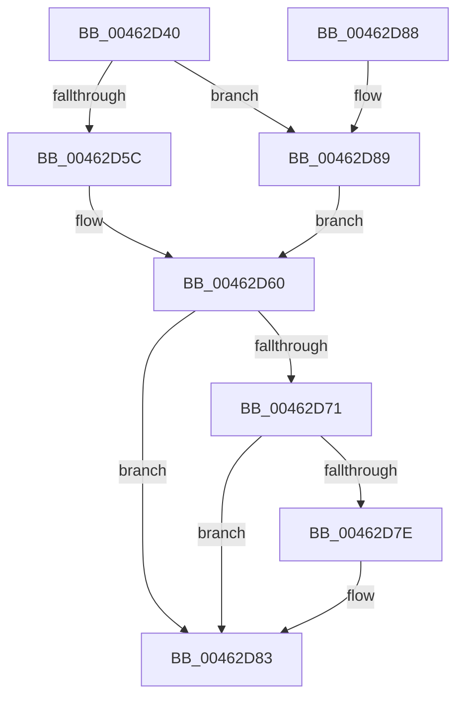

# PsRevertToUserPagePriorityThread

- RVA: `0x00462D40`–`0x00462D90` (길이 `80` bytes)
- VA: `0x0000000140462D40`
- 실행 섹션: `.text`
- PDB 이름 있음: `예`; PDB Function 태그: `아니요`
- unwind 정보 RVA: `0x0005CEE8`
- 디코드: `23`개 명령, `80/80` bytes 표시
- 미해석 바이트: `0` (있으면 어셈블리에 `.byte`로 보존)

> 이 문서는 커널 이미지의 기계어와 PDB 기호를 분석해 생성했습니다. 4번과 5번은 함수 원형과 자료형을 바이너리 사용 방식에서 추정한 C 해석이며 원본 소스 복구 결과는 아닙니다.

## 1. Dependencies

- 직접 호출 지점: **1**; 고유 호출 대상: **1**
- 직접 호출자로 확인된 함수: **3**
- RIP 상대 이미지 참조: **0**

### Outgoing calls
- `0x00462D7E` → [KiCheckForKernelApcDelivery](../2E/KiCheckForKernelApcDelivery_function_002E2C80.md) (function, `0x002E2C80`)

### Direct callers
- [MiValidateSectionCreate](../../page/94/MiValidateSectionCreate_function_00940190.md) at `0x009409AD`
- [MiValidateSectionCreate](../../page/94/MiValidateSectionCreate_function_00940190.md) at `0x00940B63`
- [MiRelocateImage](../../page/98/MiRelocateImage_function_00988E14.md) at `0x0098931C`
- [MiRelocateImage](../../page/98/MiRelocateImage_function_00988E14.md) at `0x00989647`
- [sub_00B2542C](../../page/B2/Unknown_function_00B2542C.md) at `0x00B25464`

### Static image references
- 디코드된 RIP-relative 메모리 참조가 없습니다.

## 2. Other-region calls and transfers

- 다른 실행 섹션으로 향하는 call: **0**
- 별도 외부 분기/꼬리 이동을 확인하지 못했습니다.

## 3. Assembly (complete function range)

```asm
00462D40  48 83 EC 28                     sub rsp, 0x28
00462D44  66 FF 89 E6 01 00 00            dec word ptr [rcx + 0x1e6]
00462D4B  90                              nop
00462D4C  8B 81 A8 05 00 00               mov eax, dword ptr [rcx + 0x5a8]
00462D52  25 FF F1 FF FF                  and eax, 0xfffff1ff
00462D57  83 FA FF                        cmp edx, -1
00462D5A  75 2D                           jne 0x140462d89
00462D5C  0F BA F0 08                     btr eax, 8
00462D60  89 81 A8 05 00 00               mov dword ptr [rcx + 0x5a8], eax
00462D66  90                              nop
00462D67  66 83 81 E6 01 00 00 01         add word ptr [rcx + 0x1e6], 1
00462D6F  75 12                           jne 0x140462d83
00462D71  48 8D 81 98 00 00 00            lea rax, [rcx + 0x98]
00462D78  90                              nop
00462D79  48 39 00                        cmp qword ptr [rax], rax
00462D7C  74 05                           je 0x140462d83
00462D7E  E8 FD FE E7 FF                  call 0x1402e2c80
00462D83  48 83 C4 28                     add rsp, 0x28
00462D87  C3                              ret
00462D88  CC                              int3
00462D89  C1 E2 09                        shl edx, 9
00462D8C  0B C2                           or eax, edx
00462D8E  EB D0                           jmp 0x140462d60
```

## 4. C-style interpretation (structured pseudocode)

```c
__int64 __fastcall PsRevertToUserPagePriorityThread(__int64 a1, int a2)
{
    __int64 result;
    __int64 v_rsp;

    v_rsp = (v_rsp) - (40);
    result = (unsigned int)(((unsigned int)(*(unsigned int *)(a1 + 1448))) & (0xFFFFF1FFULL));
    if (a2 != -1) goto loc_00462D89;
loc_00462D60:
    *(unsigned int *)(a1 + 1448) = (unsigned int)(result);
    if (a2 != -1) goto loc_00462D83;
    result = a1 + 152;
    if ((*(unsigned __int64 *)(a1 + 152)) != (a1 + 152)) {
        result = KiCheckForKernelApcDelivery(a1, a2, a3, a4);
    }
    v_rsp = (v_rsp) + (40);
    return result;
loc_00462D89:
    a2 = (unsigned int)((a2) << (9));
    result = (unsigned int)((result) | (a2));
    goto loc_00462D60;
}
```

## 5. (Beta) C Style

```c
int64_t PsRevertToUserPagePriorityThread(void *Arg1, int32_t Arg2)
{
    uint8_t *arg1 = (uint8_t *)Arg1;

    int64_t result;
    int64_t local_rsp;

    local_rsp = (local_rsp) - (40);
    result = (uint32_t)(((uint32_t)(*(uint32_t *)(arg1 + 0x5A8))) & (0xFFFFF1FFULL));
    if (Arg2 != -1) goto loc_00462D89;
loc_00462D60:
    *(uint32_t *)(arg1 + 0x5A8) = (uint32_t)(result);
    if (Arg2 != -1) goto loc_00462D83;
    result = Arg1 + 152;
    if ((*(uint64_t *)(arg1 + 0x98)) != (Arg1 + 152)) {
        result = KiCheckForKernelApcDelivery(Arg1, Arg2, a3, a4);
    }
    local_rsp = (local_rsp) + (40);
    return result;
loc_00462D89:
    Arg2 = (uint32_t)((Arg2) << (9));
    result = (uint32_t)((result) | (Arg2));
    goto loc_00462D60;
}
```

### 관측된 메모리 오프셋

구조체 형식이 확인되지 않은 접근은 인자 기준의 오프셋으로만 기록했습니다.

| 기준 인자 | 오프셋 표현 | 폭 (bit) | 접근 |
|---|---:|---:|---|
| `Arg1` | `+ 0x0` | `64` | `R` |
| `Arg1` | `+ 0x98` | `64` | `R` |
| `Arg1` | `+ 0x1E6` | `16` | `R/W` |
| `Arg1` | `+ 0x5A8` | `32` | `R` |
| `Arg1` | `+ 0x5A8` | `32` | `W` |

## 6. Execution-region graph

[열기: 2D/3D 그래프와 함수 탐색 컨트롤 패널](../../../control-panel.html?section=text&rva=0x00462D40&view=graph)

- 2D 그래프는 위에서 아래로 흐르고, 3D 그래프는 빈 공간을 드래그해 회전합니다. Shift+드래그는 이동, 휠은 확대·축소, 함수 노드 선택은 대상 보고서 이동입니다.

### Static fallback


