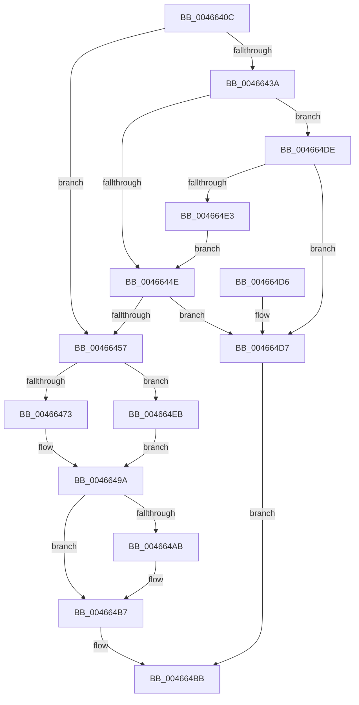

# PspJobIoRateQueryHistory

- RVA: `0x0046640C`–`0x004664F2` (길이 `230` bytes)
- VA: `0x000000014046640C`
- 실행 섹션: `.text`
- PDB 이름 있음: `예`; PDB Function 태그: `아니요`
- unwind 정보 RVA: `0x000AACF0`
- 디코드: `61`개 명령, `230/230` bytes 표시
- 미해석 바이트: `0` (있으면 어셈블리에 `.byte`로 보존)

> 이 문서는 커널 이미지의 기계어와 PDB 기호를 분석해 생성했습니다. 4번과 5번은 함수 원형과 자료형을 바이너리 사용 방식에서 추정한 C 해석이며 원본 소스 복구 결과는 아닙니다.

## 1. Dependencies

- 직접 호출 지점: **3**; 고유 호출 대상: **3**
- 직접 호출자로 확인된 함수: **1**
- RIP 상대 이미지 참조: **1**

### Outgoing calls
- `0x00466461` → [ExAcquireSpinLockExclusive](../24/ExAcquireSpinLockExclusive_function_00248690.md) (function, `0x00248690`)
- `0x0046649D` → [ExReleaseSpinLockExclusiveFromDpcLevel](../24/ExReleaseSpinLockExclusiveFromDpcLevel_function_002497E0.md) (function, `0x002497E0`)
- `0x004664B2` → [KiLowerIrqlProcessIrqlFlags](../4F/KiLowerIrqlProcessIrqlFlags_function_004F5698.md) (function, `0x004F5698`)

### Direct callers
- [PspQueryRateControlHistory](../../page/91/PspQueryRateControlHistory_function_00918D1C.md) at `0x00918DE7`

### Static image references
- `0x004664A2` → RVA `0x00FC6D20` (`ALMOSTRO`; read)

## 2. Other-region calls and transfers

- 다른 실행 섹션으로 향하는 call: **0**
- 별도 외부 분기/꼬리 이동을 확인하지 못했습니다.

## 3. Assembly (complete function range)

```asm
0046640C  48 89 5C 24 08                  mov qword ptr [rsp + 8], rbx
00466411  48 89 6C 24 10                  mov qword ptr [rsp + 0x10], rbp
00466416  48 89 74 24 18                  mov qword ptr [rsp + 0x18], rsi
0046641B  57                              push rdi
0046641C  41 56                           push r14
0046641E  41 57                           push r15
00466420  48 83 EC 20                     sub rsp, 0x20
00466424  48 83 B9 88 06 00 00 00         cmp qword ptr [rcx + 0x688], 0
0046642C  4D 8B F1                        mov r14, r9
0046642F  4D 8B F8                        mov r15, r8
00466432  48 8B EA                        mov rbp, rdx
00466435  48 8B D9                        mov rbx, rcx
00466438  75 1D                           jne 0x140466457
0046643A  48 81 C1 A0 06 00 00            add rcx, 0x6a0
00466441  F6 41 08 01                     test byte ptr [rcx + 8], 1
00466445  48 8B 01                        mov rax, qword ptr [rcx]
00466448  0F 85 90 00 00 00               jne 0x1404664de
0046644E  48 85 C0                        test rax, rax
00466451  0F 84 80 00 00 00               je 0x1404664d7
00466457  48 8D B3 98 06 00 00            lea rsi, [rbx + 0x698]
0046645E  48 8B CE                        mov rcx, rsi
00466461  E8 2A 22 DE FF                  call 0x140248690
00466466  8B 8B C0 06 00 00               mov ecx, dword ptr [rbx + 0x6c0]
0046646C  0F B6 F8                        movzx edi, al
0046646F  85 C9                           test ecx, ecx
00466471  74 78                           je 0x1404664eb
00466473  48 8B 83 B0 06 00 00            mov rax, qword ptr [rbx + 0x6b0]
0046647A  8B 93 B8 06 00 00               mov edx, dword ptr [rbx + 0x6b8]
00466480  48 89 45 00                     mov qword ptr [rbp], rax
00466484  8B C2                           mov eax, edx
00466486  2B 83 BC 06 00 00               sub eax, dword ptr [rbx + 0x6bc]
0046648C  89 93 BC 06 00 00               mov dword ptr [rbx + 0x6bc], edx
00466492  33 DB                           xor ebx, ebx
00466494  41 89 06                        mov dword ptr [r14], eax
00466497  41 89 0F                        mov dword ptr [r15], ecx
0046649A  48 8B CE                        mov rcx, rsi
0046649D  E8 3E 33 DE FF                  call 0x1402497e0
004664A2  83 3D 77 08 B6 00 00            cmp dword ptr [rip + 0xb60877], 0
004664A9  74 0C                           je 0x1404664b7
004664AB  44 0F 20 C1                     mov rcx, cr8
004664AF  40 8A D7                        mov dl, dil
004664B2  E8 E1 F1 08 00                  call 0x1404f5698
004664B7  44 0F 22 C7                     mov cr8, rdi
004664BB  48 8B 6C 24 48                  mov rbp, qword ptr [rsp + 0x48]
004664C0  8B C3                           mov eax, ebx
004664C2  48 8B 5C 24 40                  mov rbx, qword ptr [rsp + 0x40]
004664C7  48 8B 74 24 50                  mov rsi, qword ptr [rsp + 0x50]
004664CC  48 83 C4 20                     add rsp, 0x20
004664D0  41 5F                           pop r15
004664D2  41 5E                           pop r14
004664D4  5F                              pop rdi
004664D5  C3                              ret
004664D6  CC                              int3
004664D7  BB 25 02 00 C0                  mov ebx, 0xc0000225
004664DC  EB DD                           jmp 0x1404664bb
004664DE  48 85 C0                        test rax, rax
004664E1  74 F4                           je 0x1404664d7
004664E3  48 33 C1                        xor rax, rcx
004664E6  E9 63 FF FF FF                  jmp 0x14046644e
004664EB  BB 25 02 00 C0                  mov ebx, 0xc0000225
004664F0  EB A8                           jmp 0x14046649a
```

## 4. C-style interpretation (structured pseudocode)

```c
__int64 __fastcall PspJobIoRateQueryHistory(__int64 a1, __int64 a2, __int64 a3, __int64 a4)
{
    __int64 result;
    __int64 v_rbx;
    __int64 v_rsp;
    unsigned __int64 v_stack_p10;
    unsigned __int64 v_stack_p18;
    unsigned __int64 v_stack_p8;

    v_stack_p8 = v_rbx;
    v_stack_p10 = v_rbp;
    v_stack_p18 = v_rsi;
    v_rsp = (v_rsp) - (32);
    if ((*(unsigned __int64 *)(a1 + 1672)) != 0) goto loc_00466457;
    a1 = (a1) + (0x6A0ULL);
    if (((*(unsigned __int8 *)(a1 + 8)) & (1)) != 0) goto loc_004664DE;
loc_0046644E:
    if (*(unsigned __int64 *)(a1) == 0) goto loc_004664D7;
loc_00466457:
    result = ExAcquireSpinLockExclusive(a1 + 1688, a2, a3, a4);
    if ((unsigned int)((unsigned int)(*(unsigned int *)(a1 + 1728))) == 0) goto loc_004664EB;
    *(unsigned __int64 *)(a2) = *(unsigned __int64 *)(a1 + 1712);
    result = (unsigned int)(((unsigned int)((unsigned int)((unsigned int)(*(unsigned int *)(a1 + 1720))))) - (*(unsigned int *)(a1 + 1724)));
    *(unsigned int *)(a1 + 1724) = (unsigned int)((unsigned int)(*(unsigned int *)(a1 + 1720)));
    v_rbx = 0;
    *(unsigned int *)(a4) = (unsigned int)(result);
    *(unsigned int *)(a3) = (unsigned int)((unsigned int)(*(unsigned int *)(a1 + 1728)));
loc_0046649A:
    result = ExReleaseSpinLockExclusiveFromDpcLevel(a1 + 1688, (unsigned int)(*(unsigned int *)(a1 + 1720)), a3, a4);
    if ((*(unsigned int *)(v_rip + 11929719)) != 0) {
        a1 = v_cr8;
        a2 = (unsigned __int8)((unsigned __int8)(result));
        result = KiLowerIrqlProcessIrqlFlags(a1, a2, a3, a4);
    }
loc_004664BB:
    v_rsp = (v_rsp) + (32);
    return 0;
loc_004664D7:
    goto loc_004664BB;
loc_004664DE:
    if (0 == 0) goto loc_004664D7;
    result = (0) ^ (a1);
    goto loc_0046644E;
loc_004664EB:
    goto loc_0046649A;
}
```

## 5. (Beta) C Style

```c
int64_t PspJobIoRateQueryHistory(void *Arg1, void *Arg2, void *Arg3, void *Arg4)
{
    uint8_t *arg1 = (uint8_t *)Arg1;
    uint8_t *arg2 = (uint8_t *)Arg2;
    uint8_t *arg3 = (uint8_t *)Arg3;
    uint8_t *arg4 = (uint8_t *)Arg4;

    int64_t result;
    int64_t local_rbx;
    int64_t local_rsp;
    uint64_t v_stack_p10;
    uint64_t v_stack_p18;
    uint64_t v_stack_p8;

    v_stack_p8 = local_rbx;
    v_stack_p10 = local_rbp;
    v_stack_p18 = local_rsi;
    local_rsp = (local_rsp) - (32);
    if ((*(uint64_t *)(arg1 + 0x688)) != 0) goto loc_00466457;
    Arg1 = (Arg1) + (0x6A0ULL);
    if (((*(uint8_t *)(arg1 + 0x8)) & (1)) != 0) goto loc_004664DE;
loc_0046644E:
    if (*(uint64_t *)(arg1) == 0) goto loc_004664D7;
loc_00466457:
    result = ExAcquireSpinLockExclusive(Arg1 + 1688, Arg2, Arg3, Arg4);
    if ((uint32_t)((uint32_t)(*(uint32_t *)(arg1 + 0x6C0))) == 0) goto loc_004664EB;
    *(uint64_t *)(arg2) = *(uint64_t *)(arg1 + 0x6B0);
    result = (uint32_t)(((uint32_t)((uint32_t)((uint32_t)(*(uint32_t *)(arg1 + 0x6B8))))) - (*(uint32_t *)(arg1 + 0x6BC)));
    *(uint32_t *)(arg1 + 0x6BC) = (uint32_t)((uint32_t)(*(uint32_t *)(arg1 + 0x6B8)));
    local_rbx = 0;
    *(uint32_t *)(arg4) = (uint32_t)(result);
    *(uint32_t *)(arg3) = (uint32_t)((uint32_t)(*(uint32_t *)(arg1 + 0x6C0)));
loc_0046649A:
    result = ExReleaseSpinLockExclusiveFromDpcLevel(Arg1 + 1688, (uint32_t)(*(uint32_t *)(arg1 + 0x6B8)), Arg3, Arg4);
    if ((*(uint32_t *)(v_rip + 0xB60877)) != 0) {
        Arg1 = v_cr8;
        Arg2 = (uint8_t)((uint8_t)(result));
        result = KiLowerIrqlProcessIrqlFlags(Arg1, Arg2, Arg3, Arg4);
    }
loc_004664BB:
    local_rsp = (local_rsp) + (32);
    return 0;
loc_004664D7:
    goto loc_004664BB;
loc_004664DE:
    if (0 == 0) goto loc_004664D7;
    result = (0) ^ (Arg1);
    goto loc_0046644E;
loc_004664EB:
    goto loc_0046649A;
}
```

### 관측된 메모리 오프셋

구조체 형식이 확인되지 않은 접근은 인자 기준의 오프셋으로만 기록했습니다.

| 기준 인자 | 오프셋 표현 | 폭 (bit) | 접근 |
|---|---:|---:|---|
| `Arg1` | `+ 0x0` | `64` | `R` |
| `Arg1` | `+ 0x8` | `8` | `R` |
| `Arg1` | `+ 0x688` | `64` | `R` |
| `Arg1` | `+ 0x698` | `64` | `R` |
| `Arg1` | `+ 0x6B0` | `64` | `R` |
| `Arg1` | `+ 0x6B8` | `32` | `R` |
| `Arg1` | `+ 0x6BC` | `32` | `R` |
| `Arg1` | `+ 0x6BC` | `32` | `W` |
| `Arg1` | `+ 0x6C0` | `32` | `R` |
| `Arg2` | `+ 0x0` | `64` | `W` |
| `Arg3` | `+ 0x0` | `32` | `W` |
| `Arg4` | `+ 0x0` | `32` | `W` |

## 6. Execution-region graph

[열기: 2D/3D 그래프와 함수 탐색 컨트롤 패널](../../../control-panel.html?section=text&rva=0x0046640C&view=graph)

- 2D 그래프는 위에서 아래로 흐르고, 3D 그래프는 빈 공간을 드래그해 회전합니다. Shift+드래그는 이동, 휠은 확대·축소, 함수 노드 선택은 대상 보고서 이동입니다.

### Static fallback


