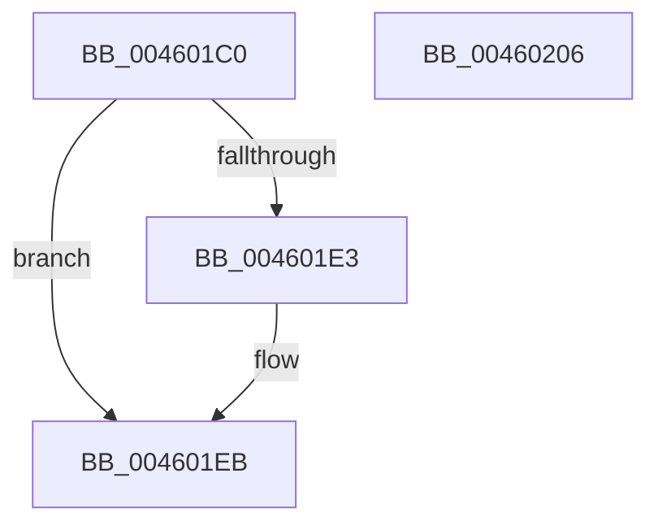

# PspUnlockProcessExclusive

- RVA: `0x004601C0`–`0x00460207` (길이 `71` bytes)
- VA: `0x00000001404601C0`
- 실행 섹션: `.text`
- PDB 이름 있음: `예`; PDB Function 태그: `아니요`
- unwind 정보 RVA: `0x0005CAAC`
- 디코드: `21`개 명령, `71/71` bytes 표시
- 미해석 바이트: `0` (있으면 어셈블리에 `.byte`로 보존)

> 이 문서는 커널 이미지의 기계어와 PDB 기호를 분석해 생성했습니다. 4번과 5번은 함수 원형과 자료형을 바이너리 사용 방식에서 추정한 C 해석이며 원본 소스 복구 결과는 아닙니다.

## 1. Dependencies

- 직접 호출 지점: **3**; 고유 호출 대상: **3**
- 직접 호출자로 확인된 함수: **23**
- RIP 상대 이미지 참조: **0**

### Outgoing calls
- `0x004601E6` → [ExfTryToWakePushLock](../26/ExfTryToWakePushLock_function_00265DD0.md) (function, `0x00265DD0`)
- `0x004601EE` → [KeAbPostRelease](../2E/KeAbPostRelease_function_002E1600.md) (function, `0x002E1600`)
- `0x004601F6` → [KeLeaveCriticalRegionThread](../25/KeLeaveCriticalRegionThread_function_0025EFF0.md) (function, `0x0025EFF0`)

### Direct callers
- [PsThawMultiProcess](../45/PsThawMultiProcess_function_0045FFE0.md) at `0x00460031`
- [PspSyscallProviderOptIn](../../page/77/PspSyscallProviderOptIn_function_0077E79C.md) at `0x0077E8CD`
- [PsTerminateMinimalProcess](../../page/78/PsTerminateMinimalProcess_function_007861A8.md) at `0x00786259`
- [PspCreatePicoProcess](../../page/78/PspCreatePicoProcess_function_007873B0.md) at `0x007875B0`
- [DbgkForwardException](../../page/8A/DbgkForwardException_function_008A2D60.md) at `0x008A2E57`
- [DbgkForwardException](../../page/8A/DbgkForwardException_function_008A2D60.md) at `0x008A307C`
- [PsSetProcessTelemetryAppState](../../page/8A/PsSetProcessTelemetryAppState_function_008A35F0.md) at `0x008A36DB`
- [PspExitLastThread](../../page/90/PspExitLastThread_function_00904184.md) at `0x009042F4`
- [PspExitLastThread](../../page/90/PspExitLastThread_function_00904184.md) at `0x009043B6`
- [PspExitThread](../../page/90/PspExitThread_function_00905F60.md) at `0x00906139`
- [PspRundownSingleProcess](../../page/90/PspRundownSingleProcess_function_00906D50.md) at `0x00907085`
- [PspInsertProcess](../../page/94/PspInsertProcess_function_009472CC.md) at `0x00947601`
- [PspInsertProcess](../../page/94/PspInsertProcess_function_009472CC.md) at `0x00947611`
- [PspAllocateAndQueryProcessNotificationChannel](../../page/9D/PspAllocateAndQueryProcessNotificationChannel_function_009D0140.md) at `0x009D0271`
- [sub_009F6528](../../page/9F/Unknown_function_009F6528.md) at `0x009F6579`
- [PspAllocateProcess](../../page/A1/PspAllocateProcess_function_00A13B3C.md) at `0x00A16260`
- [PspAllocateProcess](../../page/A1/PspAllocateProcess_function_00A13B3C.md) at `0x00A1629D`
- [PspSetProcessForegroundBackgroundRequest](../../page/A4/PspSetProcessForegroundBackgroundRequest_function_00A45DCC.md) at `0x00A45EBA`
- [PsSetProcessWin32Process](../../page/A5/PsSetProcessWin32Process_function_00A5F4F0.md) at `0x00A5F540`
- [PsSetProcessFaultInformation](../../page/A7/PsSetProcessFaultInformation_function_00A75400.md) at `0x00A75460`
- [PsSetProcessFaultInformation](../../page/A7/PsSetProcessFaultInformation_function_00A75400.md) at `0x00A75524`
- [PspThreadDelete](../../page/A7/PspThreadDelete_function_00A79C20.md) at `0x00A79FB6`
- [PsFreezeProcess](../../page/AA/PsFreezeProcess_function_00AA6D04.md) at `0x00AA6DB0`
- [NtSetInformationProcess](../../page/AE/NtSetInformationProcess_function_00AE5370.md) at `0x00AE638A`
- [NtSetInformationProcess](../../page/AE/NtSetInformationProcess_function_00AE5370.md) at `0x00AE63A5`
- [NtSetInformationProcess](../../page/AE/NtSetInformationProcess_function_00AE5370.md) at `0x00AE6B22`
- [NtSetInformationProcess](../../page/AE/NtSetInformationProcess_function_00AE5370.md) at `0x00AE6CA5`
- [NtSetInformationProcess](../../page/AE/NtSetInformationProcess_function_00AE5370.md) at `0x00AE7584`
- [NtCreateUserProcess](../../page/AE/NtCreateUserProcess_function_00AEA680.md) at `0x00AEB36D`
- [NtCreateUserProcess](../../page/AE/NtCreateUserProcess_function_00AEA680.md) at `0x00AEB48F`
- [NtCreateUserProcess](../../page/AE/NtCreateUserProcess_function_00AEA680.md) at `0x00AEB576`
- [NtTerminateProcess](../../page/AE/NtTerminateProcess_function_00AEC320.md) at `0x00AEC4DE`
- [sub_00B19CFC](../../page/B1/Unknown_function_00B19CFC.md) at `0x00B19D41`
- [sub_00B4102A](../../page/B4/Unknown_function_00B4102A.md) at `0x00B4106F`

### Static image references
- 디코드된 RIP-relative 메모리 참조가 없습니다.

## 2. Other-region calls and transfers

- 다른 실행 섹션으로 향하는 call: **0**
- 별도 외부 분기/꼬리 이동을 확인하지 못했습니다.

## 3. Assembly (complete function range)

```asm
004601C0  48 89 5C 24 08                  mov qword ptr [rsp + 8], rbx
004601C5  57                              push rdi
004601C6  48 83 EC 20                     sub rsp, 0x20
004601CA  48 8B FA                        mov rdi, rdx
004601CD  48 8D 99 C8 01 00 00            lea rbx, [rcx + 0x1c8]
004601D4  48 83 C8 FF                     or rax, 0xffffffffffffffff
004601D8  F0 48 0F C1 03                  lock xadd qword ptr [rbx], rax
004601DD  24 06                           and al, 6
004601DF  3C 02                           cmp al, 2
004601E1  75 08                           jne 0x1404601eb
004601E3  48 8B CB                        mov rcx, rbx
004601E6  E8 E5 5B E0 FF                  call 0x140265dd0
004601EB  48 8B CB                        mov rcx, rbx
004601EE  E8 0D 14 E8 FF                  call 0x1402e1600
004601F3  48 8B CF                        mov rcx, rdi
004601F6  E8 F5 ED DF FF                  call 0x14025eff0
004601FB  48 8B 5C 24 30                  mov rbx, qword ptr [rsp + 0x30]
00460200  48 83 C4 20                     add rsp, 0x20
00460204  5F                              pop rdi
00460205  C3                              ret
00460206  CC                              int3
```

## 4. C-style interpretation (structured pseudocode)

```c
__int64 __fastcall PspUnlockProcessExclusive(__int64 a1, __int64 a2)
{
    __int64 result;
    __int64 v_rsp;
    unsigned __int64 v_stack_p8;

    v_stack_p8 = v_rbx;
    v_rsp = (v_rsp) - (32);
    result = (result) | (-1);
    result = (unsigned __int8)((result) & (6));
    if (((unsigned __int8)(result)) == 2) {
        a1 = a1 + 456;
        result = ExfTryToWakePushLock(a1, a2, a3, a4);
    }
    result = KeAbPostRelease(a1 + 456, a2, a3, a4);
    result = KeLeaveCriticalRegionThread(a2, a2, a3, a4);
    v_rsp = (v_rsp) + (32);
    return result;
}
```

## 5. (Beta) C Style

```c
int64_t PspUnlockProcessExclusive(void *Arg1, int64_t Arg2)
{
    uint8_t *arg1 = (uint8_t *)Arg1;

    int64_t result;
    int64_t local_rsp;
    uint64_t v_stack_p8;

    v_stack_p8 = local_rbx;
    local_rsp = (local_rsp) - (32);
    result = (result) | (-1);
    result = (uint8_t)((result) & (6));
    if (((uint8_t)(result)) == 2) {
        Arg1 = Arg1 + 456;
        result = ExfTryToWakePushLock(Arg1, Arg2, a3, a4);
    }
    result = KeAbPostRelease(Arg1 + 456, Arg2, a3, a4);
    result = KeLeaveCriticalRegionThread(Arg2, Arg2, a3, a4);
    local_rsp = (local_rsp) + (32);
    return result;
}
```

### 관측된 메모리 오프셋

구조체 형식이 확인되지 않은 접근은 인자 기준의 오프셋으로만 기록했습니다.

| 기준 인자 | 오프셋 표현 | 폭 (bit) | 접근 |
|---|---:|---:|---|
| `Arg1` | `+ 0x0` | `64` | `R/W` |
| `Arg1` | `+ 0x1C8` | `64` | `R` |

## 6. Execution-region graph

[열기: 2D/3D 그래프와 함수 탐색 컨트롤 패널](../../../control-panel.html?section=text&rva=0x004601C0&view=graph)

- 2D 그래프는 위에서 아래로 흐르고, 3D 그래프는 빈 공간을 드래그해 회전합니다. Shift+드래그는 이동, 휠은 확대·축소, 함수 노드 선택은 대상 보고서 이동입니다.

### Static fallback


