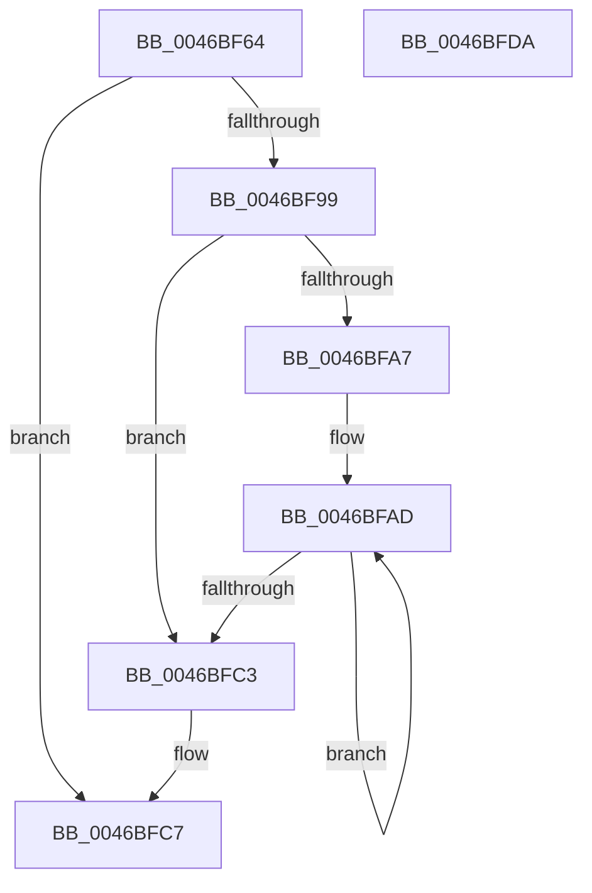

# RTL_BINARY_ARRAY&lt;RTLP_FLS_SLOT,4,4&gt;::ChunkAllocate

- RVA: `0x0046BF64`–`0x0046BFDB` (길이 `119` bytes)
- VA: `0x000000014046BF64`
- 실행 섹션: `.text`
- PDB 이름 있음: `예`; PDB Function 태그: `아니요`
- unwind 정보 RVA: `0x00060BC4`
- 디코드: `36`개 명령, `119/119` bytes 표시
- 미해석 바이트: `0` (있으면 어셈블리에 `.byte`로 보존)

> 이 문서는 커널 이미지의 기계어와 PDB 기호를 분석해 생성했습니다. 4번과 5번은 함수 원형과 자료형을 바이너리 사용 방식에서 추정한 C 해석이며 원본 소스 복구 결과는 아닙니다.

## 1. Dependencies

- 직접 호출 지점: **1**; 고유 호출 대상: **1**
- 직접 호출자로 확인된 함수: **1**
- RIP 상대 이미지 참조: **0**

### Outgoing calls
- `0x0046BF8C` → [RtlpFlsHeapAlloc](../../page/A4/RtlpFlsHeapAlloc_function_00A4F42C.md) (function, `0x00A4F42C`)

### Direct callers
- [RTL_BINARY_ARRAY&lt;RTLP_FLS_SLOT,4,4&gt;::SetValue](RTL_BINARY_ARRAY_RTLP_FLS_SLOT_4_4_SetValue_function_0046BEF0.md) at `0x0046BF22`

### Static image references
- 디코드된 RIP-relative 메모리 참조가 없습니다.

## 2. Other-region calls and transfers

- 다른 실행 섹션으로 향하는 call: **1**
  - `0x0046BF8C` → [RtlpFlsHeapAlloc](../../page/A4/RtlpFlsHeapAlloc_function_00A4F42C.md) (`.text` → `PAGE`)
- 별도 외부 분기/꼬리 이동을 확인하지 못했습니다.

## 3. Assembly (complete function range)

```asm
0046BF64  48 89 5C 24 08                  mov qword ptr [rsp + 8], rbx
0046BF69  48 89 74 24 10                  mov qword ptr [rsp + 0x10], rsi
0046BF6E  57                              push rdi
0046BF6F  48 83 EC 20                     sub rsp, 0x20
0046BF73  48 8B F1                        mov rsi, rcx
0046BF76  8B FA                           mov edi, edx
0046BF78  BB 01 00 00 00                  mov ebx, 1
0046BF7D  8D 4F 04                        lea ecx, [rdi + 4]
0046BF80  D3 E3                           shl ebx, cl
0046BF82  8D 0C 5B                        lea ecx, [rbx + rbx*2]
0046BF85  8D 0C CD 08 00 00 00            lea ecx, [rcx*8 + 8]
0046BF8C  E8 9B 34 5E 00                  call 0x140a4f42c
0046BF91  4C 8B C0                        mov r8, rax
0046BF94  48 85 C0                        test rax, rax
0046BF97  74 2E                           je 0x14046bfc7
0046BF99  0F 57 C0                        xorps xmm0, xmm0
0046BF9C  0F 11 00                        movups xmmword ptr [rax], xmm0
0046BF9F  0F 11 40 10                     movups xmmword ptr [rax + 0x10], xmm0
0046BFA3  85 DB                           test ebx, ebx
0046BFA5  74 1C                           je 0x14046bfc3
0046BFA7  48 8D 48 10                     lea rcx, [rax + 0x10]
0046BFAB  8B C3                           mov eax, ebx
0046BFAD  48 83 61 F8 00                  and qword ptr [rcx - 8], 0
0046BFB2  48 89 49 08                     mov qword ptr [rcx + 8], rcx
0046BFB6  48 89 09                        mov qword ptr [rcx], rcx
0046BFB9  48 83 C1 18                     add rcx, 0x18
0046BFBD  48 83 E8 01                     sub rax, 1
0046BFC1  75 EA                           jne 0x14046bfad
0046BFC3  4C 89 04 FE                     mov qword ptr [rsi + rdi*8], r8
0046BFC7  48 8B 5C 24 30                  mov rbx, qword ptr [rsp + 0x30]
0046BFCC  49 8B C0                        mov rax, r8
0046BFCF  48 8B 74 24 38                  mov rsi, qword ptr [rsp + 0x38]
0046BFD4  48 83 C4 20                     add rsp, 0x20
0046BFD8  5F                              pop rdi
0046BFD9  C3                              ret
0046BFDA  CC                              int3
```

## 4. C-style interpretation (structured pseudocode)

```c
__int64 __fastcall RTL_BINARY_ARRAY_RTLP_FLS_SLOT_4_4___ChunkAllocate(__int64 a1, int a2)
{
    __int64 result;
    __int64 v_rbx;
    __int64 v_rsp;
    unsigned __int64 v_stack_p10;
    unsigned __int64 v_stack_p8;

    v_stack_p8 = v_rbx;
    v_stack_p10 = v_rsi;
    v_rsp = (v_rsp) - (32);
    v_rbx = (unsigned int)((1) << ((unsigned __int8)((unsigned int)(a2) + 4)));
    result = RtlpFlsHeapAlloc(v_rbx + v_rbx * 2 * 8 + 8, a2, a3, a4);
    if (result == 0) goto loc_0046BFC7;
    *(unsigned __int64 *)(result) = v_xmm0;
    *(unsigned __int64 *)(result + 16) = v_xmm0;
    if ((unsigned int)(v_rbx) == 0) goto loc_0046BFC3;
loc_0046BFAD:
    *(unsigned __int64 *)(result + 16 + 8) = result + 16;
    *(unsigned __int64 *)(result + 16) = result + 16;
    a1 = (result + 16) + (24);
    result = ((unsigned int)((unsigned int)(v_rbx))) - (1);
    if (condition_is_not_equal) goto loc_0046BFAD;
loc_0046BFC3:
    *(unsigned __int64 *)(a1 + (unsigned int)(a2) * 8) = result;
loc_0046BFC7:
    v_rsp = (v_rsp) + (32);
    return result;
}
```

## 5. (Beta) C Style

```c
int64_t RTL_BINARY_ARRAY_RTLP_FLS_SLOT_4_4___ChunkAllocate(void *Arg1, void *Arg2)
{
    uint8_t *arg1 = (uint8_t *)Arg1;
    uint8_t *arg2 = (uint8_t *)Arg2;

    int64_t result;
    int64_t local_rbx;
    int64_t local_rsp;
    uint64_t v_stack_p10;
    uint64_t v_stack_p8;

    v_stack_p8 = local_rbx;
    v_stack_p10 = local_rsi;
    local_rsp = (local_rsp) - (32);
    local_rbx = (uint32_t)((1) << ((uint8_t)((uint32_t)(Arg2) + 4)));
    result = RtlpFlsHeapAlloc(local_rbx + local_rbx * 2 * 8 + 8, Arg2, a3, a4);
    if (result == 0) goto loc_0046BFC7;
    *(uint64_t *)(result) = v_xmm0;
    *(uint64_t *)(result + 0x10) = v_xmm0;
    if ((uint32_t)(local_rbx) == 0) goto loc_0046BFC3;
loc_0046BFAD:
    *(uint64_t *)(result + 0x10 + 0x8) = result + 16;
    *(uint64_t *)(result + 0x10) = result + 16;
    Arg1 = (result + 16) + (24);
    result = ((uint32_t)((uint32_t)(local_rbx))) - (1);
    if (condition_is_not_equal) goto loc_0046BFAD;
loc_0046BFC3:
    *(uint64_t *)(arg1 + (uint32_t)(arg2) * 8) = result;
loc_0046BFC7:
    local_rsp = (local_rsp) + (32);
    return result;
}
```

### 관측된 메모리 오프셋

구조체 형식이 확인되지 않은 접근은 인자 기준의 오프셋으로만 기록했습니다.

| 기준 인자 | 오프셋 표현 | 폭 (bit) | 접근 |
|---|---:|---:|---|
| `Arg1` | `+ 0x0 + rdi*8` | `64` | `W` |
| `Arg2` | `+ 0x4` | `32` | `R` |

## 6. Execution-region graph

[열기: 2D/3D 그래프와 함수 탐색 컨트롤 패널](../../../control-panel.html?section=text&rva=0x0046BF64&view=graph)

- 2D 그래프는 위에서 아래로 흐르고, 3D 그래프는 빈 공간을 드래그해 회전합니다. Shift+드래그는 이동, 휠은 확대·축소, 함수 노드 선택은 대상 보고서 이동입니다.

### Static fallback


