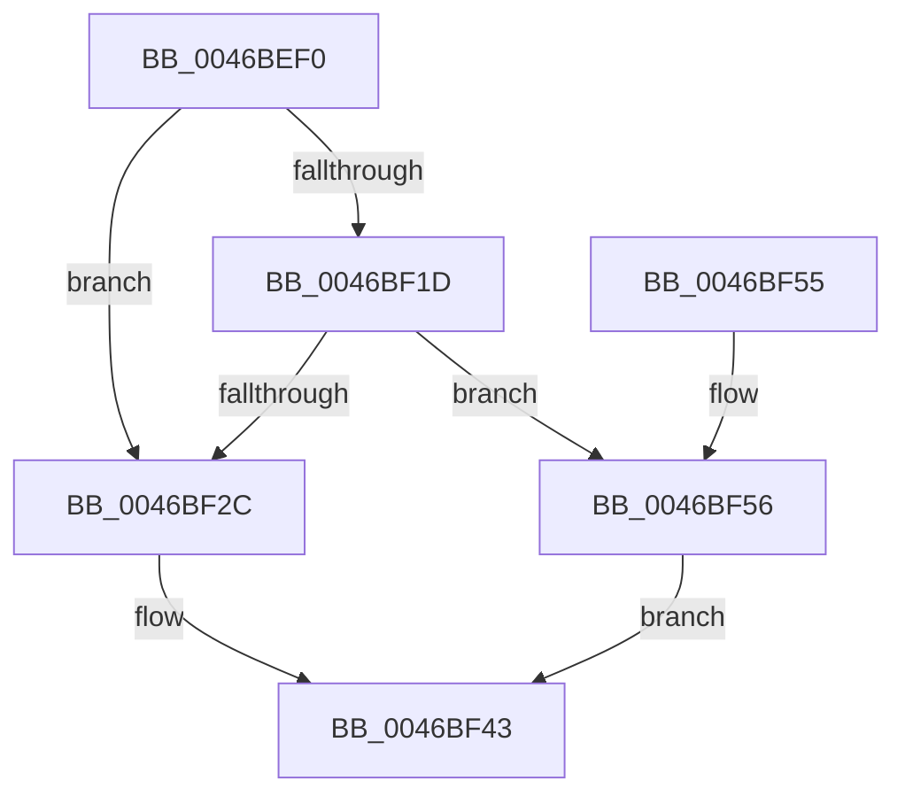

# RTL_BINARY_ARRAY&lt;RTLP_FLS_SLOT,4,4&gt;::SetValue

- RVA: `0x0046BEF0`–`0x0046BF5D` (길이 `109` bytes)
- VA: `0x000000014046BEF0`
- 실행 섹션: `.text`
- PDB 이름 있음: `예`; PDB Function 태그: `아니요`
- unwind 정보 RVA: `0x0006383C`
- 디코드: `34`개 명령, `109/109` bytes 표시
- 미해석 바이트: `0` (있으면 어셈블리에 `.byte`로 보존)

> 이 문서는 커널 이미지의 기계어와 PDB 기호를 분석해 생성했습니다. 4번과 5번은 함수 원형과 자료형을 바이너리 사용 방식에서 추정한 C 해석이며 원본 소스 복구 결과는 아닙니다.

## 1. Dependencies

- 직접 호출 지점: **1**; 고유 호출 대상: **1**
- 직접 호출자로 확인된 함수: **1**
- RIP 상대 이미지 참조: **0**

### Outgoing calls
- `0x0046BF22` → [RTL_BINARY_ARRAY<RTLP_FLS_SLOT,4,4>::ChunkAllocate](RTL_BINARY_ARRAY_RTLP_FLS_SLOT_4_4_ChunkAllocate_function_0046BF64.md) (function, `0x0046BF64`)

### Direct callers
- [RtlpFlsSetValueSlot](../../page/A2/RtlpFlsSetValueSlot_function_00A25AB4.md) at `0x00A25BD3`

### Static image references
- 디코드된 RIP-relative 메모리 참조가 없습니다.

## 2. Other-region calls and transfers

- 다른 실행 섹션으로 향하는 call: **0**
- 별도 외부 분기/꼬리 이동을 확인하지 못했습니다.

## 3. Assembly (complete function range)

```asm
0046BEF0  48 89 5C 24 08                  mov qword ptr [rsp + 8], rbx
0046BEF5  48 89 74 24 10                  mov qword ptr [rsp + 0x10], rsi
0046BEFA  57                              push rdi
0046BEFB  48 83 EC 20                     sub rsp, 0x20
0046BEFF  33 DB                           xor ebx, ebx
0046BF01  49 8B F0                        mov rsi, r8
0046BF04  4C 8B C1                        mov r8, rcx
0046BF07  0F BD CA                        bsr ecx, edx
0046BF0A  8D 7B 01                        lea edi, [rbx + 1]
0046BF0D  D3 E7                           shl edi, cl
0046BF0F  83 C1 FC                        add ecx, -4
0046BF12  33 FA                           xor edi, edx
0046BF14  49 8B 04 C8                     mov rax, qword ptr [r8 + rcx*8]
0046BF18  48 85 C0                        test rax, rax
0046BF1B  75 0F                           jne 0x14046bf2c
0046BF1D  8B D1                           mov edx, ecx
0046BF1F  49 8B C8                        mov rcx, r8
0046BF22  E8 3D 00 00 00                  call 0x14046bf64
0046BF27  48 85 C0                        test rax, rax
0046BF2A  74 2A                           je 0x14046bf56
0046BF2C  0F 28 06                        movaps xmm0, xmmword ptr [rsi]
0046BF2F  48 8D 14 7F                     lea rdx, [rdi + rdi*2]
0046BF33  F2 0F 10 4E 10                  movsd xmm1, qword ptr [rsi + 0x10]
0046BF38  0F 11 44 D0 08                  movups xmmword ptr [rax + rdx*8 + 8], xmm0
0046BF3D  F2 0F 11 4C D0 18               movsd qword ptr [rax + rdx*8 + 0x18], xmm1
0046BF43  48 8B 74 24 38                  mov rsi, qword ptr [rsp + 0x38]
0046BF48  8B C3                           mov eax, ebx
0046BF4A  48 8B 5C 24 30                  mov rbx, qword ptr [rsp + 0x30]
0046BF4F  48 83 C4 20                     add rsp, 0x20
0046BF53  5F                              pop rdi
0046BF54  C3                              ret
0046BF55  CC                              int3
0046BF56  BB 17 00 00 C0                  mov ebx, 0xc0000017
0046BF5B  EB E6                           jmp 0x14046bf43
```

## 4. C-style interpretation (structured pseudocode)

```c
__int64 __fastcall RTL_BINARY_ARRAY_RTLP_FLS_SLOT_4_4___SetValue(__int64 a1, int a2, __int64 a3)
{
    __int64 result;
    __int64 v_rbx;
    __int64 v_rdi;
    __int64 v_rsp;
    unsigned __int64 v_stack_p10;
    unsigned __int64 v_stack_p8;

    v_stack_p8 = v_rbx;
    v_stack_p10 = v_rsi;
    v_rsp = (v_rsp) - (32);
    v_rbx = 0;
    v_rdi = (unsigned int)((v_rbx + 1) << ((unsigned __int8)(a1)));
    a1 = (unsigned int)((a1) + (-4));
    v_rdi = (unsigned int)((v_rdi) ^ (a2));
    if (*(unsigned __int64 *)(a1 + a1 * 8) != 0) goto loc_0046BF2C;
    result = RTL_BINARY_ARRAY_RTLP_FLS_SLOT_4_4___ChunkAllocate(a1, (unsigned int)((unsigned int)(a1)), a1, a4);
    if (result == 0) goto loc_0046BF56;
loc_0046BF2C:
    *(unsigned __int64 *)(result + v_rdi + v_rdi * 2 * 8 + 8) = v_xmm0;
    *(unsigned __int64 *)(result + v_rdi + v_rdi * 2 * 8 + 24) = v_xmm1;
loc_0046BF43:
    v_rsp = (v_rsp) + (32);
    return 0;
loc_0046BF56:
    goto loc_0046BF43;
}
```

## 5. (Beta) C Style

```c
int64_t RTL_BINARY_ARRAY_RTLP_FLS_SLOT_4_4___SetValue(void *Arg1, int32_t Arg2, void *Arg3)
{
    uint8_t *arg1 = (uint8_t *)Arg1;
    uint8_t *arg3 = (uint8_t *)Arg3;

    int64_t result;
    int64_t local_rbx;
    int64_t local_rdi;
    int64_t local_rsp;
    uint64_t v_stack_p10;
    uint64_t v_stack_p8;

    v_stack_p8 = local_rbx;
    v_stack_p10 = local_rsi;
    local_rsp = (local_rsp) - (32);
    local_rbx = 0;
    local_rdi = (uint32_t)((local_rbx + 1) << ((uint8_t)(Arg1)));
    Arg1 = (uint32_t)((Arg1) + (-4));
    local_rdi = (uint32_t)((local_rdi) ^ (Arg2));
    if (*(uint64_t *)(arg1 + arg1 * 8) != 0) goto loc_0046BF2C;
    result = RTL_BINARY_ARRAY_RTLP_FLS_SLOT_4_4___ChunkAllocate(Arg1, (uint32_t)((uint32_t)(Arg1)), Arg1, a4);
    if (result == 0) goto loc_0046BF56;
loc_0046BF2C:
    *(uint64_t *)(result + local_rdi + local_rdi * 2 * 8 + 0x8) = v_xmm0;
    *(uint64_t *)(result + local_rdi + local_rdi * 2 * 8 + 0x18) = v_xmm1;
loc_0046BF43:
    local_rsp = (local_rsp) + (32);
    return 0;
loc_0046BF56:
    goto loc_0046BF43;
}
```

### 관측된 메모리 오프셋

구조체 형식이 확인되지 않은 접근은 인자 기준의 오프셋으로만 기록했습니다.

| 기준 인자 | 오프셋 표현 | 폭 (bit) | 접근 |
|---|---:|---:|---|
| `Arg1` | `+ 0x0 + rcx*8` | `64` | `R` |
| `Arg3` | `+ 0x0` | `128` | `R` |
| `Arg3` | `+ 0x10` | `64` | `R` |

## 6. Execution-region graph

[열기: 2D/3D 그래프와 함수 탐색 컨트롤 패널](../../../control-panel.html?section=text&rva=0x0046BEF0&view=graph)

- 2D 그래프는 위에서 아래로 흐르고, 3D 그래프는 빈 공간을 드래그해 회전합니다. Shift+드래그는 이동, 휠은 확대·축소, 함수 노드 선택은 대상 보고서 이동입니다.

### Static fallback


