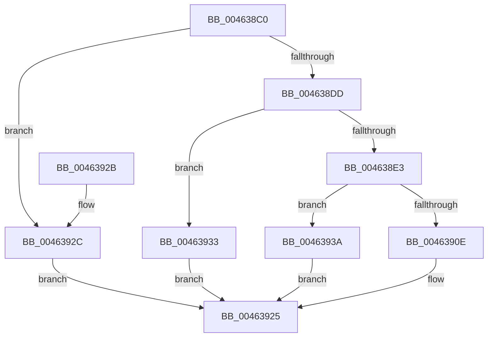

# RtlDecompressBuffer

- RVA: `0x004638C0`–`0x00463953` (길이 `147` bytes)
- VA: `0x00000001404638C0`
- 실행 섹션: `.text`
- PDB 이름 있음: `예`; PDB Function 태그: `아니요`
- unwind 정보 RVA: `0x000AA780`
- 디코드: `40`개 명령, `147/147` bytes 표시
- 미해석 바이트: `0` (있으면 어셈블리에 `.byte`로 보존)

> 이 문서는 커널 이미지의 기계어와 PDB 기호를 분석해 생성했습니다. 4번과 5번은 함수 원형과 자료형을 바이너리 사용 방식에서 추정한 C 해석이며 원본 소스 복구 결과는 아닙니다.

## 1. Dependencies

- 직접 호출 지점: **2**; 고유 호출 대상: **2**
- 직접 호출자로 확인된 함수: **1**
- RIP 상대 이미지 참조: **2**

### Outgoing calls
- `0x00463920` → [RtlDecompressBufferLZNT1](../../page/AE/RtlDecompressBufferLZNT1_function_00AEC850.md) (function, `0x00AEC850`)
- `0x0046394C` → [guard_dispatch_icall](../6B/guard_dispatch_icall_function_006BAAD0.md) (function, `0x006BAAD0`)

### Direct callers
- [RtlDecompressChunks](../../page/78/RtlDecompressChunks_function_0078B550.md) at `0x0078B6D4`

### Static image references
- `0x004638F7` → RVA `0x00001FB0` (`.rdata`; read)
- `0x00463902` → RVA `0x00AEC850` (`RtlDecompressBufferLZNT1`; read)

## 2. Other-region calls and transfers

- 다른 실행 섹션으로 향하는 call: **1**
  - `0x00463920` → [RtlDecompressBufferLZNT1](../../page/AE/RtlDecompressBufferLZNT1_function_00AEC850.md) (`.text` → `PAGE`)
- 별도 외부 분기/꼬리 이동을 확인하지 못했습니다.

## 3. Assembly (complete function range)

```asm
004638C0  40 53                           push rbx
004638C2  48 83 EC 40                     sub rsp, 0x40
004638C6  B8 FF 00 00 00                  mov eax, 0xff
004638CB  4D 8B D1                        mov r10, r9
004638CE  66 23 C8                        and cx, ax
004638D1  45 8B D8                        mov r11d, r8d
004638D4  48 8B DA                        mov rbx, rdx
004638D7  66 83 F9 02                     cmp cx, 2
004638DB  72 4F                           jb 0x14046392c
004638DD  66 83 F9 08                     cmp cx, 8
004638E1  77 50                           ja 0x140463933
004638E3  48 83 64 24 30 00               and qword ptr [rsp + 0x30], 0
004638E9  4D 8B C2                        mov r8, r10
004638EC  44 8B 4C 24 70                  mov r9d, dword ptr [rsp + 0x70]
004638F1  41 8B D3                        mov edx, r11d
004638F4  0F B7 C1                        movzx eax, cx
004638F7  48 8D 0D B2 E6 B9 FF            lea rcx, [rip - 0x46194e]
004638FE  48 8B 04 C1                     mov rax, qword ptr [rcx + rax*8]
00463902  48 8D 0D 47 8F 68 00            lea rcx, [rip + 0x688f47]
00463909  48 3B C1                        cmp rax, rcx
0046390C  75 2C                           jne 0x14046393a
0046390E  48 8B 44 24 78                  mov rax, qword ptr [rsp + 0x78]
00463913  48 8B CB                        mov rcx, rbx
00463916  48 89 44 24 28                  mov qword ptr [rsp + 0x28], rax
0046391B  83 64 24 20 00                  and dword ptr [rsp + 0x20], 0
00463920  E8 2B 8F 68 00                  call 0x140aec850
00463925  48 83 C4 40                     add rsp, 0x40
00463929  5B                              pop rbx
0046392A  C3                              ret
0046392B  CC                              int3
0046392C  B8 0D 00 00 C0                  mov eax, 0xc000000d
00463931  EB F2                           jmp 0x140463925
00463933  B8 5F 02 00 C0                  mov eax, 0xc000025f
00463938  EB EB                           jmp 0x140463925
0046393A  48 8B 4C 24 78                  mov rcx, qword ptr [rsp + 0x78]
0046393F  48 89 4C 24 28                  mov qword ptr [rsp + 0x28], rcx
00463944  48 8B CB                        mov rcx, rbx
00463947  83 64 24 20 00                  and dword ptr [rsp + 0x20], 0
0046394C  E8 7F 71 25 00                  call 0x1406baad0
00463951  EB D2                           jmp 0x140463925
```

## 4. C-style interpretation (structured pseudocode)

```c
__int64 __fastcall RtlDecompressBuffer(unsigned __int16 a1, __int64 a2, int a3, __int64 a4, unsigned int a5, __int64 a6)
{
    __int64 result;
    __int64 v_rsp;
    unsigned __int64 v_stack_m18;
    unsigned __int64 v_stack_m20;
    unsigned int v_stack_m28;
    unsigned int v_stack_p20;
    unsigned __int64 v_stack_p28;

    v_rsp = (v_rsp) - (64);
    a1 = (unsigned __int16)((a1) & (255));
    if (a1 < 2) goto loc_0046392C;
    if (a1 > 8) goto loc_00463933;
    if ((*(unsigned __int64 *)(v_rip - 4593998 + a1 * 8)) != (v_rip + 6852423)) goto loc_0046393A;
    v_stack_m20 = a6;
    result = RtlDecompressBufferLZNT1(a2, (unsigned int)((unsigned int)((unsigned int)(a3))), a4, (unsigned int)(a5));
loc_00463925:
    v_rsp = (v_rsp) + (64);
    return result;
loc_0046392C:
    goto loc_00463925;
loc_00463933:
    goto loc_00463925;
loc_0046393A:
    v_stack_p28 = a6;
    result = guard_dispatch_icall(a2, (unsigned int)((unsigned int)((unsigned int)(a3))), a4, (unsigned int)(a5));
    goto loc_00463925;
}
```

## 5. (Beta) C Style

```c
int64_t RtlDecompressBuffer(uint16_t Arg1, int64_t Arg2, int32_t Arg3, int64_t Arg4, uint32_t Arg5, int64_t Arg6)
{
    int64_t result;
    int64_t local_rsp;
    uint64_t v_stack_m18;
    uint64_t v_stack_m20;
    uint32_t v_stack_m28;
    uint32_t v_stack_p20;
    uint64_t v_stack_p28;

    local_rsp = (local_rsp) - (64);
    Arg1 = (uint16_t)((Arg1) & (255));
    if (Arg1 < 2) goto loc_0046392C;
    if (Arg1 > 8) goto loc_00463933;
    if ((*(uint64_t *)(v_rip - 0x46194E + Arg1 * 8)) != (v_rip + 6852423)) goto loc_0046393A;
    v_stack_m20 = Arg6;
    result = RtlDecompressBufferLZNT1(Arg2, (uint32_t)((uint32_t)((uint32_t)(Arg3))), Arg4, (uint32_t)(Arg5));
loc_00463925:
    local_rsp = (local_rsp) + (64);
    return result;
loc_0046392C:
    goto loc_00463925;
loc_00463933:
    goto loc_00463925;
loc_0046393A:
    v_stack_p28 = Arg6;
    result = guard_dispatch_icall(Arg2, (uint32_t)((uint32_t)((uint32_t)(Arg3))), Arg4, (uint32_t)(Arg5));
    goto loc_00463925;
}
```

## 6. Execution-region graph

[열기: 2D/3D 그래프와 함수 탐색 컨트롤 패널](../../../control-panel.html?section=text&rva=0x004638C0&view=graph)

- 2D 그래프는 위에서 아래로 흐르고, 3D 그래프는 빈 공간을 드래그해 회전합니다. Shift+드래그는 이동, 휠은 확대·축소, 함수 노드 선택은 대상 보고서 이동입니다.

### Static fallback


