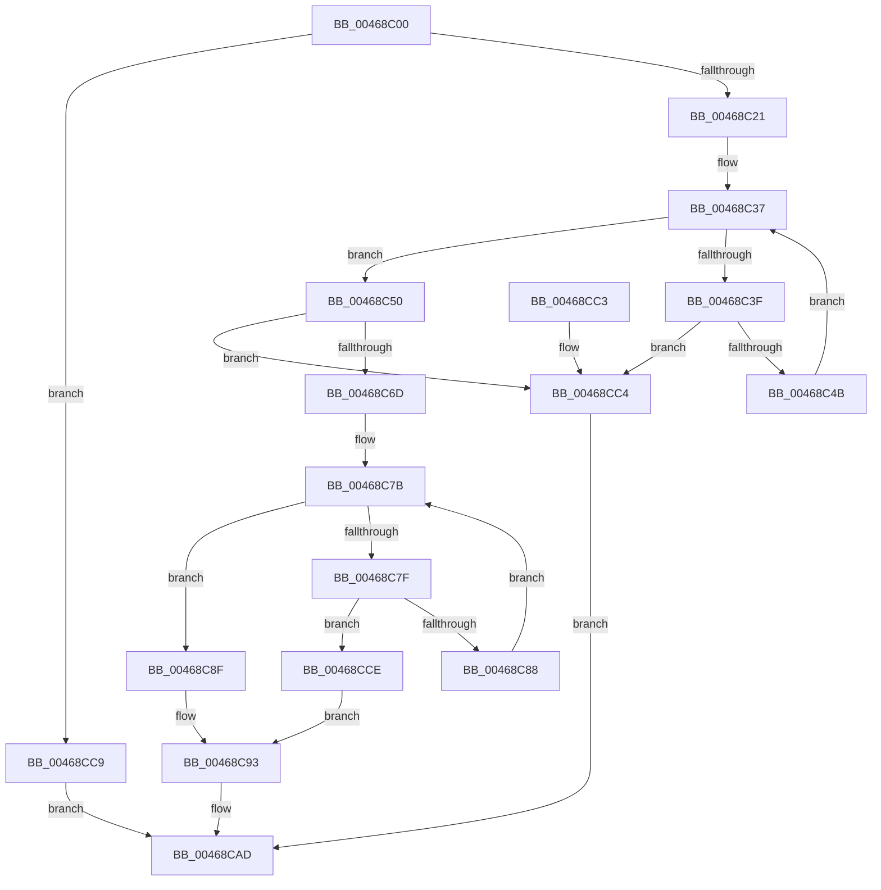

# RtlFindFirstRunClear

- RVA: `0x00468C00`–`0x00468CD5` (길이 `213` bytes)
- VA: `0x0000000140468C00`
- 실행 섹션: `.text`
- PDB 이름 있음: `예`; PDB Function 태그: `아니요`
- unwind 정보 RVA: `0x000AB09C`
- 디코드: `67`개 명령, `213/213` bytes 표시
- 미해석 바이트: `0` (있으면 어셈블리에 `.byte`로 보존)

> 이 문서는 커널 이미지의 기계어와 PDB 기호를 분석해 생성했습니다. 4번과 5번은 함수 원형과 자료형을 바이너리 사용 방식에서 추정한 C 해석이며 원본 소스 복구 결과는 아닙니다.

## 1. Dependencies

- 직접 호출 지점: **0**; 고유 호출 대상: **0**
- 직접 호출자로 확인된 함수: **1**
- RIP 상대 이미지 참조: **0**

### Outgoing calls
- 직접 디코드된 call 명령이 없습니다.

### Direct callers
- [PnprMirrorMarkedPages](../../pagelk/B6/PnprMirrorMarkedPages_function_00B6480C.md) at `0x00B648A9`

### Static image references
- 디코드된 RIP-relative 메모리 참조가 없습니다.

## 2. Other-region calls and transfers

- 다른 실행 섹션으로 향하는 call: **0**
- 별도 외부 분기/꼬리 이동을 확인하지 못했습니다.

## 3. Assembly (complete function range)

```asm
00468C00  48 89 5C 24 10                  mov qword ptr [rsp + 0x10], rbx
00468C05  48 89 74 24 18                  mov qword ptr [rsp + 0x18], rsi
00468C0A  48 89 7C 24 20                  mov qword ptr [rsp + 0x20], rdi
00468C0F  44 8B 11                        mov r10d, dword ptr [rcx]
00468C12  45 33 C0                        xor r8d, r8d
00468C15  48 8B F2                        mov rsi, rdx
00468C18  45 85 D2                        test r10d, r10d
00468C1B  0F 84 A8 00 00 00               je 0x140468cc9
00468C21  48 8B 59 08                     mov rbx, qword ptr [rcx + 8]
00468C25  41 8D 4A FF                     lea ecx, [r10 - 1]
00468C29  48 C1 E9 05                     shr rcx, 5
00468C2D  48 8B D3                        mov rdx, rbx
00468C30  44 8B 1B                        mov r11d, dword ptr [rbx]
00468C33  48 8D 3C 8B                     lea rdi, [rbx + rcx*4]
00468C37  41 F7 D3                        not r11d
00468C3A  45 85 DB                        test r11d, r11d
00468C3D  75 11                           jne 0x140468c50
00468C3F  48 8D 42 04                     lea rax, [rdx + 4]
00468C43  48 8B D0                        mov rdx, rax
00468C46  48 3B C7                        cmp rax, rdi
00468C49  77 79                           ja 0x140468cc4
00468C4B  44 8B 18                        mov r11d, dword ptr [rax]
00468C4E  EB E7                           jmp 0x140468c37
00468C50  41 8B C3                        mov eax, r11d
00468C53  4C 8B CA                        mov r9, rdx
00468C56  4C 2B CB                        sub r9, rbx
00468C59  49 C1 F9 02                     sar r9, 2
00468C5D  48 0F BC C8                     bsf rcx, rax
00468C61  41 C1 E1 05                     shl r9d, 5
00468C65  44 03 C9                        add r9d, ecx
00468C68  45 3B CA                        cmp r9d, r10d
00468C6B  77 57                           ja 0x140468cc4
00468C6D  B8 01 00 00 00                  mov eax, 1
00468C72  D3 E0                           shl eax, cl
00468C74  FF C8                           dec eax
00468C76  41 0B C3                        or eax, r11d
00468C79  F7 D0                           not eax
00468C7B  85 C0                           test eax, eax
00468C7D  75 10                           jne 0x140468c8f
00468C7F  48 8D 42 04                     lea rax, [rdx + 4]
00468C83  48 3B C7                        cmp rax, rdi
00468C86  77 46                           ja 0x140468cce
00468C88  48 8B D0                        mov rdx, rax
00468C8B  8B 00                           mov eax, dword ptr [rax]
00468C8D  EB EC                           jmp 0x140468c7b
00468C8F  48 0F BC C0                     bsf rax, rax
00468C93  48 2B D3                        sub rdx, rbx
00468C96  45 8B C2                        mov r8d, r10d
00468C99  48 C1 FA 02                     sar rdx, 2
00468C9D  C1 E2 05                        shl edx, 5
00468CA0  8D 0C 02                        lea ecx, [rdx + rax]
00468CA3  41 3B CA                        cmp ecx, r10d
00468CA6  44 0F 46 C1                     cmovbe r8d, ecx
00468CAA  45 2B C1                        sub r8d, r9d
00468CAD  44 89 0E                        mov dword ptr [rsi], r9d
00468CB0  41 8B C0                        mov eax, r8d
00468CB3  48 8B 5C 24 10                  mov rbx, qword ptr [rsp + 0x10]
00468CB8  48 8B 74 24 18                  mov rsi, qword ptr [rsp + 0x18]
00468CBD  48 8B 7C 24 20                  mov rdi, qword ptr [rsp + 0x20]
00468CC2  C3                              ret
00468CC3  CC                              int3
00468CC4  45 8B CA                        mov r9d, r10d
00468CC7  EB E4                           jmp 0x140468cad
00468CC9  45 8B C8                        mov r9d, r8d
00468CCC  EB DF                           jmp 0x140468cad
00468CCE  B8 20 00 00 00                  mov eax, 0x20
00468CD3  EB BE                           jmp 0x140468c93
```

## 4. C-style interpretation (structured pseudocode)

```c
__int64 __fastcall RtlFindFirstRunClear(__int64 a1, __int64 a2, int a3)
{
    __int64 result;
    __int64 v_r11;
    unsigned __int64 v_stack_p10;
    unsigned __int64 v_stack_p18;
    unsigned __int64 v_stack_p20;

    v_stack_p10 = v_rbx;
    v_stack_p18 = v_rsi;
    v_stack_p20 = v_rdi;
    a3 = 0;
    if ((unsigned int)((unsigned int)(*(unsigned int *)(a1))) == 0) goto loc_00468CC9;
    a1 = ((unsigned int)(*(unsigned int *)(a1)) - 1) >> (5);
loc_00468C37:
    v_r11 = (unsigned int)(~((unsigned int)(*(unsigned int *)(*(unsigned __int64 *)(a1 + 8)))));
    if ((unsigned int)(v_r11) != 0) goto loc_00468C50;
    if ((*(unsigned __int64 *)(a1 + 8) + 4) > (*(unsigned __int64 *)(a1 + 8) + a1 * 4)) goto loc_00468CC4;
    goto loc_00468C37;
loc_00468C50:
    a4 = (*(unsigned __int64 *)(a1 + 8) + 4) - (*(unsigned __int64 *)(a1 + 8));
    a4 = (a4) >> (2);
    a4 = (unsigned int)((a4) << (5));
    a4 = (unsigned int)((a4) + ((unsigned int)(a1)));
    if (((unsigned int)(a4)) > ((unsigned int)((unsigned int)(*(unsigned int *)(a1))))) goto loc_00468CC4;
    result = (unsigned int)((1) << ((unsigned __int8)(a1)));
    result = (unsigned int)((result) - 1);
    result = (unsigned int)((result) | ((unsigned int)((unsigned int)(*(unsigned int *)(*(unsigned __int64 *)(a1 + 8) + 4)))));
    result = (unsigned int)(~(result));
loc_00468C7B:
    if ((unsigned int)(result) != 0) goto loc_00468C8F;
    if ((*(unsigned __int64 *)(a1 + 8) + 4 + 4) > (*(unsigned __int64 *)(a1 + 8) + a1 * 4)) goto loc_00468CCE;
    goto loc_00468C7B;
loc_00468C8F:
loc_00468C93:
    a2 = (*(unsigned __int64 *)(a1 + 8) + 4 + 4) - (*(unsigned __int64 *)(a1 + 8));
    a2 = (a2) >> (2);
    a2 = (unsigned int)((a2) << (5));
    a3 = (unsigned int)((unsigned int)((unsigned int)(*(unsigned int *)(a1))));
    if (((unsigned int)(a2 + (unsigned int)(*(unsigned int *)(*(unsigned __int64 *)(a1 + 8) + 4 + 4)) * 1)) <= ((unsigned int)((unsigned int)(*(unsigned int *)(a1))))) { a3 = (unsigned int)(a2 + (unsigned int)(*(unsigned int *)(*(unsigned __int64 *)(a1 + 8) + 4 + 4)) * 1); }
    a3 = (unsigned int)((a3) - ((unsigned int)(a4)));
loc_00468CAD:
    *(unsigned int *)(a2) = (unsigned int)(a4);
    return (unsigned int)(a3);
loc_00468CC4:
    goto loc_00468CAD;
loc_00468CC9:
    goto loc_00468CAD;
loc_00468CCE:
    goto loc_00468C93;
}
```

## 5. (Beta) C Style

```c
int64_t RtlFindFirstRunClear(void *Arg1, void *Arg2, int32_t Arg3)
{
    uint8_t *arg1 = (uint8_t *)Arg1;
    uint8_t *arg2 = (uint8_t *)Arg2;

    int64_t result;
    int64_t local_r11;
    uint64_t v_stack_p10;
    uint64_t v_stack_p18;
    uint64_t v_stack_p20;

    v_stack_p10 = local_rbx;
    v_stack_p18 = local_rsi;
    v_stack_p20 = local_rdi;
    Arg3 = 0;
    if ((uint32_t)((uint32_t)(*(uint32_t *)(arg1))) == 0) goto loc_00468CC9;
    Arg1 = ((uint32_t)(*(uint32_t *)(arg1)) - 1) >> (5);
loc_00468C37:
    local_r11 = (uint32_t)(~((uint32_t)(*(uint32_t *)(*(uint64_t *)(arg1 + 0x8)))));
    if ((uint32_t)(local_r11) != 0) goto loc_00468C50;
    if ((*(uint64_t *)(arg1 + 0x8) + 4) > (*(uint64_t *)(arg1 + 0x8) + Arg1 * 4)) goto loc_00468CC4;
    goto loc_00468C37;
loc_00468C50:
    a4 = (*(uint64_t *)(arg1 + 0x8) + 4) - (*(uint64_t *)(arg1 + 0x8));
    a4 = (a4) >> (2);
    a4 = (uint32_t)((a4) << (5));
    a4 = (uint32_t)((a4) + ((uint32_t)(Arg1)));
    if (((uint32_t)(a4)) > ((uint32_t)((uint32_t)(*(uint32_t *)(arg1))))) goto loc_00468CC4;
    result = (uint32_t)((1) << ((uint8_t)(Arg1)));
    result = (uint32_t)((result) - 1);
    result = (uint32_t)((result) | ((uint32_t)((uint32_t)(*(uint32_t *)(*(uint64_t *)(arg1 + 0x8) + 0x4)))));
    result = (uint32_t)(~(result));
loc_00468C7B:
    if ((uint32_t)(result) != 0) goto loc_00468C8F;
    if ((*(uint64_t *)(arg1 + 0x8) + 4 + 4) > (*(uint64_t *)(arg1 + 0x8) + Arg1 * 4)) goto loc_00468CCE;
    goto loc_00468C7B;
loc_00468C8F:
loc_00468C93:
    Arg2 = (*(uint64_t *)(arg1 + 0x8) + 4 + 4) - (*(uint64_t *)(arg1 + 0x8));
    Arg2 = (Arg2) >> (2);
    Arg2 = (uint32_t)((Arg2) << (5));
    Arg3 = (uint32_t)((uint32_t)((uint32_t)(*(uint32_t *)(arg1))));
    if (((uint32_t)(Arg2 + (uint32_t)(*(uint32_t *)(*(uint64_t *)(arg1 + 0x8) + 0x4 + 0x4)) * 1)) <= ((uint32_t)((uint32_t)(*(uint32_t *)(arg1))))) { Arg3 = (uint32_t)(Arg2 + (uint32_t)(*(uint32_t *)(*(uint64_t *)(arg1 + 0x8) + 0x4 + 0x4)) * 1); }
    Arg3 = (uint32_t)((Arg3) - ((uint32_t)(a4)));
loc_00468CAD:
    *(uint32_t *)(arg2) = (uint32_t)(a4);
    return (uint32_t)(Arg3);
loc_00468CC4:
    goto loc_00468CAD;
loc_00468CC9:
    goto loc_00468CAD;
loc_00468CCE:
    goto loc_00468C93;
}
```

### 관측된 메모리 오프셋

구조체 형식이 확인되지 않은 접근은 인자 기준의 오프셋으로만 기록했습니다.

| 기준 인자 | 오프셋 표현 | 폭 (bit) | 접근 |
|---|---:|---:|---|
| `Arg1` | `+ 0x0` | `32` | `R` |
| `Arg1` | `+ 0x8` | `64` | `R` |
| `Arg2` | `+ 0x0` | `32` | `W` |

## 6. Execution-region graph

[열기: 2D/3D 그래프와 함수 탐색 컨트롤 패널](../../../control-panel.html?section=text&rva=0x00468C00&view=graph)

- 2D 그래프는 위에서 아래로 흐르고, 3D 그래프는 빈 공간을 드래그해 회전합니다. Shift+드래그는 이동, 휠은 확대·축소, 함수 노드 선택은 대상 보고서 이동입니다.

### Static fallback


