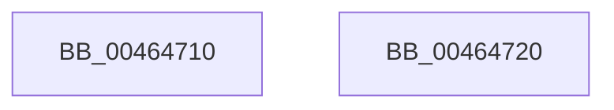

# RtlFindLeastSignificantBit

- RVA: `0x00464710`–`0x00464721` (길이 `17` bytes)
- VA: `0x0000000140464710`
- 실행 섹션: `.text`
- PDB 이름 있음: `예`; PDB Function 태그: `아니요`
- unwind 정보 RVA: `0x000DB714`
- 디코드: `6`개 명령, `17/17` bytes 표시
- 미해석 바이트: `0` (있으면 어셈블리에 `.byte`로 보존)

> 이 문서는 커널 이미지의 기계어와 PDB 기호를 분석해 생성했습니다. 4번과 5번은 함수 원형과 자료형을 바이너리 사용 방식에서 추정한 C 해석이며 원본 소스 복구 결과는 아닙니다.

## 1. Dependencies

- 직접 호출 지점: **0**; 고유 호출 대상: **0**
- 직접 호출자로 확인된 함수: **1**
- RIP 상대 이미지 참조: **0**

### Outgoing calls
- 직접 디코드된 call 명령이 없습니다.

### Direct callers
- [KiMaskToLength](../../pagelk/B6/KiMaskToLength_function_00B67E00.md) at `0x00B67E11`

### Static image references
- 디코드된 RIP-relative 메모리 참조가 없습니다.

## 2. Other-region calls and transfers

- 다른 실행 섹션으로 향하는 call: **0**
- 별도 외부 분기/꼬리 이동을 확인하지 못했습니다.

## 3. Assembly (complete function range)

```asm
00464710  48 0F BC D1                     bsf rdx, rcx
00464714  B8 FF FF FF FF                  mov eax, 0xffffffff
00464719  0F B6 CA                        movzx ecx, dl
0046471C  0F 45 C1                        cmovne eax, ecx
0046471F  C3                              ret
00464720  CC                              int3
```

## 4. C-style interpretation (structured pseudocode)

```c
__int64 __fastcall RtlFindLeastSignificantBit(__int64 a1)
{
    __int64 result;

    result = (unsigned int)(0xFFFFFFFFULL);
    if (condition_is_not_equal) { result = (unsigned int)((unsigned __int8)(a2)); }
    return result;
}
```

## 5. (Beta) C Style

```c
int64_t RtlFindLeastSignificantBit(int64_t Arg1)
{
    int64_t result;

    result = (uint32_t)(0xFFFFFFFFULL);
    if (condition_is_not_equal) { result = (uint32_t)((uint8_t)(a2)); }
    return result;
}
```

## 6. Execution-region graph

[열기: 2D/3D 그래프와 함수 탐색 컨트롤 패널](../../../control-panel.html?section=text&rva=0x00464710&view=graph)

- 2D 그래프는 위에서 아래로 흐르고, 3D 그래프는 빈 공간을 드래그해 회전합니다. Shift+드래그는 이동, 휠은 확대·축소, 함수 노드 선택은 대상 보고서 이동입니다.

### Static fallback


