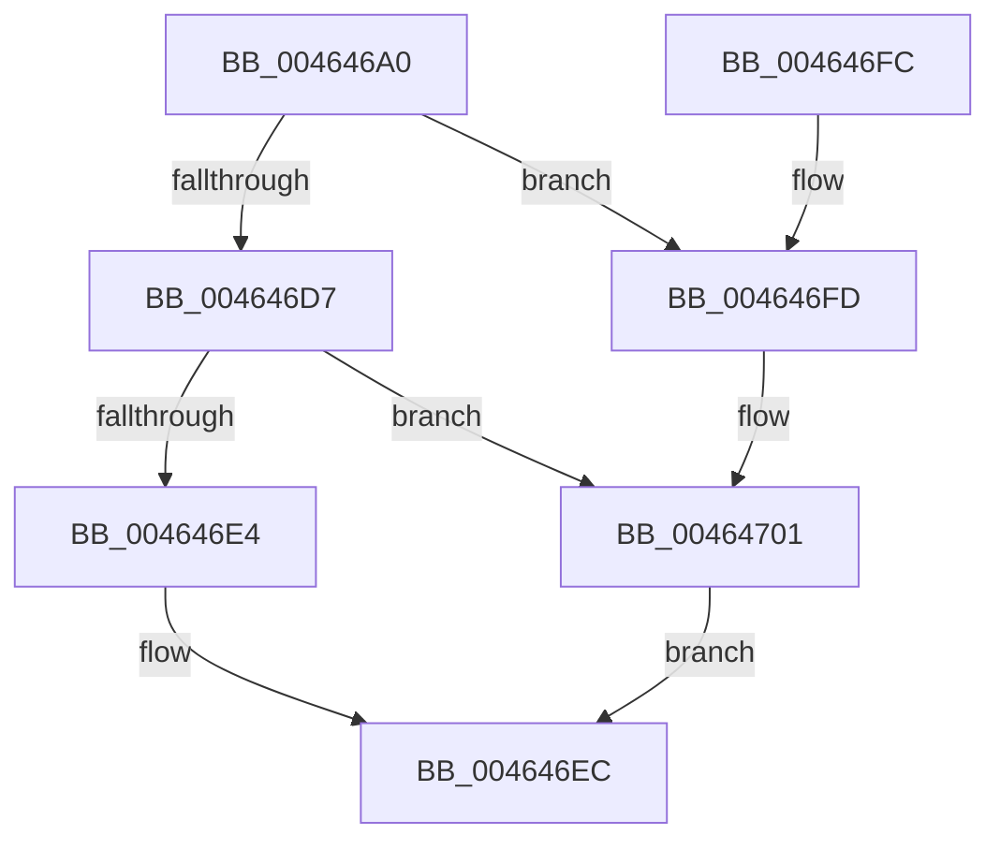

# RtlGetCallersAddress

- RVA: `0x004646A0`–`0x00464707` (길이 `103` bytes)
- VA: `0x00000001404646A0`
- 실행 섹션: `.text`
- PDB 이름 있음: `예`; PDB Function 태그: `아니요`
- unwind 정보 RVA: `0x000AA8A4`
- 디코드: `32`개 명령, `103/103` bytes 표시
- 미해석 바이트: `0` (있으면 어셈블리에 `.byte`로 보존)

> 이 문서는 커널 이미지의 기계어와 PDB 기호를 분석해 생성했습니다. 4번과 5번은 함수 원형과 자료형을 바이너리 사용 방식에서 추정한 C 해석이며 원본 소스 복구 결과는 아닙니다.

## 1. Dependencies

- 직접 호출 지점: **1**; 고유 호출 대상: **1**
- 직접 호출자로 확인된 함수: **0**
- RIP 상대 이미지 참조: **0**

### Outgoing calls
- `0x004646CC` → [RtlCaptureStackBackTrace](../2F/RtlCaptureStackBackTrace_function_002F9FF0.md) (function, `0x002F9FF0`)

### Direct callers
- 이 함수 시작 RVA로 연결되는 직접 call은 확인되지 않았습니다. 간접 호출은 완전히 역산할 수 없습니다.

### Static image references
- 디코드된 RIP-relative 메모리 참조가 없습니다.

## 2. Other-region calls and transfers

- 다른 실행 섹션으로 향하는 call: **0**
- 별도 외부 분기/꼬리 이동을 확인하지 못했습니다.

## 3. Assembly (complete function range)

```asm
004646A0  48 8B C4                        mov rax, rsp
004646A3  48 89 58 08                     mov qword ptr [rax + 8], rbx
004646A7  48 89 70 10                     mov qword ptr [rax + 0x10], rsi
004646AB  57                              push rdi
004646AC  48 83 EC 30                     sub rsp, 0x30
004646B0  45 33 C9                        xor r9d, r9d
004646B3  4C 8D 40 E8                     lea r8, [rax - 0x18]
004646B7  48 8B DA                        mov rbx, rdx
004646BA  48 8B F9                        mov rdi, rcx
004646BD  0F 57 C0                        xorps xmm0, xmm0
004646C0  0F 11 40 E8                     movups xmmword ptr [rax - 0x18], xmm0
004646C4  41 8D 71 02                     lea esi, [r9 + 2]
004646C8  8B D6                           mov edx, esi
004646CA  8B CE                           mov ecx, esi
004646CC  E8 1F 59 E9 FF                  call 0x1402f9ff0
004646D1  66 83 F8 01                     cmp ax, 1
004646D5  72 26                           jb 0x1404646fd
004646D7  48 8B 4C 24 20                  mov rcx, qword ptr [rsp + 0x20]
004646DC  48 89 0F                        mov qword ptr [rdi], rcx
004646DF  66 3B C6                        cmp ax, si
004646E2  72 1D                           jb 0x140464701
004646E4  48 8B 44 24 28                  mov rax, qword ptr [rsp + 0x28]
004646E9  48 89 03                        mov qword ptr [rbx], rax
004646EC  48 8B 5C 24 40                  mov rbx, qword ptr [rsp + 0x40]
004646F1  48 8B 74 24 48                  mov rsi, qword ptr [rsp + 0x48]
004646F6  48 83 C4 30                     add rsp, 0x30
004646FA  5F                              pop rdi
004646FB  C3                              ret
004646FC  CC                              int3
004646FD  48 83 27 00                     and qword ptr [rdi], 0
00464701  48 83 23 00                     and qword ptr [rbx], 0
00464705  EB E5                           jmp 0x1404646ec
```

## 4. C-style interpretation (structured pseudocode)

```c
__int64 __fastcall RtlGetCallersAddress(__int64 a1, __int64 a2, __int64 a3, int a4)
{
    __int64 result;
    __int64 v_rsp;
    unsigned __int64 v_stack_m10;
    unsigned __int64 v_stack_m18;
    unsigned __int64 v_stack_p10;
    unsigned __int64 v_stack_p8;

    *(unsigned __int64 *)(v_rsp + 8) = v_rbx;
    *(unsigned __int64 *)(v_rsp + 16) = v_rsi;
    v_rsp = (v_rsp) - (48);
    a4 = 0;
    *(unsigned __int64 *)(v_rsp - 24) = v_xmm0;
    result = RtlCaptureStackBackTrace((unsigned int)((unsigned int)(a4 + 2)), (unsigned int)((unsigned int)(a4 + 2)), v_rsp - 24, a4);
    if (((unsigned __int16)(result)) < 1) goto loc_004646FD;
    *(unsigned __int64 *)(a1) = v_stack_m18;
    if (((unsigned __int16)(result)) < ((unsigned __int16)(a4 + 2))) goto loc_00464701;
    *(unsigned __int64 *)(a2) = v_stack_m10;
loc_004646EC:
    v_rsp = (v_rsp) + (48);
    return v_stack_m10;
loc_004646FD:
loc_00464701:
    goto loc_004646EC;
}
```

## 5. (Beta) C Style

```c
int64_t RtlGetCallersAddress(void *Arg1, void *Arg2, int64_t Arg3, int32_t Arg4)
{
    uint8_t *arg1 = (uint8_t *)Arg1;
    uint8_t *arg2 = (uint8_t *)Arg2;

    int64_t result;
    int64_t local_rsp;
    uint64_t v_stack_m10;
    uint64_t v_stack_m18;
    uint64_t v_stack_p10;
    uint64_t v_stack_p8;

    *(uint64_t *)(local_rsp + 0x8) = local_rbx;
    *(uint64_t *)(local_rsp + 0x10) = local_rsi;
    local_rsp = (local_rsp) - (48);
    Arg4 = 0;
    *(uint64_t *)(local_rsp - 0x18) = v_xmm0;
    result = RtlCaptureStackBackTrace((uint32_t)((uint32_t)(Arg4 + 2)), (uint32_t)((uint32_t)(Arg4 + 2)), local_rsp - 24, Arg4);
    if (((uint16_t)(result)) < 1) goto loc_004646FD;
    *(uint64_t *)(arg1) = v_stack_m18;
    if (((uint16_t)(result)) < ((uint16_t)(Arg4 + 2))) goto loc_00464701;
    *(uint64_t *)(arg2) = v_stack_m10;
loc_004646EC:
    local_rsp = (local_rsp) + (48);
    return v_stack_m10;
loc_004646FD:
loc_00464701:
    goto loc_004646EC;
}
```

### 관측된 메모리 오프셋

구조체 형식이 확인되지 않은 접근은 인자 기준의 오프셋으로만 기록했습니다.

| 기준 인자 | 오프셋 표현 | 폭 (bit) | 접근 |
|---|---:|---:|---|
| `Arg1` | `+ 0x0` | `64` | `R/W` |
| `Arg1` | `+ 0x0` | `64` | `W` |
| `Arg2` | `+ 0x0` | `64` | `R/W` |
| `Arg2` | `+ 0x0` | `64` | `W` |

## 6. Execution-region graph

[열기: 2D/3D 그래프와 함수 탐색 컨트롤 패널](../../../control-panel.html?section=text&rva=0x004646A0&view=graph)

- 2D 그래프는 위에서 아래로 흐르고, 3D 그래프는 빈 공간을 드래그해 회전합니다. Shift+드래그는 이동, 휠은 확대·축소, 함수 노드 선택은 대상 보고서 이동입니다.

### Static fallback


